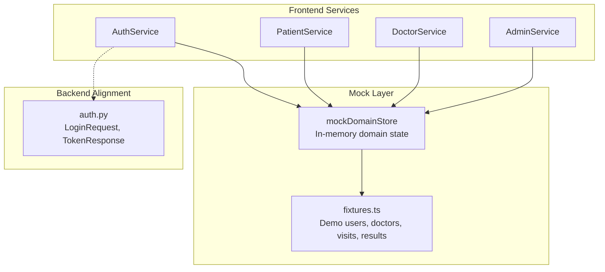
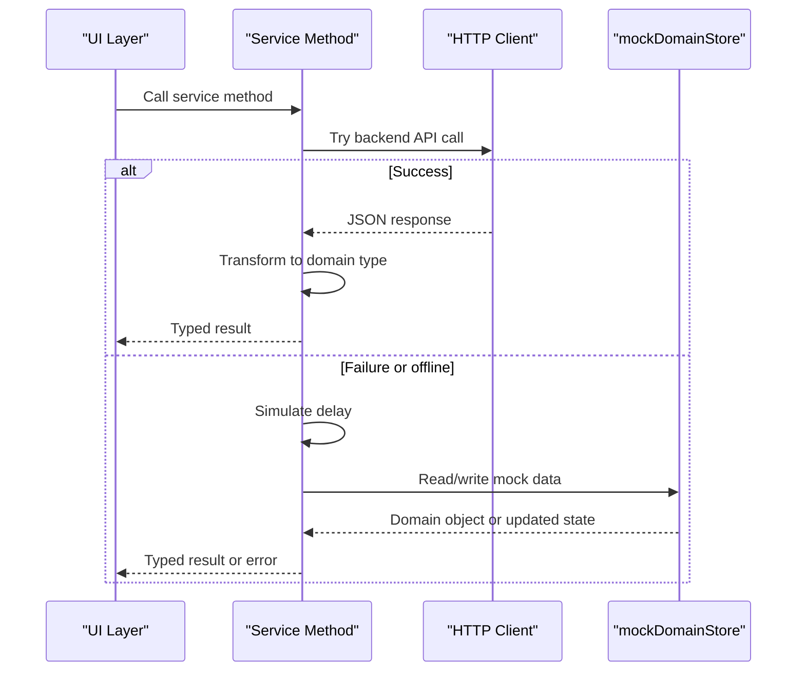
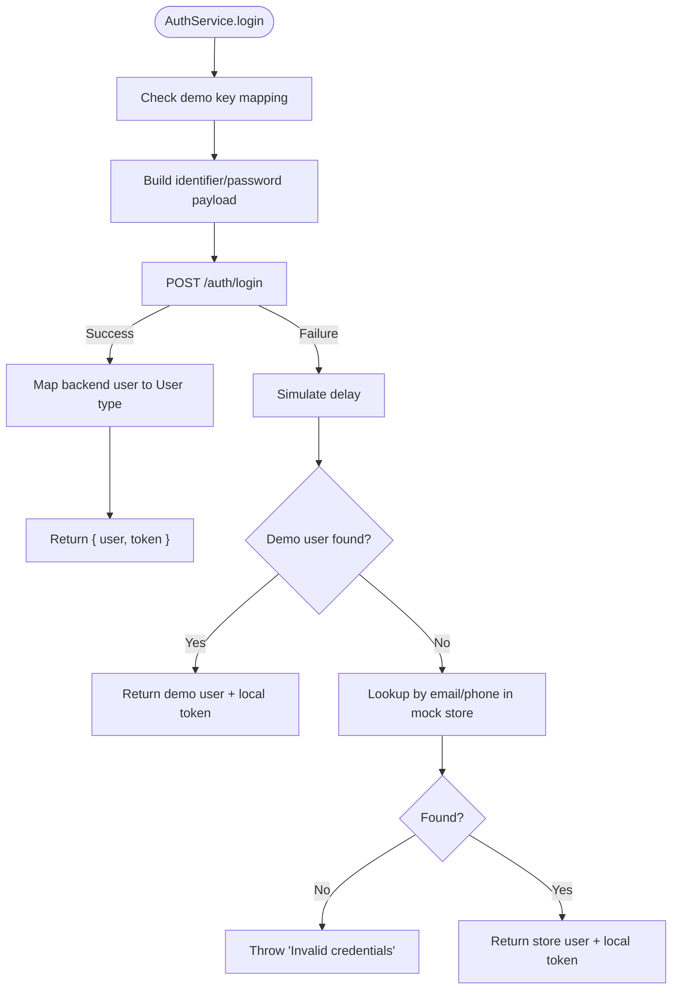
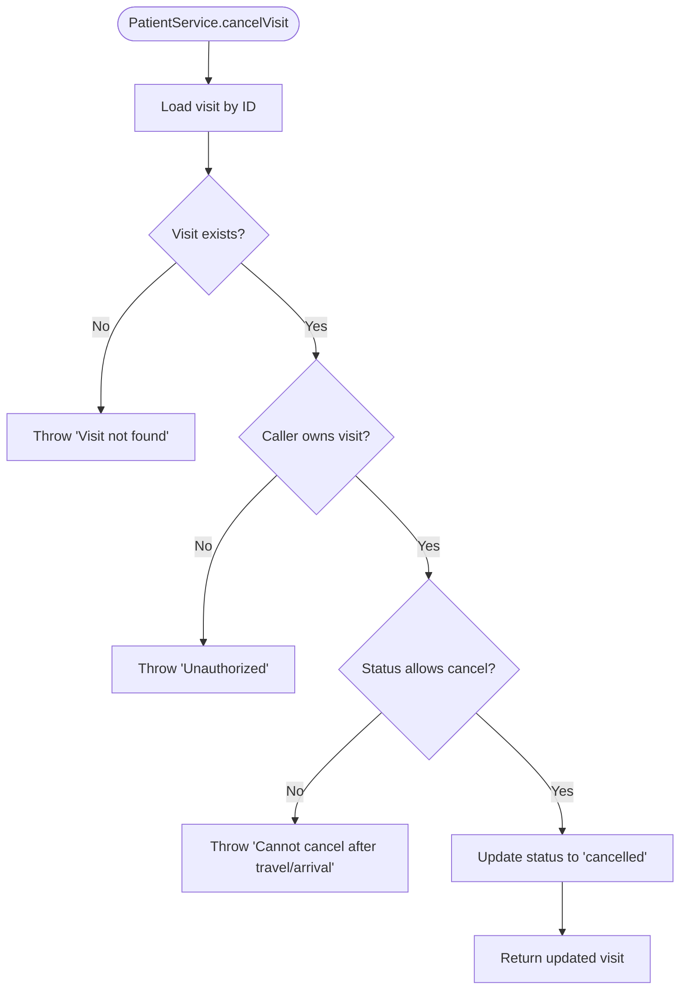
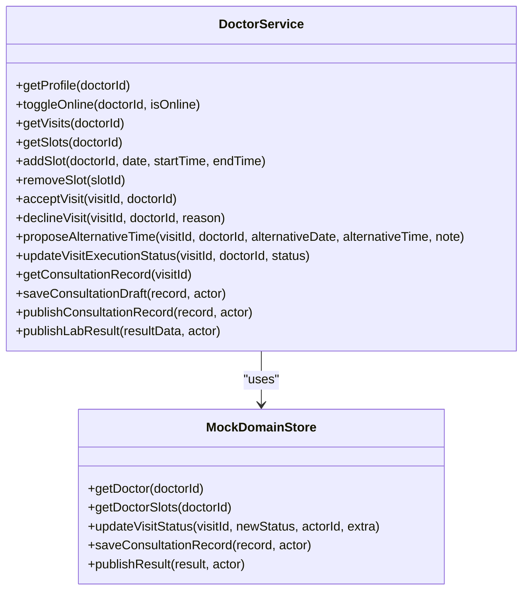
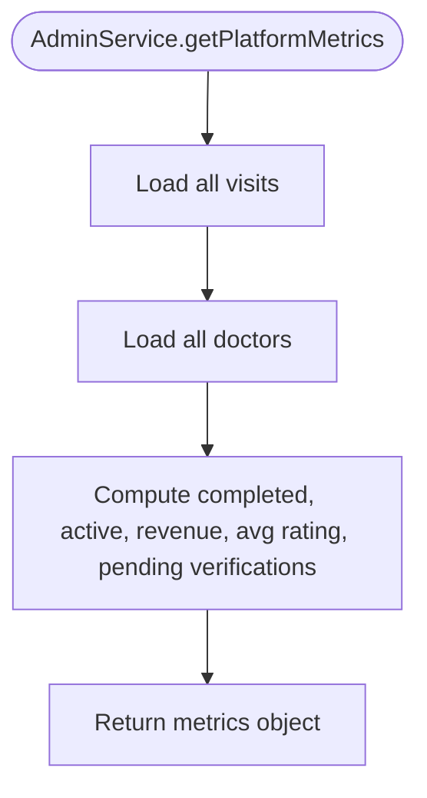
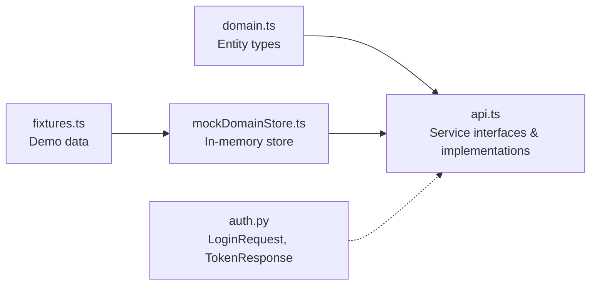

# API Service Abstraction

<cite>
**Referenced Files in This Document**   
- [api.ts](file://src/services/api.ts)
- [domain.ts](file://src/types/domain.ts)
- [fixtures.ts](file://src/mock/fixtures.ts)
- [mockDomainStore.ts](file://src/mock/mockDomainStore.ts)
- [auth.py](file://backend/app/schemas/auth.py)
</cite>

## Table of Contents
1. [Introduction](#introduction)
2. [Project Structure](#project-structure)
3. [Core Components](#core-components)
4. [Architecture Overview](#architecture-overview)
5. [Detailed Component Analysis](#detailed-component-analysis)
6. [Dependency Analysis](#dependency-analysis)
7. [Performance Considerations](#performance-considerations)
8. [Troubleshooting Guide](#troubleshooting-guide)
9. [Conclusion](#conclusion)

## Introduction
This document explains the API service abstraction layer that provides unified interfaces for all domain operations in the HomeCare application. It focuses on four main service contracts: `AuthService`, `PatientService`, `DoctorService`, and `AdminService`. Each service method is designed to attempt a real backend REST call first, then gracefully fall back to an in-memory mock store with simulated latency when the backend is unavailable. The services also handle authentication token management, parameter validation, data transformation, and error handling patterns consistently across the codebase.

The goal is to make the frontend resilient and testable while keeping a clear migration path to a future Node.js or Python backend.

## Project Structure
The abstraction lives under `src/services/api.ts` and depends on:
- Domain types from `src/types/domain.ts`
- Mock fixtures and initial data from `src/mock/fixtures.ts`
- An in-memory reactive store from `src/mock/mockDomainStore.ts`
- Backend schema definitions from `backend/app/schemas/auth.py` (for alignment with the planned REST API)

**Diagram sources**
- [api.ts:25-41](file://src/services/api.ts#L25-L41)
- [api.ts:247-272](file://src/services/api.ts#L247-L272)
- [api.ts:432-466](file://src/services/api.ts#L432-L466)
- [api.ts:587-602](file://src/services/api.ts#L587-L602)
- [mockDomainStore.ts:35-48](file://src/mock/mockDomainStore.ts#L35-L48)
- [fixtures.ts:72-118](file://src/mock/fixtures.ts#L72-L118)
- [auth.py:52-59](file://backend/app/schemas/auth.py#L52-L59)

**Section sources**
- [api.ts:1-23](file://src/services/api.ts#L1-L23)
- [domain.ts:1-242](file://src/types/domain.ts#L1-L242)
- [fixtures.ts:1-800](file://src/mock/fixtures.ts#L1-L800)
- [mockDomainStore.ts:1-557](file://src/mock/mockDomainStore.ts#L1-L557)
- [auth.py:1-59](file://backend/app/schemas/auth.py#L1-L59)

## Core Components
The abstraction defines four service interfaces and their implementations:

- `AuthService`: Authentication, OTP verification, registration, current user retrieval, and password reset.
- `PatientService`: Patient profile management, doctor search, visit lifecycle, records, reviews, and complaints.
- `DoctorService`: Doctor profile management, availability slots, visit acceptance/decline/alternative time, execution status updates, consultation records, and result publication.
- `AdminService`: Doctor verification, visit oversight, complaint resolution, audit logs, and platform metrics.

All methods return typed promises aligned with domain entities defined in `src/types/domain.ts`.

**Section sources**
- [api.ts:25-41](file://src/services/api.ts#L25-L41)
- [api.ts:247-272](file://src/services/api.ts#L247-L272)
- [api.ts:432-466](file://src/services/api.ts#L432-L466)
- [api.ts:587-602](file://src/services/api.ts#L587-L602)
- [domain.ts:29-242](file://src/types/domain.ts#L29-L242)

## Architecture Overview
The service layer follows a consistent pattern:

1. Attempt a live HTTP request to the backend base URL.
2. If successful, transform backend responses into domain types.
3. On failure or network error, simulate realistic latency and use the in-memory mock store.
4. Return domain-typed results or throw explicit errors for invalid states.

**Diagram sources**
- [api.ts:46-104](file://src/services/api.ts#L46-L104)
- [api.ts:106-122](file://src/services/api.ts#L106-L122)
- [api.ts:124-197](file://src/services/api.ts#L124-L197)
- [mockDomainStore.ts:129-154](file://src/mock/mockDomainStore.ts#L129-L154)

## Detailed Component Analysis

### AuthService
Responsibilities:
- Login with identifier and role-aware credentials.
- OTP verification with backend fallback.
- Registration for patients and doctors.
- Current user lookup and password reset simulation.

Key behaviors:
- Login tries the backend `/auth/login`. On success, it maps backend fields to the `User` type and returns `{ user, token }`. On failure, it falls back to demo users or the mock store and generates a local JWT-like token string.
- OTP verification calls `/auth/verify-otp`; if unavailable, it accepts a six-character code or a known demo code.
- Patient registration attempts the backend endpoint; on success, it also registers the patient in the mock store so subsequent flows can read it. On failure, it creates a mock patient and profile.
- Doctor registration currently uses mock logic with a simulated delay and stores both user and doctor profile.
- `getCurrentUser` and `resetPassword` are mock-backed with delays.

Authentication token management:
- Tokens are returned as strings by the service. The login flow constructs a deterministic-looking token based on user identity and timestamp when using mock fallbacks.
- The backend schema expects a `LoginRequest` with `identifier` and `password`, and returns a `TokenResponse` containing `access_token`.

Parameter validation and error handling:
- Login validates demo keys and resolves effective credentials before calling the backend.
- Registration handles missing email by generating one from phone number.
- Errors thrown include invalid credentials, unregistered accounts, and backend detail messages when available.

**Diagram sources**
- [api.ts:46-104](file://src/services/api.ts#L46-L104)
- [auth.py:52-59](file://backend/app/schemas/auth.py#L52-L59)

**Section sources**
- [api.ts:25-41](file://src/services/api.ts#L25-L41)
- [api.ts:46-104](file://src/services/api.ts#L46-L104)
- [api.ts:106-122](file://src/services/api.ts#L106-L122)
- [api.ts:124-197](file://src/services/api.ts#L124-L197)
- [api.ts:200-244](file://src/services/api.ts#L200-L244)
- [auth.py:52-59](file://backend/app/schemas/auth.py#L52-L59)

### PatientService
Responsibilities:
- Profile retrieval and update.
- Specialty listing and doctor search with multiple filters.
- Visit creation, retrieval, cancellation, rescheduling, and alternative time negotiation.
- Records retrieval, result document access, review submission, and complaint submission.

Key behaviors:
- All methods simulate latency via `delay()` before accessing the mock store.
- `searchDoctors` applies query, specialty, district, language, max fee, min rating, and online availability filters over the full doctor list.
- `getDoctorDetails` throws an error if the doctor does not exist; otherwise returns doctor, slots, and reviews.
- Visit mutation methods enforce business rules:
  - Canceling requires ownership and prevents cancellation after travel has started.
  - Rescheduling prevents changes once the doctor has departed.
  - Accepting or rejecting alternative times validates state and updates scheduled fields accordingly.
- Records aggregation returns consultations and results for a patient.

Data transformation:
- Methods return domain-typed objects directly from the mock store without additional transformation, ensuring consistency with `PatientProfile`, `VisitRequest`, `ConsultationRecord`, `ResultDocument`, `DoctorReview`, and `ComplaintReport`.

**Diagram sources**
- [api.ts:359-368](file://src/services/api.ts#L359-L368)
- [mockDomainStore.ts:283-380](file://src/mock/mockDomainStore.ts#L283-L380)

**Section sources**
- [api.ts:247-272](file://src/services/api.ts#L247-L272)
- [api.ts:274-430](file://src/services/api.ts#L274-L430)
- [domain.ts:39-129](file://src/types/domain.ts#L39-L129)

### DoctorService
Responsibilities:
- Doctor profile retrieval and online toggle.
- Visit management: accept, decline, propose alternative time, and update execution status.
- Availability slot management: add and remove slots.
- Clinical documentation: save draft or publish consultation records and publish lab/examination results.

Key behaviors:
- `acceptVisit` enforces that only approved doctors can accept visits.
- `updateVisitExecutionStatus` validates allowed transitions against a whitelist of statuses.
- Consultation record methods create either drafts or published records with timestamps and audit metadata.
- Result publication creates a result document with PDF metadata and notifies the patient through the mock store.

**Diagram sources**
- [api.ts:432-466](file://src/services/api.ts#L432-L466)
- [api.ts:468-585](file://src/services/api.ts#L468-L585)
- [mockDomainStore.ts:175-200](file://src/mock/mockDomainStore.ts#L175-L200)
- [mockDomainStore.ts:283-380](file://src/mock/mockDomainStore.ts#L283-L380)
- [mockDomainStore.ts:393-406](file://src/mock/mockDomainStore.ts#L393-L406)
- [mockDomainStore.ts:436-464](file://src/mock/mockDomainStore.ts#L436-L464)

**Section sources**
- [api.ts:432-466](file://src/services/api.ts#L432-L466)
- [api.ts:468-585](file://src/services/api.ts#L468-L585)
- [domain.ts:61-194](file://src/types/domain.ts#L61-L194)

### AdminService
Responsibilities:
- Listing all doctors including unverified ones.
- Updating doctor verification status.
- Viewing all visits, complaints, and audit logs.
- Resolving complaints.
- Computing platform metrics such as total/completed/active visits, gross revenue, average rating, and pending verifications.

Key behaviors:
- All methods simulate latency and delegate to the mock store.
- Metrics computation aggregates visit counts, revenue totals, and doctor ratings from the in-memory store.

**Diagram sources**
- [api.ts:635-658](file://src/services/api.ts#L635-L658)
- [mockDomainStore.ts:235-239](file://src/mock/mockDomainStore.ts#L235-L239)
- [mockDomainStore.ts:175-179](file://src/mock/mockDomainStore.ts#L175-L179)

**Section sources**
- [api.ts:587-602](file://src/services/api.ts#L587-L602)
- [api.ts:604-658](file://src/services/api.ts#L604-L658)
- [domain.ts:218-241](file://src/types/domain.ts#L218-L241)

## Dependency Analysis
The services depend on:
- Domain types for strong typing across the stack.
- Mock fixtures for initial data and demo users.
- Mock store for persistent in-memory state and business rule enforcement.
- Backend schemas for alignment with the planned REST API contract.

**Diagram sources**
- [domain.ts:1-242](file://src/types/domain.ts#L1-L242)
- [fixtures.ts:1-800](file://src/mock/fixtures.ts#L1-L800)
- [mockDomainStore.ts:1-557](file://src/mock/mockDomainStore.ts#L1-L557)
- [api.ts:1-23](file://src/services/api.ts#L1-L23)
- [auth.py:1-59](file://backend/app/schemas/auth.py#L1-L59)

**Section sources**
- [api.ts:1-23](file://src/services/api.ts#L1-L23)
- [domain.ts:1-242](file://src/types/domain.ts#L1-L242)
- [fixtures.ts:1-800](file://src/mock/fixtures.ts#L1-L800)
- [mockDomainStore.ts:1-557](file://src/mock/mockDomainStore.ts#L1-L557)
- [auth.py:1-59](file://backend/app/schemas/auth.py#L1-L59)

## Performance Considerations
- Simulated latency: Every service method introduces a small delay to mimic network round-trips and improve UX realism during development.
- In-memory store: Fast reads/writes with no I/O overhead; suitable for offline testing and rapid iteration.
- Filtering and aggregation: Doctor search and metrics computations run locally; consider pagination or memoization if datasets grow significantly.
- Error recovery: Network failures trigger immediate fallback to mock data, preventing UI stalls.
- Audit logging: Operations that modify state log audit entries; keep audit volume reasonable to avoid memory pressure in long sessions.

[No sources needed since this section provides general guidance]

## Troubleshooting Guide
Common issues and strategies:

- Invalid credentials or unregistered account:
  - The login flow throws an explicit error when neither backend nor mock store finds a matching user.
  - Verify identifiers and passwords, or use demo keys for quick testing.

- Unauthorized actions:
  - Visit mutations check ownership and state constraints; ensure the caller’s user context matches the resource owner and the visit is in a mutable state.

- Doctor verification restrictions:
  - Only approved doctors can accept visits; verify the doctor’s verification status before attempting acceptance.

- Backend vs mock behavior differences:
  - When the backend is reachable, transformations map backend payloads to domain types. When offline, mock data is used. Ensure tests cover both paths.

- Audit and notifications:
  - Mutations may generate notifications and audit logs; inspect the mock store’s notification and audit collections to validate side effects.

**Section sources**
- [api.ts:46-104](file://src/services/api.ts#L46-L104)
- [api.ts:359-368](file://src/services/api.ts#L359-L368)
- [api.ts:508-515](file://src/services/api.ts#L508-L515)
- [mockDomainStore.ts:283-380](file://src/mock/mockDomainStore.ts#L283-L380)
- [mockDomainStore.ts:529-552](file://src/mock/mockDomainStore.ts#L529-L552)

## Conclusion
The API service abstraction layer provides a robust, testable, and resilient interface for all domain operations. By combining real backend calls with graceful mock fallbacks, it ensures the application remains functional offline while maintaining a clear path to production APIs. Consistent error handling, typed data models, and simulated latency improve developer experience and system reliability. Future work should focus on adding caching strategies, retry policies, and observability hooks around the service layer to further enhance performance and maintainability.

[No sources needed since this section summarizes without analyzing specific files]