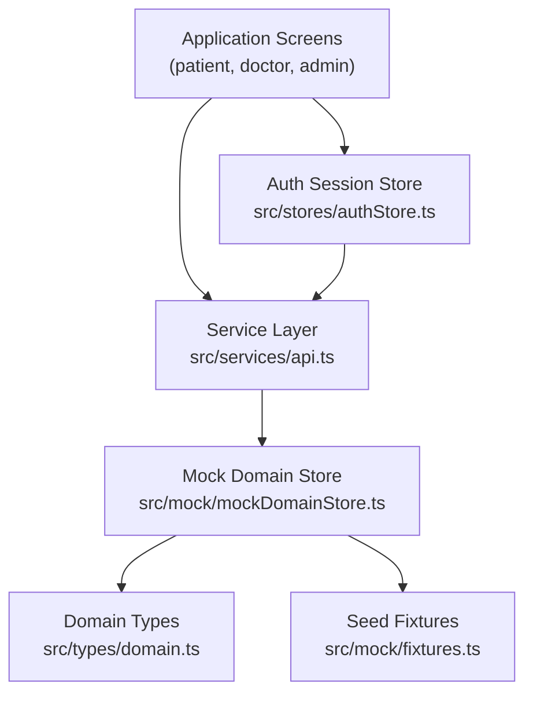
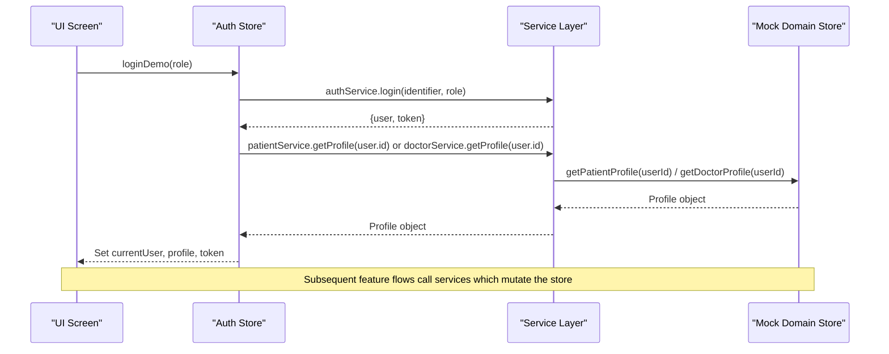
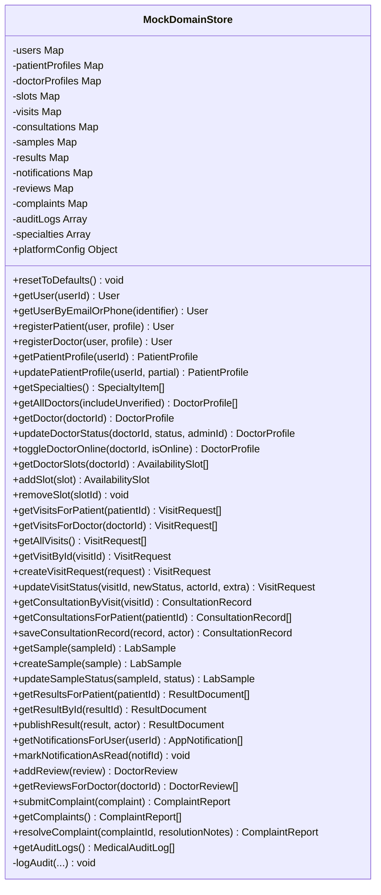
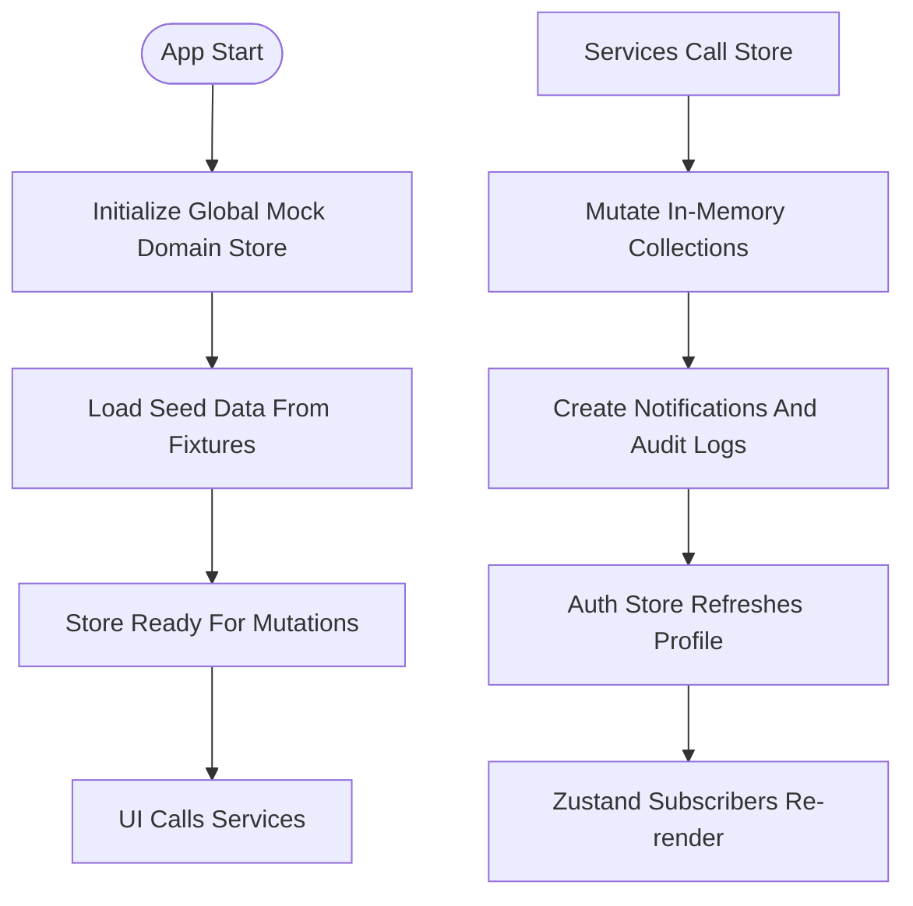
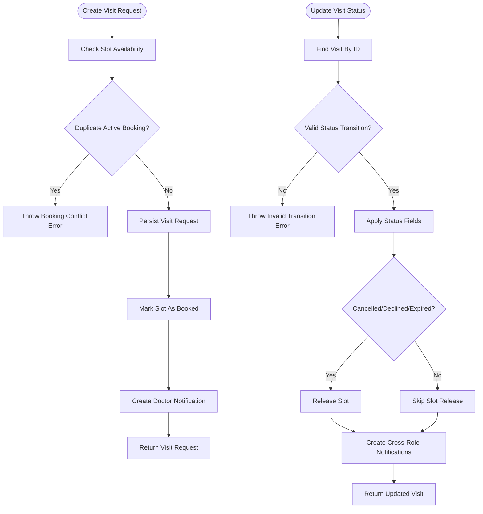
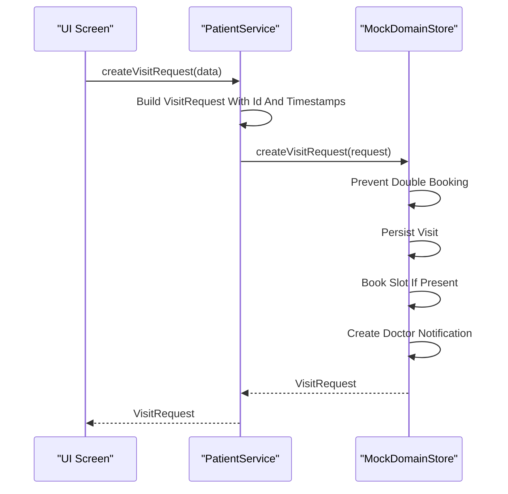
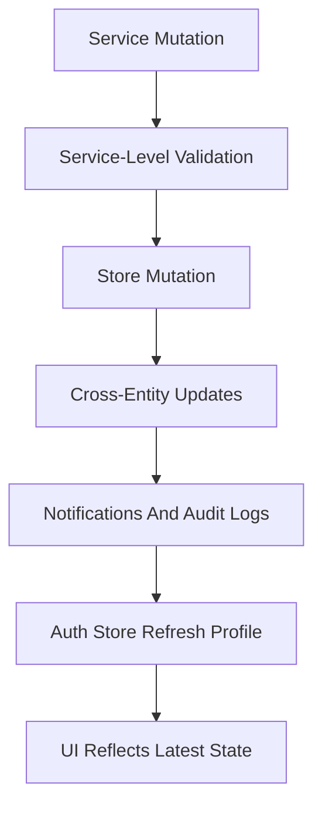
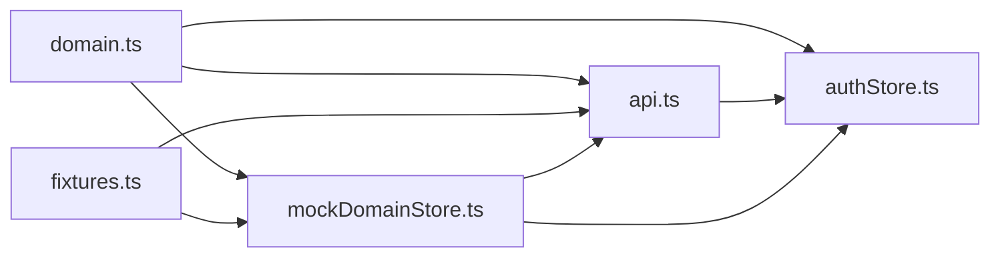

# Mock Domain Store

<cite>
**Referenced Files in This Document**
- [mockDomainStore.ts](file://src/mock/mockDomainStore.ts)
- [fixtures.ts](file://src/mock/fixtures.ts)
- [domain.ts](file://src/types/domain.ts)
- [api.ts](file://src/services/api.ts)
- [authStore.ts](file://src/stores/authStore.ts)
</cite>

## Table of Contents
1. [Introduction](#introduction)
2. [Project Structure](#project-structure)
3. [Core Components](#core-components)
4. [Architecture Overview](#architecture-overview)
5. [Detailed Component Analysis](#detailed-component-analysis)
6. [Dependency Analysis](#dependency-analysis)
7. [Performance Considerations](#performance-considerations)
8. [Troubleshooting Guide](#troubleshooting-guide)
9. [Conclusion](#conclusion)

## Introduction
The mock domain store is an in-memory, process-scoped data layer that acts as the single source of truth for demo and testing scenarios. It models a home-care platform with East African coverage, supporting patients, doctors, visits, consultations, lab samples, results, notifications, reviews, complaints, audit logs, specialties, and availability slots. The store exposes typed CRUD operations and lifecycle transitions while maintaining cross-entity consistency such as slot booking state, doctor ratings, and notification generation.

It is not a persistent database. Data lives only in memory for the current application instance and can be reset to deterministic defaults. The service layer wraps these operations behind asynchronous contracts with simulated latency, enabling UI components to interact with the store through familiar async APIs.

## Project Structure
The mock domain store sits under `src/mock`, with fixtures providing seed data and types defining the domain model. The services layer consumes the store, and the auth store manages user session state while delegating domain mutations to the store via services.



**Diagram sources**
- [domain.ts:1-242](file://src/types/domain.ts#L1-L242)
- [fixtures.ts:1-800](file://src/mock/fixtures.ts#L1-L800)
- [mockDomainStore.ts:1-557](file://src/mock/mockDomainStore.ts#L1-L557)
- [api.ts:1-660](file://src/services/api.ts#L1-L660)
- [authStore.ts:1-112](file://src/stores/authStore.ts#L1-L112)

**Section sources**
- [mockDomainStore.ts:1-70](file://src/mock/mockDomainStore.ts#L1-L70)
- [fixtures.ts:1-70](file://src/mock/fixtures.ts#L1-L70)
- [domain.ts:1-242](file://src/types/domain.ts#L1-L242)
- [api.ts:1-45](file://src/services/api.ts#L1-L45)
- [authStore.ts:1-23](file://src/stores/authStore.ts#L1-L23)

## Core Components
- Domain types define users, patient profiles, doctor profiles, availability slots, visit requests, consultation records, lab samples, result documents, notifications, reviews, complaints, audit logs, and specialty catalog items.
- Fixtures provide initial data for all entities, including multi-country doctors, sample visits, consultation records, lab results, and notifications.
- The mock domain store implements in-memory collections using Maps and arrays, with validation, cross-entity updates, and audit logging.
- The service layer provides asynchronous contracts for authentication, patient flows, doctor flows, and administrative operations, delegating persistence to the store.
- The auth store manages the current user session and profile data, integrating with both the service layer and the mock store for demo resets.

**Section sources**
- [domain.ts:29-242](file://src/types/domain.ts#L29-L242)
- [fixtures.ts:72-800](file://src/mock/fixtures.ts#L72-L800)
- [mockDomainStore.ts:35-127](file://src/mock/mockDomainStore.ts#L35-L127)
- [api.ts:25-45](file://src/services/api.ts#L25-L45)
- [authStore.ts:7-23](file://src/stores/authStore.ts#L7-L23)

## Architecture Overview
The architecture follows a layered pattern:
- Presentation/UI calls service methods.
- Services perform optional validation and then delegate to the mock domain store.
- The store mutates in-memory collections and emits side effects like notifications and audit logs.
- The auth store holds reactive session state and triggers store resets when needed.



**Diagram sources**
- [authStore.ts:31-56](file://src/stores/authStore.ts#L31-L56)
- [api.ts:46-104](file://src/services/api.ts#L46-L104)
- [api.ts:274-288](file://src/services/api.ts#L274-L288)
- [api.ts:468-477](file://src/services/api.ts#L468-L477)
- [mockDomainStore.ts:157-183](file://src/mock/mockDomainStore.ts#L157-L183)

## Detailed Component Analysis

### Mock Domain Store Class
The store encapsulates all domain entities as private collections and exposes public methods for reading, creating, updating, and deleting data. It also maintains system configuration for emergency numbers, cancellation windows, base travel fees, and coverage districts across Rwanda, Kenya, and Tanzania.

Key responsibilities:
- Initialize and reset data from fixtures.
- Manage users, patient profiles, doctor profiles, slots, visits, consultations, samples, results, notifications, reviews, complaints, audit logs, and specialties.
- Enforce business rules such as double-booking prevention, slot booking/unbooking, visit status transitions, review average recalculation, and notification creation.
- Record audit events for sensitive operations.



**Diagram sources**
- [mockDomainStore.ts:35-553](file://src/mock/mockDomainStore.ts#L35-L553)

**Section sources**
- [mockDomainStore.ts:35-127](file://src/mock/mockDomainStore.ts#L35-L127)
- [mockDomainStore.ts:129-220](file://src/mock/mockDomainStore.ts#L129-L220)
- [mockDomainStore.ts:222-380](file://src/mock/mockDomainStore.ts#L222-L380)
- [mockDomainStore.ts:382-553](file://src/mock/mockDomainStore.ts#L382-L553)

### Reactive State Management and Observer Subscriptions
The store itself does not implement a reactive observer API. Instead, it provides a global singleton instance consumed by the service layer. Reactivity is achieved at the UI/session layer:
- The auth store uses Zustand to hold the current user and profile data.
- Components subscribe to the auth store to react to changes.
- When demo data is reset, the auth store calls the store’s reset method and refreshes the current profile.

This design keeps the domain store simple and focused on data integrity, while UI reactivity is handled by the session store.



**Diagram sources**
- [mockDomainStore.ts:68-127](file://src/mock/mockDomainStore.ts#L68-L127)
- [authStore.ts:31-56](file://src/stores/authStore.ts#L31-L56)
- [authStore.ts:95-110](file://src/stores/authStore.ts#L95-L110)

**Section sources**
- [authStore.ts:1-23](file://src/stores/authStore.ts#L1-L23)
- [authStore.ts:31-56](file://src/stores/authStore.ts#L31-L56)
- [authStore.ts:95-110](file://src/stores/authStore.ts#L95-L110)

### Account Isolation System
Account isolation is implemented through explicit entity ownership fields rather than per-user isolated stores:
- Users are identified by `id`.
- Patient profiles are keyed by `userId`.
- Visits link `patientId` and `doctorId`.
- Consultations and results link `patientId`, `doctorId`, and optionally `visitId`.
- Notifications target `recipientUserId`.
- Reviews and complaints reference reporter and subject roles and IDs.

Queries filter by these identifiers to ensure that each user sees only their own data. The store does not create separate in-memory databases per account; instead, it enforces logical separation through ID-based filtering and authorization checks performed by the service layer.

```mermaid
erDiagram
USER ||--o{ PATIENT_PROFILE : "owns"
USER ||--o{ DOCTOR_PROFILE : "owns"
USER ||--o{ VISIT_REQUEST : "requests_as_patient"
USER ||--o{ VISIT_REQUEST : "assigned_doctor"
VISIT_REQUEST ||--o| CONSULTATION_RECORD : "has_record"
VISIT_REQUEST ||--o LAB_SAMPLE : "generates_sample"
LAB_SAMPLE ||--o RESULT_DOCUMENT : "produces_result"
USER ||--o{ APP_NOTIFICATION : "receives"
USER ||--o{ DOCTOR_REVIEW : "writes_review"
USER ||--o{ COMPLAINT_REPORT : "submits_complaint"
```

**Diagram sources**
- [domain.ts:29-242](file://src/types/domain.ts#L29-L242)
- [mockDomainStore.ts:129-220](file://src/mock/mockDomainStore.ts#L129-L220)
- [mockDomainStore.ts:222-380](file://src/mock/mockDomainStore.ts#L222-L380)
- [mockDomainStore.ts:382-553](file://src/mock/mockDomainStore.ts#L382-L553)

**Section sources**
- [domain.ts:29-242](file://src/types/domain.ts#L29-L242)
- [mockDomainStore.ts:129-220](file://src/mock/mockDomainStore.ts#L129-L220)
- [mockDomainStore.ts:222-380](file://src/mock/mockDomainStore.ts#L222-L380)
- [mockDomainStore.ts:382-553](file://src/mock/mockDomainStore.ts#L382-L553)

### CRUD Operations for Domain Entities

#### Users and Profiles
- Retrieve users by ID or by email/phone.
- Register patients and doctors, linking user accounts to profiles.
- Read and update patient profiles with audit logging.
- Query specialties and doctors, with optional inclusion of unverified doctors.
- Update doctor verification status and online presence.

**Section sources**
- [mockDomainStore.ts:129-220](file://src/mock/mockDomainStore.ts#L129-L220)
- [api.ts:124-244](file://src/services/api.ts#L124-L244)
- [api.ts:274-332](file://src/services/api.ts#L274-L332)

#### Availability Slots
- Get available slots for a doctor, excluding blocked slots.
- Add slots with overlap detection.
- Remove slots.

**Section sources**
- [mockDomainStore.ts:202-220](file://src/mock/mockDomainStore.ts#L202-L220)
- [api.ts:489-506](file://src/services/api.ts#L489-L506)

#### Visits
- Create visit requests with double-booking prevention and automatic slot booking.
- Query visits by patient, doctor, or globally.
- Update visit status with cross-role notifications and slot release logic.
- Cancel visits with authorization and state guards.
- Reschedule and handle alternative time proposals.



**Diagram sources**
- [mockDomainStore.ts:245-380](file://src/mock/mockDomainStore.ts#L245-L380)
- [api.ts:334-403](file://src/services/api.ts#L334-L403)

**Section sources**
- [mockDomainStore.ts:222-380](file://src/mock/mockDomainStore.ts#L222-L380)
- [api.ts:334-403](file://src/services/api.ts#L334-L403)

#### Consultations
- Save draft or published consultation records.
- Query consultation records for a patient, excluding drafts.
- Link consultations to visits, prescriptions, recommendations, lab tests, and follow-ups.

**Section sources**
- [mockDomainStore.ts:382-406](file://src/mock/mockDomainStore.ts#L382-L406)
- [api.ts:540-568](file://src/services/api.ts#L540-L568)

#### Lab Samples and Results
- Create and update lab samples.
- Query results by patient or by ID.
- Publish results, notify patients, and log audits.

**Section sources**
- [mockDomainStore.ts:408-464](file://src/mock/mockDomainStore.ts#L408-L464)
- [api.ts:570-584](file://src/services/api.ts#L570-L584)

#### Notifications
- Query notifications for a user.
- Mark notifications as read.
- Automatically generate notifications for visit status changes and result publication.

**Section sources**
- [mockDomainStore.ts:466-479](file://src/mock/mockDomainStore.ts#L466-L479)
- [mockDomainStore.ts:267-278](file://src/mock/mockDomainStore.ts#L267-L278)
- [mockDomainStore.ts:322-377](file://src/mock/mockDomainStore.ts#L322-L377)
- [mockDomainStore.ts:439-450](file://src/mock/mockDomainStore.ts#L439-L450)

#### Reviews and Complaints
- Add reviews and automatically compute doctor averages.
- Query reviews for a doctor.
- Submit complaints and resolve them with notes.

**Section sources**
- [mockDomainStore.ts:481-520](file://src/mock/mockDomainStore.ts#L481-L520)
- [api.ts:419-429](file://src/services/api.ts#L419-L429)
- [api.ts:620-628](file://src/services/api.ts#L620-L628)

#### Audit Logs
- Retrieve audit logs sorted by timestamp.
- Internal logging for profile updates, consultation saves, and result publications.

**Section sources**
- [mockDomainStore.ts:522-553](file://src/mock/mockDomainStore.ts#L522-L553)
- [api.ts:630-633](file://src/services/api.ts#L630-L633)

### Data Seeding, Test Fixtures, and Scenario Setup
The fixtures module defines:
- Specialties catalog.
- Demo users across Rwanda, Kenya, and Tanzania.
- Patient profiles with health details and consent metadata.
- Doctor profiles with credentials, languages, fees, and working schedules.
- Availability slots for scheduling.
- Visit requests covering completed, active, and pending states.
- Consultation records with prescriptions and lab requirements.
- Lab samples and published result documents.
- Initial notifications.

The store’s constructor calls a reset method that clears existing collections and populates them from fixtures, ensuring deterministic test data.

**Section sources**
- [fixtures.ts:18-70](file://src/mock/fixtures.ts#L18-L70)
- [fixtures.ts:72-118](file://src/mock/fixtures.ts#L72-L118)
- [fixtures.ts:120-163](file://src/mock/fixtures.ts#L120-L163)
- [fixtures.ts:165-515](file://src/mock/fixtures.ts#L165-L515)
- [fixtures.ts:517-603](file://src/mock/fixtures.ts#L517-L603)
- [fixtures.ts:605-691](file://src/mock/fixtures.ts#L605-L691)
- [fixtures.ts:693-778](file://src/mock/fixtures.ts#L693-L778)
- [fixtures.ts:780-800](file://src/mock/fixtures.ts#L780-L800)
- [mockDomainStore.ts:68-127](file://src/mock/mockDomainStore.ts#L68-L127)

### Integration With the Service Layer
The service layer defines three main interfaces:
- `AuthService`: login, OTP verification, registration, current user retrieval, password reset.
- `PatientService`: profile management, doctor search, visit lifecycle, records, reviews, complaints.
- `DoctorService`: profile management, availability, visit acceptance/decline/alternative proposal, execution status, consultation records, lab result publishing.
- `AdminService`: doctor verification, visit oversight, complaints, audit logs, platform metrics.

Each service method adds simulated latency and delegates mutation or query operations to the mock domain store. This allows UI code to remain unchanged when switching between mock and real backend implementations.



**Diagram sources**
- [api.ts:334-345](file://src/services/api.ts#L334-L345)
- [mockDomainStore.ts:245-280](file://src/mock/mockDomainStore.ts#L245-L280)

**Section sources**
- [api.ts:25-45](file://src/services/api.ts#L25-L45)
- [api.ts:46-244](file://src/services/api.ts#L46-L244)
- [api.ts:274-430](file://src/services/api.ts#L274-L430)
- [api.ts:468-584](file://src/services/api.ts#L468-L584)
- [api.ts:604-659](file://src/services/api.ts#L604-L659)

### Consistency Across Application State
Consistency is maintained through:
- Centralized mutations in the store.
- Validation and guard clauses in services before calling store methods.
- Cross-entity updates (e.g., marking slots booked/unbooked, recalculating doctor ratings).
- Side effects like notifications and audit logs triggered by domain events.
- Session store refreshing profile data after login or demo reset.



**Diagram sources**
- [api.ts:359-368](file://src/services/api.ts#L359-L368)
- [mockDomainStore.ts:283-380](file://src/mock/mockDomainStore.ts#L283-L380)
- [mockDomainStore.ts:481-496](file://src/mock/mockDomainStore.ts#L481-L496)
- [authStore.ts:95-110](file://src/stores/authStore.ts#L95-L110)

**Section sources**
- [api.ts:359-368](file://src/services/api.ts#L359-L368)
- [mockDomainStore.ts:283-380](file://src/mock/mockDomainStore.ts#L283-L380)
- [mockDomainStore.ts:481-496](file://src/mock/mockDomainStore.ts#L481-L496)
- [authStore.ts:95-110](file://src/stores/authStore.ts#L95-L110)

## Dependency Analysis
The mock domain store depends on:
- Domain types for type safety.
- Fixtures for initial data.

The service layer depends on:
- Domain types.
- Fixtures for demo user keys.
- The mock domain store for persistence.

The auth store depends on:
- Domain types.
- Service layer for authenticated flows.
- The mock domain store for demo reset.



**Diagram sources**
- [domain.ts:1-242](file://src/types/domain.ts#L1-L242)
- [fixtures.ts:1-800](file://src/mock/fixtures.ts#L1-L800)
- [mockDomainStore.ts:1-34](file://src/mock/mockDomainStore.ts#L1-L34)
- [api.ts:1-20](file://src/services/api.ts#L1-L20)
- [authStore.ts:1-6](file://src/stores/authStore.ts#L1-L6)

**Section sources**
- [mockDomainStore.ts:1-34](file://src/mock/mockDomainStore.ts#L1-L34)
- [api.ts:1-20](file://src/services/api.ts#L1-L20)
- [authStore.ts:1-6](file://src/stores/authStore.ts#L1-L6)

## Performance Considerations
- All collections use Maps for O(1) lookups by ID.
- Queries often convert Maps to arrays and filter/sort, which is acceptable for demo-scale data but may become costly if datasets grow significantly.
- Sorting by timestamps occurs frequently; consider indexing or precomputed ordering if performance becomes critical.
- Simulated latency in services improves UX realism but should be removed or parameterized for production backend integration.
- Avoid unnecessary deep copies; the store already spreads objects during reset and updates.

[No sources needed since this section provides general guidance]

## Troubleshooting Guide
Common issues and resolutions:
- Invalid credentials: The service layer throws an error when no matching user is found in fixtures or the store. Verify the identifier matches a fixture key or stored user.
- Double booking conflict: Creating a visit request for an already reserved doctor slot throws a conflict error. Check existing active visits and slot booking state.
- Unauthorized visit actions: Cancelling or rescheduling requires the caller to match the visit’s patient ID and valid state. Ensure the correct actor is used.
- Invalid visit status transition: Updating to unsupported execution statuses throws an error. Use allowed transitions defined by the service and store.
- Missing profile data: After login, profile retrieval returns null if the profile does not exist. Register the profile or initialize fixtures correctly.
- Demo data drift: If tests modify shared store state, reset to defaults using the auth store’s reset method to restore deterministic state.

**Section sources**
- [api.ts:99-103](file://src/services/api.ts#L99-L103)
- [mockDomainStore.ts:245-256](file://src/mock/mockDomainStore.ts#L245-L256)
- [api.ts:359-368](file://src/services/api.ts#L359-L368)
- [api.ts:531-538](file://src/services/api.ts#L531-L538)
- [authStore.ts:107-110](file://src/stores/authStore.ts#L107-L110)

## Conclusion
The mock domain store provides a robust, typed, in-memory representation of the home-care platform’s core domain. It centralizes data mutations, enforces business rules, and generates consistent side effects such as notifications and audit logs. The service layer abstracts persistence behind async contracts, enabling seamless integration with UI components and future backend migration. While not reactive by itself, it integrates cleanly with Zustand-based session state to deliver a responsive user experience. For testing and demos, the store’s deterministic seeding and reset capabilities make it a reliable single source of truth.

[No sources needed since this section summarizes without analyzing specific files]