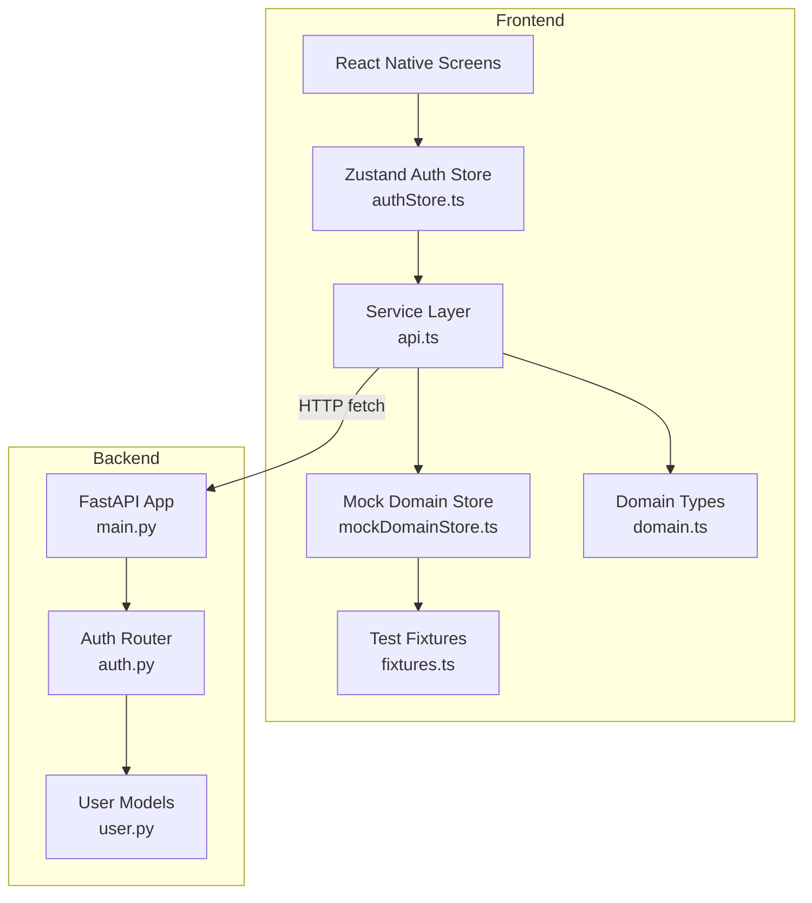
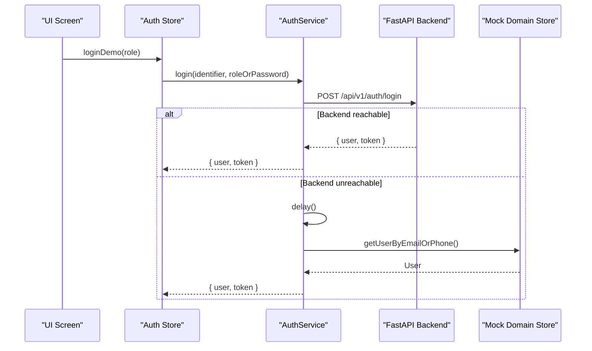
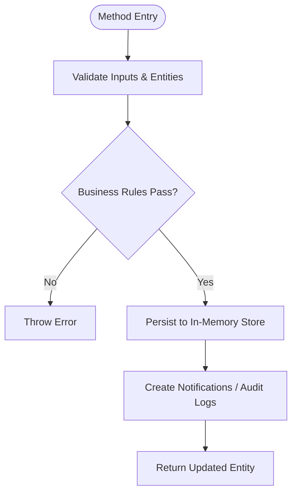
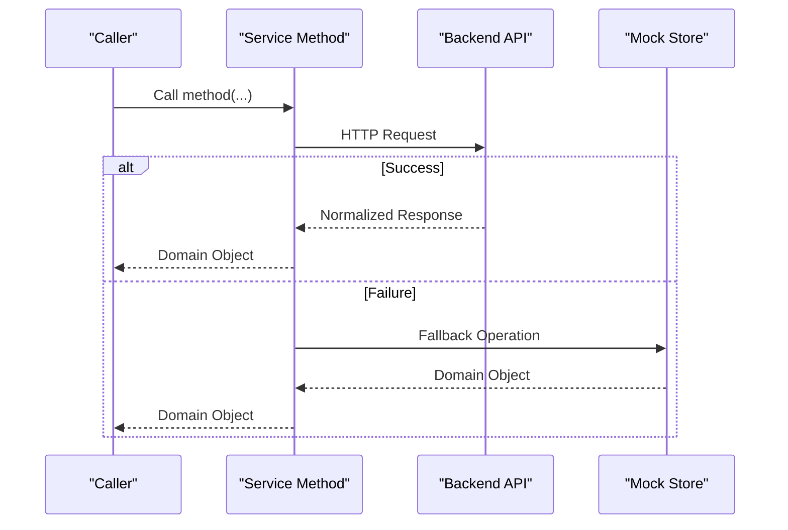
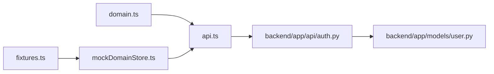

# Service Layer Architecture

<cite>
**Referenced Files in This Document**
- [api.ts](file://src/services/api.ts)
- [mockDomainStore.ts](file://src/mock/mockDomainStore.ts)
- [fixtures.ts](file://src/mock/fixtures.ts)
- [domain.ts](file://src/types/domain.ts)
- [authStore.ts](file://src/stores/authStore.ts)
- [main.py](file://backend/app/main.py)
- [auth.py](file://backend/app/api/auth.py)
- [user.py](file://backend/app/models/user.py)
- [README.md](file://README.md)
</cite>

## Table of Contents
1. [Introduction](#introduction)
2. [Project Structure](#project-structure)
3. [Core Components](#core-components)
4. [Architecture Overview](#architecture-overview)
5. [Detailed Component Analysis](#detailed-component-analysis)
6. [Dependency Analysis](#dependency-analysis)
7. [Performance Considerations](#performance-considerations)
8. [Troubleshooting Guide](#troubleshooting-guide)
9. [Conclusion](#conclusion)
10. [Appendices](#appendices)

## Introduction
This document explains the service layer architecture that abstracts data access and API communication for the HomeCare application. It focuses on:
- Service interface patterns that allow seamless switching between mock and real backend implementations.
- The mock domain store providing reactive in-memory database functionality with account isolation, test fixtures, and data seeding.
- The API service abstraction layer, including method signatures, error handling strategies, and data transformation patterns.
- Domain-specific service interfaces for authentication, patient, doctor, and admin domains.
- Practical guidance for adding new services, implementing custom data sources, integrating external APIs, performance considerations, caching strategies, and testing approaches.

The frontend is a React Native / Expo application backed by a FastAPI Python backend. The current frontend service layer uses an in-memory mock store while also attempting live HTTP calls to a local backend when available.

## Project Structure
The service layer lives under `src/services`, the mock domain store under `src/mock`, shared types under `src/types`, and the Zustand session store under `src/stores`. The backend is under `backend/app`.



**Diagram sources**
- [api.ts:1-660](file://src/services/api.ts#L1-L660)
- [mockDomainStore.ts:1-557](file://src/mock/mockDomainStore.ts#L1-L557)
- [fixtures.ts:1-904](file://src/mock/fixtures.ts#L1-L904)
- [domain.ts:1-242](file://src/types/domain.ts#L1-L242)
- [authStore.ts:1-112](file://src/stores/authStore.ts#L1-L112)
- [main.py:1-61](file://backend/app/main.py#L1-L61)
- [auth.py:1-182](file://backend/app/api/auth.py#L1-L182)
- [user.py:1-82](file://backend/app/models/user.py#L1-L82)

**Section sources**
- [README.md:1-245](file://README.md#L1-L245)

## Core Components
The core components are:
- Service interfaces and implementations: `AuthService`, `PatientService`, `DoctorService`, `AdminService` defined and exported from the service layer.
- Mock domain store: an in-memory persistent store with seeded data, validation, notifications, audit logs, and cross-entity updates.
- Domain types: strongly typed entities for users, profiles, visits, records, results, reviews, complaints, and audit logs.
- Session store: a Zustand-based auth store coordinating login flows, profile loading, and demo data reset.

Key responsibilities:
- Service layer: encapsulates business operations, performs validation, transforms data, and delegates persistence to either the mock store or backend API.
- Mock store: provides deterministic behavior, account isolation, and rich domain logic such as visit lifecycle transitions, slot booking constraints, and notification generation.
- Backend: implements authentication endpoints and user/profile models for future full integration.

**Section sources**
- [api.ts:25-41](file://src/services/api.ts#L25-L41)
- [api.ts:247-272](file://src/services/api.ts#L247-L272)
- [api.ts:432-466](file://src/services/api.ts#L432-L466)
- [api.ts:587-602](file://src/services/api.ts#L587-L602)
- [mockDomainStore.ts:35-70](file://src/mock/mockDomainStore.ts#L35-L70)
- [domain.ts:29-242](file://src/types/domain.ts#L29-L242)
- [authStore.ts:23-111](file://src/stores/authStore.ts#L23-L111)

## Architecture Overview
The service layer follows a clear separation of concerns:
- UI screens call service methods.
- Services perform validation, transform payloads, simulate latency, and delegate to either:
  - Live backend via HTTP fetch (with graceful fallback).
  - Mock domain store for deterministic offline/demo behavior.
- The mock store maintains all domain state, enforces business rules, and emits side effects like notifications and audit logs.



**Diagram sources**
- [authStore.ts:31-55](file://src/stores/authStore.ts#L31-L55)
- [api.ts:46-104](file://src/services/api.ts#L46-L104)
- [auth.py:121-153](file://backend/app/api/auth.py#L121-L153)
- [mockDomainStore.ts:130-142](file://src/mock/mockDomainStore.ts#L130-L142)

## Detailed Component Analysis

### Service Interface Patterns
The service layer defines TypeScript interfaces per domain and exports concrete objects implementing those interfaces. This pattern enables:
- Type-safe contracts across the app.
- Easy swapping of implementations (mock vs real).
- Centralized error handling and data transformation.

Interfaces:
- `AuthService`: login, OTP verification, registration, current user retrieval, password reset.
- `PatientService`: profile management, specialty listing, doctor search, doctor details, visit request lifecycle, records, reviews, complaints.
- `DoctorService`: profile, availability slots, visit acceptance/decline/alternative time, execution status transitions, consultation records, lab result publishing.
- `AdminService`: doctor verification, visit oversight, complaint resolution, audit logs, platform metrics.

Implementation notes:
- Methods typically simulate network latency using a small delay helper.
- Many methods attempt a live HTTP call first; if it fails, they fall back to the mock store.
- Data returned to callers is normalized to domain types.

```mermaid
classDiagram
class AuthService {
+login(identifier, demoRole) Promise~{user, token}~
+verifyOtp(code, userId) Promise~boolean~
+registerPatient(data) Promise~User~
+registerDoctor(data) Promise~User~
+getCurrentUser(userId) Promise~User|null~
+resetPassword(email) Promise~boolean~
}
class PatientService {
+getProfile(patientId) Promise~PatientProfile|null~
+updateProfile(patientId, partial) Promise~PatientProfile~
+getSpecialties() Promise~SpecialtyItem[]~
+searchDoctors(params) Promise~DoctorProfile[]~
+getDoctorDetails(doctorId) Promise~{doctor, slots, reviews}~
+createVisitRequest(data) Promise~VisitRequest~
+getVisits(patientId) Promise~VisitRequest[]~
+getVisitDetails(visitId) Promise~VisitRequest~
+cancelVisit(visitId, patientId, reason) Promise~VisitRequest~
+rescheduleVisit(visitId, patientId, newDate, newTime) Promise~VisitRequest~
+acceptAlternativeTime(visitId, patientId) Promise~VisitRequest~
+rejectAlternativeTime(visitId, patientId, reason) Promise~VisitRequest~
+getRecords(patientId) Promise~{consultations, results}~
+getResultDocument(resultId) Promise~ResultDocument~
+submitReview(review) Promise~DoctorReview~
+submitComplaint(complaint) Promise~ComplaintReport~
}
class DoctorService {
+getProfile(doctorId) Promise~DoctorProfile|null~
+toggleOnline(doctorId, isOnline) Promise~DoctorProfile~
+getVisits(doctorId) Promise~VisitRequest[]~
+getSlots(doctorId) Promise~AvailabilitySlot[]~
+addSlot(doctorId, date, startTime, endTime) Promise~AvailabilitySlot~
+removeSlot(slotId) Promise~void~
+acceptVisit(visitId, doctorId) Promise~VisitRequest~
+declineVisit(visitId, doctorId, reason) Promise~VisitRequest~
+proposeAlternativeTime(visitId, doctorId, alternativeDate, alternativeTime, note) Promise~VisitRequest~
+updateVisitExecutionStatus(visitId, doctorId, status) Promise~VisitRequest~
+getConsultationRecord(visitId) Promise~ConsultationRecord|null~
+saveConsultationDraft(record, actor) Promise~ConsultationRecord~
+publishConsultationRecord(record, actor) Promise~ConsultationRecord~
+publishLabResult(resultData, actor) Promise~ResultDocument~
}
class AdminService {
+getAllDoctors() Promise~DoctorProfile[]~
+updateDoctorVerification(doctorId, status) Promise~DoctorProfile~
+getAllVisits() Promise~VisitRequest[]~
+getComplaints() Promise~ComplaintReport[]~
+resolveComplaint(complaintId, resolutionNotes) Promise~ComplaintReport|undefined~
+getAuditLogs() Promise~MedicalAuditLog[]~
+getPlatformMetrics() Promise~PlatformMetrics~
}
```

**Diagram sources**
- [api.ts:25-41](file://src/services/api.ts#L25-L41)
- [api.ts:247-272](file://src/services/api.ts#L247-L272)
- [api.ts:432-466](file://src/services/api.ts#L432-L466)
- [api.ts:587-602](file://src/services/api.ts#L587-L602)

**Section sources**
- [api.ts:25-41](file://src/services/api.ts#L25-L41)
- [api.ts:247-272](file://src/services/api.ts#L247-L272)
- [api.ts:432-466](file://src/services/api.ts#L432-L466)
- [api.ts:587-602](file://src/services/api.ts#L587-L602)

### Mock Domain Store Architecture
The mock domain store is a singleton class that holds all domain state in memory using Maps and arrays. It:
- Seeds initial data from fixtures at construction.
- Provides CRUD operations for users, patient profiles, doctor profiles, slots, visits, consultations, samples, results, notifications, reviews, complaints, and audit logs.
- Enforces business rules such as double-booking prevention, cancellation restrictions, and valid visit status transitions.
- Emits side effects: creates notifications and audit log entries on relevant mutations.
- Supports account isolation by filtering queries by patientId, doctorId, or recipientUserId.



**Diagram sources**
- [mockDomainStore.ts:245-281](file://src/mock/mockDomainStore.ts#L245-L281)
- [mockDomainStore.ts:283-380](file://src/mock/mockDomainStore.ts#L283-L380)
- [mockDomainStore.ts:393-406](file://src/mock/mockDomainStore.ts#L393-L406)
- [mockDomainStore.ts:436-464](file://src/mock/mockDomainStore.ts#L436-L464)

Key behaviors:
- Visit creation prevents overlapping bookings for the same doctor and marks slots booked.
- Visit status transitions update related fields, free up slots on cancellation/decline/expiry, and create cross-role notifications.
- Consultation record saves and publishes trigger audit logging.
- Result publication notifies patients and logs actions.

**Section sources**
- [mockDomainStore.ts:35-70](file://src/mock/mockDomainStore.ts#L35-L70)
- [mockDomainStore.ts:72-127](file://src/mock/mockDomainStore.ts#L72-L127)
- [mockDomainStore.ts:144-154](file://src/mock/mockDomainStore.ts#L144-L154)
- [mockDomainStore.ts:175-200](file://src/mock/mockDomainStore.ts#L175-L200)
- [mockDomainStore.ts:207-220](file://src/mock/mockDomainStore.ts#L207-L220)
- [mockDomainStore.ts:245-281](file://src/mock/mockDomainStore.ts#L245-L281)
- [mockDomainStore.ts:283-380](file://src/mock/mockDomainStore.ts#L283-L380)
- [mockDomainStore.ts:393-406](file://src/mock/mockDomainStore.ts#L393-L406)
- [mockDomainStore.ts:436-464](file://src/mock/mockDomainStore.ts#L436-L464)

### API Service Abstraction Layer
The service layer attempts to call the backend API first and falls back to the mock store when unavailable. This ensures robustness during development and testing.

Authentication flow highlights:
- Login tries `/api/v1/auth/login`; on success, returns normalized user and token.
- On failure, simulates latency and falls back to mock store lookup by email or phone.
- Registration endpoints attempt backend calls; on failure, create mock users and profiles.

Error handling strategy:
- Network errors are caught and handled gracefully.
- Backend error responses are parsed where possible.
- Business rule violations throw descriptive errors.

Data transformation:
- Backend responses are mapped to domain types before returning to callers.
- Mock data is created with consistent IDs and timestamps.



**Diagram sources**
- [api.ts:46-104](file://src/services/api.ts#L46-L104)
- [api.ts:124-197](file://src/services/api.ts#L124-L197)
- [auth.py:121-153](file://backend/app/api/auth.py#L121-L153)

**Section sources**
- [api.ts:46-104](file://src/services/api.ts#L46-L104)
- [api.ts:124-197](file://src/services/api.ts#L124-L197)
- [api.ts:274-430](file://src/services/api.ts#L274-L430)
- [api.ts:468-585](file://src/services/api.ts#L468-L585)
- [api.ts:604-659](file://src/services/api.ts#L604-L659)

### Domain-Specific Services

#### Authentication Service
Responsibilities:
- Authenticate users by identifier or demo role.
- Verify OTP codes.
- Register patients and doctors.
- Retrieve current user and reset passwords.

Behavior:
- Tries backend endpoints first; falls back to mock store.
- Returns normalized user objects and tokens.

**Section sources**
- [api.ts:25-41](file://src/services/api.ts#L25-L41)
- [api.ts:46-104](file://src/services/api.ts#L46-L104)
- [api.ts:106-122](file://src/services/api.ts#L106-L122)
- [api.ts:124-197](file://src/services/api.ts#L124-L197)
- [api.ts:236-244](file://src/services/api.ts#L236-L244)

#### Patient Service
Responsibilities:
- Manage patient profiles and specialties.
- Search and filter doctors.
- Handle visit requests and their lifecycle.
- Provide medical records and result documents.
- Submit reviews and complaints.

Validation and rules:
- Prevents cancellations after certain statuses.
- Validates alternative time proposals and accept/reject flows.
- Ensures unauthorized access checks based on patientId.

**Section sources**
- [api.ts:247-272](file://src/services/api.ts#L247-L272)
- [api.ts:274-430](file://src/services/api.ts#L274-L430)

#### Doctor Service
Responsibilities:
- Manage doctor profiles and online status.
- Manage availability slots.
- Accept/decline visits and propose alternative times.
- Update visit execution status through valid transitions.
- Save/publish consultation records and publish lab results.

Validation and rules:
- Only approved doctors can accept visits.
- Execution status must be one of allowed states.
- Draft vs published records are tracked.

**Section sources**
- [api.ts:432-466](file://src/services/api.ts#L432-L466)
- [api.ts:468-585](file://src/services/api.ts#L468-L585)

#### Admin Service
Responsibilities:
- List all doctors and update verification status.
- View all visits and complaints.
- Resolve complaints.
- Access audit logs and compute platform metrics.

Metrics computation:
- Aggregates completed visits, active visits, gross revenue, average rating, and pending verifications.

**Section sources**
- [api.ts:587-602](file://src/services/api.ts#L587-L602)
- [api.ts:604-659](file://src/services/api.ts#L604-L659)

### Adding New Services and Implementing Custom Data Sources
To add a new service:
1. Define a TypeScript interface describing the service contract in the service layer file.
2. Implement the interface with methods that:
   - Perform input validation.
   - Attempt backend calls when appropriate.
   - Fall back to the mock store for deterministic behavior.
   - Transform backend responses into domain types.
3. Export the service object alongside existing services.
4. Integrate the service into the Zustand store or screens as needed.

Custom data source implementation:
- Extend the mock domain store with new entities and methods.
- Seed initial data in fixtures.
- Ensure account isolation by filtering queries by relevant IDs.
- Add business rules and side effects (notifications, audit logs).

External API integration:
- Replace mock calls with HTTP fetches to the backend.
- Normalize responses to domain types.
- Maintain error handling and fallback behavior during transition.

**Section sources**
- [api.ts:1-23](file://src/services/api.ts#L1-L23)
- [api.ts:25-41](file://src/services/api.ts#L25-L41)
- [mockDomainStore.ts:35-70](file://src/mock/mockDomainStore.ts#L35-L70)
- [fixtures.ts:1-118](file://src/mock/fixtures.ts#L1-L118)

## Dependency Analysis
The service layer depends on:
- Domain types for strong typing.
- Mock fixtures for seed data.
- Mock domain store for persistence and business logic.
- Backend API for live authentication and registration endpoints.



**Diagram sources**
- [domain.ts:1-242](file://src/types/domain.ts#L1-L242)
- [fixtures.ts:1-118](file://src/mock/fixtures.ts#L1-L118)
- [mockDomainStore.ts:1-33](file://src/mock/mockDomainStore.ts#L1-L33)
- [api.ts:1-23](file://src/services/api.ts#L1-L23)
- [auth.py:1-18](file://backend/app/api/auth.py#L1-L18)
- [user.py:1-82](file://backend/app/models/user.py#L1-L82)

**Section sources**
- [api.ts:1-23](file://src/services/api.ts#L1-L23)
- [mockDomainStore.ts:1-33](file://src/mock/mockDomainStore.ts#L1-L33)
- [auth.py:1-18](file://backend/app/api/auth.py#L1-L18)

## Performance Considerations
- Simulated latency: Service methods use small delays to mimic network conditions. This improves UX realism but should be removed or reduced in production.
- Caching strategy:
  - Use the Zustand store to cache current user and profiles.
  - Consider adding a lightweight in-memory cache layer in services for read-heavy data like specialties and doctor catalogs.
  - For large datasets, implement pagination and selective fetching.
- Query optimization:
  - Filter at the service layer to reduce payload size.
  - Avoid unnecessary re-renders by memoizing derived data in UI layers.
- Backend integration:
  - Use efficient endpoints and eager loading where applicable.
  - Leverage database indexes for frequently queried fields (email, phone, ids).

[No sources needed since this section provides general guidance]

## Troubleshooting Guide
Common issues and resolutions:
- Login failures:
  - If backend is unreachable, the service falls back to mock store. Ensure mock data includes the target user.
  - Check credentials against demo accounts and verify OTP code format.
- Registration errors:
  - Duplicate email/phone or license number will raise backend errors.
  - Fallback registration creates mock users; ensure subsequent flows reference correct IDs.
- Visit lifecycle errors:
  - Cancellation/rescheduling restrictions are enforced by service and mock store.
  - Unauthorized access checks prevent cross-user modifications.
- Slot conflicts:
  - Overlapping slots are rejected by the mock store.
  - Ensure slot times do not conflict with existing bookings.

Operational tips:
- Reset demo data via the auth store to restore initial state.
- Inspect audit logs for mutation traces.
- Validate backend health endpoint and Swagger docs.

**Section sources**
- [api.ts:46-104](file://src/services/api.ts#L46-L104)
- [api.ts:124-197](file://src/services/api.ts#L124-L197)
- [api.ts:359-403](file://src/services/api.ts#L359-L403)
- [mockDomainStore.ts:207-220](file://src/mock/mockDomainStore.ts#L207-L220)
- [mockDomainStore.ts:245-281](file://src/mock/mockDomainStore.ts#L245-L281)
- [mockDomainStore.ts:523-552](file://src/mock/mockDomainStore.ts#L523-L552)
- [authStore.ts:107-111](file://src/stores/authStore.ts#L107-L111)
- [main.py:49-61](file://backend/app/main.py#L49-L61)

## Conclusion
The service layer provides a robust abstraction over data access and API communication. By defining strict TypeScript interfaces and implementing them with both mock and backend capabilities, the application achieves:
- Seamless switching between mock and real data sources.
- Deterministic testing with rich fixtures and account isolation.
- Clear error handling and data transformation patterns.
- Extensibility for new domains and custom data sources.

Adopting the patterns described here will help maintain consistency, improve testability, and simplify migration to a production backend.

[No sources needed since this section summarizes without analyzing specific files]

## Appendices

### Backend API Endpoints Used by Frontend
- Authentication:
  - POST `/api/v1/auth/login`
  - POST `/api/v1/auth/verify-otp`
  - POST `/api/v1/auth/register/patient`
  - POST `/api/v1/auth/register/doctor`
  - GET `/api/v1/auth/me`

These endpoints are implemented in the FastAPI router and interact with SQLAlchemy models.

**Section sources**
- [auth.py:24-65](file://backend/app/api/auth.py#L24-L65)
- [auth.py:68-118](file://backend/app/api/auth.py#L68-L118)
- [auth.py:121-153](file://backend/app/api/auth.py#L121-L153)
- [auth.py:156-180](file://backend/app/api/auth.py#L156-L180)
- [user.py:26-82](file://backend/app/models/user.py#L26-L82)