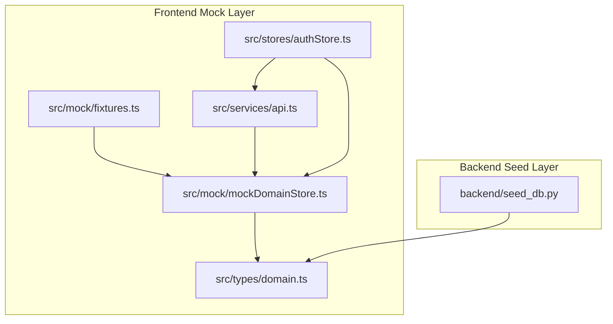
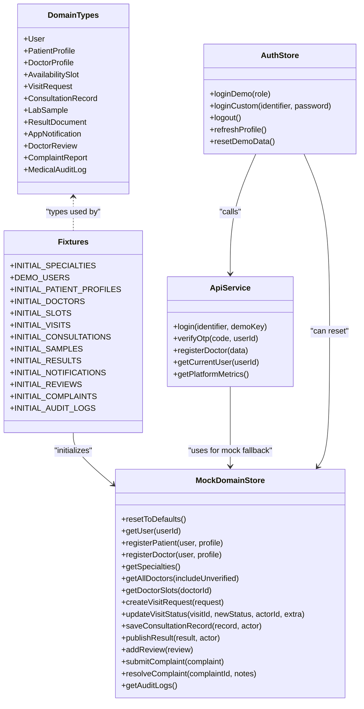
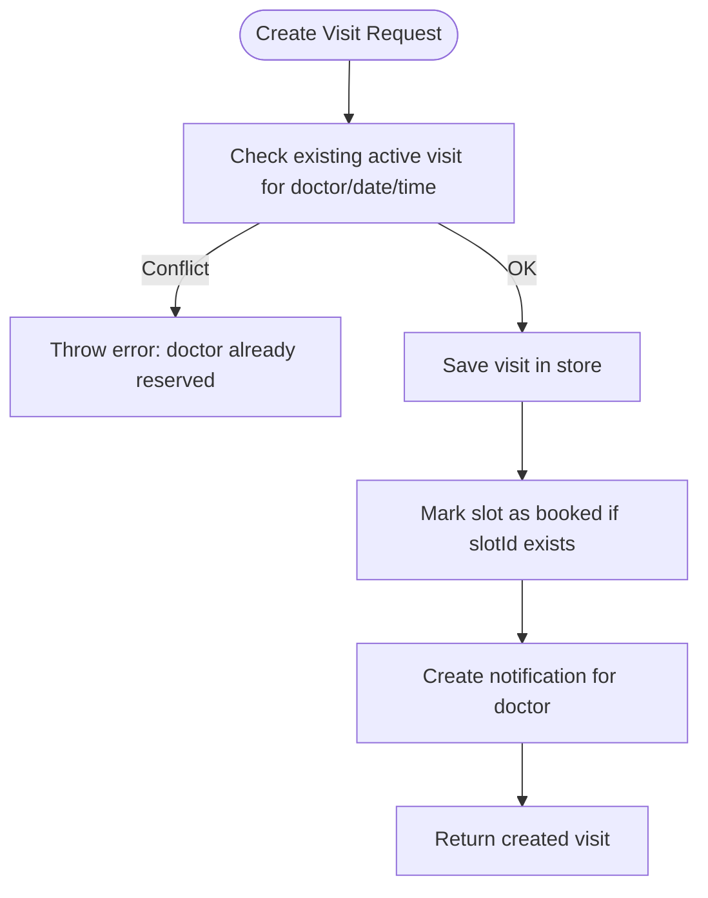
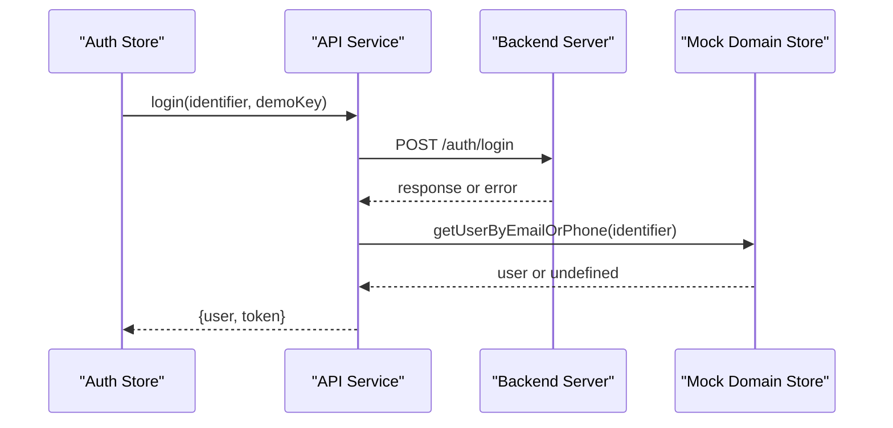
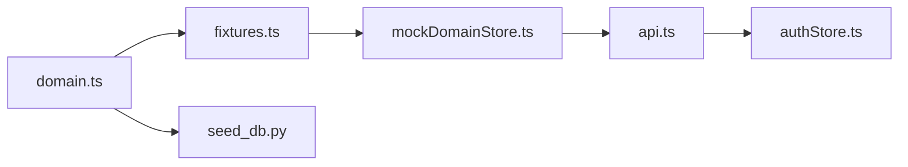

# Test Fixtures & Data Seeding

<cite>
**Referenced Files in This Document**
- [fixtures.ts](file://src/mock/fixtures.ts)
- [mockDomainStore.ts](file://src/mock/mockDomainStore.ts)
- [domain.ts](file://src/types/domain.ts)
- [api.ts](file://src/services/api.ts)
- [authStore.ts](file://src/stores/authStore.ts)
- [seed_db.py](file://backend/seed_db.py)
</cite>

## Table of Contents
1. [Introduction](#introduction)
2. [Project Structure](#project-structure)
3. [Core Components](#core-components)
4. [Architecture Overview](#architecture-overview)
5. [Detailed Component Analysis](#detailed-component-analysis)
6. [Dependency Analysis](#dependency-analysis)
7. [Performance Considerations](#performance-considerations)
8. [Troubleshooting Guide](#troubleshooting-guide)
9. [Conclusion](#conclusion)
10. [Appendices](#appendices)

## Introduction
This document explains the test fixtures and data seeding system used to provide realistic sample data for development, testing, and demonstration. The system covers:
- Predefined specialty items for doctor discovery
- Demo user configurations across patient, doctor, and admin roles
- Sample medical records including visits, consultation records, lab samples, results, notifications, reviews, complaints, and audit logs
- A backend seed script that initializes core database users and profiles

The fixtures are designed to support:
- Patient journeys such as booking a visit, receiving a home consultation, viewing lab results, and leaving reviews
- Doctor workflows such as availability management, visit approval, clinical documentation, and result publishing
- Administrative operations such as doctor verification, platform metrics, complaint resolution, and audit log review

## Project Structure
The fixture and seeding system spans frontend mock data, domain type definitions, an in-memory store, API service integration, authentication flow, and a backend seed script.

**Diagram sources**
- [fixtures.ts:1-16](file://src/mock/fixtures.ts#L1-L16)
- [mockDomainStore.ts:1-33](file://src/mock/mockDomainStore.ts#L1-L33)
- [domain.ts:1-242](file://src/types/domain.ts#L1-L242)
- [api.ts:70-104](file://src/services/api.ts#L70-L104)
- [authStore.ts:1-42](file://src/stores/authStore.ts#L1-L42)
- [seed_db.py:1-105](file://backend/seed_db.py#L1-L105)

**Section sources**
- [fixtures.ts:1-16](file://src/mock/fixtures.ts#L1-L16)
- [mockDomainStore.ts:1-33](file://src/mock/mockDomainStore.ts#L1-L33)
- [domain.ts:1-242](file://src/types/domain.ts#L1-L242)
- [api.ts:70-104](file://src/services/api.ts#L70-L104)
- [authStore.ts:1-42](file://src/stores/authStore.ts#L1-L42)
- [seed_db.py:1-105](file://backend/seed_db.py#L1-L105)

## Core Components
The core components are:
- Domain types defining entities such as User, PatientProfile, DoctorProfile, VisitRequest, ConsultationRecord, LabSample, ResultDocument, AppNotification, DoctorReview, ComplaintReport, and MedicalAuditLog
- Fixtures providing initial datasets for specialties, demo users, patients, doctors, slots, visits, consultations, samples, results, notifications, reviews, complaints, and audit logs
- In-memory mock store initializing from fixtures and exposing CRUD and workflow methods
- API service layer integrating with both real backend endpoints and mock store fallbacks
- Authentication store enabling demo login flows and profile refresh
- Backend seed script creating core users and profiles in PostgreSQL

Key responsibilities:
- Domain types enforce structure and validation rules
- Fixtures provide consistent, realistic sample data
- Mock store provides deterministic behavior for tests and demos
- API service abstracts backend vs mock usage
- Auth store orchestrates demo login and session state
- Seed script bootstraps backend data for integration testing

**Section sources**
- [domain.ts:29-242](file://src/types/domain.ts#L29-L242)
- [fixtures.ts:18-904](file://src/mock/fixtures.ts#L18-L904)
- [mockDomainStore.ts:35-127](file://src/mock/mockDomainStore.ts#L35-L127)
- [api.ts:70-104](file://src/services/api.ts#L70-L104)
- [authStore.ts:23-42](file://src/stores/authStore.ts#L23-L42)
- [seed_db.py:8-105](file://backend/seed_db.py#L8-L105)

## Architecture Overview
The architecture separates concerns between data definitions, sample data, in-memory persistence, API abstraction, and authentication orchestration.

**Diagram sources**
- [domain.ts:29-242](file://src/types/domain.ts#L29-L242)
- [fixtures.ts:18-904](file://src/mock/fixtures.ts#L18-L904)
- [mockDomainStore.ts:35-557](file://src/mock/mockDomainStore.ts#L35-L557)
- [api.ts:70-104](file://src/services/api.ts#L70-L104)
- [authStore.ts:23-42](file://src/stores/authStore.ts#L23-L42)

## Detailed Component Analysis

### Domain Types and Validation Rules
The domain types define the canonical shape of all entities. They include enums and constrained fields that act as validation rules:
- Roles: patient, doctor, admin
- Verification status: pending, approved, suspended
- Visit statuses: pending, alternative_proposed, confirmed, declined, expired, cancelled, on_the_way, arrived, in_consultation, completed
- Sample statuses: collected, delivered, processing, completed
- Result statuses: pending_sample, in_lab, available
- Payment method and payment status enums
- Geographic constraints via country codes and district lists
- Time formats for date and time strings
- Required relationships such as patientId, doctorId, visitId, sampleId

These types ensure consistency across fixtures, mock store operations, and API payloads.

**Section sources**
- [domain.ts:5-28](file://src/types/domain.ts#L5-L28)
- [domain.ts:29-242](file://src/types/domain.ts#L29-L242)

### Fixtures: Specialties, Users, Profiles, Slots, Visits, Clinical Records
The fixtures module exports comprehensive datasets:
- Specialties: predefined categories like General Medicine, Pediatrics, Cardiology, Dermatology, Obstetrics & Gynecology, Geriatric Medicine
- Demo users: representative accounts for Rwanda, Kenya, and Tanzania
- Patient profiles: detailed health information, emergency contacts, allergies, known conditions, medications, consent metadata
- Doctors: verified, pending, and suspended profiles with specialties, qualifications, coverage districts, fees, ratings, working days/hours
- Availability slots: booked and unbooked time windows per doctor
- Visits: completed, active, and pending scenarios with symptoms, location details, fees, payments
- Consultation records: diagnosis, prescriptions, recommendations, lab requirements, follow-up plans
- Lab samples: collection metadata, destination lab, status
- Result documents: titles, summaries, PDF references, publication timestamps
- Notifications: visit status updates, result readiness, reminders
- Reviews: ratings and comments tied to visits and doctors
- Complaints: subject, details, status, resolution notes
- Audit logs: actor identity, action, entity type, patient linkage, descriptive details

These fixtures enable realistic scenario simulation across multiple countries and roles.

**Section sources**
- [fixtures.ts:18-70](file://src/mock/fixtures.ts#L18-L70)
- [fixtures.ts:72-118](file://src/mock/fixtures.ts#L72-L118)
- [fixtures.ts:120-163](file://src/mock/fixtures.ts#L120-L163)
- [fixtures.ts:165-515](file://src/mock/fixtures.ts#L165-L515)
- [fixtures.ts:517-603](file://src/mock/fixtures.ts#L517-L603)
- [fixtures.ts:605-691](file://src/mock/fixtures.ts#L605-L691)
- [fixtures.ts:693-739](file://src/mock/fixtures.ts#L693-L739)
- [fixtures.ts:741-778](file://src/mock/fixtures.ts#L741-L778)
- [fixtures.ts:780-822](file://src/mock/fixtures.ts#L780-L822)
- [fixtures.ts:824-837](file://src/mock/fixtures.ts#L824-L837)
- [fixtures.ts:839-904](file://src/mock/fixtures.ts#L839-L904)

### Mock Domain Store: Initialization and Workflow Logic
The mock store initializes its in-memory maps and arrays from fixtures during construction and exposes methods for:
- User lookup and registration
- Patient profile retrieval and update with audit logging
- Doctor catalog queries including filtering by verification status
- Slot management with overlap prevention
- Visit lifecycle creation, status transitions, slot booking/unbooking, and cross-role notifications
- Consultation record saving and publishing with audit entries
- Lab sample creation and status updates
- Result publishing with patient notification and audit entry
- Review submission with average rating recalculation
- Complaint submission, listing, and resolution
- Audit log retrieval

The store also includes platform configuration for emergency numbers, cancellation windows, base travel fee, and coverage districts.

**Diagram sources**
- [mockDomainStore.ts:245-281](file://src/mock/mockDomainStore.ts#L245-L281)

**Section sources**
- [mockDomainStore.ts:35-127](file://src/mock/mockDomainStore.ts#L35-L127)
- [mockDomainStore.ts:170-220](file://src/mock/mockDomainStore.ts#L170-L220)
- [mockDomainStore.ts:222-380](file://src/mock/mockDomainStore.ts#L222-L380)
- [mockDomainStore.ts:382-464](file://src/mock/mockDomainStore.ts#L382-L464)
- [mockDomainStore.ts:466-557](file://src/mock/mockDomainStore.ts#L466-L557)

### API Service Integration and Fallback Behavior
The API service integrates with backend endpoints when available and falls back to the mock store for offline or direct testing:
- Login attempts backend; if unavailable, uses demo keys or mock store lookup
- OTP verification returns deterministic success for demo codes
- Doctor registration creates mock user/profile and persists via mock store
- Platform metrics compute aggregates over mock visits and doctors

This design allows tests to run without a live backend while preserving realistic behavior.

**Diagram sources**
- [api.ts:70-104](file://src/services/api.ts#L70-L104)
- [authStore.ts:31-42](file://src/stores/authStore.ts#L31-L42)

**Section sources**
- [api.ts:70-104](file://src/services/api.ts#L70-L104)
- [api.ts:200-233](file://src/services/api.ts#L200-L233)
- [api.ts:274-288](file://src/services/api.ts#L274-L288)
- [api.ts:630-659](file://src/services/api.ts#L630-L659)

### Backend Seed Script: Database Initialization
The backend seed script initializes tables and seeds core users and profiles into PostgreSQL:
- Creates tables using SQLAlchemy Base metadata
- Checks for existing users to avoid duplication
- Seeds a patient account with profile details
- Seeds a doctor account with profile details
- Seeds an admin account
- Prints credentials for demonstration

This script supports integration testing against a real database.

**Section sources**
- [seed_db.py:8-24](file://backend/seed_db.py#L8-L24)
- [seed_db.py:25-51](file://backend/seed_db.py#L25-L51)
- [seed_db.py:53-81](file://backend/seed_db.py#L53-L81)
- [seed_db.py:83-105](file://backend/seed_db.py#L83-L105)

## Dependency Analysis
The dependency graph shows how fixtures feed the mock store, which is consumed by API services and auth flows, while domain types constrain all structures.

**Diagram sources**
- [domain.ts:1-242](file://src/types/domain.ts#L1-L242)
- [fixtures.ts:1-16](file://src/mock/fixtures.ts#L1-L16)
- [mockDomainStore.ts:1-33](file://src/mock/mockDomainStore.ts#L1-L33)
- [api.ts:70-104](file://src/services/api.ts#L70-L104)
- [authStore.ts:1-42](file://src/stores/authStore.ts#L1-L42)
- [seed_db.py:1-105](file://backend/seed_db.py#L1-L105)

**Section sources**
- [domain.ts:1-242](file://src/types/domain.ts#L1-L242)
- [fixtures.ts:1-16](file://src/mock/fixtures.ts#L1-L16)
- [mockDomainStore.ts:1-33](file://src/mock/mockDomainStore.ts#L1-L33)
- [api.ts:70-104](file://src/services/api.ts#L70-L104)
- [authStore.ts:1-42](file://src/stores/authStore.ts#L1-L42)
- [seed_db.py:1-105](file://backend/seed_db.py#L1-L105)

## Performance Considerations
- The mock store uses Maps for O(1) lookups by id and filters arrays for list queries; this is efficient for small-to-medium fixture sizes typical in tests and demos.
- Sorting visits and audit logs by timestamp ensures predictable ordering but adds O(n log n) cost; acceptable for test datasets.
- Avoid mutating shared fixture arrays directly; the store copies arrays and nested objects during initialization to prevent unintended side effects.
- For large-scale integration tests, consider partitioning fixtures by scenario (patient journey, doctor workflow, admin operation) to reduce memory footprint and improve startup time.

[No sources needed since this section provides general guidance]

## Troubleshooting Guide
Common issues and resolutions:
- Duplicate slot creation: The store prevents overlapping slots; ensure unique date/time combinations per doctor.
- Double booking prevention: Creating a visit checks for existing active bookings; resolve conflicts by selecting another slot or doctor.
- Missing references: Ensure visitId, patientId, doctorId, sampleId align across related entities; mismatches cause lookup failures.
- Demo login failures: If backend is unavailable, verify demo keys exist in DEMO_USERS or identifiers match stored users.
- Backend seed errors: Confirm database connection and table creation; check duplicate user insertion guards.

Operational tips:
- Use resetToDefaults to restore fixtures after destructive tests.
- Leverage audit logs to trace actions and validate compliance workflows.
- Validate domain types before constructing fixtures to catch structural errors early.

**Section sources**
- [mockDomainStore.ts:207-216](file://src/mock/mockDomainStore.ts#L207-L216)
- [mockDomainStore.ts:245-256](file://src/mock/mockDomainStore.ts#L245-L256)
- [mockDomainStore.ts:529-552](file://src/mock/mockDomainStore.ts#L529-L552)
- [seed_db.py:14-24](file://backend/seed_db.py#L14-L24)

## Conclusion
The fixture and seeding system provides a robust foundation for realistic testing and demonstration across patient, doctor, and administrative workflows. Domain types enforce validation, fixtures supply rich sample data, the mock store implements deterministic business logic, the API service bridges backend and mock environments, and the backend seed script bootstraps persistent data. Together, these components enable reliable unit tests, meaningful integration tests, and compelling demos.

[No sources needed since this section summarizes without analyzing specific files]

## Appendices

### Extending the Fixture System
To add new test data:
- Define new entities or extend existing ones in domain types
- Add corresponding entries in fixtures under appropriate collections
- Initialize new collections in the mock store constructor and expose accessors
- Update API service methods if new endpoints or behaviors are required
- Extend auth store demo keys if new demo users are introduced
- Update backend seed script if persistent entities need database representation

Maintain consistency by:
- Using stable IDs and referencing them across related entities
- Keeping currency, country, and district values aligned with platform configuration
- Ensuring timestamps and statuses follow defined enums
- Recording audit events for mutations affecting sensitive data

**Section sources**
- [domain.ts:29-242](file://src/types/domain.ts#L29-L242)
- [fixtures.ts:18-904](file://src/mock/fixtures.ts#L18-L904)
- [mockDomainStore.ts:68-127](file://src/mock/mockDomainStore.ts#L68-L127)
- [api.ts:200-233](file://src/services/api.ts#L200-L233)
- [authStore.ts:31-42](file://src/stores/authStore.ts#L31-L42)
- [seed_db.py:25-105](file://backend/seed_db.py#L25-L105)