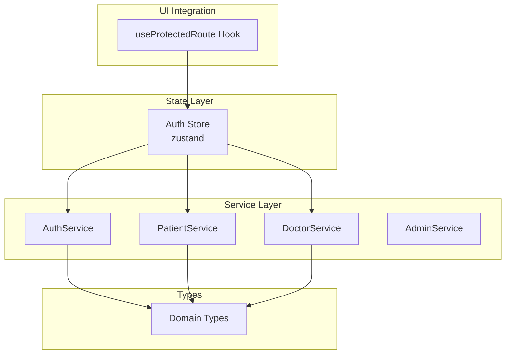
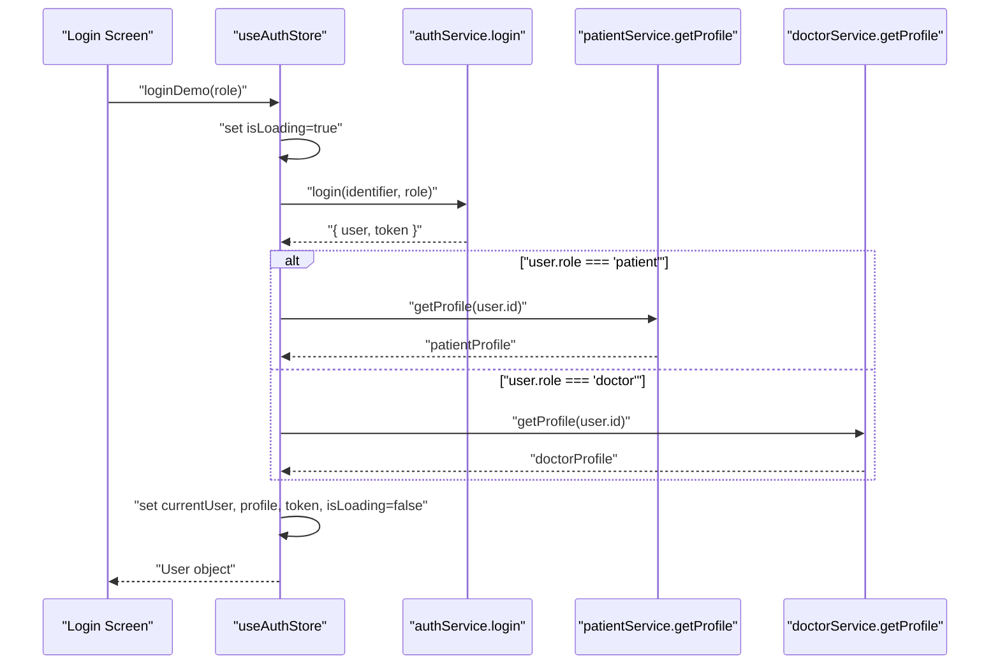
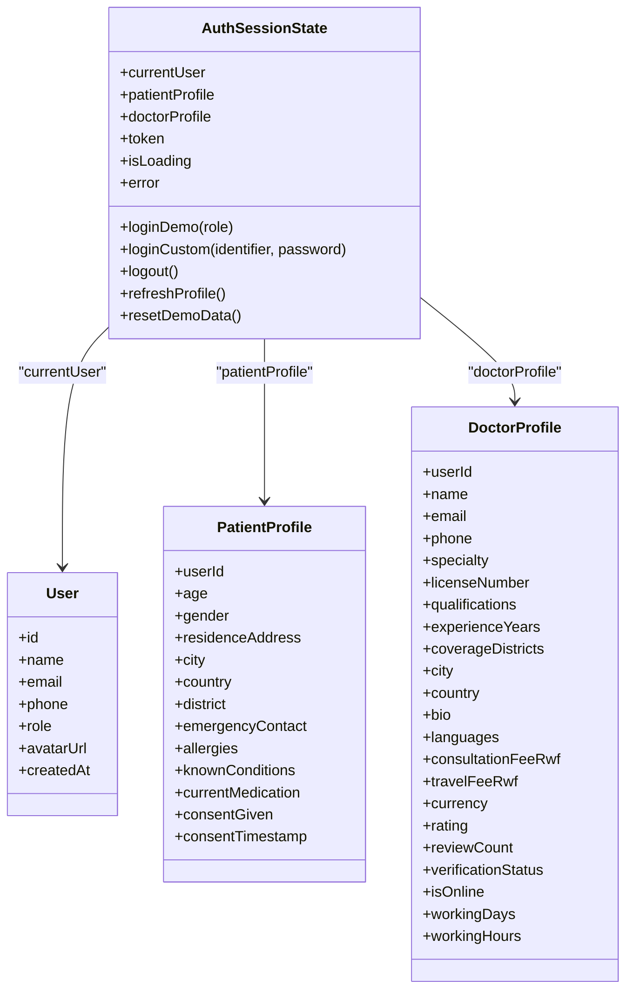
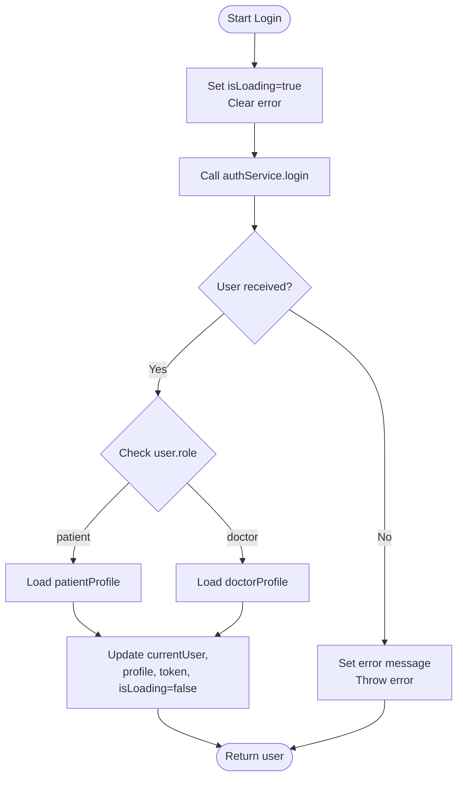
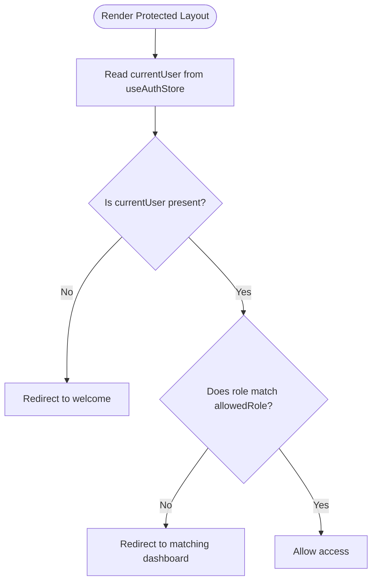
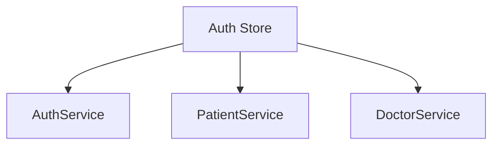
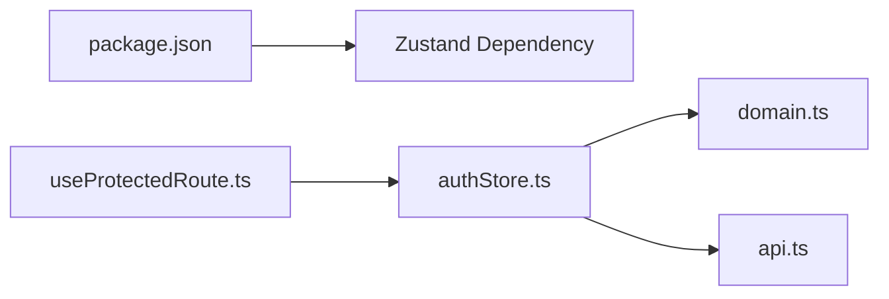

# Global State with Zustand

<cite>
**Referenced Files in This Document**
- [authStore.ts](file://src/stores/authStore.ts)
- [domain.ts](file://src/types/domain.ts)
- [api.ts](file://src/services/api.ts)
- [useProtectedRoute.ts](file://src/hooks/useProtectedRoute.ts)
- [package.json](file://package.json)
</cite>

## Table of Contents
1. [Introduction](#introduction)
2. [Project Structure](#project-structure)
3. [Core Components](#core-components)
4. [Architecture Overview](#architecture-overview)
5. [Detailed Component Analysis](#detailed-component-analysis)
6. [Dependency Analysis](#dependency-analysis)
7. [Performance Considerations](#performance-considerations)
8. [Troubleshooting Guide](#troubleshooting-guide)
9. [Conclusion](#conclusion)
10. [Appendices](#appendices)

## Introduction
This document explains the global state management implementation using Zustand in the mobile application. It focuses on the authentication store, role-based profile loading, session state, and how UI components integrate with the store through hooks. It also provides guidance for creating custom stores, handling asynchronous operations safely, optimizing re-renders with selective subscriptions, debugging state, and applying middleware patterns.

The current implementation uses a single-purpose auth store that manages user identity, tokens, and role-specific profiles. Authentication integrates with an API service layer that supports live backend calls with graceful fallbacks to mock data. Route protection is implemented via a hook that reads from the auth store and redirects users based on their roles.

## Project Structure
The relevant parts of the project structure for global state are:

- `src/stores/authStore.ts`: Zustand store defining auth state, actions, and role-based profile loading.
- `src/types/domain.ts`: Domain types for users, patient profiles, doctor profiles, and related entities.
- `src/services/api.ts`: Service contracts and implementations for authentication, patient, doctor, and admin operations.
- `src/hooks/useProtectedRoute.ts`: Hook that enforces role-based route access by reading from the auth store.
- `package.json`: Declares the Zustand dependency used across the app.

**Diagram sources**
- [authStore.ts:1-112](file://src/stores/authStore.ts#L1-L112)
- [api.ts:25-245](file://src/services/api.ts#L25-L245)
- [api.ts:247-430](file://src/services/api.ts#L247-L430)
- [api.ts:432-585](file://src/services/api.ts#L432-L585)
- [domain.ts:29-85](file://src/types/domain.ts#L29-L85)
- [useProtectedRoute.ts:1-40](file://src/hooks/useProtectedRoute.ts#L1-L40)

**Section sources**
- [authStore.ts:1-112](file://src/stores/authStore.ts#L1-L112)
- [api.ts:1-660](file://src/services/api.ts#L1-L660)
- [domain.ts:1-242](file://src/types/domain.ts#L1-L242)
- [useProtectedRoute.ts:1-40](file://src/hooks/useProtectedRoute.ts#L1-L40)
- [package.json:1-36](file://package.json#L1-L36)

## Core Components
The core global state component is the auth store. It encapsulates:

- User identity (`currentUser`)
- Role-specific profiles (`patientProfile`, `doctorProfile`)
- Session token (`token`)
- Loading and error states (`isLoading`, `error`)
- Actions for login (demo and custom), logout, profile refresh, and demo reset

Key responsibilities:
- Authenticate users via the API service layer.
- Load the correct profile type based on the authenticated user’s role.
- Manage session state and provide safe logout behavior.
- Expose a refresh action to update role-specific profiles without full re-authentication.

Selectors and computed properties:
- The store currently exposes raw state fields rather than derived selectors. Consumers can subscribe to specific fields directly when using the store hook.
- Computed values such as “isAuthenticated” or “currentRole” can be added later as memoized selectors if needed.

Persistence:
- There is no explicit persistence middleware configured in the store. Token and user state are held in memory during the app lifecycle.

**Section sources**
- [authStore.ts:7-21](file://src/stores/authStore.ts#L7-L21)
- [authStore.ts:23-111](file://src/stores/authStore.ts#L23-L111)

## Architecture Overview
The authentication flow integrates three layers:

1. UI layer: Screens call store actions like `loginDemo` or `loginCustom`.
2. Store layer: The auth store coordinates authentication and profile loading.
3. Service layer: Services perform network requests with fallbacks to mock data.

**Diagram sources**
- [authStore.ts:31-56](file://src/stores/authStore.ts#L31-L56)
- [authStore.ts:58-83](file://src/stores/authStore.ts#L58-L83)
- [api.ts:46-104](file://src/services/api.ts#L46-L104)
- [api.ts:274-278](file://src/services/api.ts#L274-L278)
- [api.ts:468-472](file://src/services/api.ts#L468-L472)

## Detailed Component Analysis

### Auth Store Architecture
The auth store defines a typed state interface and a Zustand creator function that returns state plus actions.

State shape:
- `currentUser`: Current authenticated user or null.
- `patientProfile`: Profile for patients; null otherwise.
- `doctorProfile`: Profile for doctors; null otherwise.
- `token`: Access token string or null.
- `isLoading`: Boolean indicating ongoing async operations.
- `error`: Error message string or null.

Actions:
- `loginDemo(role)`: Logs in using a demo role and loads the corresponding profile.
- `loginCustom(identifier, password?)`: Logs in with credentials and loads the corresponding profile.
- `logout()`: Clears all auth-related state.
- `refreshProfile()`: Refreshes the role-specific profile for the current user.
- `resetDemoData()`: Resets mock domain data and refreshes the profile.

Error handling:
- Both login actions set `isLoading` and clear previous errors before attempting authentication.
- On failure, they set an error message and throw the original error so callers can handle it.

Computed properties and selectors:
- No derived selectors are defined. Consumers should subscribe to specific fields to avoid unnecessary re-renders.

Persistence:
- Not implemented. If persistence is required, consider adding a middleware that persists `token` and `currentUser` to secure storage.

**Diagram sources**
- [authStore.ts:7-21](file://src/stores/authStore.ts#L7-L21)
- [domain.ts:29-85](file://src/types/domain.ts#L29-L85)

**Section sources**
- [authStore.ts:7-21](file://src/stores/authStore.ts#L7-L21)
- [authStore.ts:23-111](file://src/stores/authStore.ts#L23-L111)
- [domain.ts:29-85](file://src/types/domain.ts#L29-L85)

### Authentication Flow and Role-Based Profile Loading
The authentication flow performs these steps:

1. Set loading state and clear previous errors.
2. Call `authService.login` with either a demo role or real credentials.
3. Based on the returned user’s role:
   - For patients: load `patientProfile` via `patientService.getProfile`.
   - For doctors: load `doctorProfile` via `doctorService.getProfile`.
4. Update store state with user, profile, token, and loading status.
5. Return the user object to the caller.

**Diagram sources**
- [authStore.ts:31-56](file://src/stores/authStore.ts#L31-L56)
- [authStore.ts:58-83](file://src/stores/authStore.ts#L58-L83)
- [api.ts:46-104](file://src/services/api.ts#L46-L104)
- [api.ts:274-278](file://src/services/api.ts#L274-L278)
- [api.ts:468-472](file://src/services/api.ts#L468-L472)

**Section sources**
- [authStore.ts:31-83](file://src/stores/authStore.ts#L31-L83)
- [api.ts:46-104](file://src/services/api.ts#L46-L104)
- [api.ts:274-278](file://src/services/api.ts#L274-L278)
- [api.ts:468-472](file://src/services/api.ts#L468-L472)

### Logout and Session Management
Logout clears all authentication-related state:
- Removes `currentUser`, `patientProfile`, `doctorProfile`, `token`, and `error`.

This ensures that subsequent navigation and UI rendering treat the user as unauthenticated.

Best practices:
- Always call logout after successful sign-out flows.
- Clear any local caches or navigation stacks if necessary at the UI layer.

**Section sources**
- [authStore.ts:85-93](file://src/stores/authStore.ts#L85-L93)

### Profile Refresh
The `refreshProfile` action updates only the role-specific profile for the current user:
- If the user is a patient, it fetches and sets `patientProfile`.
- If the user is a doctor, it fetches and sets `doctorProfile`.

This allows UI components to refresh profile data without re-authenticating.

**Section sources**
- [authStore.ts:95-105](file://src/stores/authStore.ts#L95-L105)
- [api.ts:274-278](file://src/services/api.ts#L274-L278)
- [api.ts:468-472](file://src/services/api.ts#L468-L472)

### Demo Data Reset
The `resetDemoData` action resets mock domain data and then refreshes the current profile. This is useful for development and testing scenarios where you want to return to default mock state while keeping the current user context.

**Section sources**
- [authStore.ts:107-110](file://src/stores/authStore.ts#L107-L110)

### Route Protection and Role-Based Navigation
The protected route hook reads `currentUser` from the auth store and enforces role-based navigation:
- If no user is logged in, redirect to the welcome screen.
- If the user has a different role than allowed, redirect to the appropriate dashboard layout.
- Returns a boolean indicating whether the current user is authorized for the requested role.

**Diagram sources**
- [useProtectedRoute.ts:11-38](file://src/hooks/useProtectedRoute.ts#L11-L38)

**Section sources**
- [useProtectedRoute.ts:1-40](file://src/hooks/useProtectedRoute.ts#L1-L40)

### Service Layer Integration
The services define contracts and implementations for:
- Authentication: login, OTP verification, registration, current user retrieval, password reset.
- Patient operations: profile retrieval and updates, specialty listing, doctor search, visit management, records, reviews, complaints.
- Doctor operations: profile retrieval, availability slots, visit acceptance/decline, consultation records, lab results.
- Admin operations: doctor verification, visits, complaints, audit logs, platform metrics.

The auth store depends primarily on `authService`, `patientService`, and `doctorService`.

**Diagram sources**
- [authStore.ts:1-5](file://src/stores/authStore.ts#L1-L5)
- [api.ts:25-245](file://src/services/api.ts#L25-L245)
- [api.ts:247-430](file://src/services/api.ts#L247-L430)
- [api.ts:432-585](file://src/services/api.ts#L432-L585)

**Section sources**
- [api.ts:1-660](file://src/services/api.ts#L1-L660)

## Dependency Analysis
The dependencies between modules are straightforward:

- The auth store imports domain types and service contracts.
- The services import domain types and mock fixtures/store for fallback behavior.
- The protected route hook imports the auth store.
- The package manifest declares Zustand as a runtime dependency.

**Diagram sources**
- [package.json:1-36](file://package.json#L1-L36)
- [authStore.ts:1-5](file://src/stores/authStore.ts#L1-L5)
- [useProtectedRoute.ts:1-8](file://src/hooks/useProtectedRoute.ts#L1-L8)

**Section sources**
- [package.json:1-36](file://package.json#L1-L36)
- [authStore.ts:1-5](file://src/stores/authStore.ts#L1-L5)
- [useProtectedRoute.ts:1-8](file://src/hooks/useProtectedRoute.ts#L1-L8)

## Performance Considerations
To optimize performance with Zustand:

- Selective subscriptions: Subscribe only to the fields your component needs. For example, a header component might subscribe only to `currentUser` and `token`, avoiding re-renders caused by profile changes.
- Avoid large derived computations inside components; prefer memoized selectors in the store if you need computed values.
- Batch state updates: The store already batches updates within each action. Keep related state changes together to minimize re-renders.
- Debounce heavy operations: If refreshing profiles frequently, consider debouncing refresh triggers at the UI layer.
- Minimize object churn: Reuse stable references where possible to prevent unnecessary subscriber updates.

[No sources needed since this section provides general guidance]

## Troubleshooting Guide
Common issues and resolutions:

- Login fails with invalid credentials:
  - The service layer falls back to mock data if the backend is unavailable. Ensure identifiers and passwords match known demo users or registered accounts.
  - Check error messages set in the store’s catch blocks.

- Profile not loaded after login:
  - Verify that the user’s role matches expected values (`patient` or `doctor`).
  - Confirm that the corresponding service method returns valid data.

- Unauthorized navigation:
  - Ensure the protected route hook receives the correct `allowedRole`.
  - Confirm that `currentUser.role` is set correctly after login.

- Stale token or user state:
  - Call `logout()` to clear state.
  - Implement persistence and hydration if you need to survive app restarts.

**Section sources**
- [authStore.ts:52-55](file://src/stores/authStore.ts#L52-L55)
- [authStore.ts:79-82](file://src/stores/authStore.ts#L79-L82)
- [useProtectedRoute.ts:14-33](file://src/hooks/useProtectedRoute.ts#L14-L33)

## Conclusion
The auth store provides a clean, role-aware authentication model backed by a service layer that supports both live APIs and mock data. It manages user identity, tokens, and role-specific profiles, and integrates with route protection to enforce access control. While there is no persistence or middleware configured yet, the store is structured to support future enhancements such as selectors, computed properties, persistence, and logging. Following the best practices outlined here will help maintain clean, readable, and performant global state.

[No sources needed since this section summarizes without analyzing specific files]

## Appendices

### Creating Custom Stores
When building additional stores:

- Define a typed state interface describing all state fields.
- Group related actions into a single store to maximize cohesion.
- Use selectors sparingly; prefer direct field subscriptions unless you need derived data.
- Centralize async logic in actions and handle errors consistently.
- Consider middleware for persistence, logging, or undo/redo if needed.

[No sources needed since this section provides general guidance]

### Implementing Async Operations with Proper Error Handling
Patterns used in the auth store:

- Set loading state and clear previous errors before starting async work.
- Wrap network calls in try/catch blocks.
- Set meaningful error messages and propagate errors to callers.
- Reset loading state in both success and failure paths.

**Section sources**
- [authStore.ts:31-56](file://src/stores/authStore.ts#L31-L56)
- [authStore.ts:58-83](file://src/stores/authStore.ts#L58-L83)

### Optimizing Re-renders with Selective Subscriptions
Guidelines:

- Subscribe to minimal state slices in components.
- Avoid subscribing to the entire store unless necessary.
- Extract reusable selectors if you compute derived values frequently.
- Keep state shapes normalized to reduce nested updates.

[No sources needed since this section provides general guidance]

### State Debugging Techniques
Recommendations:

- Log state transitions around key actions like login/logout.
- Add a debug selector that returns a serializable snapshot for inspection.
- Use browser devtools or React Native inspector to inspect store subscribers.
- Introduce a logger middleware to record actions and state diffs.

[No sources needed since this section provides general guidance]

### Middleware Usage
Potential middleware strategies:

- Persistence: Persist `token` and `currentUser` to secure storage and hydrate on app start.
- Logging: Record actions, payloads, and resulting state snapshots.
- Undo/Redo: Snapshot state before mutations for critical workflows.
- Validation: Validate incoming state updates against schema constraints.

[No sources needed since this section provides general guidance]