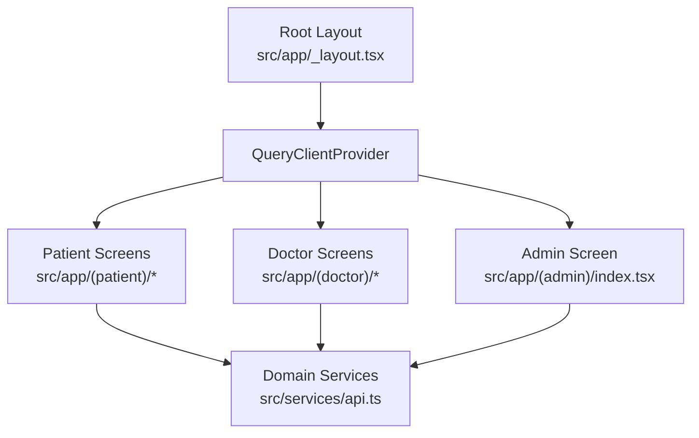
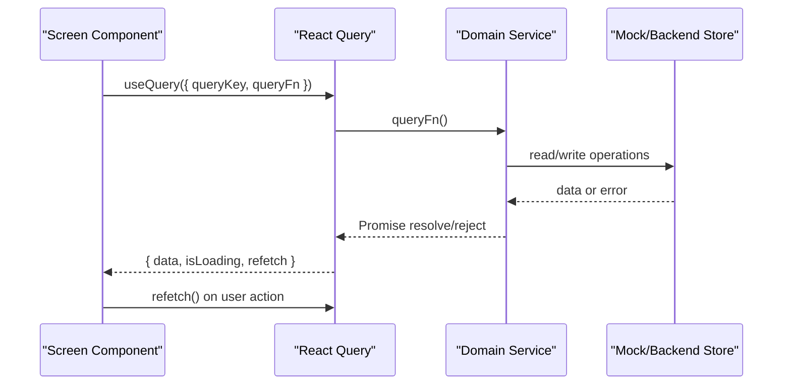
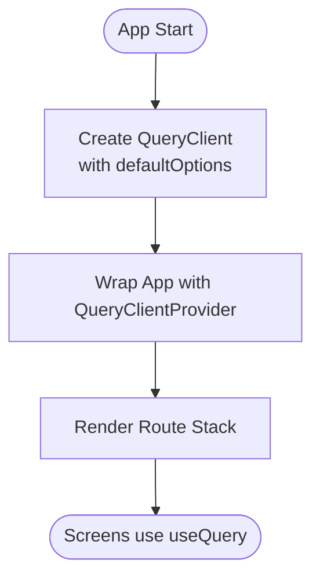
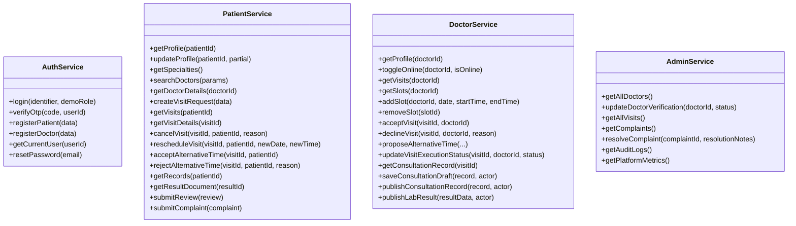
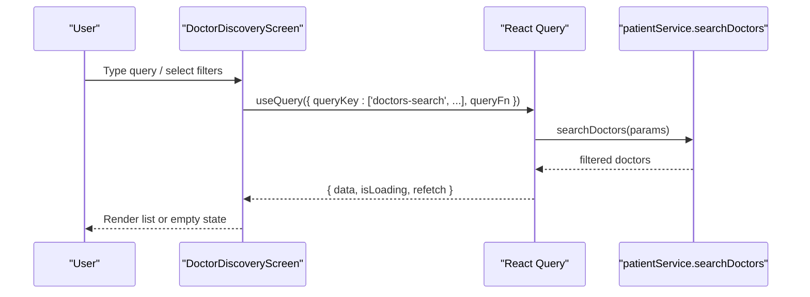
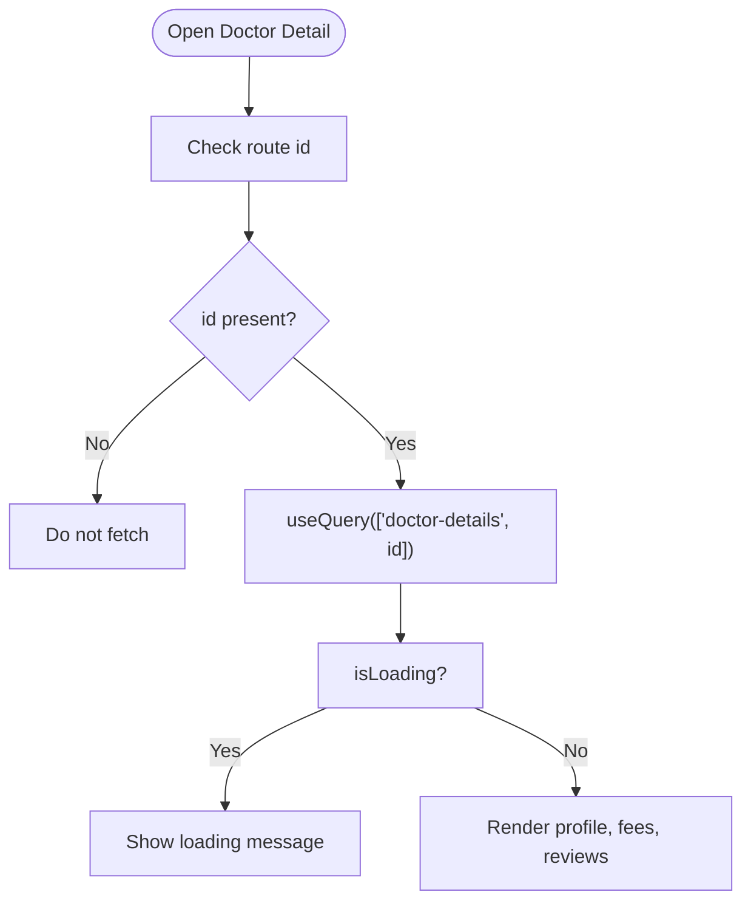
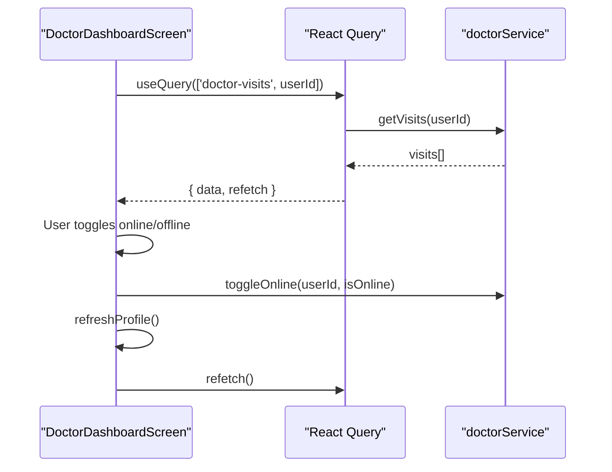
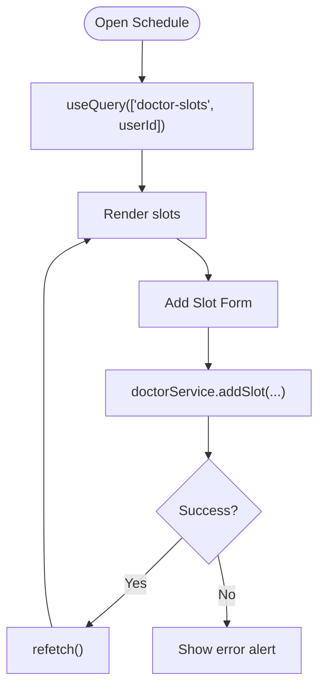
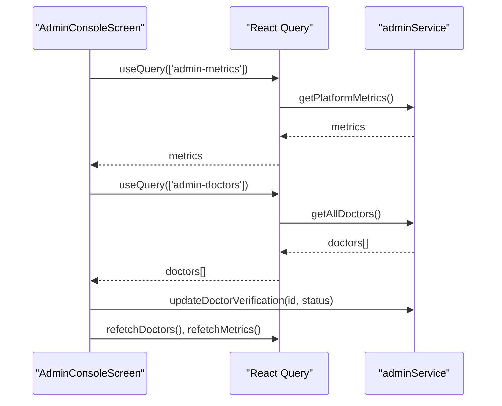
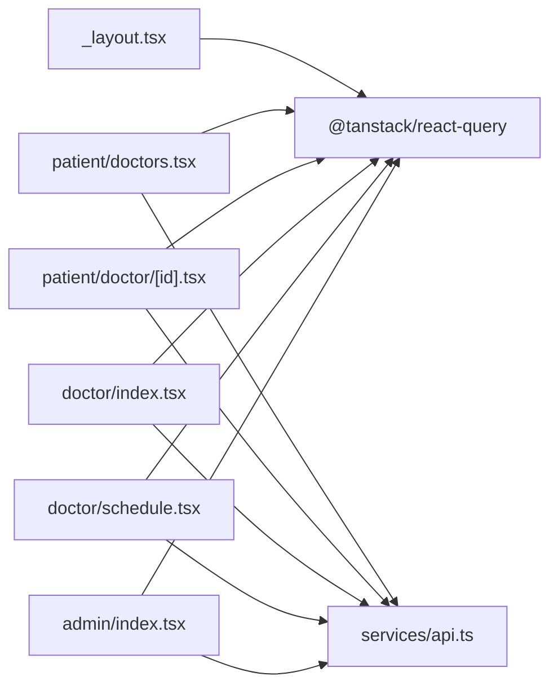

# Server State with React Query

<cite>
**Referenced Files in This Document**
- [package.json](file://package.json)
- [_layout.tsx](file://src/app/_layout.tsx)
- [api.ts](file://src/services/api.ts)
- [doctors.tsx](file://src/app/(patient)/doctors.tsx)
- [doctor-detail.tsx](file://src/app/(patient)/doctor/[id].tsx)
- [doctor-dashboard.tsx](file://src/app/(doctor)/index.tsx)
- [schedule.tsx](file://src/app/(doctor)/schedule.tsx)
- [admin-index.tsx](file://src/app/(admin)/index.tsx)
</cite>

## Table of Contents
1. [Introduction](#introduction)
2. [Project Structure](#project-structure)
3. [Core Components](#core-components)
4. [Architecture Overview](#architecture-overview)
5. [Detailed Component Analysis](#detailed-component-analysis)
6. [Dependency Analysis](#dependency-analysis)
7. [Performance Considerations](#performance-considerations)
8. [Troubleshooting Guide](#troubleshooting-guide)
9. [Conclusion](#conclusion)

## Introduction
This document explains how server state is managed using TanStack React Query in the mobile application. It covers:
- Query configuration and provider setup at the root layout
- Cache management strategies, including default options and stale time
- Automatic data fetching patterns through `useQuery`
- Service layer integration with domain services
- Mutation patterns and manual cache invalidation
- Examples for loading states, search, filtering, and background refetching
- Query key design patterns and performance techniques such as deduplication and stale-time tuning

The goal is to make the server-state architecture clear for both new contributors and maintainers.

## Project Structure
The project uses Expo Router with role-based route groups:
- `(auth)` authentication flows
- `(patient)` patient-facing screens
- `(doctor)` doctor dashboard and scheduling
- `(admin)` platform administration console

React Query is configured once at the root layout and provided globally via `QueryClientProvider`. Data fetching is performed by screen components that call domain services under `services/api.ts`.

**Diagram sources**
- [_layout.tsx:12-19](file://src/app/_layout.tsx#L12-L19)
- [_layout.tsx:60-83](file://src/app/_layout.tsx#L60-L83)
- [api.ts:21-24](file://src/services/api.ts#L21-L24)

**Section sources**
- [_layout.tsx:12-19](file://src/app/_layout.tsx#L12-L19)
- [_layout.tsx:60-83](file://src/app/_layout.tsx#L60-L83)
- [api.ts:21-24](file://src/services/api.ts#L21-L24)

## Core Components
- Query client configuration: A single `QueryClient` instance is created with global defaults for retries and stale time.
- Provider placement: The client is wrapped around the app via `QueryClientProvider` at the root layout.
- Domain services: Centralized service functions abstract data access and simulate latency or call a backend API when available.
- Screen hooks: Each screen composes one or more `useQuery` calls with stable query keys derived from route parameters and local filters.

Key responsibilities:
- `_layout.tsx`: Initializes and provides the query client.
- `api.ts`: Defines typed service contracts and implementations for auth, patient, doctor, and admin domains.
- Screens: Use `useQuery` to fetch, display, and refresh data.

**Section sources**
- [_layout.tsx:12-19](file://src/app/_layout.tsx#L12-L19)
- [_layout.tsx:60-83](file://src/app/_layout.tsx#L60-L83)
- [api.ts:25-41](file://src/services/api.ts#L25-L41)
- [api.ts:247-272](file://src/services/api.ts#L247-L272)
- [api.ts:432-466](file://src/services/api.ts#L432-L466)
- [api.ts:587-602](file://src/services/api.ts#L587-L602)

## Architecture Overview
At runtime:
1. The root layout creates a `QueryClient` with global defaults.
2. `QueryClientProvider` makes the client available to all screens.
3. Screens call `useQuery` with a unique `queryKey` and a `queryFn` that delegates to a domain service.
4. Services encapsulate network or mock logic and return typed data.
5. Screens handle loading states and can manually trigger refetches after mutations.

**Diagram sources**
- [_layout.tsx:12-19](file://src/app/_layout.tsx#L12-L19)
- [_layout.tsx:60-83](file://src/app/_layout.tsx#L60-L83)
- [api.ts:21-24](file://src/services/api.ts#L21-L24)
- [doctors.tsx:31-54](file://src/app/(patient)/doctors.tsx#L31-L54)

## Detailed Component Analysis

### Root Layout: Query Client Configuration and Provider
The root layout:
- Creates a `QueryClient` with:
  - Global retry count
  - Stale time set to one minute
- Wraps the app tree with `QueryClientProvider`
- Integrates navigation stack and session UI

Implications:
- All queries inherit retry and stale-time defaults unless overridden locally.
- The provider ensures consistent caching across routes.

**Diagram sources**
- [_layout.tsx:12-19](file://src/app/_layout.tsx#L12-L19)
- [_layout.tsx:60-83](file://src/app/_layout.tsx#L60-L83)

**Section sources**
- [_layout.tsx:12-19](file://src/app/_layout.tsx#L12-L19)
- [_layout.tsx:60-83](file://src/app/_layout.tsx#L60-L83)

### Service Layer Integration
The service layer defines typed interfaces and implementations:
- `AuthService`: login, OTP verification, registration, current user retrieval, password reset
- `PatientService`: profile CRUD, specialties, doctor search, visit requests, records, reviews, complaints
- `DoctorService`: profile, availability slots, visit lifecycle, consultation records, lab results
- `AdminService`: doctors, visits, complaints, audit logs, metrics

Design notes:
- Services abstract data sources (mock store or live API).
- Simulated latency is applied to mimic real-world network behavior.
- Errors are thrown for invalid operations; callers should handle them.

**Diagram sources**
- [api.ts:25-41](file://src/services/api.ts#L25-L41)
- [api.ts:247-272](file://src/services/api.ts#L247-L272)
- [api.ts:432-466](file://src/services/api.ts#L432-L466)
- [api.ts:587-602](file://src/services/api.ts#L587-L602)

**Section sources**
- [api.ts:21-24](file://src/services/api.ts#L21-L24)
- [api.ts:25-41](file://src/services/api.ts#L25-L41)
- [api.ts:247-272](file://src/services/api.ts#L247-L272)
- [api.ts:432-466](file://src/services/api.ts#L432-L466)
- [api.ts:587-602](file://src/services/api.ts#L587-L602)

### Patient Doctor Discovery: Search and Filtering
The discovery screen demonstrates:
- Fetching static reference data (specialties)
- Dynamic search with multiple filter parameters
- Query key composition including search text and filter values
- Loading and empty states

**Diagram sources**
- [doctors.tsx:31-54](file://src/app/(patient)/doctors.tsx#L31-L54)
- [api.ts:290-323](file://src/services/api.ts#L290-L323)

**Section sources**
- [doctors.tsx:31-54](file://src/app/(patient)/doctors.tsx#L31-L54)
- [doctors.tsx:192-221](file://src/app/(patient)/doctors.tsx#L192-L221)
- [api.ts:290-323](file://src/services/api.ts#L290-L323)

### Doctor Details: Parameterized Query
The doctor detail screen shows:
- Parameterized query key based on route id
- Conditional execution with `enabled`
- Loading state handling before rendering content

**Diagram sources**
- [doctor-detail.tsx:22-34](file://src/app/(patient)/doctor/[id].tsx#L22-L34)

**Section sources**
- [doctor-detail.tsx:22-34](file://src/app/(patient)/doctor/[id].tsx#L22-L34)

### Doctor Dashboard: Refetch After Mutations
The dashboard:
- Fetches the current user’s visits
- Provides pull-to-refresh that triggers refetch and profile refresh
- Updates online/offline status and refreshes profile afterward

**Diagram sources**
- [doctor-dashboard.tsx:29-49](file://src/app/(doctor)/index.tsx#L29-L49)
- [api.ts:468-477](file://src/services/api.ts#L468-L477)

**Section sources**
- [doctor-dashboard.tsx:29-49](file://src/app/(doctor)/index.tsx#L29-L49)
- [api.ts:468-477](file://src/services/api.ts#L468-L477)

### Schedule Management: Manual Refetch Pattern
The schedule screen:
- Lists availability slots per doctor
- Adds/removes slots and calls `refetch()` to update the list
- Demonstrates optimistic UX by immediately updating UI after successful mutation

**Diagram sources**
- [schedule.tsx:28-58](file://src/app/(doctor)/schedule.tsx#L28-L58)
- [api.ts:489-506](file://src/services/api.ts#L489-L506)

**Section sources**
- [schedule.tsx:28-58](file://src/app/(doctor)/schedule.tsx#L28-L58)
- [api.ts:489-506](file://src/services/api.ts#L489-L506)

### Admin Console: Multiple Queries and Manual Invalidation
The admin console:
- Uses multiple independent queries for metrics, doctors, complaints, and audit logs
- Performs manual invalidation by calling `refetch()` for each relevant query after mutations
- Implements pull-to-refresh to batch refetch all queries

**Diagram sources**
- [admin-index.tsx:67-105](file://src/app/(admin)/index.tsx#L67-L105)
- [api.ts:604-613](file://src/services/api.ts#L604-L613)

**Section sources**
- [admin-index.tsx:67-105](file://src/app/(admin)/index.tsx#L67-L105)
- [api.ts:604-613](file://src/services/api.ts#L604-L613)

## Dependency Analysis
The following diagram maps the primary dependencies between screens, services, and the query client.

**Diagram sources**
- [_layout.tsx:60-83](file://src/app/_layout.tsx#L60-L83)
- [doctors.tsx:12-15](file://src/app/(patient)/doctors.tsx#L12-L15)
- [doctor-detail.tsx:12-15](file://src/app/(patient)/doctor/[id].tsx#L12-L15)
- [doctor-dashboard.tsx:15-18](file://src/app/(doctor)/index.tsx#L15-L18)
- [schedule.tsx:10-14](file://src/app/(doctor)/schedule.tsx#L10-L14)
- [admin-index.tsx:15-20](file://src/app/(admin)/index.tsx#L15-L20)
- [api.ts:21-24](file://src/services/api.ts#L21-L24)

**Section sources**
- [_layout.tsx:60-83](file://src/app/_layout.tsx#L60-L83)
- [doctors.tsx:12-15](file://src/app/(patient)/doctors.tsx#L12-L15)
- [doctor-detail.tsx:12-15](file://src/app/(patient)/doctor/[id].tsx#L12-L15)
- [doctor-dashboard.tsx:15-18](file://src/app/(doctor)/index.tsx#L15-L18)
- [schedule.tsx:10-14](file://src/app/(doctor)/schedule.tsx#L10-L14)
- [admin-index.tsx:15-20](file://src/app/(admin)/index.tsx#L15-L20)
- [api.ts:21-24](file://src/services/api.ts#L21-L24)

## Performance Considerations
- Query deduplication: React Query automatically deduplicates identical queries within the same scope. Ensure stable query keys to benefit from this.
- Stale time: Global stale time is set to one minute. Adjust per-query if needed for frequently changing data.
- Retry policy: Global retry is set to one attempt. For critical endpoints, consider increasing retries or customizing retry conditions.
- Pagination: Not implemented yet. When adding pagination, prefer page-based or cursor-based keys and avoid re-fetching entire datasets.
- Background refetching: Use `refetch()` after mutations or integrate polling where appropriate.
- Memory usage: Avoid overly large query keys; keep only necessary identifiers and filters.

[No sources needed since this section provides general guidance]

## Troubleshooting Guide
Common issues and resolutions:
- Empty results during search:
  - Verify query key includes all active filters.
  - Confirm service filters match expected parameter names.
- Stale data after mutation:
  - Ensure you call `refetch()` for affected queries after successful mutations.
- Network errors:
  - Check service fallback behavior and error throwing.
  - Inspect global retry settings and consider endpoint-specific overrides.
- Unnecessary re-renders:
  - Stabilize query keys and avoid creating new objects inline.
- Loading state not shown:
  - Handle `isLoading` and early return patterns consistently.

**Section sources**
- [doctors.tsx:31-54](file://src/app/(patient)/doctors.tsx#L31-L54)
- [doctor-dashboard.tsx:35-49](file://src/app/(doctor)/index.tsx#L35-L49)
- [schedule.tsx:34-58](file://src/app/(doctor)/schedule.tsx#L34-L58)
- [admin-index.tsx:93-115](file://src/app/(admin)/index.tsx#L93-L115)

## Conclusion
The application uses React Query effectively to manage server state:
- A single `QueryClient` is configured at the root layout and provided globally.
- Domain services encapsulate data access and provide a clean abstraction for screens.
- Screens compose `useQuery` with stable query keys, handle loading states, and trigger refetches after mutations.
- While explicit mutations via `useMutation` are not used in the current codebase, the existing pattern of calling services and then refetching related queries serves as a practical approach to cache invalidation.

For future enhancements:
- Introduce `useMutation` for write operations to leverage built-in optimistic updates and automatic cache updates.
- Implement pagination for large lists like doctors and visits.
- Tune stale times and retry policies per endpoint based on data volatility.

[No sources needed since this section summarizes without analyzing specific files]