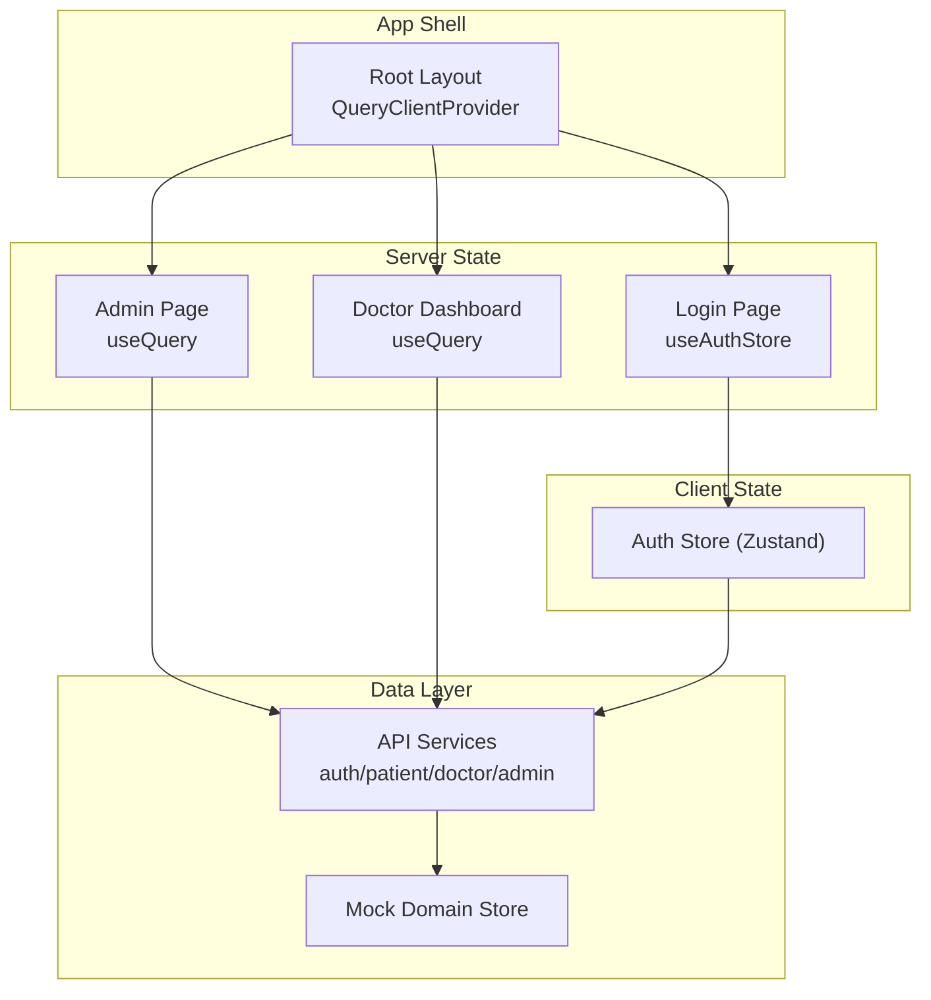
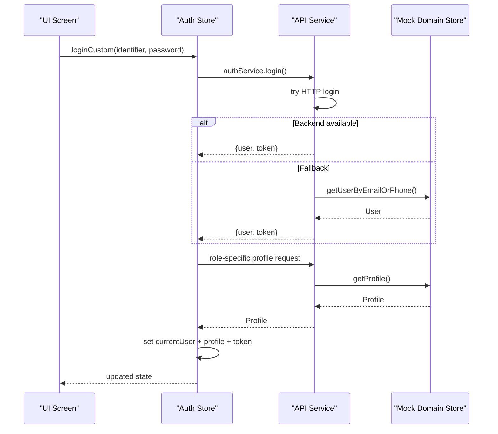
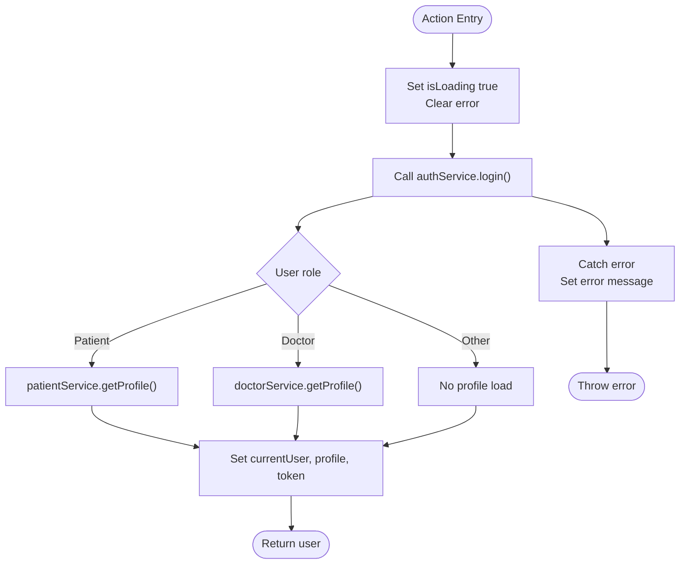
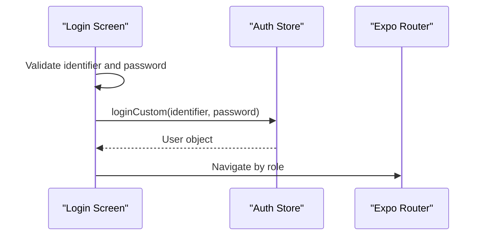
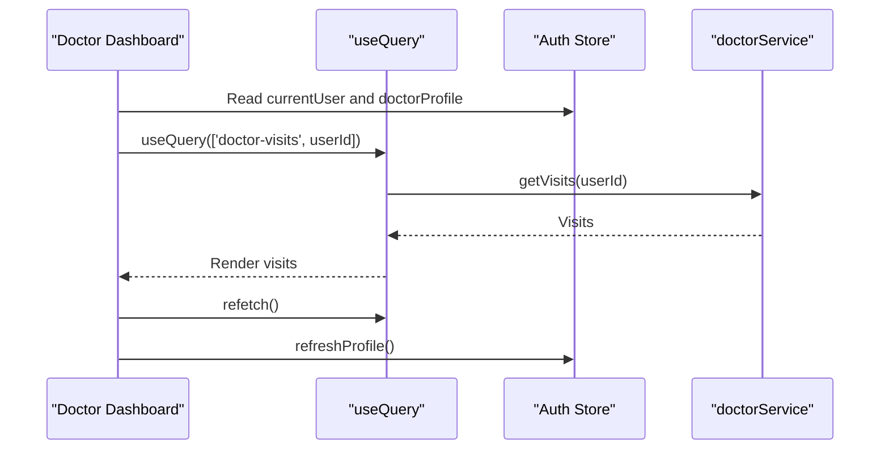
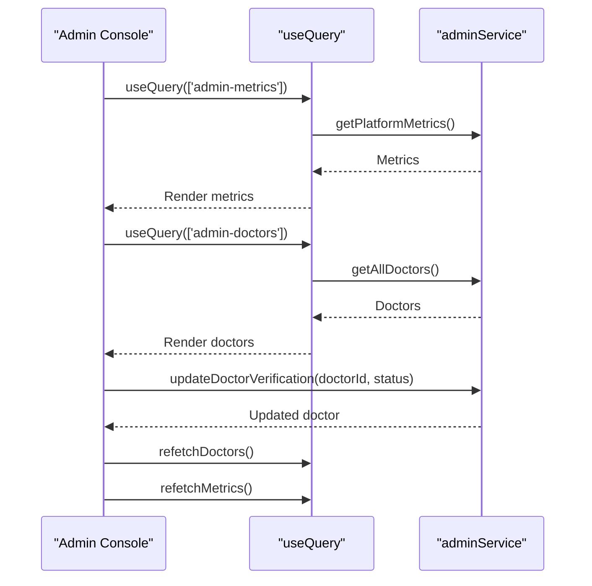
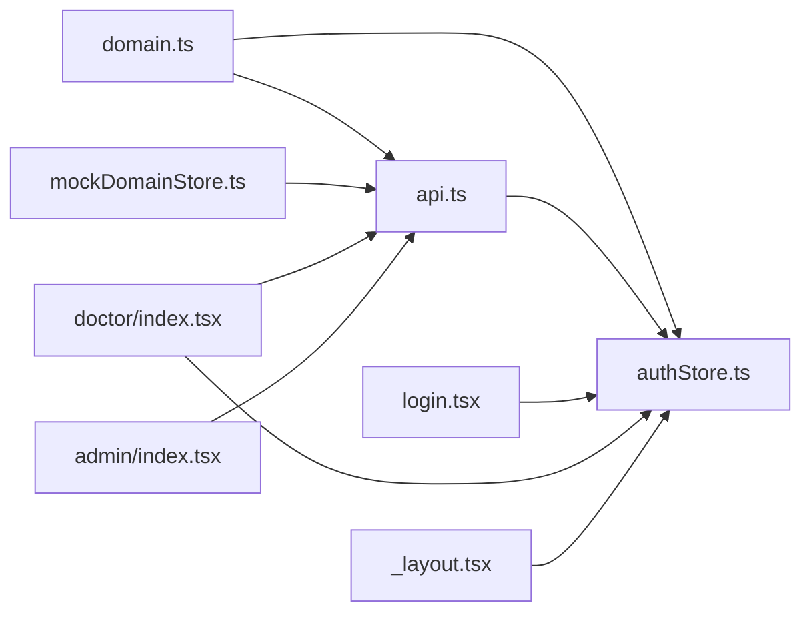

# State Management

<cite>
**Referenced Files in This Document**   
- [authStore.ts](file://src/stores/authStore.ts)
- [api.ts](file://src/services/api.ts)
- [domain.ts](file://src/types/domain.ts)
- [_layout.tsx](file://src/app/_layout.tsx)
- [login.tsx](file://src/app/(auth)/login.tsx)
- [index.tsx](file://src/app/(doctor)/index.tsx)
- [index.tsx](file://src/app/(admin)/index.tsx)
- [mockDomainStore.ts](file://src/mock/mockDomainStore.ts)
- [package.json](file://package.json)
</cite>

## Table of Contents
1. [Introduction](#introduction)
2. [Project Structure](#project-structure)
3. [Core Components](#core-components)
4. [Architecture Overview](#architecture-overview)
5. [Detailed Component Analysis](#detailed-component-analysis)
6. [Dependency Analysis](#dependency-analysis)
7. [Performance Considerations](#performance-considerations)
8. [Troubleshooting Guide](#troubleshooting-guide)
9. [Conclusion](#conclusion)

## Introduction
This document explains the state management architecture for the HomeCare mobile application. It focuses on:
- Client-side session and profile state using Zustand
- Server-state fetching, caching, and refetching with TanStack React Query
- Authentication flows, role-based profile loading, and session synchronization
- Mock service layer behavior and how it integrates with both stores
- Practical patterns for creating custom stores, handling async operations, and maintaining clean state boundaries

The current implementation uses:
- Zustand for global client-side state such as authentication, token, and loaded profiles
- TanStack React Query for server data like visits, admin metrics, complaints, audit logs, and doctor details
- A mock domain store that simulates backend persistence and domain rules

## Project Structure
State-related code is organized into clear layers:
- Types define shared domain models
- Services encapsulate asynchronous operations and mock or real API calls
- Stores manage client-side reactive state
- Pages consume stores and queries to render UI
- Root layout provides QueryClientProvider and a session bar

**Diagram sources**
- [_layout.tsx:12-19](file://src/app/_layout.tsx#L12-L19)
- [_layout.tsx:57-85](file://src/app/_layout.tsx#L57-L85)
- [authStore.ts:23-111](file://src/stores/authStore.ts#L23-L111)
- [api.ts:46-245](file://src/services/api.ts#L46-L245)
- [api.ts:274-430](file://src/services/api.ts#L274-L430)
- [api.ts:468-585](file://src/services/api.ts#L468-L585)
- [api.ts:604-659](file://src/services/api.ts#L604-L659)
- [login.tsx:17-46](file://src/app/(auth)/login.tsx#L17-L46)
- [index.tsx:25-39](file://src/app/(doctor)/index.tsx#L25-L39)
- [index.tsx:67-85](file://src/app/(admin)/index.tsx#L67-L85)

**Section sources**
- [_layout.tsx:12-19](file://src/app/_layout.tsx#L12-L19)
- [_layout.tsx:57-85](file://src/app/_layout.tsx#L57-L85)
- [package.json:5-21](file://package.json#L5-L21)

## Core Components
This section summarizes the main state-management building blocks.

### Global State with Zustand
The auth store manages:
- Current user
- Role-specific profile
- Token
- Loading and error flags
- Login, logout, profile refresh, and demo reset actions

It coordinates with services to authenticate users and load their role-specific profile.

**Section sources**
- [authStore.ts:7-21](file://src/stores/authStore.ts#L7-L21)
- [authStore.ts:23-111](file://src/stores/authStore.ts#L23-L111)

### Server State with React Query
Pages use `useQuery` to fetch:
- Admin metrics, doctors, complaints, and audit logs
- Doctor visits
- Other domain resources through service functions

The root layout configures a single `QueryClient` with retry and stale-time defaults.

**Section sources**
- [_layout.tsx:12-19](file://src/app/_layout.tsx#L12-L19)
- [index.tsx:67-85](file://src/app/(admin)/index.tsx#L67-L85)
- [index.tsx:29-33](file://src/app/(doctor)/index.tsx#L29-L33)

### Service Layer
The service layer defines typed interfaces and implementations for:
- Authentication
- Patient operations
- Doctor operations
- Admin operations

Most methods currently simulate latency and delegate mutations to the mock domain store.

**Section sources**
- [api.ts:25-41](file://src/services/api.ts#L25-L41)
- [api.ts:46-245](file://src/services/api.ts#L46-L245)
- [api.ts:247-272](file://src/services/api.ts#L247-L272)
- [api.ts:274-430](file://src/services/api.ts#L274-L430)
- [api.ts:432-466](file://src/services/api.ts#L432-L466)
- [api.ts:468-585](file://src/services/api.ts#L468-L585)
- [api.ts:587-602](file://src/services/api.ts#L587-L602)
- [api.ts:604-659](file://src/services/api.ts#L604-L659)

### Mock Domain Store
The mock store acts as an in-memory database with:
- Account isolation
- Domain validation
- Visit lifecycle transitions
- Notification generation
- Audit logging

It is used by services and can be reset from the UI.

**Section sources**
- [mockDomainStore.ts:35-70](file://src/mock/mockDomainStore.ts#L35-L70)
- [mockDomainStore.ts:72-127](file://src/mock/mockDomainStore.ts#L72-L127)
- [mockDomainStore.ts:129-168](file://src/mock/mockDomainStore.ts#L129-L168)
- [mockDomainStore.ts:170-220](file://src/mock/mockDomainStore.ts#L170-L220)
- [mockDomainStore.ts:222-380](file://src/mock/mockDomainStore.ts#L222-L380)
- [mockDomainStore.ts:382-464](file://src/mock/mockDomainStore.ts#L382-L464)
- [mockDomainStore.ts:466-557](file://src/mock/mockDomainStore.ts#L466-L557)

### Domain Types
Shared types define roles, statuses, and entities such as users, patient profiles, doctor profiles, visits, results, and audit logs.

**Section sources**
- [domain.ts:5-28](file://src/types/domain.ts#L5-L28)
- [domain.ts:29-85](file://src/types/domain.ts#L29-L85)
- [domain.ts:87-171](file://src/types/domain.ts#L87-L171)
- [domain.ts:173-242](file://src/types/domain.ts#L173-L242)

## Architecture Overview
The application separates concerns between:
- Client-side session state (Zustand)
- Server-side data fetching and caching (React Query)
- Service contracts (API layer)
- In-memory domain persistence (mock store)
- Typed domain models

**Diagram sources**
- [authStore.ts:58-83](file://src/stores/authStore.ts#L58-L83)
- [api.ts:46-104](file://src/services/api.ts#L46-L104)
- [api.ts:274-278](file://src/services/api.ts#L274-L278)
- [api.ts:468-472](file://src/services/api.ts#L468-L472)
- [mockDomainStore.ts:134-142](file://src/mock/mockDomainStore.ts#L134-L142)

## Detailed Component Analysis

### Authentication Store
The auth store implements:
- Demo login and custom login
- Role-based profile loading
- Logout
- Profile refresh
- Demo data reset

Key behaviors:
- Login sets loading and clears previous errors before attempting authentication
- After successful login, it loads either a patient or doctor profile based on role
- Errors are captured and exposed via store state
- Logout resets all session fields
- Refresh updates only the relevant profile field
- Reset demo data triggers mock store reset and profile refresh

**Diagram sources**
- [authStore.ts:31-56](file://src/stores/authStore.ts#L31-L56)
- [authStore.ts:58-83](file://src/stores/authStore.ts#L58-L83)
- [authStore.ts:85-110](file://src/stores/authStore.ts#L85-L110)

**Section sources**
- [authStore.ts:7-21](file://src/stores/authStore.ts#L7-L21)
- [authStore.ts:23-111](file://src/stores/authStore.ts#L23-L111)

### Login Flow
The login screen validates input, calls the auth store, and navigates based on role.

Behavior highlights:
- Validates email or phone and password
- Clears previous error messages
- Navigates to patient, doctor, or admin routes after successful login
- Displays authentication failure messages

**Diagram sources**
- [login.tsx:17-46](file://src/app/(auth)/login.tsx#L17-L46)
- [authStore.ts:58-83](file://src/stores/authStore.ts#L58-L83)

**Section sources**
- [login.tsx:17-46](file://src/app/(auth)/login.tsx#L17-L46)

### Doctor Dashboard Queries
The doctor dashboard:
- Loads visits for the current user
- Uses the auth store for current user and profile
- Supports pull-to-refresh that refetches visits and refreshes the profile

**Diagram sources**
- [index.tsx:25-39](file://src/app/(doctor)/index.tsx#L25-L39)
- [api.ts:468-482](file://src/services/api.ts#L468-L482)
- [authStore.ts:95-105](file://src/stores/authStore.ts#L95-L105)

**Section sources**
- [index.tsx:25-39](file://src/app/(doctor)/index.tsx#L25-L39)

### Admin Console Queries and Mutations
The admin console:
- Fetches platform metrics, doctors, complaints, and audit logs
- Refetches multiple queries together during manual refresh
- Performs mutations such as updating doctor verification status and resolving complaints
- Updates local query caches by calling refetch functions

**Diagram sources**
- [index.tsx:67-85](file://src/app/(admin)/index.tsx#L67-L85)
- [index.tsx:93-105](file://src/app/(admin)/index.tsx#L93-L105)
- [api.ts:604-613](file://src/services/api.ts#L604-L613)
- [api.ts:635-659](file://src/services/api.ts#L635-L659)

**Section sources**
- [index.tsx:67-121](file://src/app/(admin)/index.tsx#L67-L121)

### Root Query Client Configuration
The root layout creates a `QueryClient` and wraps the app with `QueryClientProvider`. Default options include:
- One retry
- One-minute stale time

A session bar reads the auth store to display the current user and provide logout and demo reset actions.

**Section sources**
- [_layout.tsx:12-19](file://src/app/_layout.tsx#L12-L19)
- [_layout.tsx:21-55](file://src/app/_layout.tsx#L21-L55)
- [_layout.tsx:57-85](file://src/app/_layout.tsx#L57-L85)

## Dependency Analysis
The following diagram shows how components and modules depend on each other for state management.

**Diagram sources**
- [domain.ts:5-242](file://src/types/domain.ts#L5-L242)
- [mockDomainStore.ts:1-557](file://src/mock/mockDomainStore.ts#L1-L557)
- [api.ts:1-660](file://src/services/api.ts#L1-L660)
- [authStore.ts:1-112](file://src/stores/authStore.ts#L1-L112)
- [login.tsx:1-174](file://src/app/(auth)/login.tsx#L1-L174)
- [index.tsx:1-329](file://src/app/(doctor)/index.tsx#L1-L329)
- [index.tsx:1-800](file://src/app/(admin)/index.tsx#L1-L800)
- [_layout.tsx:1-133](file://src/app/_layout.tsx#L1-L133)

**Section sources**
- [api.ts:1-660](file://src/services/api.ts#L1-L660)
- [authStore.ts:1-112](file://src/stores/authStore.ts#L1-L112)
- [mockDomainStore.ts:1-557](file://src/mock/mockDomainStore.ts#L1-L557)

## Performance Considerations
Current performance characteristics:
- React Query default stale time is one minute, reducing frequent refetches
- Retry count is limited to one, preventing aggressive retries
- Services add simulated latency to mimic network delays
- Admin page batches refetches during manual refresh

Recommendations:
- Use `select` or derived selectors in components to avoid unnecessary re-renders
- Cache frequently accessed read-only data longer when appropriate
- Prefer optimistic updates for low-risk mutations where possible
- Debounce search inputs before triggering queries
- Avoid reading large objects directly from Zustand; prefer small slices or memoized selectors

[No sources needed since this section provides general guidance]

## Troubleshooting Guide

### Common Issues and Resolutions
- Authentication fails with invalid credentials
  - The service falls back to the mock store if the backend is unavailable
  - Ensure identifiers match registered mock users or valid credentials
- Profile not loaded after login
  - Verify role-based profile loading logic
  - Check that the correct service method is called for the user’s role
- Doctor visits not refreshing
  - Confirm that `refetch()` is called after mutations
  - Ensure `currentUser` is present so the query key includes the user id
- Admin mutations do not update UI
  - Call the corresponding `refetch*` function after mutation success
  - Verify that the mock store returns updated data

**Section sources**
- [api.ts:46-104](file://src/services/api.ts#L46-L104)
- [authStore.ts:31-83](file://src/stores/authStore.ts#L31-L83)
- [index.tsx:29-39](file://src/app/(doctor)/index.tsx#L29-L39)
- [index.tsx:93-121](file://src/app/(admin)/index.tsx#L93-L121)

### Debugging Approaches
- Inspect auth store state by subscribing to `useAuthStore` in development screens
- Use React Query DevTools to inspect query keys, cache entries, and refetch behavior
- Log service calls to understand whether requests go to the backend or mock store
- Reset demo data to baseline when diagnosing inconsistent state across sessions

**Section sources**
- [_layout.tsx:21-55](file://src/app/_layout.tsx#L21-L55)
- [authStore.ts:107-110](file://src/stores/authStore.ts#L107-L110)

## Conclusion
The application uses a clean separation between client-side session state and server-side data:
- Zustand holds authentication, tokens, and role-specific profiles
- React Query handles server data with caching, retries, and refetch strategies
- Services abstract API and mock behavior behind typed interfaces
- The mock domain store provides realistic domain rules and persistence for development

This architecture supports:
- Role-based navigation and profile loading
- Reactive UI updates through store subscriptions and query cache updates
- Clear mutation and refetch patterns
- Extensibility toward a real backend while preserving development workflows

[No sources needed since this section summarizes without analyzing specific files]