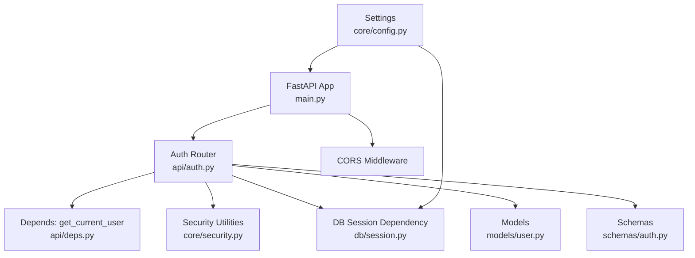
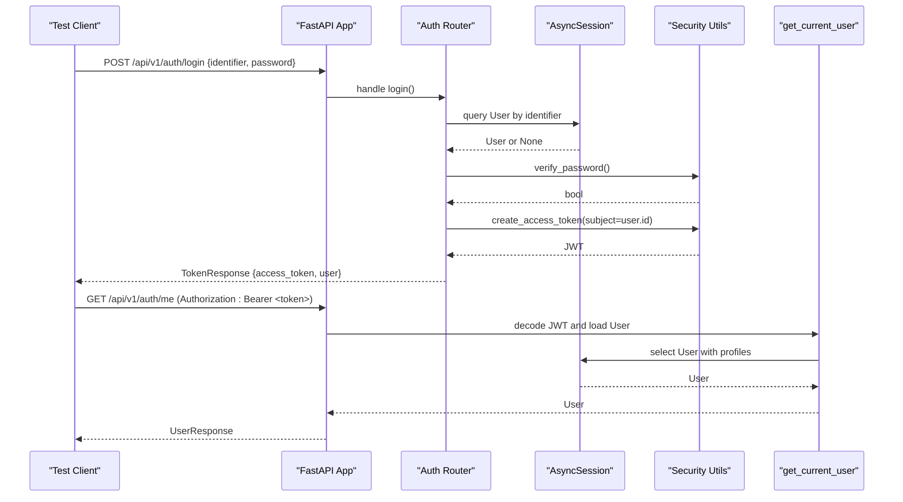
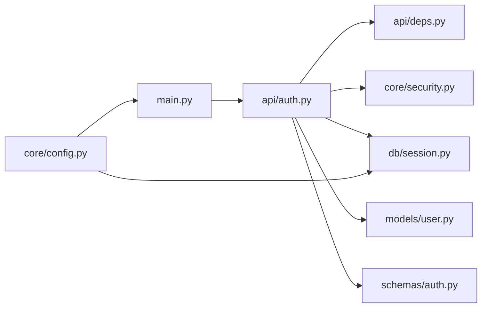

# Backend Testing

<cite>
**Referenced Files in This Document**
- [main.py](file://backend/app/main.py)
- [auth.py](file://backend/app/api/auth.py)
- [deps.py](file://backend/app/api/deps.py)
- [security.py](file://backend/app/core/security.py)
- [config.py](file://backend/app/core/config.py)
- [session.py](file://backend/app/db/session.py)
- [user.py](file://backend/app/models/user.py)
- [auth_schemas.py](file://backend/app/schemas/auth.py)
</cite>

## Table of Contents
1. [Introduction](#introduction)
2. [Project Structure](#project-structure)
3. [Core Components](#core-components)
4. [Architecture Overview](#architecture-overview)
5. [Detailed Component Analysis](#detailed-component-analysis)
6. [Dependency Analysis](#dependency-analysis)
7. [Performance Considerations](#performance-considerations)
8. [Troubleshooting Guide](#troubleshooting-guide)
9. [Conclusion](#conclusion)

## Introduction
This document provides a comprehensive backend testing strategy for the FastAPI application, focusing on:
- Authentication verification with JWT tokens
- OTP validation endpoints
- Role-based authorization and protected routes
- REST endpoint testing patterns (request/response validation, error handling)
- Database testing with SQLAlchemy async models, transactional tests, and migration checks
- Security testing for authentication, input validation, and SQL injection prevention
- Test utilities for mocking external dependencies, test database setup, and fixtures
- Performance testing for API endpoints and database query optimization verification

The guidance is grounded in the actual codebase structure and implementation details found in the backend module.

## Project Structure
The backend follows a modular FastAPI layout:
- Application entrypoint and lifespan configuration
- API routers for authentication and dependency injection
- Core security utilities and settings
- Async SQLAlchemy session management
- Data models and Pydantic schemas for request/response validation

**Diagram sources**
- [main.py:11-46](file://backend/app/main.py#L11-L46)
- [auth.py:1-21](file://backend/app/api/auth.py#L1-L21)
- [deps.py:1-12](file://backend/app/api/deps.py#L1-L12)
- [security.py:1-26](file://backend/app/core/security.py#L1-L26)
- [session.py:1-49](file://backend/app/db/session.py#L1-L49)
- [user.py:10-81](file://backend/app/models/user.py#L10-L81)
- [auth_schemas.py:1-119](file://backend/app/schemas/auth.py#L1-L119)
- [config.py:10-30](file://backend/app/core/config.py#L10-L30)

**Section sources**
- [main.py:11-46](file://backend/app/main.py#L11-L46)
- [auth.py:1-21](file://backend/app/api/auth.py#L1-L21)
- [deps.py:1-12](file://backend/app/api/deps.py#L1-L12)
- [security.py:1-26](file://backend/app/core/security.py#L1-L26)
- [session.py:1-49](file://backend/app/db/session.py#L1-L49)
- [user.py:10-81](file://backend/app/models/user.py#L10-L81)
- [auth_schemas.py:1-119](file://backend/app/schemas/auth.py#L1-L119)
- [config.py:10-30](file://backend/app/core/config.py#L10-L30)

## Core Components
- FastAPI app initialization and lifespan:
  - Connects to PostgreSQL at startup, verifies version, creates tables via Base.metadata.create_all, and disposes engine on shutdown.
  - Includes CORS middleware and mounts auth router under /api/v1/auth.
- Authentication router:
  - Endpoints for patient/doctor registration, login, OTP verification, password reset, and protected “me” route.
  - Uses Pydantic schemas for validation and returns structured responses.
- Dependency injection:
  - OAuth2PasswordBearer scheme configured to use /api/v1/auth/login.
  - get_current_user decodes JWT, validates token, loads user with eager-loaded profiles.
- Security utilities:
  - Password hashing and verification using bcrypt via passlib.
  - JWT access token creation with configurable expiry and algorithm from settings.
- Database layer:
  - Async SQLAlchemy engine and session factory configured for asyncpg.
  - get_db dependency yields an AsyncSession per request.
- Models and schemas:
  - User, PatientProfile, DoctorProfile with relationships and enums.
  - Pydantic request/response models mirroring domain concepts.

**Section sources**
- [main.py:11-46](file://backend/app/main.py#L11-L46)
- [auth.py:24-180](file://backend/app/api/auth.py#L24-L180)
- [deps.py:12-41](file://backend/app/api/deps.py#L12-L41)
- [security.py:10-26](file://backend/app/core/security.py#L10-L26)
- [session.py:23-48](file://backend/app/db/session.py#L23-L48)
- [user.py:26-81](file://backend/app/models/user.py#L26-L81)
- [auth_schemas.py:27-119](file://backend/app/schemas/auth.py#L27-L119)

## Architecture Overview
The authentication flow and protected route usage are central to testing. The following sequence shows how a client interacts with the login endpoint and then accesses a protected route.

**Diagram sources**
- [auth.py:121-153](file://backend/app/api/auth.py#L121-L153)
- [deps.py:15-41](file://backend/app/api/deps.py#L15-L41)
- [security.py:18-26](file://backend/app/core/security.py#L18-L26)

## Detailed Component Analysis

### Authentication Verification Testing (JWT)
Testing goals:
- Validate successful login and token issuance
- Verify token decoding and user retrieval in protected routes
- Ensure invalid/expired tokens return 401 Unauthorized
- Confirm WWW-Authenticate header presence on unauthorized responses

Recommended test cases:
- Successful login with valid credentials returns TokenResponse with access_token and user payload.
- Protected route /api/v1/auth/me returns current user when a valid bearer token is provided.
- Missing Authorization header returns 401 with WWW-Authenticate: Bearer.
- Invalid or tampered token returns 401.
- Expired token behavior aligns with ACCESS_TOKEN_EXPIRE_MINUTES setting.

Implementation notes:
- Use httpx.AsyncClient or TestClient with lifespan enabled to start the app within tests.
- For async tests, prefer httpx.AsyncClient and run against the running app or use pytest-asyncio with TestClient.
- Extract token from login response and attach Authorization: Bearer <token> header in subsequent requests.

Error handling expectations:
- Login with wrong credentials raises 401 Unauthorized.
- Decoding failures in get_current_user raise 401 with WWW-Authenticate header.

**Section sources**
- [auth.py:121-153](file://backend/app/api/auth.py#L121-L153)
- [deps.py:15-41](file://backend/app/api/deps.py#L15-L41)
- [security.py:18-26](file://backend/app/core/security.py#L18-L26)

### OTP Validation Testing
Testing goals:
- Validate OTP verification endpoint behavior for valid codes and lengths.
- Ensure invalid codes return appropriate error responses.

Recommended test cases:
- Valid OTP code returns verified success response.
- Code length equals 6 returns verified success response.
- Invalid code returns 400 Bad Request with detail.

Notes:
- The OTP logic includes demo support; tests should cover both exact match and length-based acceptance paths.

**Section sources**
- [auth.py:156-164](file://backend/app/api/auth.py#L156-L164)

### Role-Based Authorization Testing
Testing goals:
- Enforce role constraints on protected endpoints.
- Ensure only authenticated users can access protected routes.

Current state:
- The “me” endpoint uses get_current_user to enforce authentication but does not explicitly check roles.
- Tests should assert that unauthenticated requests are rejected and authenticated requests succeed.

Recommendations:
- Add role checks in dependencies or route handlers if role-based access control is required.
- Introduce a dependency like require_role(role: UserRole) to centralize authorization logic.

**Section sources**
- [auth.py:178-180](file://backend/app/api/auth.py#L178-L180)
- [deps.py:15-41](file://backend/app/api/deps.py#L15-L41)
- [user.py:10-13](file://backend/app/models/user.py#L10-L13)

### API Endpoint Testing Patterns (RESTful Services)
Patterns to adopt:
- Registration endpoints:
  - Validate unique constraints for email/phone and doctor license number.
  - Assert 201 Created on successful registration and correct UserResponse shape.
  - Assert 400 Bad Request for duplicate identifiers.
- Login endpoint:
  - Validate identifier supports email or phone.
  - Assert TokenResponse fields and user payload.
- OTP verification:
  - Validate code format and accepted values.
- Reset password:
  - Ensure non-enumeration behavior and consistent messaging.

Request/response validation:
- Leverage Pydantic schemas for automatic validation and serialization.
- Assert response model fields and nested profile objects.

Error handling:
- HTTPException status codes map to standard REST semantics.
- Include meaningful detail messages for client feedback.

**Section sources**
- [auth.py:24-118](file://backend/app/api/auth.py#L24-L118)
- [auth.py:121-175](file://backend/app/api/auth.py#L121-L175)
- [auth_schemas.py:27-119](file://backend/app/schemas/auth.py#L27-L119)

### Database Testing Approaches (SQLAlchemy Models)
Goals:
- Isolate tests with a dedicated test database or in-memory SQLite.
- Use transactions to roll back changes after each test.
- Verify schema creation and data integrity.

Approach:
- Create a test-specific AsyncEngine bound to an isolated database URL.
- Override get_db dependency in tests to yield sessions from the test engine.
- Use Base.metadata.create_all to initialize schema before tests.
- Wrap each test in a transaction and rollback afterward to maintain isolation.

Migration testing:
- If migrations are introduced, assert that migration scripts update schema correctly.
- Compare expected table structures and indexes with actual metadata.

Data fixtures:
- Generate deterministic test data for users and profiles.
- Seed minimal records needed for endpoint assertions.

**Section sources**
- [session.py:23-48](file://backend/app/db/session.py#L23-L48)
- [user.py:26-81](file://backend/app/models/user.py#L26-L81)

### Security Testing
Focus areas:
- Authentication endpoints:
  - Validate password hashing and verification.
  - Ensure JWT secrets and algorithms are loaded from settings.
- Input validation:
  - Rely on Pydantic schemas to reject malformed payloads.
- SQL injection prevention:
  - All queries use parameterized ORM constructs; no raw string concatenation.
  - Tests should assert safe behavior even with malicious inputs.

Recommendations:
- Add fuzzing tests for sensitive fields (passwords, emails).
- Validate that error responses do not leak internal details.

**Section sources**
- [security.py:10-26](file://backend/app/core/security.py#L10-L26)
- [auth.py:24-175](file://backend/app/api/auth.py#L24-L175)

### Testing Utilities
Mocking external dependencies:
- Mock SMTP/email services for password reset flows.
- Mock third-party OTP providers if integrated later.

Test database setup:
- Provide a fixture that configures a test engine and overrides get_db.
- Ensure lifespan runs to initialize tables during tests.

Fixtures generation:
- Factory functions to create User, PatientProfile, DoctorProfile with deterministic attributes.
- Helper functions to generate valid tokens for protected route tests.

**Section sources**
- [session.py:43-48](file://backend/app/db/session.py#L43-L48)
- [main.py:11-28](file://backend/app/main.py#L11-L28)

## Dependency Analysis
Key dependencies and their interactions:
- FastAPI app depends on CORS middleware and auth router.
- Auth router depends on:
  - get_db for database access
  - get_current_user for protected routes
  - security utilities for password and token operations
  - Pydantic schemas for validation
- Settings provide DATABASE_URL, SECRET_KEY, ALGORITHM, and token expiry.

**Diagram sources**
- [main.py:31-46](file://backend/app/main.py#L31-L46)
- [auth.py:1-21](file://backend/app/api/auth.py#L1-L21)
- [deps.py:1-12](file://backend/app/api/deps.py#L1-L12)
- [security.py:1-26](file://backend/app/core/security.py#L1-L26)
- [session.py:1-49](file://backend/app/db/session.py#L1-L49)
- [user.py:1-81](file://backend/app/models/user.py#L1-L81)
- [auth_schemas.py:1-119](file://backend/app/schemas/auth.py#L1-L119)
- [config.py:10-30](file://backend/app/core/config.py#L10-L30)

**Section sources**
- [main.py:31-46](file://backend/app/main.py#L31-L46)
- [auth.py:1-21](file://backend/app/api/auth.py#L1-L21)
- [deps.py:1-12](file://backend/app/api/deps.py#L1-L12)
- [security.py:1-26](file://backend/app/core/security.py#L1-L26)
- [session.py:1-49](file://backend/app/db/session.py#L1-L49)
- [user.py:1-81](file://backend/app/models/user.py#L1-L81)
- [auth_schemas.py:1-119](file://backend/app/schemas/auth.py#L1-L119)
- [config.py:10-30](file://backend/app/core/config.py#L10-L30)

## Performance Considerations
- Database connection pooling:
  - Engine uses pool_pre_ping to ensure healthy connections.
  - Tests should reuse engines where possible to reduce overhead.
- Query efficiency:
  - Endpoints use selectinload to eagerly load related profiles, avoiding N+1 queries.
  - Tests should validate that responses include necessary nested data without extra round trips.
- Token operations:
  - JWT encoding/decoding is lightweight; ensure secret key and algorithm are constant across tests.
- Concurrency:
  - Async endpoints benefit from asynchronous clients in tests; avoid blocking calls.

[No sources needed since this section provides general guidance]

## Troubleshooting Guide
Common issues and resolutions:
- Database connectivity errors:
  - Verify DATABASE_URL and SSL parameters for asyncpg.
  - Ensure engine initialization succeeds during app lifespan.
- Authentication failures:
  - Check SECRET_KEY and ALGORITHM consistency between token creation and decoding.
  - Confirm WWW-Authenticate header presence on 401 responses.
- Schema mismatches:
  - Ensure Base.metadata.create_all runs before tests.
  - Align Pydantic schemas with model attributes.

**Section sources**
- [main.py:11-28](file://backend/app/main.py#L11-L28)
- [session.py:23-29](file://backend/app/db/session.py#L23-L29)
- [deps.py:15-41](file://backend/app/api/deps.py#L15-L41)

## Conclusion
This testing strategy covers authentication verification with JWT, OTP validation, role-based authorization patterns, REST endpoint testing, database isolation and migration checks, security validations, and performance considerations. By leveraging the existing FastAPI architecture, SQLAlchemy async models, and Pydantic schemas, tests can be robust, maintainable, and aligned with production behavior. Adopting the recommended patterns will improve confidence in correctness, security, and performance of the backend services.

[No sources needed since this section summarizes without analyzing specific files]