# Integration Testing

<cite>
**Referenced Files in This Document**
- [README.md](file://README.md)
- [package.json](file://package.json)
- [App.tsx](file://App.tsx)
- [index.ts](file://index.ts)
- [src/app/(auth)/login.tsx](file://src/app/(auth)/login.tsx)
- [src/app/(auth)/otp-verification.tsx](file://src/app/(auth)/otp-verification.tsx)
- [src/app/(auth)/register-patient.tsx](file://src/app/(auth)/register-patient.tsx)
- [src/app/(auth)/register-doctor.tsx](file://src/app/(auth)/register-doctor.tsx)
- [src/app/(patient)/book/[doctorId].tsx](file://src/app/(patient)/book/[doctorId].tsx)
- [src/app/(patient)/visit/[id].tsx](file://src/app/(patient)/visit/[id].tsx)
- [src/app/(doctor)/consultation/[visitId].tsx](file://src/app/(doctor)/consultation/[visitId].tsx)
- [src/app/(admin)/index.tsx](file://src/app/(admin)/index.tsx)
- [src/hooks/useProtectedRoute.ts](file://src/hooks/useProtectedRoute.ts)
- [src/services/api.ts](file://src/services/api.ts)
- [src/stores/authStore.ts](file://src/stores/authStore.ts)
- [src/mock/fixtures.ts](file://src/mock/fixtures.ts)
- [src/mock/mockDomainStore.ts](file://src/mock/mockDomainStore.ts)
- [backend/app/main.py](file://backend/app/main.py)
- [backend/app/api/auth.py](file://backend/app/api/auth.py)
- [backend/app/core/security.py](file://backend/app/core/security.py)
- [backend/app/models/user.py](file://backend/app/models/user.py)
- [backend/seed_db.py](file://backend/seed_db.py)
- [backend/verify_auth.py](file://backend/verify_auth.py)
</cite>

## Table of Contents
1. [Introduction](#introduction)
2. [Project Structure](#project-structure)
3. [Core Components](#core-components)
4. [Architecture Overview](#architecture-overview)
5. [Detailed Component Analysis](#detailed-component-analysis)
6. [Dependency Analysis](#dependency-analysis)
7. [Performance Considerations](#performance-considerations)
8. [Troubleshooting Guide](#troubleshooting-guide)
9. [Conclusion](#conclusion)

## Introduction
This document defines integration testing strategies for the HomeCare healthcare application. It covers end-to-end user flows across patient registration, doctor booking, consultation workflows, and administrative processes; API integration testing with mock and real backend services; authentication flow testing including multi-role login, OTP verification, and session management; cross-component interaction patterns; navigation guards and role-based access control; database integration testing with transaction isolation and data seeding; and performance testing considerations for mobile responsiveness and API response times.

The application uses an Expo/React Native frontend with a Zustand-based auth store, a service layer that can call a FastAPI backend or fall back to an in-memory mock domain store, and a Python backend with PostgreSQL for production-like integration tests.

## Project Structure
At a high level:
- Frontend entry points are defined by Expo Router and the app shell.
- Authentication screens live under `(auth)`.
- Role-specific experiences live under `(patient)`, `(doctor)`, and `(admin)`.
- The service layer abstracts API calls and falls back to mock data.
- The backend exposes auth endpoints and manages users, patient profiles, and doctor profiles.

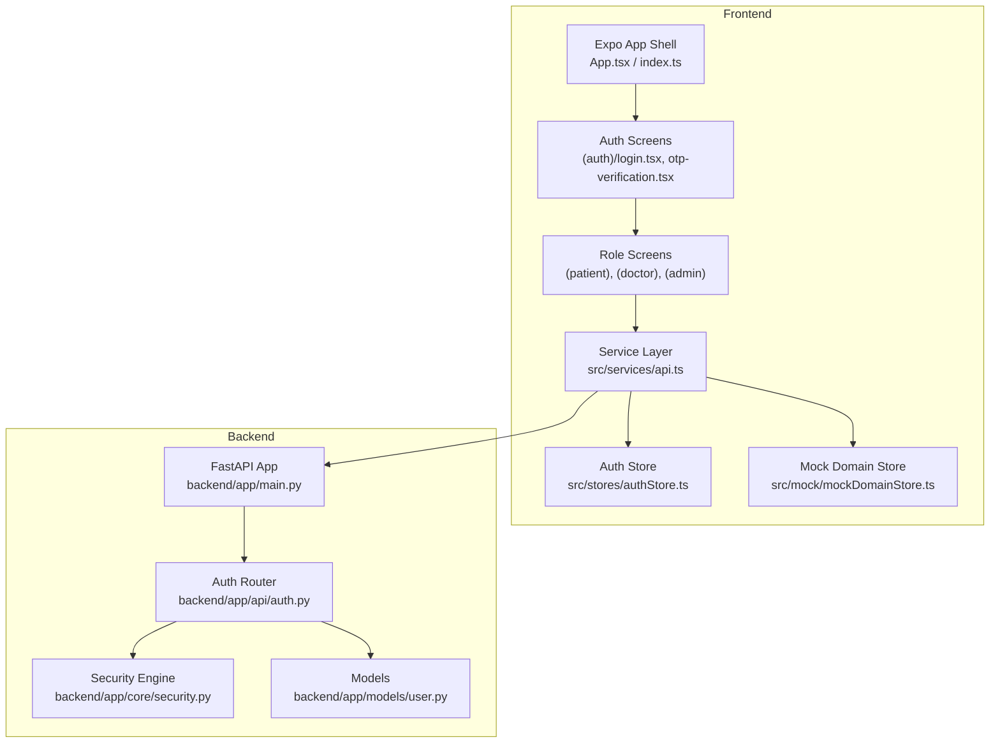

**Diagram sources**
- [App.tsx:1-200](file://App.tsx#L1-L200)
- [index.ts:1-200](file://index.ts#L1-L200)
- [src/app/(auth)/login.tsx:1-200](file://src/app/(auth)/login.tsx#L1-L200)
- [src/app/(auth)/otp-verification.tsx:1-200](file://src/app/(auth)/otp-verification.tsx#L1-L200)
- [src/app/(patient)/book/[doctorId].tsx:1-200](file://src/app/(patient)/book/[doctorId].tsx#L1-L200)
- [src/app/(doctor)/consultation/[visitId].tsx:1-200](file://src/app/(doctor)/consultation/[visitId].tsx#L1-L200)
- [src/app/(admin)/index.tsx:1-200](file://src/app/(admin)/index.tsx#L1-L200)
- [src/services/api.ts:1-200](file://src/services/api.ts#L1-L200)
- [src/stores/authStore.ts:1-112](file://src/stores/authStore.ts#L1-L112)
- [src/mock/mockDomainStore.ts:1-120](file://src/mock/mockDomainStore.ts#L1-L120)
- [backend/app/main.py:1-61](file://backend/app/main.py#L1-L61)
- [backend/app/api/auth.py:1-182](file://backend/app/api/auth.py#L1-L182)
- [backend/app/core/security.py:1-27](file://backend/app/core/security.py#L1-L27)
- [backend/app/models/user.py:1-82](file://backend/app/models/user.py#L1-L82)

**Section sources**
- [README.md:1-245](file://README.md#L1-L245)
- [package.json:1-36](file://package.json#L1-L36)

## Core Components
- Auth service abstraction: `src/services/api.ts` provides login, OTP verification, registration, and domain operations, with fallback to mock data when the backend is unavailable.
- Auth store: `src/stores/authStore.ts` manages current user, token, and profile loading per role.
- Mock domain store: `src/mock/mockDomainStore.ts` implements account isolation, visit lifecycle, notifications, reviews, complaints, and audit logs.
- Backend auth router: `backend/app/api/auth.py` implements register/login/OTP/reset-password/me endpoints and integrates with security utilities and models.
- Security engine: `backend/app/core/security.py` handles password hashing and JWT creation.
- Models: `backend/app/models/user.py` defines User, PatientProfile, DoctorProfile, roles, and verification status.
- Seed script: `backend/seed_db.py` seeds core demo accounts into PostgreSQL.
- Verification script: `backend/verify_auth.py` validates cryptographic primitives and configured credentials.

**Section sources**
- [src/services/api.ts:1-245](file://src/services/api.ts#L1-L245)
- [src/stores/authStore.ts:1-112](file://src/stores/authStore.ts#L1-L112)
- [src/mock/mockDomainStore.ts:1-120](file://src/mock/mockDomainStore.ts#L1-L120)
- [backend/app/api/auth.py:1-182](file://backend/app/api/auth.py#L1-L182)
- [backend/app/core/security.py:1-27](file://backend/app/core/security.py#L1-L27)
- [backend/app/models/user.py:1-82](file://backend/app/models/user.py#L1-L82)
- [backend/seed_db.py:1-105](file://backend/seed_db.py#L1-L105)
- [backend/verify_auth.py:1-84](file://backend/verify_auth.py#L1-L84)

## Architecture Overview
Integration testing should validate both the frontend service layer and the backend endpoints. The following diagram maps the primary integration paths used during testing.

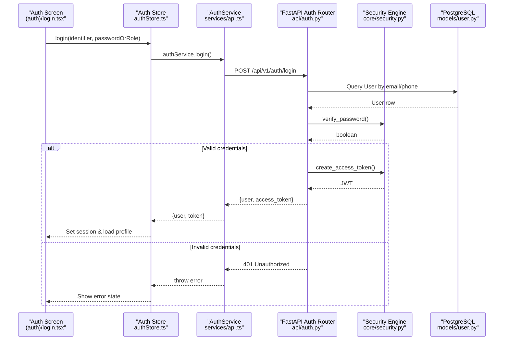

**Diagram sources**
- [src/app/(auth)/login.tsx:1-200](file://src/app/(auth)/login.tsx#L1-L200)
- [src/stores/authStore.ts:1-112](file://src/stores/authStore.ts#L1-L112)
- [src/services/api.ts:46-104](file://src/services/api.ts#L46-L104)
- [backend/app/api/auth.py:121-153](file://backend/app/api/auth.py#L121-L153)
- [backend/app/core/security.py:10-26](file://backend/app/core/security.py#L10-L26)
- [backend/app/models/user.py:26-43](file://backend/app/models/user.py#L26-L43)

## Detailed Component Analysis

### End-to-End User Flow Testing

#### Patient Registration and Profile Consent
- Test scenarios:
  - Register a new patient with mandatory consent.
  - Validate duplicate email/phone rejection on the backend.
  - Verify local mock registration fallback when backend is down.
- Key files:
  - Registration screen: `src/app/(auth)/register-patient.tsx`
  - Backend registration endpoint: `backend/app/api/auth.py`
  - Service fallback logic: `src/services/api.ts`
  - Mock store registration: `src/mock/mockDomainStore.ts`

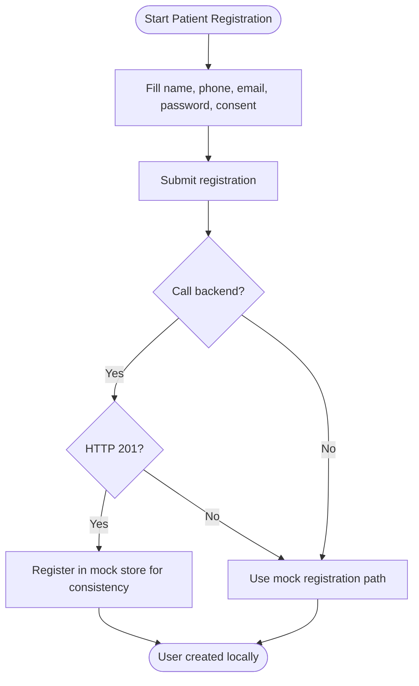

**Diagram sources**
- [src/app/(auth)/register-patient.tsx:1-200](file://src/app/(auth)/register-patient.tsx#L1-L200)
- [backend/app/api/auth.py:24-65](file://backend/app/api/auth.py#L24-L65)
- [src/services/api.ts:124-197](file://src/services/api.ts#L124-L197)
- [src/mock/mockDomainStore.ts:144-154](file://src/mock/mockDomainStore.ts#L144-L154)

**Section sources**
- [src/app/(auth)/register-patient.tsx:1-200](file://src/app/(auth)/register-patient.tsx#L1-L200)
- [backend/app/api/auth.py:24-65](file://backend/app/api/auth.py#L24-L65)
- [src/services/api.ts:124-197](file://src/services/api.ts#L124-L197)
- [src/mock/mockDomainStore.ts:144-154](file://src/mock/mockDomainStore.ts#L144-L154)

#### Doctor Booking and Visit Lifecycle
- Test scenarios:
  - Search doctors with filters and availability.
  - Book a slot and prevent double bookings.
  - Accept/decline alternative time proposals.
  - Cancel before departure and block cancellation after travel starts.
- Key files:
  - Booking screen: `src/app/(patient)/book/[doctorId].tsx`
  - Visit tracking screen: `src/app/(patient)/visit/[id].tsx`
  - Service methods: `src/services/api.ts`
  - Domain store validation: `src/mock/mockDomainStore.ts`

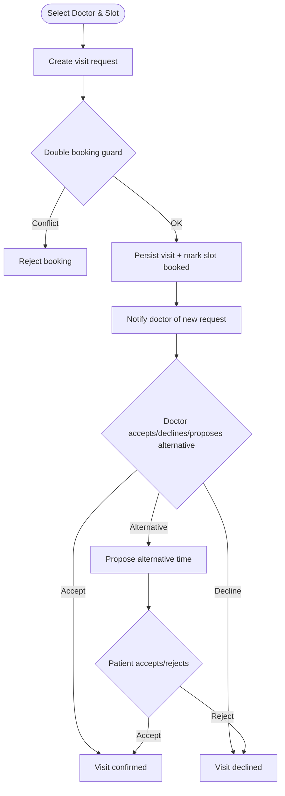

**Diagram sources**
- [src/app/(patient)/book/[doctorId].tsx:1-200](file://src/app/(patient)/book/[doctorId].tsx#L1-L200)
- [src/app/(patient)/visit/[id].tsx:1-200](file://src/app/(patient)/visit/[id].tsx#L1-L200)
- [src/services/api.ts:334-403](file://src/services/api.ts#L334-L403)
- [src/mock/mockDomainStore.ts:245-380](file://src/mock/mockDomainStore.ts#L245-L380)

**Section sources**
- [src/app/(patient)/book/[doctorId].tsx:1-200](file://src/app/(patient)/book/[doctorId].tsx#L1-L200)
- [src/app/(patient)/visit/[id].tsx:1-200](file://src/app/(patient)/visit/[id].tsx#L1-L200)
- [src/services/api.ts:334-403](file://src/services/api.ts#L334-L403)
- [src/mock/mockDomainStore.ts:245-380](file://src/mock/mockDomainStore.ts#L245-L380)

#### Consultation Workflow and Results Publishing
- Test scenarios:
  - Doctor advances visit execution statuses.
  - Doctor creates consultation record and publishes it.
  - Lab sample creation and result publication.
- Key files:
  - Doctor consultation screen: `src/app/(doctor)/consultation/[visitId].tsx`
  - Doctor service: `src/services/api.ts`
  - Domain store: `src/mock/mockDomainStore.ts`

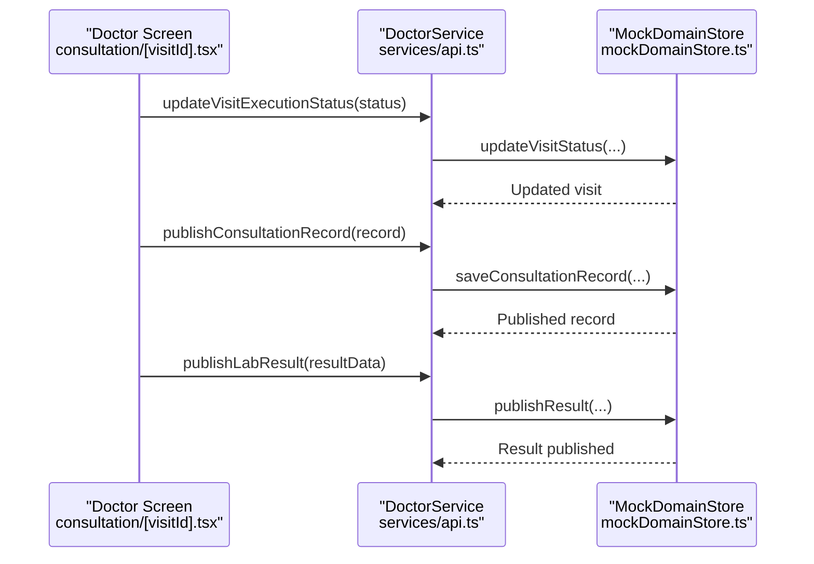

**Diagram sources**
- [src/app/(doctor)/consultation/[visitId].tsx:137-157](file://src/app/(doctor)/consultation/[visitId].tsx#L137-L157)
- [src/services/api.ts:531-584](file://src/services/api.ts#L531-L584)
- [src/mock/mockDomainStore.ts:393-464](file://src/mock/mockDomainStore.ts#L393-L464)

**Section sources**
- [src/app/(doctor)/consultation/[visitId].tsx:137-157](file://src/app/(doctor)/consultation/[visitId].tsx#L137-L157)
- [src/services/api.ts:531-584](file://src/services/api.ts#L531-L584)
- [src/mock/mockDomainStore.ts:393-464](file://src/mock/mockDomainStore.ts#L393-L464)

#### Administrative Processes
- Test scenarios:
  - View platform metrics.
  - Approve/suspend doctors.
  - Resolve complaints.
  - Inspect immutable audit logs.
- Key files:
  - Admin console: `src/app/(admin)/index.tsx`
  - Admin service: `src/services/api.ts`
  - Domain store: `src/mock/mockDomainStore.ts`

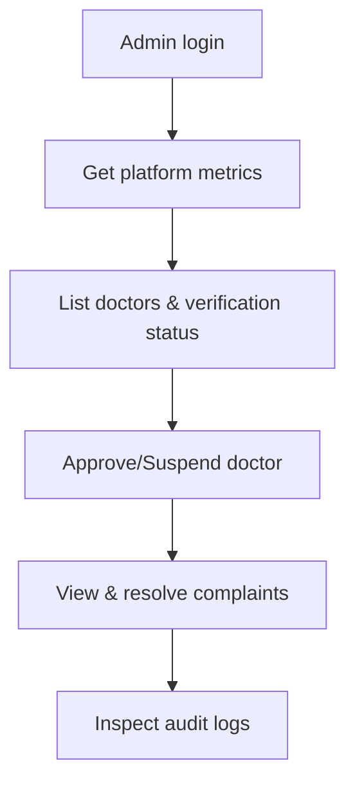

**Diagram sources**
- [src/app/(admin)/index.tsx:1-200](file://src/app/(admin)/index.tsx#L1-L200)
- [src/services/api.ts:587-659](file://src/services/api.ts#L587-L659)
- [src/mock/mockDomainStore.ts:185-192](file://src/mock/mockDomainStore.ts#L185-L192)
- [src/mock/mockDomainStore.ts:502-527](file://src/mock/mockDomainStore.ts#L502-L527)

**Section sources**
- [src/app/(admin)/index.tsx:1-200](file://src/app/(admin)/index.tsx#L1-L200)
- [src/services/api.ts:587-659](file://src/services/api.ts#L587-L659)
- [src/mock/mockDomainStore.ts:185-192](file://src/mock/mockDomainStore.ts#L185-L192)
- [src/mock/mockDomainStore.ts:502-527](file://src/mock/mockDomainStore.ts#L502-L527)

### API Integration Testing Strategies

#### Mock vs Real Backend
- Strategy:
  - Prefer calling the real backend when available; gracefully fall back to mock store for offline or test environments.
  - Assert both success and failure branches, including network errors and HTTP error responses.
- Key implementation:
  - AuthService login and OTP verification attempt real fetch then fallback.
  - Registration attempts backend and falls back to mock store.

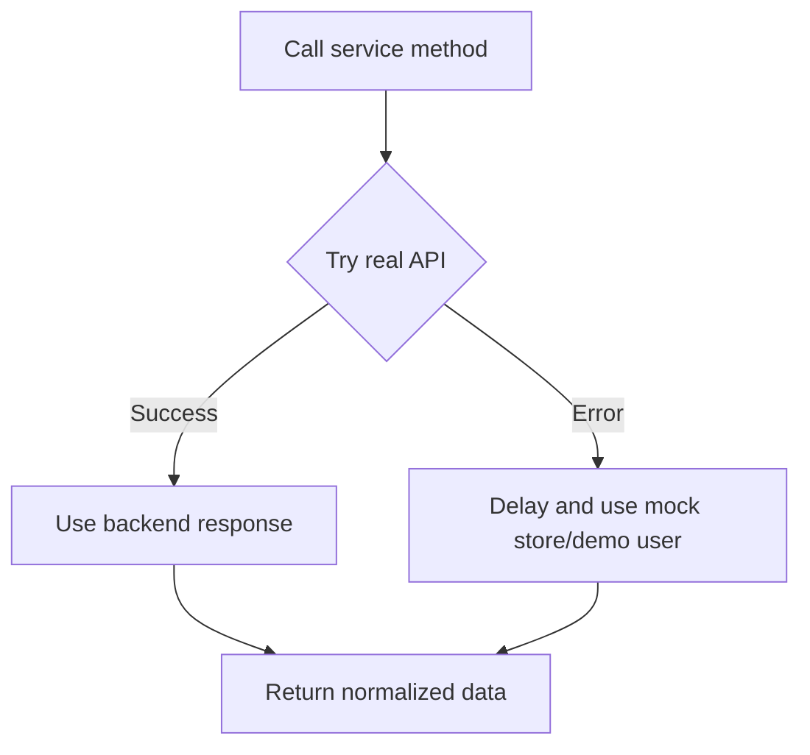

**Diagram sources**
- [src/services/api.ts:46-104](file://src/services/api.ts#L46-L104)
- [src/services/api.ts:106-122](file://src/services/api.ts#L106-L122)
- [src/services/api.ts:124-197](file://src/services/api.ts#L124-L197)

**Section sources**
- [src/services/api.ts:46-122](file://src/services/api.ts#L46-L122)
- [src/services/api.ts:124-197](file://src/services/api.ts#L124-L197)

#### Backend Endpoint Contracts
- Endpoints relevant to integration tests:
  - POST `/api/v1/auth/register/patient`
  - POST `/api/v1/auth/register/doctor`
  - POST `/api/v1/auth/login`
  - POST `/api/v1/auth/verify-otp`
  - GET `/api/v1/auth/me`
- Validation expectations:
  - Duplicate email/phone checks.
  - Password hashing and JWT generation.
  - Demo OTP acceptance.

**Section sources**
- [backend/app/api/auth.py:24-182](file://backend/app/api/auth.py#L24-L182)
- [backend/app/core/security.py:10-26](file://backend/app/core/security.py#L10-L26)

### Authentication Flow Testing

#### Multi-Role Login and Session Management
- Scenarios:
  - Login as admin, doctor, and patient using demo keys or identifiers.
  - Load role-specific profiles after login.
  - Logout clears session state.
- Key files:
  - Auth store actions: `src/stores/authStore.ts`
  - AuthService login mapping: `src/services/api.ts`
  - Backend login route: `backend/app/api/auth.py`

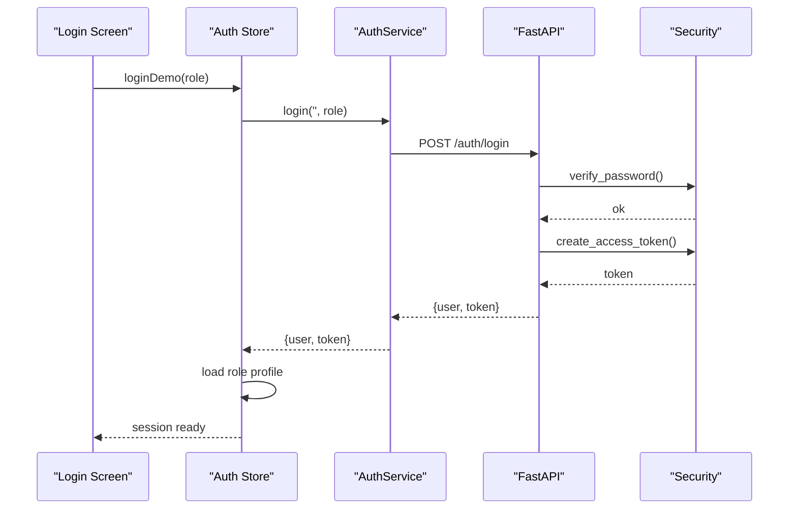

**Diagram sources**
- [src/stores/authStore.ts:31-83](file://src/stores/authStore.ts#L31-L83)
- [src/services/api.ts:46-104](file://src/services/api.ts#L46-L104)
- [backend/app/api/auth.py:121-153](file://backend/app/api/auth.py#L121-L153)
- [backend/app/core/security.py:10-26](file://backend/app/core/security.py#L10-L26)

**Section sources**
- [src/stores/authStore.ts:31-83](file://src/stores/authStore.ts#L31-L83)
- [src/services/api.ts:46-104](file://src/services/api.ts#L46-L104)
- [backend/app/api/auth.py:121-153](file://backend/app/api/auth.py#L121-L153)

#### OTP Verification
- Scenarios:
  - Valid OTP accepted.
  - Invalid OTP rejected.
  - Network failure falls back to demo OTP behavior.
- Key files:
  - OTP screen: `src/app/(auth)/otp-verification.tsx`
  - AuthService.verifyOtp: `src/services/api.ts`
  - Backend verify-otp: `backend/app/api/auth.py`

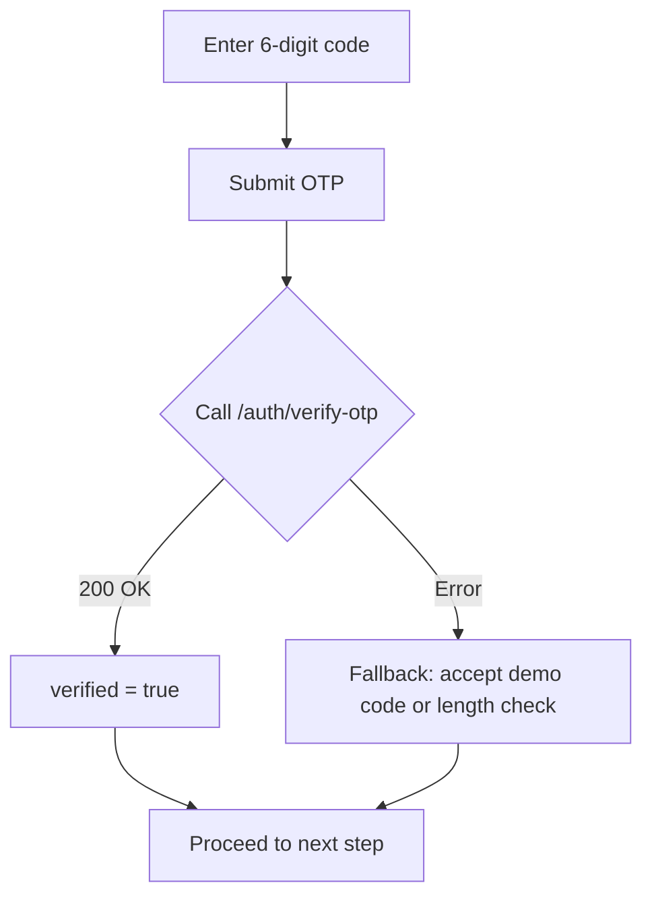

**Diagram sources**
- [src/app/(auth)/otp-verification.tsx:1-200](file://src/app/(auth)/otp-verification.tsx#L1-L200)
- [src/services/api.ts:106-122](file://src/services/api.ts#L106-L122)
- [backend/app/api/auth.py:156-164](file://backend/app/api/auth.py#L156-L164)

**Section sources**
- [src/app/(auth)/otp-verification.tsx:1-200](file://src/app/(auth)/otp-verification.tsx#L1-L200)
- [src/services/api.ts:106-122](file://src/services/api.ts#L106-L122)
- [backend/app/api/auth.py:156-164](file://backend/app/api/auth.py#L156-L164)

### Cross-Component Interactions and Navigation Guards

#### Navigation Guards and Role-Based Access Control
- Patterns:
  - Protected routes enforce role-based access.
  - Auth store controls navigation based on current user and profile.
- Key files:
  - Protected route hook: `src/hooks/useProtectedRoute.ts`
  - Auth store session state: `src/stores/authStore.ts`

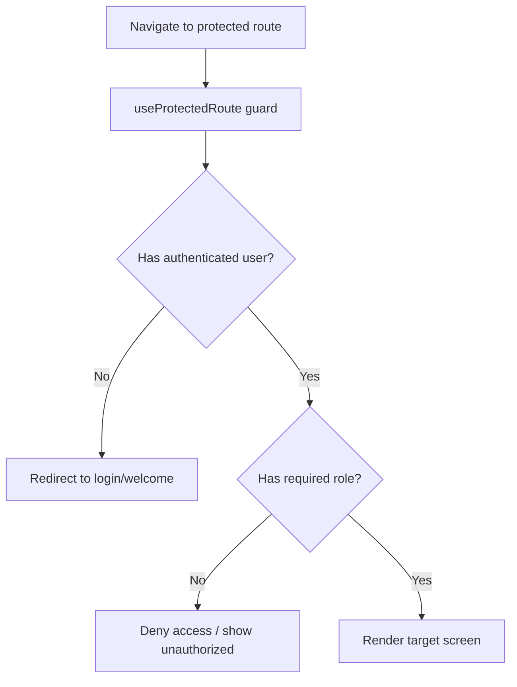

**Diagram sources**
- [src/hooks/useProtectedRoute.ts:1-200](file://src/hooks/useProtectedRoute.ts#L1-L200)
- [src/stores/authStore.ts:1-112](file://src/stores/authStore.ts#L1-L112)

**Section sources**
- [src/hooks/useProtectedRoute.ts:1-200](file://src/hooks/useProtectedRoute.ts#L1-L200)
- [src/stores/authStore.ts:1-112](file://src/stores/authStore.ts#L1-L112)

### Database Integration Testing

#### Transaction Isolation and Data Seeding
- Strategy:
  - Use seed script to initialize deterministic data for integration tests.
  - Wrap test cases in transactions where supported by the test runner and database.
  - Reset state between tests using seed script or explicit cleanup.
- Key files:
  - Seed script: `backend/seed_db.py`
  - Models: `backend/app/models/user.py`
  - App lifespan initializes tables: `backend/app/main.py`

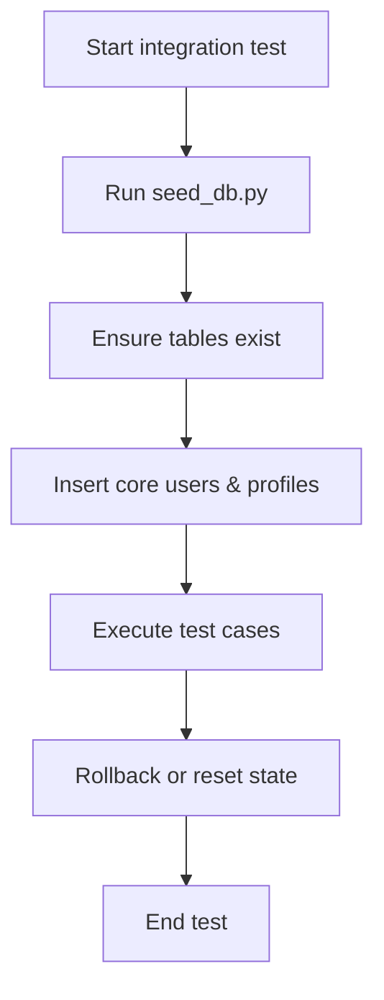

**Diagram sources**
- [backend/seed_db.py:1-105](file://backend/seed_db.py#L1-L105)
- [backend/app/models/user.py:26-82](file://backend/app/models/user.py#L26-L82)
- [backend/app/main.py:11-28](file://backend/app/main.py#L11-L28)

**Section sources**
- [backend/seed_db.py:1-105](file://backend/seed_db.py#L1-L105)
- [backend/app/models/user.py:26-82](file://backend/app/models/user.py#L26-L82)
- [backend/app/main.py:11-28](file://backend/app/main.py#L11-L28)

## Dependency Analysis
The frontend service layer depends on both the backend and the mock domain store. The auth store depends on the service layer and updates global session state. The backend depends on security utilities and SQLAlchemy models.

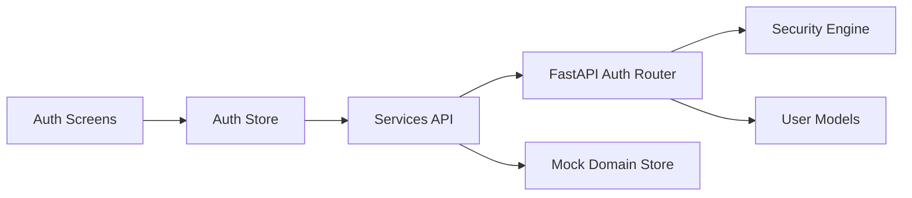

**Diagram sources**
- [src/stores/authStore.ts:1-112](file://src/stores/authStore.ts#L1-L112)
- [src/services/api.ts:1-245](file://src/services/api.ts#L1-L245)
- [backend/app/api/auth.py:1-182](file://backend/app/api/auth.py#L1-L182)
- [backend/app/core/security.py:1-27](file://backend/app/core/security.py#L1-L27)
- [backend/app/models/user.py:1-82](file://backend/app/models/user.py#L1-L82)

**Section sources**
- [src/stores/authStore.ts:1-112](file://src/stores/authStore.ts#L1-L112)
- [src/services/api.ts:1-245](file://src/services/api.ts#L1-L245)
- [backend/app/api/auth.py:1-182](file://backend/app/api/auth.py#L1-L182)
- [backend/app/core/security.py:1-27](file://backend/app/core/security.py#L1-L27)
- [backend/app/models/user.py:1-82](file://backend/app/models/user.py#L1-L82)

## Performance Considerations
- Mobile responsiveness:
  - Simulate realistic latency in service methods to approximate network conditions.
  - Debounce search inputs and avoid unnecessary re-renders in doctor search and booking flows.
- API response times:
  - Measure round-trip latency for login, OTP verification, and registration.
  - Ensure fallback paths do not introduce excessive delays.
- Concurrency:
  - Avoid double bookings by validating at the service/domain layer.
  - Use optimistic UI updates with rollback on failure.

[No sources needed since this section provides general guidance]

## Troubleshooting Guide
- Authentication failures:
  - Verify password hashing and JWT generation using the backend verification script.
  - Confirm demo credentials matrix matches expected roles and passwords.
- Backend connectivity:
  - Check health endpoint and OpenAPI docs.
  - Ensure CORS is enabled for web/mobile clients.
- State inconsistencies:
  - Reset demo data via auth store to restore defaults.
  - Re-run seed script to ensure consistent database state.

**Section sources**
- [backend/verify_auth.py:1-84](file://backend/verify_auth.py#L1-L84)
- [backend/app/main.py:49-61](file://backend/app/main.py#L49-L61)
- [src/stores/authStore.ts:107-112](file://src/stores/authStore.ts#L107-L112)

## Conclusion
This integration testing strategy ensures robust validation of end-to-end user flows, API contracts, authentication mechanisms, cross-component interactions, and database integrity. By combining real backend tests with controlled mock fallbacks, the team can confidently verify critical healthcare workflows such as patient registration, doctor booking, consultation execution, and administrative oversight while maintaining performance and reliability standards.

[No sources needed since this section summarizes without analyzing specific files]