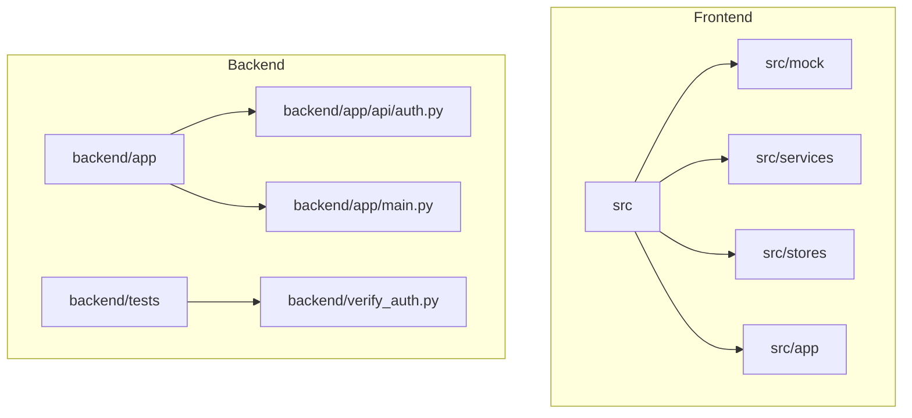
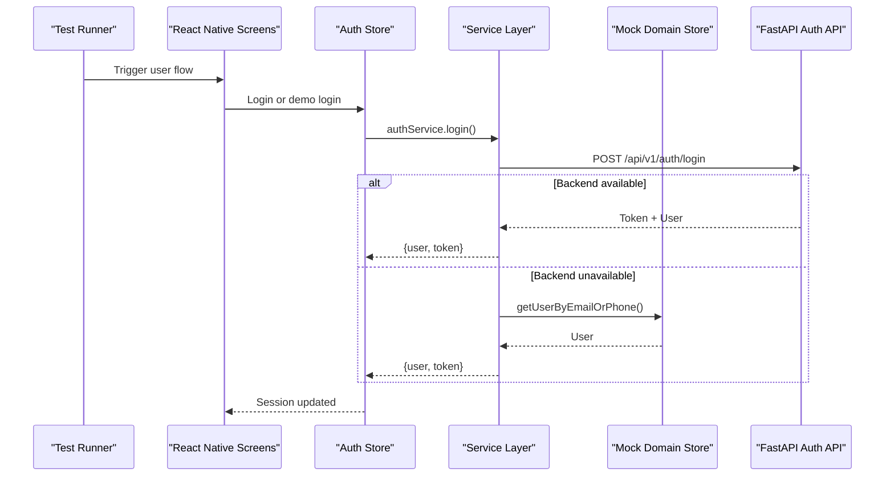
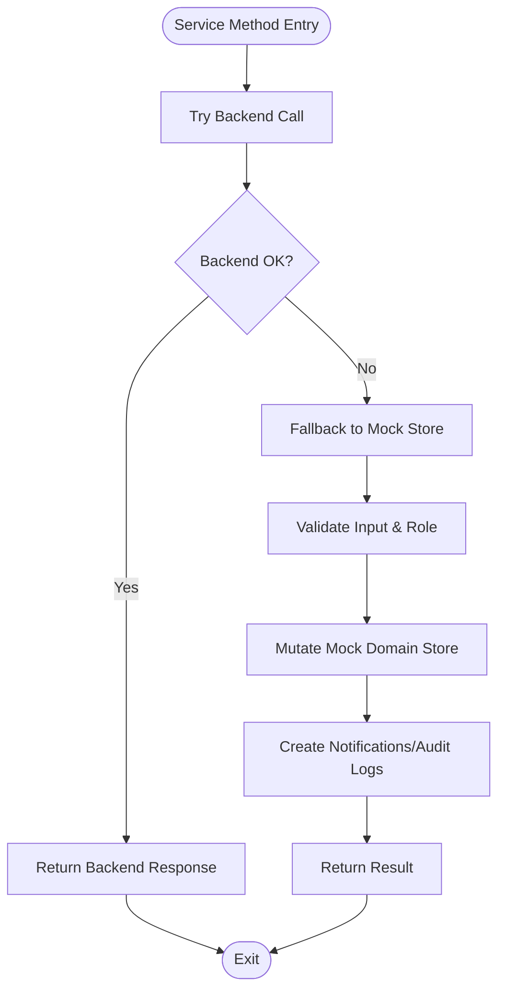
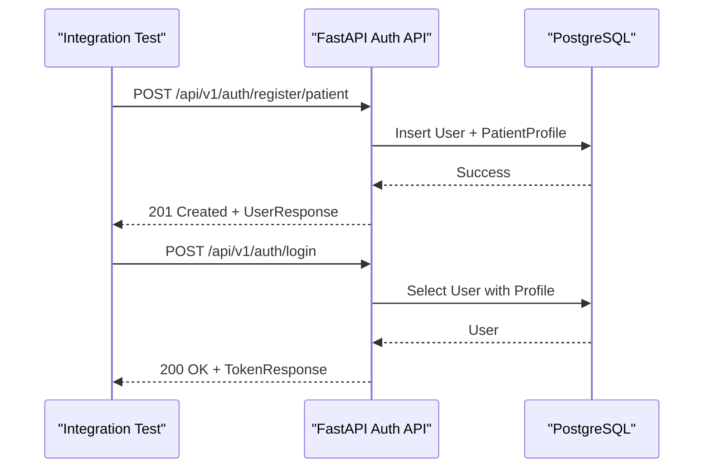
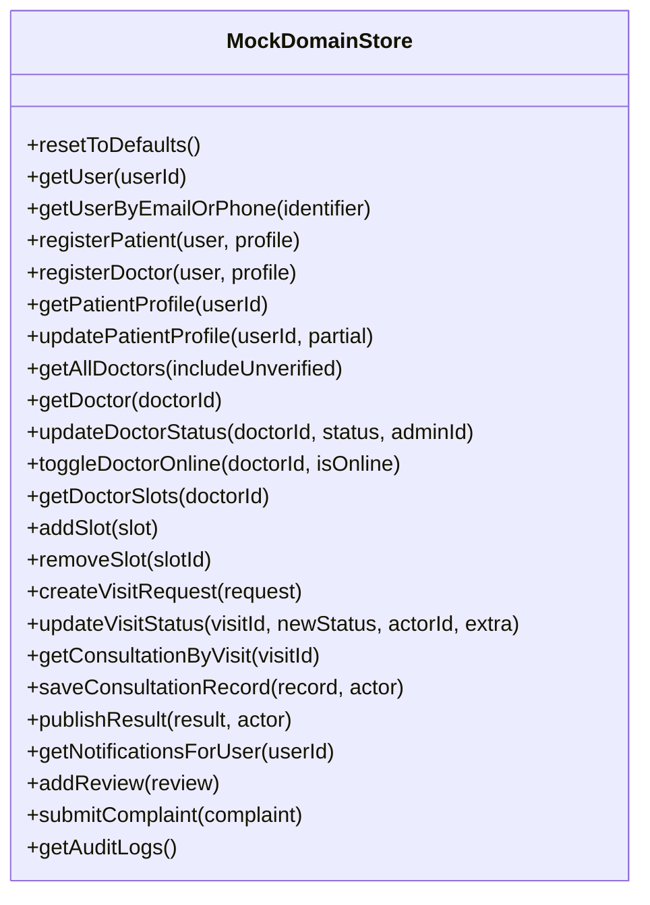
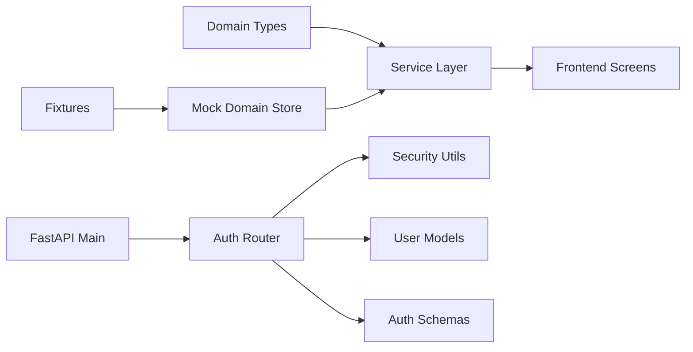

# Testing Strategy

<cite>
**Referenced Files in This Document**
- [fixtures.ts](file://src/mock/fixtures.ts)
- [mockDomainStore.ts](file://src/mock/mockDomainStore.ts)
- [api.ts](file://src/services/api.ts)
- [authStore.ts](file://src/stores/authStore.ts)
- [main.py](file://backend/app/main.py)
- [auth.py](file://backend/app/api/auth.py)
- [verify_auth.py](file://backend/verify_auth.py)
- [test_auth.py](file://backend/tests/test_auth.py)
- [README.md](file://README.md)
</cite>

## Table of Contents
1. [Introduction](#introduction)
2. [Project Structure](#project-structure)
3. [Core Components](#core-components)
4. [Architecture Overview](#architecture-overview)
5. [Detailed Component Analysis](#detailed-component-analysis)
6. [Dependency Analysis](#dependency-analysis)
7. [Performance Considerations](#performance-considerations)
8. [Troubleshooting Guide](#troubleshooting-guide)
9. [Conclusion](#conclusion)
10. [Appendices](#appendices)

## Introduction
This document describes the testing strategy and implementation patterns for a healthcare application that supports patients, doctors, and platform administrators across East African regions. The system includes:
- A React Native frontend with role-based screens for admin, doctor, and patient flows.
- A TypeScript service layer that can call a FastAPI backend or fall back to an in-memory mock domain store.
- A Python FastAPI backend providing authentication, registration, and database-backed user management.
- Comprehensive test fixtures and a mock domain store used to simulate realistic healthcare scenarios such as visits, lab samples, results, notifications, reviews, complaints, and audit logs.

The goal is to provide guidance for unit testing components and services, integration testing user flows and API endpoints, end-to-end scenario testing, backend authentication verification, database transaction testing, utilities and helper functions, performance and load testing considerations, and continuous integration practices.

## Project Structure
The repository is organized into frontend source code under `src`, backend application code under `backend`, and supporting documentation and configuration files at the root.

**Diagram sources**
- [api.ts:1-45](file://src/services/api.ts#L1-L45)
- [mockDomainStore.ts:1-35](file://src/mock/mockDomainStore.ts#L1-L35)
- [main.py:1-46](file://backend/app/main.py#L1-L46)
- [auth.py:1-21](file://backend/app/api/auth.py#L1-L21)

**Section sources**
- [README.md:238-245](file://README.md#L238-L245)

## Core Components
The testing strategy centers around these core areas:

- **Test fixtures**: Realistic healthcare data for users, patient profiles, doctors, availability slots, visit requests, consultation records, lab samples, result documents, notifications, reviews, complaints, specialties, and audit logs.
- **Mock domain store**: An in-memory reactive store with account isolation, state mutation, cross-role notifications, audit logging, and business rules such as double-booking prevention and slot lifecycle management.
- **Service layer**: Typed APIs for authentication, patient operations, doctor operations, and admin operations that either call the live backend or fall back to the mock store.
- **Authentication store**: Zustand-based session state for login, profile loading, demo login, logout, and reset of demo data.
- **Backend authentication**: FastAPI routes for registration, login, OTP verification, password reset, and current-user retrieval, backed by hashed passwords and JWT tokens.
- **Verification script**: A standalone script validating cryptographic hashing, token generation, and configured test credentials.

**Section sources**
- [fixtures.ts:1-118](file://src/mock/fixtures.ts#L1-L118)
- [mockDomainStore.ts:35-127](file://src/mock/mockDomainStore.ts#L35-L127)
- [api.ts:46-245](file://src/services/api.ts#L46-L245)
- [authStore.ts:1-42](file://src/stores/authStore.ts#L1-L42)
- [auth.py:121-180](file://backend/app/api/auth.py#L121-L180)
- [verify_auth.py:15-59](file://backend/verify_auth.py#L15-L59)

## Architecture Overview
The testing architecture connects UI flows through typed services to either a real backend or an in-memory domain store. Tests can assert on:
- Service-layer behavior and error handling.
- Domain-store mutations, isolation, and side effects like notifications and audit logs.
- Backend authentication endpoints and credential validation.
- End-to-end user journeys such as booking a visit, proposing alternative times, publishing lab results, and reviewing doctor ratings.

**Diagram sources**
- [api.ts:46-104](file://src/services/api.ts#L46-L104)
- [authStore.ts:31-42](file://src/stores/authStore.ts#L31-L42)
- [auth.py:121-153](file://backend/app/api/auth.py#L121-L153)

## Detailed Component Analysis

### Unit Testing Approach for Services and Business Logic
The service layer provides clear asynchronous contracts for authentication, patient operations, doctor operations, and admin operations. Each method simulates latency and delegates to the mock domain store when the backend is unavailable. This design enables:
- Deterministic unit tests for service methods without network calls.
- Assertions on thrown errors for invalid inputs, unauthorized access, and invalid state transitions.
- Coverage of fallback logic when the backend is offline.

Recommended unit testing patterns:
- Test each service method independently using its interface contract.
- Assert successful responses and expected domain-store interactions.
- Assert error cases such as missing entities, unauthorized actions, and invalid status transitions.
- Use the mock domain store’s reset functionality to isolate tests.

**Diagram sources**
- [api.ts:46-104](file://src/services/api.ts#L46-L104)
- [api.ts:274-430](file://src/services/api.ts#L274-L430)
- [api.ts:468-585](file://src/services/api.ts#L468-L585)

**Section sources**
- [api.ts:25-41](file://src/services/api.ts#L25-L41)
- [api.ts:247-272](file://src/services/api.ts#L247-L272)
- [api.ts:432-466](file://src/services/api.ts#L432-L466)
- [api.ts:587-602](file://src/services/api.ts#L587-L602)

### Integration Testing Strategies for User Flows and API Patterns
Integration tests should cover complete user journeys:
- Patient registration and profile updates.
- Doctor registration and pending verification.
- Visit request creation, acceptance, decline, alternative time proposal, and execution status transitions.
- Consultation record drafting and publishing.
- Lab sample creation and result publication.
- Review submission and complaint filing.
- Admin operations including doctor verification changes, complaint resolution, audit log retrieval, and platform metrics.

For API integration:
- Test `/register/patient` and `/register/doctor` endpoints for duplicate email/phone/license checks.
- Test `/login` with valid credentials and invalid credentials.
- Test `/verify-otp` with valid and invalid codes.
- Test `/reset-password` for non-enumerating behavior.
- Test `/me` with authenticated requests.

**Diagram sources**
- [auth.py:24-65](file://backend/app/api/auth.py#L24-L65)
- [auth.py:68-118](file://backend/app/api/auth.py#L68-L118)
- [auth.py:121-153](file://backend/app/api/auth.py#L121-L153)

**Section sources**
- [auth.py:24-180](file://backend/app/api/auth.py#L24-L180)
- [main.py:31-46](file://backend/app/main.py#L31-L46)

### End-to-End Scenario Testing
End-to-end tests should validate multi-step healthcare workflows:
- A patient books a visit with an approved doctor.
- The doctor accepts or declines the visit.
- If declined, the doctor proposes an alternative time.
- The patient accepts or rejects the alternative time.
- The doctor marks the visit as on the way, arrived, in consultation, and completed.
- The doctor publishes a consultation record and optionally a lab result.
- The patient views results and submits a review or complaint.
- The admin verifies doctor licenses, resolves complaints, and inspects audit logs.

These scenarios rely on:
- Fixtures for realistic data.
- Mock domain store for deterministic state mutations.
- Service layer for orchestrating domain operations.
- Backend verification scripts for authentication and security checks.

**Section sources**
- [fixtures.ts:120-515](file://src/mock/fixtures.ts#L120-L515)
- [fixtures.ts:517-778](file://src/mock/fixtures.ts#L517-L778)
- [mockDomainStore.ts:222-380](file://src/mock/mockDomainStore.ts#L222-L380)
- [api.ts:334-430](file://src/services/api.ts#L334-L430)
- [api.ts:468-585](file://src/services/api.ts#L468-L585)

### Mock Domain Store Usage for Realistic Data Scenarios
The mock domain store provides:
- Account isolation via userId-based queries.
- State mutation methods for users, profiles, slots, visits, consultations, samples, results, notifications, reviews, complaints, and audit logs.
- Business rule enforcement such as double-booking prevention and slot lifecycle management.
- Cross-role notification triggers and immutable audit logging.

Testing recommendations:
- Reset the store before each test suite or test case.
- Use fixture data to initialize realistic scenarios.
- Assert both direct state changes and side effects like notifications and audit logs.
- Verify account isolation by querying different user IDs.

**Diagram sources**
- [mockDomainStore.ts:35-557](file://src/mock/mockDomainStore.ts#L35-L557)

**Section sources**
- [mockDomainStore.ts:72-127](file://src/mock/mockDomainStore.ts#L72-L127)
- [mockDomainStore.ts:129-220](file://src/mock/mockDomainStore.ts#L129-L220)
- [mockDomainStore.ts:222-380](file://src/mock/mockDomainStore.ts#L222-L380)
- [mockDomainStore.ts:382-557](file://src/mock/mockDomainStore.ts#L382-L557)

### Account Isolation Testing
Account isolation ensures that:
- Patients see only their own visits, records, and results.
- Doctors see only their assigned visits and related data.
- Admins can view all data but must respect role-based permissions.

Use the mock domain store’s query methods to verify isolation:
- `getVisitsForPatient`
- `getVisitsForDoctor`
- `getConsultationsForPatient`
- `getResultsForPatient`
- `getNotificationsForUser`

Assert that unrelated user IDs return empty or filtered results.

**Section sources**
- [mockDomainStore.ts:222-243](file://src/mock/mockDomainStore.ts#L222-L243)
- [mockDomainStore.ts:382-430](file://src/mock/mockDomainStore.ts#L382-L430)
- [mockDomainStore.ts:467-479](file://src/mock/mockDomainStore.ts#L467-L479)

### State Mutation Testing
State mutation tests should verify:
- Valid transitions for visit statuses.
- Slot booking and unbooking during visit lifecycle.
- Notification creation for relevant events.
- Audit log entries for sensitive operations.
- Review average recalculation and doctor rating updates.

Focus on:
- `createVisitRequest`
- `updateVisitStatus`
- `saveConsultationRecord`
- `publishResult`
- `addReview`

**Section sources**
- [mockDomainStore.ts:245-281](file://src/mock/mockDomainStore.ts#L245-L281)
- [mockDomainStore.ts:283-380](file://src/mock/mockDomainStore.ts#L283-L380)
- [mockDomainStore.ts:393-406](file://src/mock/mockDomainStore.ts#L393-L406)
- [mockDomainStore.ts:436-464](file://src/mock/mockDomainStore.ts#L436-L464)
- [mockDomainStore.ts:482-496](file://src/mock/mockDomainStore.ts#L482-L496)

### Backend Testing Approaches
Backend testing should include:
- Authentication verification tests using the provided verification script.
- API endpoint testing for registration, login, OTP verification, password reset, and current-user retrieval.
- Database transaction testing ensuring user and profile creation are committed atomically.

The verification script validates:
- Password hashing and verification.
- JWT token generation.
- Configured test credentials for admin, doctor, and patient roles.

**Section sources**
- [verify_auth.py:15-59](file://backend/verify_auth.py#L15-L59)
- [verify_auth.py:61-80](file://backend/verify_auth.py#L61-L80)
- [auth.py:24-180](file://backend/app/api/auth.py#L24-L180)

### Testing Utilities, Helper Functions, and Test Data Generation Patterns
Utilities and helpers include:
- Delay simulation in the service layer to mimic network latency.
- Demo user mapping for quick login flows.
- Fixture exports for consistent test data.
- Mock domain store singleton for shared state across tests.

Patterns:
- Use `DEMO_USERS` keys to simplify login tests.
- Import fixtures to seed realistic scenarios.
- Reset the mock store between tests to avoid cross-test pollution.
- Generate unique IDs for new entities in tests where needed.

**Section sources**
- [api.ts:21-23](file://src/services/api.ts#L21-L23)
- [api.ts:46-68](file://src/services/api.ts#L46-L68)
- [fixtures.ts:1-118](file://src/mock/fixtures.ts#L1-L118)
- [mockDomainStore.ts:555-557](file://src/mock/mockDomainStore.ts#L555-L557)

### Performance Testing Considerations and Load Testing Strategies
While the repository does not include dedicated load-testing scripts, the following strategies apply:
- Measure service-layer latency using the simulated delay constants.
- Stress-test the mock domain store by creating large datasets from fixtures and asserting query performance.
- Benchmark backend endpoints under concurrent requests using external tools.
- Monitor database connection and transaction throughput during load tests.
- Ensure CORS and health-check endpoints remain responsive under load.

[No sources needed since this section provides general guidance]

### Continuous Integration Testing Pipelines
A robust CI pipeline should:
- Run TypeScript type checking.
- Execute frontend unit tests for components, hooks, stores, and services.
- Run backend unit and integration tests for FastAPI endpoints.
- Execute the authentication verification script.
- Lint and format code.
- Build the app and run smoke tests against a test environment.

The README confirms type checking and backend auth verification as part of validation.

**Section sources**
- [README.md:238-245](file://README.md#L238-L245)

## Dependency Analysis
The frontend service layer depends on:
- Domain types.
- Mock fixtures.
- Mock domain store.
- Optional backend API endpoints.

The backend depends on:
- FastAPI router and middleware.
- Database session management.
- Security utilities for password hashing and JWT generation.
- User models and schemas.

**Diagram sources**
- [api.ts:1-20](file://src/services/api.ts#L1-L20)
- [mockDomainStore.ts:1-34](file://src/mock/mockDomainStore.ts#L1-L34)
- [main.py:1-46](file://backend/app/main.py#L1-L46)
- [auth.py:1-21](file://backend/app/api/auth.py#L1-L21)

**Section sources**
- [api.ts:1-20](file://src/services/api.ts#L1-L20)
- [mockDomainStore.ts:1-34](file://src/mock/mockDomainStore.ts#L1-L34)
- [main.py:1-46](file://backend/app/main.py#L1-L46)
- [auth.py:1-21](file://backend/app/api/auth.py#L1-L21)

## Performance Considerations
- Keep mock store operations efficient by avoiding unnecessary deep copies.
- Use selective filtering in queries rather than loading entire collections when possible.
- Limit simulated delays in tests to reduce test runtime.
- For backend load testing, monitor PostgreSQL connection pooling and query performance.
- Cache frequently accessed read-only data such as specialties and verified doctor catalogs in tests where appropriate.

[No sources needed since this section provides general guidance]

## Troubleshooting Guide
Common issues and resolutions:
- **Invalid credentials**: Ensure identifiers match stored emails or phones; verify demo user mapping in the service layer.
- **Unauthorized actions**: Confirm role-based checks in services and domain store methods.
- **Double booking errors**: Verify slot overlap checks and visit status constraints.
- **Backend connectivity failures**: Rely on service-layer fallback to mock store for offline testing.
- **OTP verification failures**: Use the documented test OTP or ensure six-digit codes are passed.
- **Database connection errors**: Check backend lifespan initialization and PostgreSQL availability.

**Section sources**
- [api.ts:89-104](file://src/services/api.ts#L89-L104)
- [api.ts:106-122](file://src/services/api.ts#L106-L122)
- [mockDomainStore.ts:207-216](file://src/mock/mockDomainStore.ts#L207-L216)
- [auth.py:121-164](file://backend/app/api/auth.py#L121-L164)
- [main.py:11-28](file://backend/app/main.py#L11-L28)

## Conclusion
The testing strategy combines deterministic frontend unit tests, realistic integration tests, and backend authentication verification. The mock domain store and fixtures enable comprehensive coverage of healthcare workflows while maintaining account isolation and auditability. By following the patterns described here, teams can build reliable tests for components, services, business logic, API endpoints, and end-to-end scenarios, while preparing for performance and continuous integration needs.

[No sources needed since this section summarizes without analyzing specific files]

## Appendices

### Example Test Scenarios for Healthcare Application
- **Patient login and profile update**: Assert successful login, profile retrieval, and profile mutation.
- **Doctor registration and pending verification**: Assert registration success and pending status.
- **Visit booking and cancellation**: Assert double-booking prevention and cancellation restrictions.
- **Alternative time proposal and acceptance**: Assert state transitions and notification creation.
- **Consultation draft and publication**: Assert record creation, audit logging, and patient visibility.
- **Lab result publication**: Assert result creation, notification, and audit entry.
- **Admin doctor verification**: Assert status change and audit logging.
- **Complaint filing and resolution**: Assert complaint creation and resolution notes.

[No sources needed since this section provides conceptual examples]