# Component Testing

<cite>
**Referenced Files in This Document**
- [package.json](file://package.json)
- [Button.tsx](file://src/components/ui/Button.tsx)
- [InputField.tsx](file://src/components/ui/InputField.tsx)
- [Card.tsx](file://src/components/ui/Card.tsx)
- [DoctorCard.tsx](file://src/components/ui/DoctorCard.tsx)
- [VisitCard.tsx](file://src/components/ui/VisitCard.tsx)
- [login.tsx](file://src/app/(auth)/login.tsx)
- [register-patient.tsx](file://src/app/(auth)/register-patient.tsx)
- [index.tsx (patient home)](file://src/app/(patient)/index.tsx)
- [index.tsx (doctor dashboard)](file://src/app/(doctor)/index.tsx)
</cite>

## Table of Contents
1. [Introduction](#introduction)
2. [Project Structure](#project-structure)
3. [Core Components](#core-components)
4. [Architecture Overview](#architecture-overview)
5. [Detailed Component Analysis](#detailed-component-analysis)
6. [Dependency Analysis](#dependency-analysis)
7. [Performance Considerations](#performance-considerations)
8. [Troubleshooting Guide](#troubleshooting-guide)
9. [Conclusion](#conclusion)

## Introduction
This document provides a comprehensive guide to testing React Native components in the healthcare application. It covers UI primitives (Button, InputField, Card), specialized cards (DoctorCard, VisitCard), and screen-level components for authentication and dashboards. You will learn how to test props validation, user interactions, state changes, conditional rendering, navigation mocking, accessibility, visual consistency, custom hooks integration, and async operations within component lifecycles.

## Project Structure
The app uses Expo Router for navigation and TanStack Query for data fetching. UI is built with reusable components under src/components/ui, while screens live under src/app grouped by role: auth, patient, doctor.

```mermaid
graph TB
subgraph "UI Components"
Button["Button.tsx"]
InputField["InputField.tsx"]
Card["Card.tsx"]
DoctorCard["DoctorCard.tsx"]
VisitCard["VisitCard.tsx"]
end
subgraph "Screens"
Login["login.tsx"]
RegisterPatient["register-patient.tsx"]
PatientHome["index.tsx (patient)"]
DoctorDash["index.tsx (doctor)"]
end
subgraph "External"
Router["expo-router"]
Query["@tanstack/react-query"]
Store["authStore"]
Theme["theme"]
end
Login --> Button
Login --> InputField
RegisterPatient --> Button
RegisterPatient --> InputField
PatientHome --> DoctorCard
PatientHome --> VisitCard
DoctorDash --> VisitCard
DoctorDash --> Card
DoctorDash --> Button
PatientHome --> Router
DoctorDash --> Router
Login --> Router
RegisterPatient --> Router
PatientHome --> Query
DoctorDash --> Query
Login --> Store
PatientHome --> Store
DoctorDash --> Store
All components --> Theme
```

**Diagram sources**
- [Button.tsx:1-150](file://src/components/ui/Button.tsx#L1-L150)
- [InputField.tsx:1-129](file://src/components/ui/InputField.tsx#L1-L129)
- [Card.tsx:1-56](file://src/components/ui/Card.tsx#L1-L56)
- [DoctorCard.tsx:1-213](file://src/components/ui/DoctorCard.tsx#L1-L213)
- [VisitCard.tsx:1-204](file://src/components/ui/VisitCard.tsx#L1-L204)
- [login.tsx:1-174](file://src/app/(auth)/login.tsx#L1-L174)
- [register-patient.tsx:1-234](file://src/app/(auth)/register-patient.tsx#L1-L234)
- [index.tsx (patient home):1-340](file://src/app/(patient)/index.tsx#L1-L340)
- [index.tsx (doctor dashboard):1-329](file://src/app/(doctor)/index.tsx#L1-L329)

**Section sources**
- [package.json:1-36](file://package.json#L1-L36)

## Core Components
This section outlines what to test for each core UI component and how to validate behavior.

- Button
  - Props: title, onPress, variant, size, loading, disabled, style, textStyle, icon
  - Interactions: press triggers onPress only when not disabled/loading; shows ActivityIndicator when loading; applies pressed state visually
  - Accessibility: ensure accessible labels are present where applicable
  - Visuals: verify styles per variant/size and disabled state

- InputField
  - Props: label, error, hint, secureTextEntry, containerStyle, plus TextInputProps
  - Interactions: password visibility toggle; input value updates via onChangeText; hints/errors display correctly
  - Accessibility: eye toggle has accessibilityRole and accessibilityLabel; label associated with input
  - Visuals: error styling applied when error provided

- Card
  - Props: children, style, onPress, subtle
  - Interactions: wraps content in Pressable when onPress provided; subtle vs shadow variants
  - Accessibility: if interactive, ensure proper role and hitSlop considerations

- DoctorCard
  - Props: doctor, onPress, onBookPress
  - Conditional rendering: verification badge based on doctor.verificationStatus; rating/reviews/experience; district chips; fee formatting
  - Interactions: card press navigates; optional book action overrides default press

- VisitCard
  - Props: visit, onPress, viewerRole, onActionPress, actionLabel
  - Conditional rendering: alternative proposal alert when status is alternative_proposed; different person fields based on viewerRole
  - Interactions: primary card press vs action button press

**Section sources**
- [Button.tsx:13-74](file://src/components/ui/Button.tsx#L13-L74)
- [InputField.tsx:15-71](file://src/components/ui/InputField.tsx#L15-L71)
- [Card.tsx:6-38](file://src/components/ui/Card.tsx#L6-L38)
- [DoctorCard.tsx:9-86](file://src/components/ui/DoctorCard.tsx#L9-L86)
- [VisitCard.tsx:9-88](file://src/components/ui/VisitCard.tsx#L9-L88)

## Architecture Overview
Testing strategy aligns with the app’s architecture:
- UI primitives are tested in isolation with minimal mocks
- Specialized cards are tested with typed fixtures from domain types
- Screens are tested with mocked navigation (expo-router), store (authStore), and services (api)
- Data fetching is handled via TanStack Query; tests should control query states

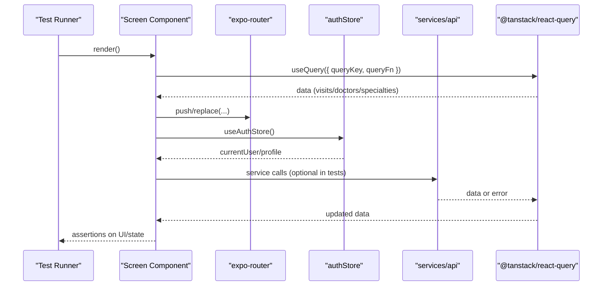

**Diagram sources**
- [index.tsx (patient home):22-49](file://src/app/(patient)/index.tsx#L22-L49)
- [index.tsx (doctor dashboard):25-49](file://src/app/(doctor)/index.tsx#L25-L49)
- [login.tsx:17-46](file://src/app/(auth)/login.tsx#L17-L46)
- [register-patient.tsx:17-69](file://src/app/(auth)/register-patient.tsx#L17-L69)

## Detailed Component Analysis

### Button Testing
- Validate props:
  - Render text/title and optional icon
  - Apply correct variant and size classes/styles
  - Show ActivityIndicator when loading
  - Disable interaction when disabled or loading
- Interactions:
  - onPress called only when interactive
  - Pressed state affects opacity
- Accessibility:
  - Ensure focusability and readable labels
- Visual consistency:
  - Compare rendered styles against theme tokens

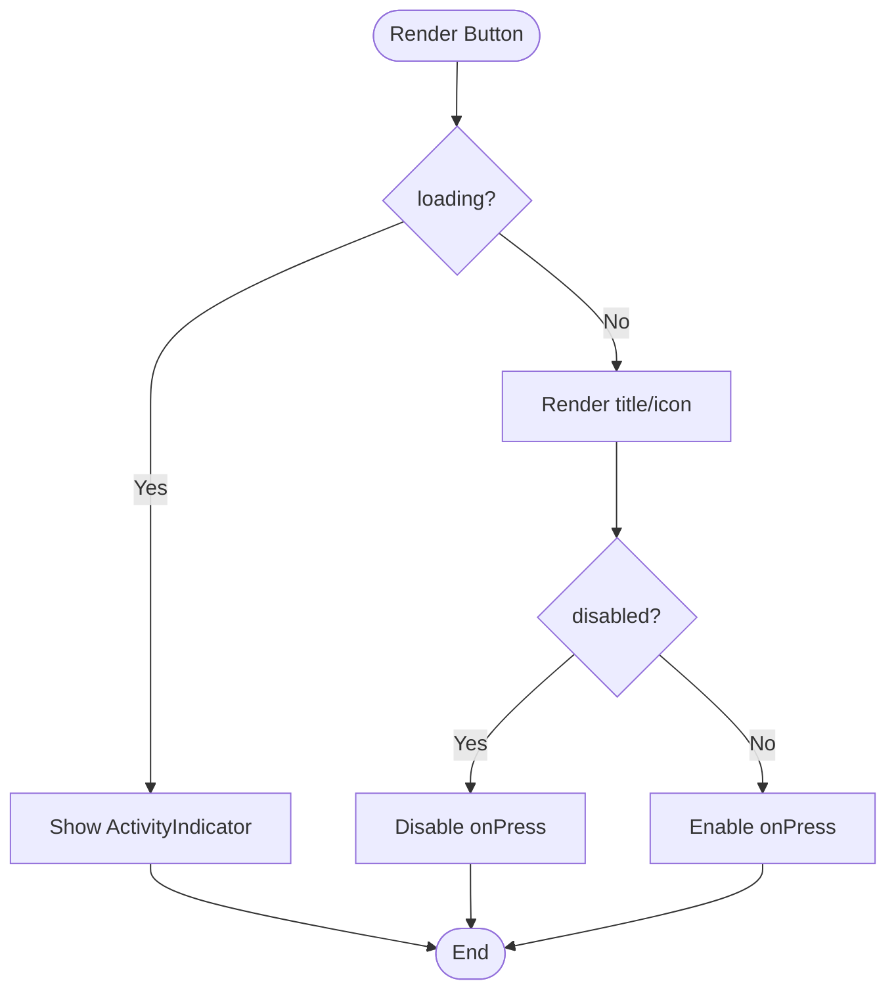

**Diagram sources**
- [Button.tsx:25-74](file://src/components/ui/Button.tsx#L25-L74)

**Section sources**
- [Button.tsx:13-74](file://src/components/ui/Button.tsx#L13-L74)

### InputField Testing
- Validate props:
  - Label renders; hint/error conditions
  - secureTextEntry toggles visibility
- Interactions:
  - onChangeText updates local state
  - Toggle button updates passwordVisible
- Accessibility:
  - Eye toggle has accessibilityRole="button" and dynamic accessibilityLabel
- Visual consistency:
  - Error border/background applied when error exists

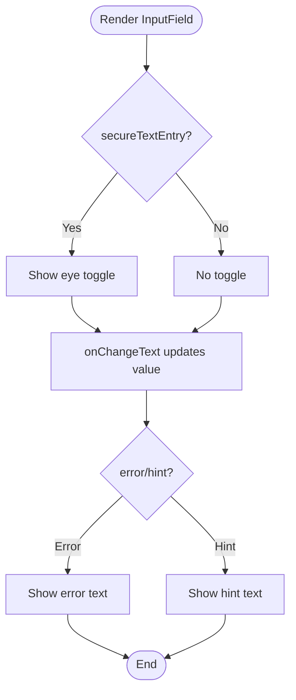

**Diagram sources**
- [InputField.tsx:22-71](file://src/components/ui/InputField.tsx#L22-L71)

**Section sources**
- [InputField.tsx:15-71](file://src/components/ui/InputField.tsx#L15-L71)

### Card Testing
- Validate props:
  - Renders children
  - Applies subtle vs shadow style
  - Wraps in Pressable when onPress provided
- Interactions:
  - Pressed state affects opacity
- Accessibility:
  - If interactive, ensure appropriate roles

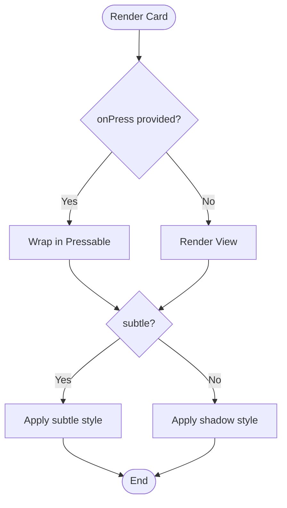

**Diagram sources**
- [Card.tsx:13-38](file://src/components/ui/Card.tsx#L13-L38)

**Section sources**
- [Card.tsx:6-38](file://src/components/ui/Card.tsx#L6-L38)

### DoctorCard Testing
- Validate props:
  - Renders doctor info: name, specialty, rating, reviews, experience, bio, coverage districts, fee
  - Verification badge shown when approved
- Interactions:
  - onPress navigates or performs default action
  - onBookPress overrides default press
- Accessibility:
  - Ensure image has alt-like properties; buttons have labels

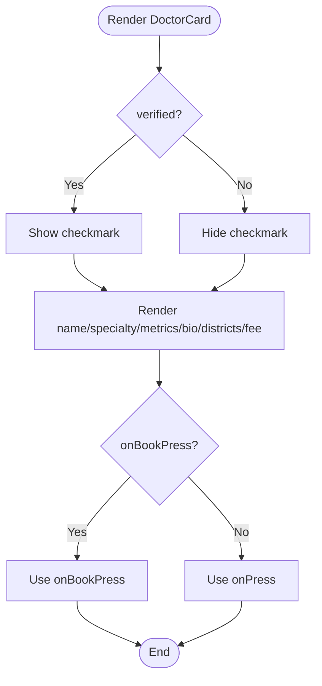

**Diagram sources**
- [DoctorCard.tsx:15-86](file://src/components/ui/DoctorCard.tsx#L15-L86)

**Section sources**
- [DoctorCard.tsx:9-86](file://src/components/ui/DoctorCard.tsx#L9-L86)

### VisitCard Testing
- Validate props:
  - Renders date/time, status badge, person details based on viewerRole, address, symptoms snippet
  - Shows alternative proposal alert when status is alternative_proposed
- Interactions:
  - Primary card press vs action button press
- Accessibility:
  - Ensure meaningful labels for icons and actions

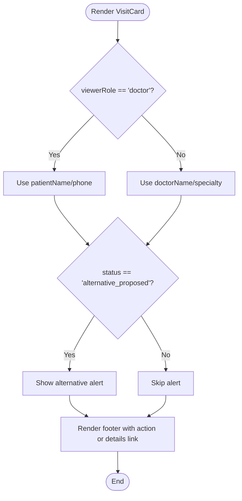

**Diagram sources**
- [VisitCard.tsx:17-88](file://src/components/ui/VisitCard.tsx#L17-L88)

**Section sources**
- [VisitCard.tsx:9-88](file://src/components/ui/VisitCard.tsx#L9-L88)

### Authentication Screens Testing

#### Login Screen
- State and validation:
  - Validates identifier and password presence
  - Displays error messages
- Async flow:
  - Calls loginCustom from authStore
  - Navigates based on user.role using expo-router
- Interactions:
  - Sign In button triggers handleLogin
  - Forgot Password and Register links navigate appropriately

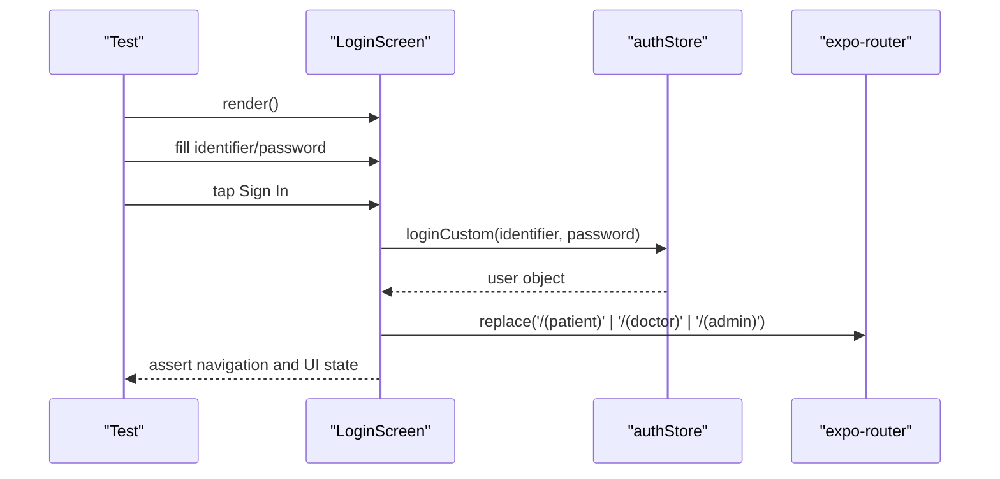

**Diagram sources**
- [login.tsx:17-46](file://src/app/(auth)/login.tsx#L17-L46)

**Section sources**
- [login.tsx:17-46](file://src/app/(auth)/login.tsx#L17-L46)

#### Register Patient Screen
- Validation:
  - Requires full name, either email or phone, password length, consent checkboxes
- Async flow:
  - Calls authService.registerPatient
  - Navigates to OTP verification with params
- Interactions:
  - Consent checkboxes toggle state
  - Submit button triggers registration flow

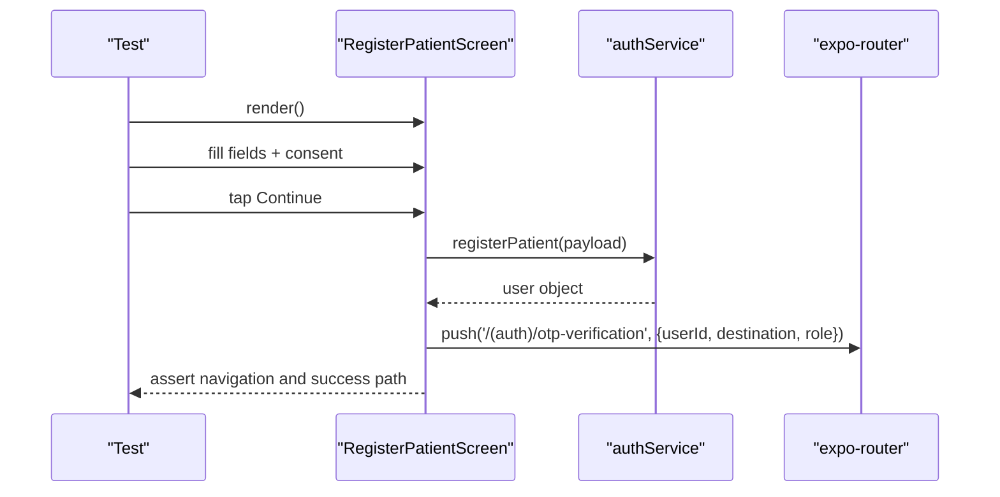

**Diagram sources**
- [register-patient.tsx:28-69](file://src/app/(auth)/register-patient.tsx#L28-L69)

**Section sources**
- [register-patient.tsx:28-69](file://src/app/(auth)/register-patient.tsx#L28-L69)

### Dashboards Testing

#### Patient Home Screen
- Data fetching:
  - Uses useQuery for visits, specialties, recommended doctors
- Interactions:
  - Pull-to-refresh refetches data
  - Navigation to doctors, notifications, and visit details
- Conditional rendering:
  - Upcoming visit banner appears when matching visits exist

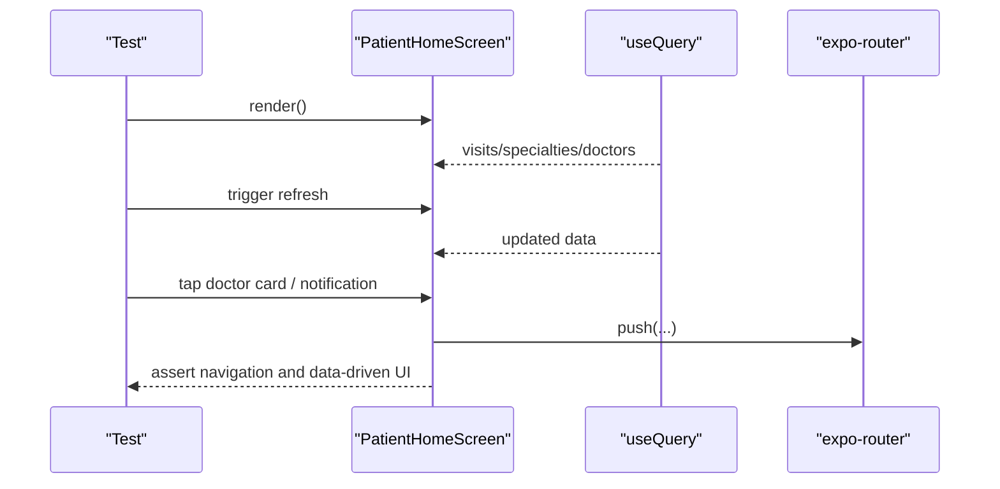

**Diagram sources**
- [index.tsx (patient home):22-49](file://src/app/(patient)/index.tsx#L22-L49)

**Section sources**
- [index.tsx (patient home):22-49](file://src/app/(patient)/index.tsx#L22-L49)

#### Doctor Dashboard Screen
- Data fetching:
  - Uses useQuery for visits
- Interactions:
  - Online/offline toggle calls doctorService.toggleOnline and refreshProfile
  - Navigation to requests and visit details
- Conditional rendering:
  - Verification notice for unapproved doctors
  - Sections for pending, active, completed visits

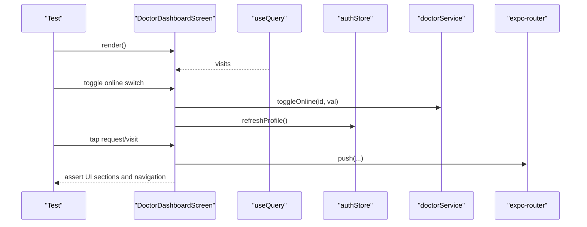

**Diagram sources**
- [index.tsx (doctor dashboard):25-49](file://src/app/(doctor)/index.tsx#L25-L49)

**Section sources**
- [index.tsx (doctor dashboard):25-49](file://src/app/(doctor)/index.tsx#L25-L49)

## Dependency Analysis
- External dependencies relevant to testing:
  - expo-router: navigation APIs (push, replace)
  - @tanstack/react-query: data fetching and caching
  - zustand: global state via authStore
  - react-native: core UI primitives
  - @expo/vector-icons: icons used across components

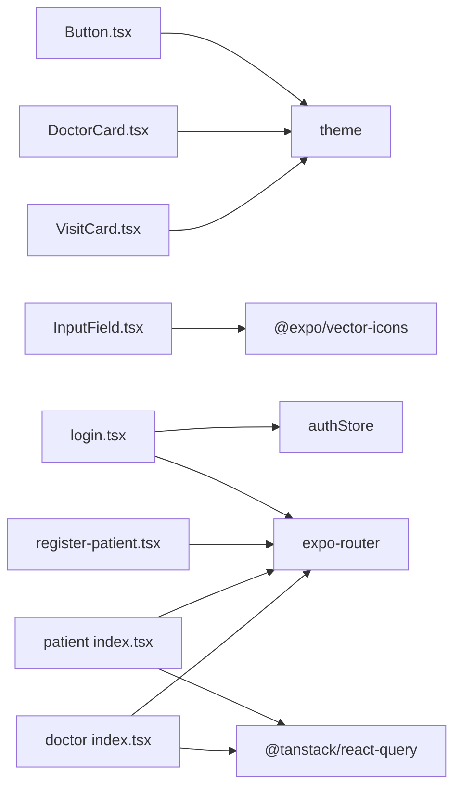

**Diagram sources**
- [Button.tsx:1-12](file://src/components/ui/Button.tsx#L1-L12)
- [InputField.tsx:1-14](file://src/components/ui/InputField.tsx#L1-L14)
- [DoctorCard.tsx:1-8](file://src/components/ui/DoctorCard.tsx#L1-L8)
- [VisitCard.tsx:1-8](file://src/components/ui/VisitCard.tsx#L1-L8)
- [login.tsx:1-16](file://src/app/(auth)/login.tsx#L1-L16)
- [register-patient.tsx:1-16](file://src/app/(auth)/register-patient.tsx#L1-L16)
- [index.tsx (patient home):1-21](file://src/app/(patient)/index.tsx#L1-L21)
- [index.tsx (doctor dashboard):1-24](file://src/app/(doctor)/index.tsx#L1-L24)

**Section sources**
- [package.json:5-21](file://package.json#L5-L21)

## Performance Considerations
- Keep unit tests fast by mocking external dependencies (router, store, services).
- Avoid heavy snapshots for complex screens; prefer focused assertions on critical paths.
- For data-heavy screens, mock query results to prevent network calls and reduce flakiness.
- Reuse fixtures for domain models (DoctorProfile, VisitRequest) to keep tests concise.

## Troubleshooting Guide
Common issues and resolutions:
- Navigation not triggered in tests
  - Ensure expo-router is properly configured in your test environment and mocks are set up for push/replace.
- Auth store methods not invoked
  - Mock useAuthStore to return expected currentUser and methods like loginCustom, refreshProfile.
- Query not resolving
  - Provide mock data via @tanstack/react-query testing utilities or wrap components with a test provider that supplies queries.
- Accessibility failures
  - Verify accessibilityRole and accessibilityLabel on interactive elements; ensure labels reflect current state (e.g., show/hide password).
- Visual regressions
  - Use snapshot tests sparingly and compare against stable baselines; prefer visual regression tools for entire screens.

**Section sources**
- [login.tsx:23-46](file://src/app/(auth)/login.tsx#L23-L46)
- [register-patient.tsx:28-69](file://src/app/(auth)/register-patient.tsx#L28-L69)
- [index.tsx (patient home):22-49](file://src/app/(patient)/index.tsx#L22-L49)
- [index.tsx (doctor dashboard):25-49](file://src/app/(doctor)/index.tsx#L25-L49)

## Conclusion
By isolating UI primitives, validating props and interactions, mocking navigation and data layers, and asserting accessibility and visual consistency, you can build robust tests for this healthcare application. Focus on realistic user flows for authentication and dashboards, and leverage fixtures and mocks to keep tests deterministic and maintainable.