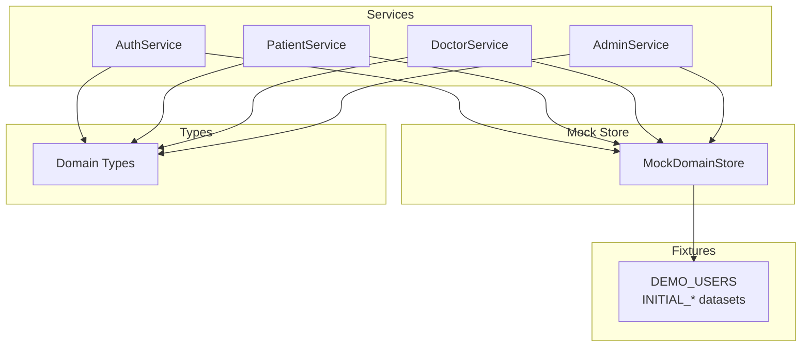
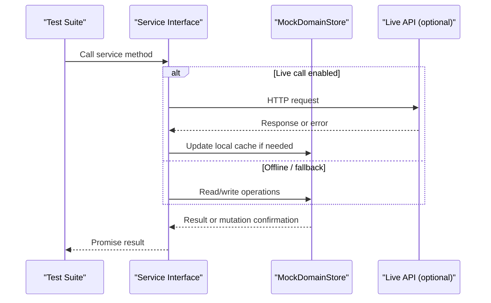
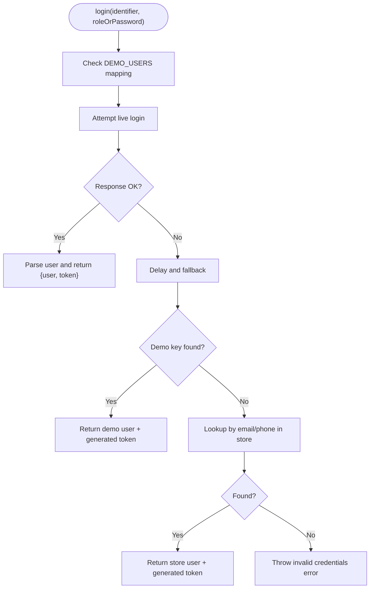
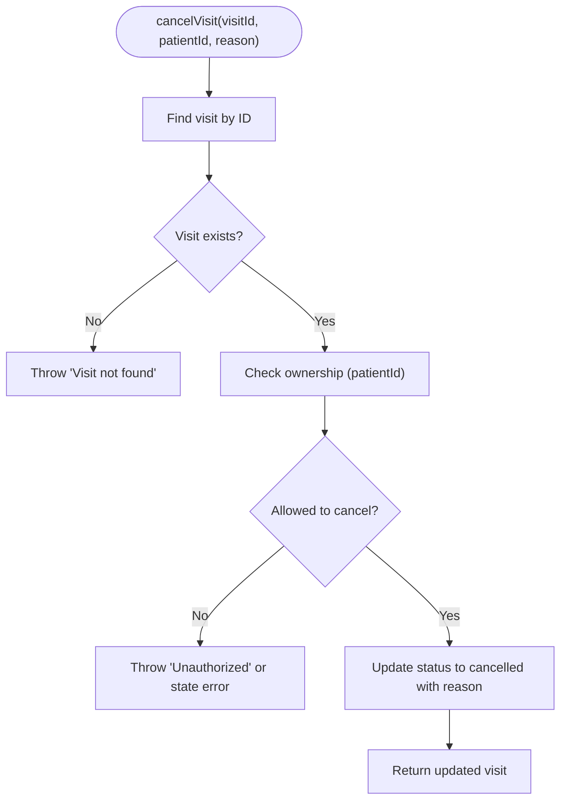
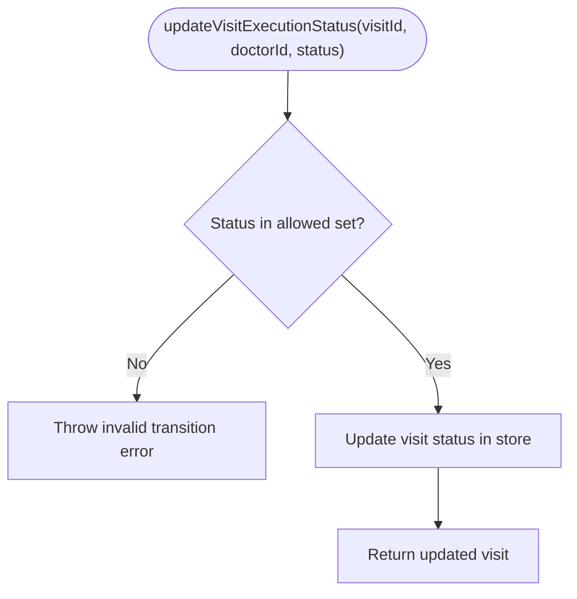
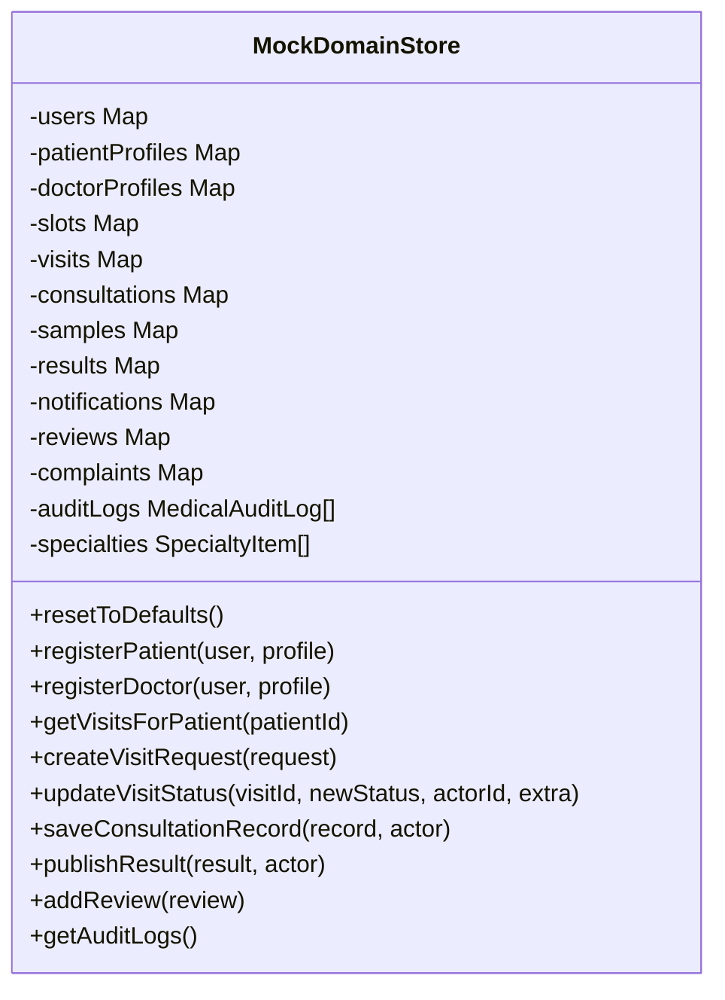
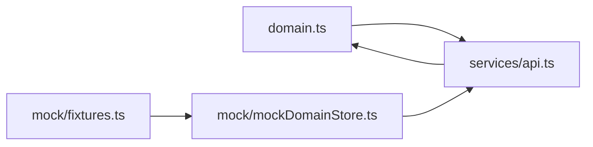

# Service Layer Testing

<cite>
**Referenced Files in This Document**
- [api.ts](file://src/services/api.ts)
- [mockDomainStore.ts](file://src/mock/mockDomainStore.ts)
- [fixtures.ts](file://src/mock/fixtures.ts)
- [domain.ts](file://src/types/domain.ts)
- [package.json](file://package.json)
</cite>

## Table of Contents
1. [Introduction](#introduction)
2. [Project Structure](#project-structure)
3. [Core Components](#core-components)
4. [Architecture Overview](#architecture-overview)
5. [Detailed Component Analysis](#detailed-component-analysis)
6. [Dependency Analysis](#dependency-analysis)
7. [Performance Considerations](#performance-considerations)
8. [Troubleshooting Guide](#troubleshooting-guide)
9. [Conclusion](#conclusion)

## Introduction
This document explains how to test the service layer abstraction and mock data system for a healthcare application. It covers testing API service interfaces, mock implementations, and real backend integrations. It also details strategies for testing the mock domain store with realistic healthcare scenarios including patient-doctor relationships, visit workflows, and medical records. The guidance includes approaches for testing service method calls, error handling, data transformation logic, CRUD operations, complex business logic, validation rules, asynchronous operations, network failures, and edge cases specific to healthcare data management.

## Project Structure
The service layer is implemented as TypeScript modules that expose typed service interfaces and concrete implementations. A global in-memory mock store provides deterministic state for tests. Domain types define entities such as users, patients, doctors, visits, consultations, lab samples, results, notifications, reviews, complaints, and audit logs. Fixtures provide realistic seed data for East African healthcare scenarios.

**Diagram sources**
- [api.ts:25-41](file://src/services/api.ts#L25-L41)
- [api.ts:247-272](file://src/services/api.ts#L247-L272)
- [api.ts:432-466](file://src/services/api.ts#L432-L466)
- [api.ts:587-602](file://src/services/api.ts#L587-L602)
- [mockDomainStore.ts:35-49](file://src/mock/mockDomainStore.ts#L35-L49)
- [fixtures.ts:72-118](file://src/mock/fixtures.ts#L72-L118)
- [domain.ts:29-241](file://src/types/domain.ts#L29-L241)

**Section sources**
- [api.ts:1-660](file://src/services/api.ts#L1-L660)
- [mockDomainStore.ts:1-557](file://src/mock/mockDomainStore.ts#L1-L557)
- [fixtures.ts:1-904](file://src/mock/fixtures.ts#L1-L904)
- [domain.ts:1-242](file://src/types/domain.ts#L1-L242)

## Core Components
- AuthService: Authentication, OTP verification, registration, current user retrieval, password reset.
- PatientService: Patient profile management, doctor search, visit lifecycle (create, cancel, reschedule, accept/reject alternative time), records retrieval, result documents, reviews, complaints.
- DoctorService: Doctor profile, availability slots, visit acceptance/decline/alternative proposal, execution status transitions, consultation record drafting/publishing, lab result publishing.
- AdminService: Doctor verification, visit oversight, complaint resolution, audit logs, platform metrics.
- MockDomainStore: In-memory persistent reactive store with account isolation, domain events, cross-role notifications, audit logging, and comprehensive CRUD operations.
- Fixtures: Realistic seed data for users, patients, doctors, slots, visits, consultations, samples, results, notifications, reviews, audit logs, complaints, and specialties.
- Domain Types: Strongly-typed entities ensuring consistent contracts across services and store.

Key responsibilities and interactions are defined by service interfaces and implemented via the mock store. Services may attempt live HTTP calls but gracefully fall back to the mock store when offline or during tests.

**Section sources**
- [api.ts:25-41](file://src/services/api.ts#L25-L41)
- [api.ts:247-272](file://src/services/api.ts#L247-L272)
- [api.ts:432-466](file://src/services/api.ts#L432-L466)
- [api.ts:587-602](file://src/services/api.ts#L587-L602)
- [mockDomainStore.ts:35-49](file://src/mock/mockDomainStore.ts#L35-L49)
- [domain.ts:29-241](file://src/types/domain.ts#L29-L241)

## Architecture Overview
The service layer abstracts both live backend integration and mock behavior behind stable interfaces. Tests can target these interfaces directly, enabling unit tests without network dependencies while still validating business logic and data transformations.

**Diagram sources**
- [api.ts:46-104](file://src/services/api.ts#L46-L104)
- [api.ts:106-122](file://src/services/api.ts#L106-L122)
- [api.ts:124-197](file://src/services/api.ts#L124-L197)
- [mockDomainStore.ts:129-154](file://src/mock/mockDomainStore.ts#L129-L154)

## Detailed Component Analysis

### AuthService Testing
- Login flow: Supports demo keys, resolves credentials, attempts live login, falls back to mock store, returns token and user.
- OTP verification: Attempts live endpoint; otherwise validates code length or known value.
- Registration: Creates user and profile, persists to mock store, returns user.
- Current user: Returns user from store or null.
- Password reset: Simulated success.

Testing strategies:
- Verify successful login with demo keys and correct token format.
- Assert fallback behavior when fetch fails or backend is unavailable.
- Validate registration creates both User and PatientProfile in the store.
- Ensure getCurrentUser returns null for missing IDs.
- Confirm resetPassword returns true deterministically.

**Diagram sources**
- [api.ts:46-104](file://src/services/api.ts#L46-L104)

**Section sources**
- [api.ts:46-104](file://src/services/api.ts#L46-L104)
- [api.ts:106-122](file://src/services/api.ts#L106-L122)
- [api.ts:124-197](file://src/services/api.ts#L124-L197)
- [api.ts:236-244](file://src/services/api.ts#L236-L244)

### PatientService Testing
- Profile management: Get/update profiles with delays and store mutations.
- Doctor search: Filters by query, specialty, district, language, fee, rating, online status.
- Visit lifecycle: Create pending visits, cancel/reschedule with validations, accept/reject alternative times.
- Records and results: Retrieve consultations and results; throw errors for missing resources.
- Reviews and complaints: Add reviews and update doctor ratings; submit complaints.

Testing strategies:
- Validate filtering logic across multiple parameters.
- Assert visit cancellation constraints (e.g., cannot cancel after doctor started traveling).
- Confirm rescheduling resets status to pending and updates timestamps.
- Ensure alternative time acceptance updates scheduled fields and clears alternatives.
- Verify error throwing for missing visits/results/doctors.
- Check review submission updates average rating and review count on doctor profile.

**Diagram sources**
- [api.ts:359-368](file://src/services/api.ts#L359-L368)

**Section sources**
- [api.ts:274-430](file://src/services/api.ts#L274-L430)
- [mockDomainStore.ts:222-380](file://src/mock/mockDomainStore.ts#L222-L380)

### DoctorService Testing
- Availability slots: Add/remove slots with overlap checks.
- Visit workflow: Accept/decline visits, propose alternative times, update execution statuses with valid states.
- Consultation records: Save drafts and publish final records with audit logging.
- Lab results: Publish results with metadata and notify patients.

Testing strategies:
- Assert slot overlap prevention and blocked slot handling.
- Validate doctor verification status before accepting visits.
- Enforce valid execution status transitions.
- Confirm draft vs published record differences and audit entries.
- Verify result publication triggers notifications and audit logs.

**Diagram sources**
- [api.ts:531-538](file://src/services/api.ts#L531-L538)

**Section sources**
- [api.ts:468-585](file://src/services/api.ts#L468-L585)
- [mockDomainStore.ts:202-220](file://src/mock/mockDomainStore.ts#L202-L220)
- [mockDomainStore.ts:382-406](file://src/mock/mockDomainStore.ts#L382-L406)
- [mockDomainStore.ts:436-464](file://src/mock/mockDomainStore.ts#L436-L464)

### AdminService Testing
- Doctor verification: Approve/pending/suspend doctors with audit logging.
- Visits and complaints: Retrieve all visits and complaints; resolve complaints.
- Audit logs: Access chronological audit entries.
- Platform metrics: Compute totals, active visits, gross revenue, average rating, pending verifications.

Testing strategies:
- Verify doctor status changes reflect in store and audit logs.
- Ensure resolved complaints include resolution notes.
- Validate metric calculations against stored visits and doctors.

**Section sources**
- [api.ts:604-659](file://src/services/api.ts#L604-L659)
- [mockDomainStore.ts:185-192](file://src/mock/mockDomainStore.ts#L185-L192)
- [mockDomainStore.ts:513-520](file://src/mock/mockDomainStore.ts#L513-L520)
- [mockDomainStore.ts:523-527](file://src/mock/mockDomainStore.ts#L523-L527)

### MockDomainStore Testing
- Data initialization: Reset to defaults using fixtures.
- CRUD operations: Users, patient profiles, doctor profiles, slots, visits, consultations, samples, results, notifications, reviews, complaints, audit logs.
- Business rules: Double booking prevention, slot booking/unbooking, visit status transitions, notification generation, audit logging, rating recalculation.

Testing strategies:
- Assert resetToDefaults restores initial state deterministically.
- Validate createVisitRequest prevents double bookings and marks slots booked.
- Confirm updateVisitStatus frees slots on cancellation/decline/expiry and generates notifications.
- Ensure addReview recalculates doctor average rating and review count.
- Verify publishResult notifies patient and logs audit entry.

**Diagram sources**
- [mockDomainStore.ts:35-49](file://src/mock/mockDomainStore.ts#L35-L49)
- [mockDomainStore.ts:72-127](file://src/mock/mockDomainStore.ts#L72-L127)
- [mockDomainStore.ts:144-154](file://src/mock/mockDomainStore.ts#L144-L154)
- [mockDomainStore.ts:245-281](file://src/mock/mockDomainStore.ts#L245-L281)
- [mockDomainStore.ts:283-380](file://src/mock/mockDomainStore.ts#L283-L380)
- [mockDomainStore.ts:393-406](file://src/mock/mockDomainStore.ts#L393-L406)
- [mockDomainStore.ts:436-464](file://src/mock/mockDomainStore.ts#L436-L464)
- [mockDomainStore.ts:482-496](file://src/mock/mockDomainStore.ts#L482-L496)
- [mockDomainStore.ts:523-527](file://src/mock/mockDomainStore.ts#L523-L527)

**Section sources**
- [mockDomainStore.ts:1-557](file://src/mock/mockDomainStore.ts#L1-L557)

### Fixtures and Domain Types
- Fixtures provide realistic seed data for multi-country healthcare scenarios, including verified, pending, and suspended doctors; sample visits with varied statuses; consultation records; lab samples; results; notifications; reviews; audit logs; complaints; and specialties.
- Domain types enforce strict contracts for users, profiles, visits, consultations, samples, results, notifications, reviews, complaints, and audit logs.

Testing strategies:
- Use fixtures to construct predictable scenarios for each service method.
- Validate type safety across service inputs/outputs and store mutations.
- Ensure multi-country coverage districts and currencies are respected where applicable.

**Section sources**
- [fixtures.ts:1-904](file://src/mock/fixtures.ts#L1-L904)
- [domain.ts:1-242](file://src/types/domain.ts#L1-L242)

## Dependency Analysis
The services depend on the mock store for persistence and on fixtures for initial data. Domain types are shared across services and store. The live API is optional and only used when available; otherwise, services rely on the mock store.

**Diagram sources**
- [domain.ts:1-242](file://src/types/domain.ts#L1-L242)
- [fixtures.ts:1-904](file://src/mock/fixtures.ts#L1-L904)
- [mockDomainStore.ts:1-557](file://src/mock/mockDomainStore.ts#L1-L557)
- [api.ts:1-660](file://src/services/api.ts#L1-L660)

**Section sources**
- [api.ts:1-660](file://src/services/api.ts#L1-L660)
- [mockDomainStore.ts:1-557](file://src/mock/mockDomainStore.ts#L1-L557)
- [fixtures.ts:1-904](file://src/mock/fixtures.ts#L1-L904)
- [domain.ts:1-242](file://src/types/domain.ts#L1-L242)

## Performance Considerations
- All service methods introduce simulated latency via a delay helper. Tests should await promises and avoid relying on synchronous behavior.
- The mock store uses Maps for O(1) lookups and arrays for filtered queries; large datasets may incur O(n) filtering costs.
- Metrics computation aggregates over visits and doctors; ensure test datasets are representative but minimal for speed.

[No sources needed since this section provides general guidance]

## Troubleshooting Guide
Common issues and resolutions:
- Network failures: Services catch fetch errors and fall back to mock store. Tests should assert fallback paths and error messages.
- Invalid credentials: Login throws an error when no matching user is found in store.
- Unauthorized actions: PatientService enforces ownership checks; DoctorService enforces verification status.
- State transitions: DoctorService restricts execution statuses; PatientService restricts cancellations/reschedules based on visit status.
- Missing resources: Methods throw errors for non-existent visits, results, or doctors.

Recommended assertions:
- Catch thrown errors and verify message content.
- Inspect store state after mutations (e.g., visit status, slot booking flags, notifications, audit logs).
- Validate derived values like doctor ratings and platform metrics.

**Section sources**
- [api.ts:89-104](file://src/services/api.ts#L89-L104)
- [api.ts:359-368](file://src/services/api.ts#L359-L368)
- [api.ts:508-515](file://src/services/api.ts#L508-L515)
- [api.ts:531-538](file://src/services/api.ts#L531-L538)
- [mockDomainStore.ts:245-281](file://src/mock/mockDomainStore.ts#L245-L281)
- [mockDomainStore.ts:283-380](file://src/mock/mockDomainStore.ts#L283-L380)

## Conclusion
The service layer provides robust, testable abstractions for authentication, patient and doctor workflows, administrative functions, and clinical documentation. By leveraging the mock domain store and realistic fixtures, tests can validate business logic, error handling, and data transformations without external dependencies. The documented strategies enable comprehensive coverage of CRUD operations, complex workflows, validation rules, asynchronous behavior, network failure resilience, and healthcare-specific edge cases.

[No sources needed since this section summarizes without analyzing specific files]