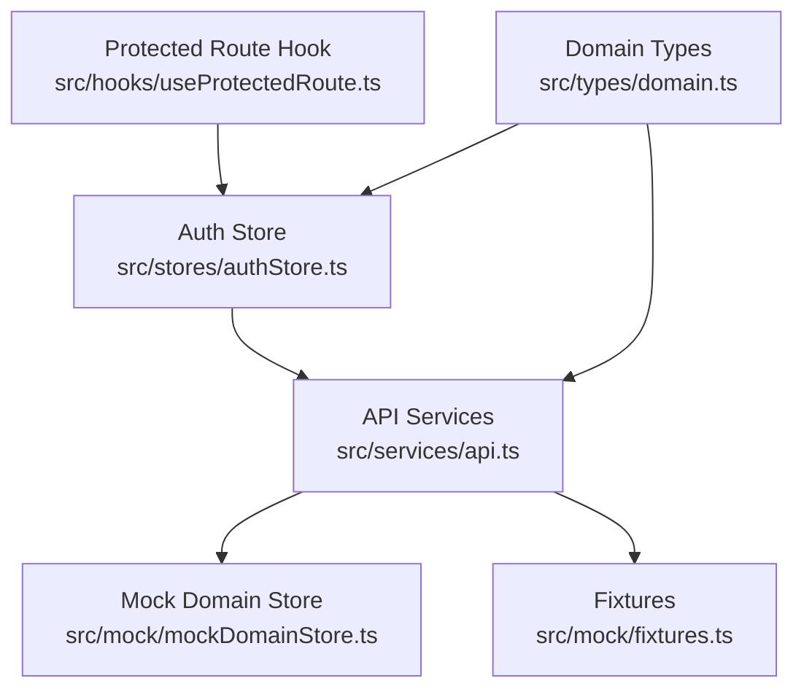
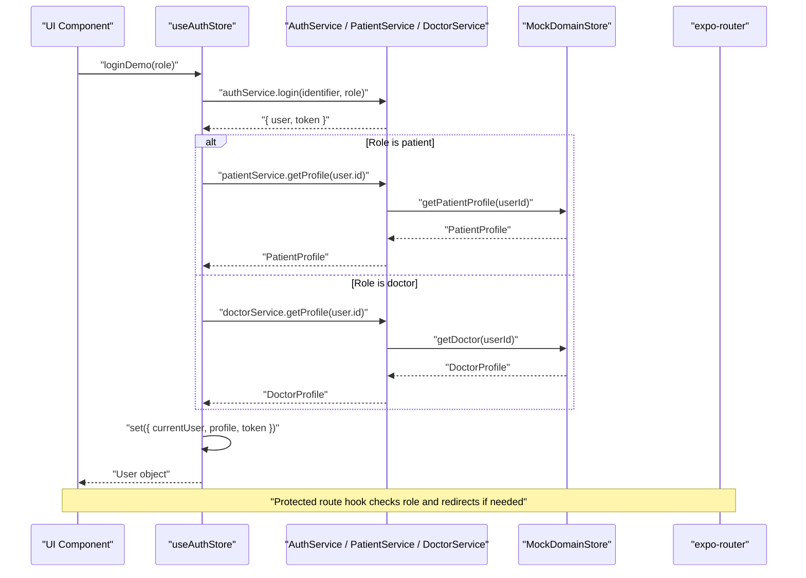
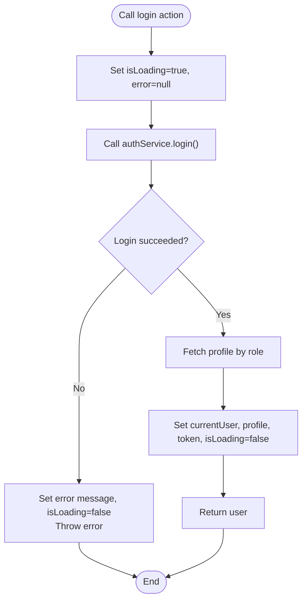
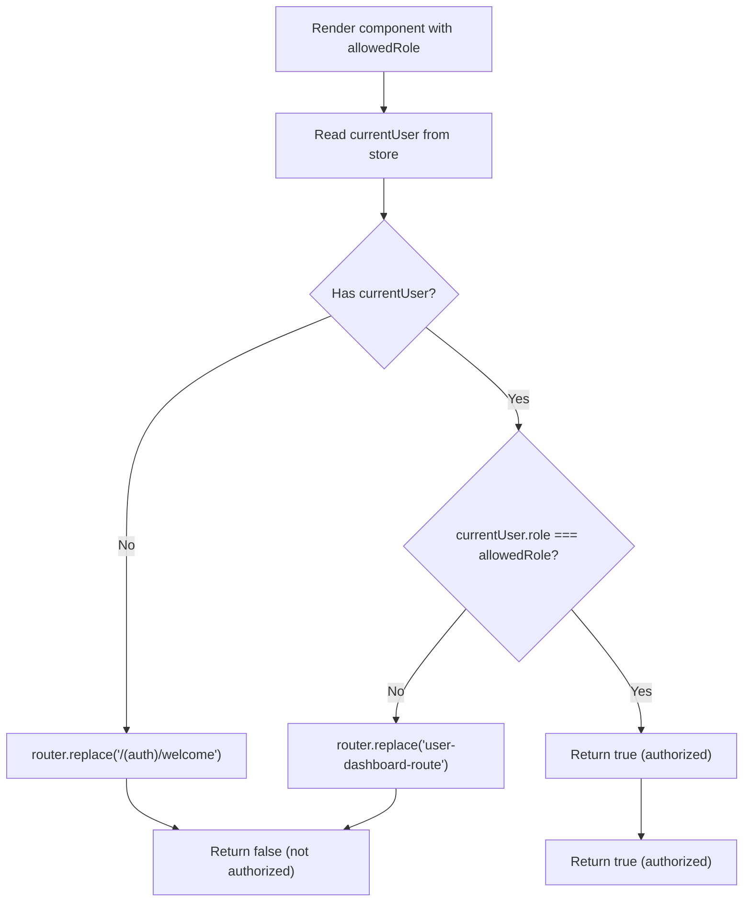
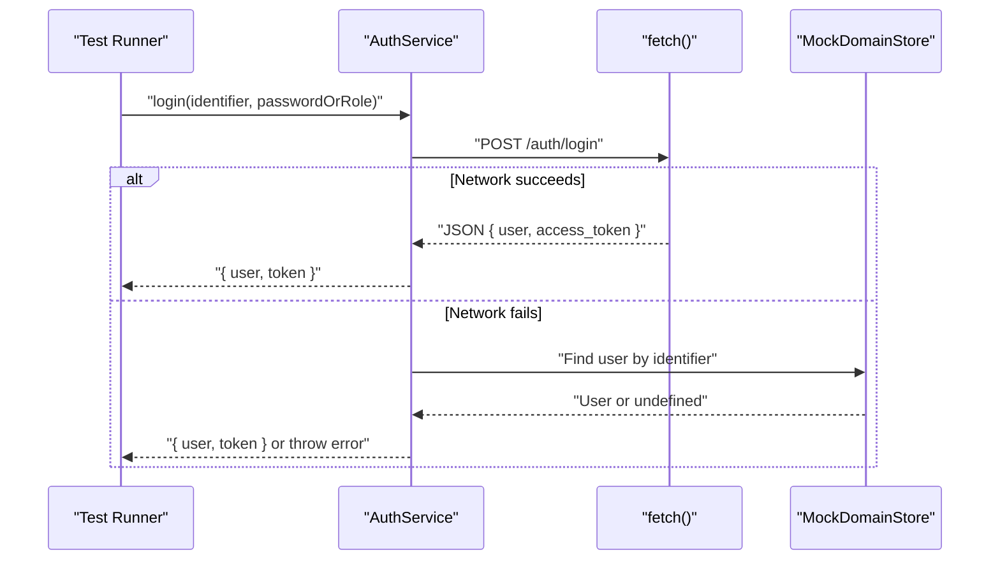
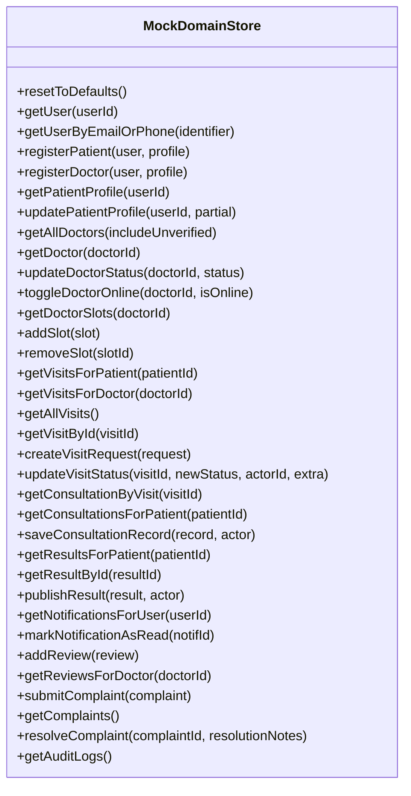
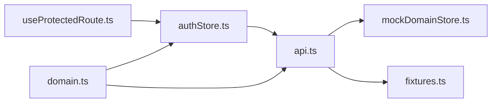

# State Management Testing

<cite>
**Referenced Files in This Document**
- [authStore.ts](file://src/stores/authStore.ts)
- [useProtectedRoute.ts](file://src/hooks/useProtectedRoute.ts)
- [api.ts](file://src/services/api.ts)
- [domain.ts](file://src/types/domain.ts)
- [fixtures.ts](file://src/mock/fixtures.ts)
- [mockDomainStore.ts](file://src/mock/mockDomainStore.ts)
- [package.json](file://package.json)
</cite>

## Table of Contents
1. [Introduction](#introduction)
2. [Project Structure](#project-structure)
3. [Core Components](#core-components)
4. [Architecture Overview](#architecture-overview)
5. [Detailed Component Analysis](#detailed-component-analysis)
6. [Dependency Analysis](#dependency-analysis)
7. [Performance Considerations](#performance-considerations)
8. [Troubleshooting Guide](#troubleshooting-guide)
9. [Conclusion](#conclusion)

## Introduction
This document explains how to test Zustand-based state management and role-aware navigation in the application. It focuses on:
- Testing the authentication store for user login, logout, profile loading, error handling, and demo data reset.
- Testing the protected route hook for authorization guards and navigation redirections.
- Testing async operations, side effects, and mock-driven service layers.
- Strategies for testing store subscriptions, performance optimization, and memory leak prevention during tests.

The codebase uses Zustand for client-side state, a service layer that can call a backend or fall back to an in-memory mock domain store, and React hooks for UI logic and navigation guards.

## Project Structure
The relevant parts for state management testing are:
- Store: `src/stores/authStore.ts`
- Navigation guard hook: `src/hooks/useProtectedRoute.ts`
- Service contracts and implementations: `src/services/api.ts`
- Domain types: `src/types/domain.ts`
- Mock fixtures and in-memory store: `src/mock/fixtures.ts`, `src/mock/mockDomainStore.ts`
- Dependencies: `package.json`

**Diagram sources**
- [authStore.ts:1-112](file://src/stores/authStore.ts#L1-L112)
- [useProtectedRoute.ts:1-40](file://src/hooks/useProtectedRoute.ts#L1-L40)
- [api.ts:1-660](file://src/services/api.ts#L1-L660)
- [domain.ts:1-242](file://src/types/domain.ts#L1-L242)
- [fixtures.ts:1-904](file://src/mock/fixtures.ts#L1-L904)
- [mockDomainStore.ts:1-557](file://src/mock/mockDomainStore.ts#L1-L557)

**Section sources**
- [authStore.ts:1-112](file://src/stores/authStore.ts#L1-L112)
- [useProtectedRoute.ts:1-40](file://src/hooks/useProtectedRoute.ts#L1-L40)
- [api.ts:1-660](file://src/services/api.ts#L1-L660)
- [domain.ts:1-242](file://src/types/domain.ts#L1-L242)
- [fixtures.ts:1-904](file://src/mock/fixtures.ts#L1-L904)
- [mockDomainStore.ts:1-557](file://src/mock/mockDomainStore.ts#L1-L557)
- [package.json:1-36](file://package.json#L1-L36)

## Core Components
- Authentication store: Manages current user, token, patient/doctor profiles, loading and error states, and exposes actions for demo login, custom login, logout, profile refresh, and demo data reset.
- Protected route hook: Enforces role-based access by redirecting unauthorized users to appropriate routes and returning an authorization flag for rendering decisions.
- API services: Provide asynchronous contracts for auth, patient, doctor, and admin operations. They attempt real network calls but gracefully fallback to mock data when unavailable.
- Mock domain store: In-memory reactive store with account isolation, rich domain entities, and deterministic behavior for tests.
- Domain types: Strongly typed models for users, profiles, visits, results, notifications, and audit logs.

Key responsibilities:
- Auth store orchestrates login flows and profile fetching based on user roles.
- Protected route hook centralizes navigation guards for protected groups.
- Services abstract persistence and external dependencies, making them easy to mock or replace.
- Mock domain store provides stable, predictable data for unit and integration tests.

**Section sources**
- [authStore.ts:7-111](file://src/stores/authStore.ts#L7-L111)
- [useProtectedRoute.ts:9-38](file://src/hooks/useProtectedRoute.ts#L9-L38)
- [api.ts:25-245](file://src/services/api.ts#L25-L245)
- [mockDomainStore.ts:35-127](file://src/mock/mockDomainStore.ts#L35-L127)
- [domain.ts:29-85](file://src/types/domain.ts#L29-L85)

## Architecture Overview
The authentication flow involves the UI calling the auth store, which delegates to API services. The services may call a backend or use the mock domain store. The protected route hook reads the current user from the store and enforces navigation rules.

**Diagram sources**
- [authStore.ts:31-83](file://src/stores/authStore.ts#L31-L83)
- [api.ts:46-104](file://src/services/api.ts#L46-L104)
- [api.ts:274-278](file://src/services/api.ts#L274-L278)
- [api.ts:468-472](file://src/services/api.ts#L468-L472)
- [mockDomainStore.ts:157-168](file://src/mock/mockDomainStore.ts#L157-L168)
- [mockDomainStore.ts:181-183](file://src/mock/mockDomainStore.ts#L181-L183)
- [useProtectedRoute.ts:14-33](file://src/hooks/useProtectedRoute.ts#L14-L33)

## Detailed Component Analysis

### Authentication Store Testing
The authentication store encapsulates session state and role-aware profile loading. Tests should cover:
- Successful login with demo roles and custom identifiers.
- Profile resolution for patients and doctors.
- Error propagation and error state updates.
- Logout clearing all session fields.
- Profile refresh updating only the relevant profile slice.
- Demo data reset invoking mock store defaults and refreshing the profile.

Recommended test scenarios:
- Login success path: assert that `currentUser`, `token`, and the correct profile are set after login.
- Login failure path: assert that `error` is set and `isLoading` returns to false; verify thrown errors propagate to callers.
- Logout: assert that `currentUser`, `token`, and both profiles become null.
- Refresh profile: assert that only the matching profile field changes based on `currentUser.role`.
- Reset demo data: assert that mock store defaults are restored and profile refresh is triggered.

**Diagram sources**
- [authStore.ts:31-55](file://src/stores/authStore.ts#L31-L55)
- [authStore.ts:58-83](file://src/stores/authStore.ts#L58-L83)

Testing tips:
- Use the store’s selector pattern to subscribe to specific slices like `currentUser`, `token`, `isLoading`, and `error`.
- For async assertions, await the promise returned by login actions before asserting state.
- To isolate tests, reset the mock domain store before each test using the store’s reset function or by reinitializing the store instance where applicable.

**Section sources**
- [authStore.ts:7-111](file://src/stores/authStore.ts#L7-L111)

### Protected Route Hook Testing
The protected route hook enforces role-based access control by redirecting unauthorized users and returning an authorization boolean for conditional rendering.

Recommended test scenarios:
- Unauthenticated user: assert navigation to welcome screen and return value indicates not authorized.
- Wrong role: assert navigation to the user’s dashboard route and return value indicates not authorized.
- Correct role: assert no navigation occurs and return value indicates authorized.
- Multiple renders: ensure the effect runs once per dependency change and does not cause repeated redirects.

**Diagram sources**
- [useProtectedRoute.ts:11-38](file://src/hooks/useProtectedRoute.ts#L11-L38)

Testing tips:
- Mock the router module to capture navigation calls without triggering actual route transitions.
- Assert the exact replacement route based on the user’s role.
- Verify the hook returns the expected boolean for rendering sensitive UI conditionally.

**Section sources**
- [useProtectedRoute.ts:1-40](file://src/hooks/useProtectedRoute.ts#L1-L40)

### Service Layer and Async Operations Testing
The service layer defines asynchronous contracts for authentication, patient, doctor, and admin operations. It attempts real HTTP requests but falls back to mock data when the backend is unavailable.

Recommended test strategies:
- Mock fetch or intercept network calls to simulate success and failure responses.
- Validate that login resolves with `{ user, token }` and that errors are propagated correctly.
- Confirm profile endpoints return the expected domain objects from the mock store.
- Ensure delays are handled in tests using timers or test utilities to avoid flaky timing issues.

**Diagram sources**
- [api.ts:46-104](file://src/services/api.ts#L46-L104)
- [api.ts:106-122](file://src/services/api.ts#L106-L122)
- [api.ts:274-278](file://src/services/api.ts#L274-L278)
- [api.ts:468-472](file://src/services/api.ts#L468-L472)

Testing tips:
- Use timer mocks to resolve simulated latency deterministically.
- Prefer mocking the service layer rather than the store to keep tests focused on business logic.
- Validate error messages and thrown exceptions for invalid credentials or missing resources.

**Section sources**
- [api.ts:1-660](file://src/services/api.ts#L1-L660)

### Mock Domain Store and Fixtures Testing
The mock domain store provides deterministic data and behaviors for users, profiles, visits, slots, results, notifications, reviews, complaints, and audit logs. Fixtures define initial data sets used across the app.

Recommended test scenarios:
- Reset to defaults: assert all collections are initialized to known values.
- User lookup: assert email/phone lookup returns the correct user.
- Profile updates: assert partial updates merge correctly and audit logs are recorded.
- Visit lifecycle: assert status transitions, slot booking/unbooking, and notification creation.
- Result publishing: assert result documents are stored and patient notifications created.

**Diagram sources**
- [mockDomainStore.ts:35-557](file://src/mock/mockDomainStore.ts#L35-L557)

Testing tips:
- Use `resetToDefaults()` before tests to ensure clean state.
- Validate cross-role side effects such as notifications and audit logs.
- Keep fixture data minimal for fast tests while covering edge cases like unverified/suspended doctors.

**Section sources**
- [mockDomainStore.ts:35-557](file://src/mock/mockDomainStore.ts#L35-L557)
- [fixtures.ts:72-118](file://src/mock/fixtures.ts#L72-L118)

### Session Management and Role Switching
Session management includes setting tokens, profiles, and clearing state on logout. Role switching can be tested by logging in with different roles and verifying:
- Correct profile type is loaded.
- Protected routes redirect appropriately.
- Subsequent profile refresh targets the correct profile slice.

Recommended approach:
- Create helper functions to log in as a specific role using demo keys.
- Assert store state after each login.
- Assert navigation outcomes via mocked router.

**Section sources**
- [authStore.ts:31-111](file://src/stores/authStore.ts#L31-L111)
- [useProtectedRoute.ts:11-38](file://src/hooks/useProtectedRoute.ts#L11-L38)

### Protected Route Access Control
Protected route access control ensures only authorized roles can render sensitive screens. Tests should validate:
- Unauthorized users are redirected to welcome.
- Users with wrong roles are redirected to their own dashboards.
- Authorized users see the intended content.

Recommended approach:
- Wrap components under test with the hook and assert rendered output based on the authorization boolean.
- Mock the router to prevent actual navigation during tests.

**Section sources**
- [useProtectedRoute.ts:1-40](file://src/hooks/useProtectedRoute.ts#L1-L40)

## Dependency Analysis
The following diagram shows how components depend on each other:

**Diagram sources**
- [authStore.ts:1-112](file://src/stores/authStore.ts#L1-L112)
- [useProtectedRoute.ts:1-40](file://src/hooks/useProtectedRoute.ts#L1-L40)
- [api.ts:1-660](file://src/services/api.ts#L1-L660)
- [mockDomainStore.ts:1-557](file://src/mock/mockDomainStore.ts#L1-L557)
- [fixtures.ts:1-904](file://src/mock/fixtures.ts#L1-L904)
- [domain.ts:1-242](file://src/types/domain.ts#L1-L242)

Coupling and cohesion:
- Auth store depends on API services and domain types; it remains cohesive around session state.
- Protected route hook depends only on the auth store and router; it is highly cohesive for navigation guards.
- API services depend on mock domain store and fixtures; they provide a clear abstraction boundary for persistence.

Potential circular dependencies:
- No direct circular imports are visible between these modules; dependencies flow from UI/hook/store to services to mock store.

External dependencies:
- Zustand for state management.
- Expo Router for navigation.
- React hooks for side effects.

**Section sources**
- [authStore.ts:1-112](file://src/stores/authStore.ts#L1-L112)
- [useProtectedRoute.ts:1-40](file://src/hooks/useProtectedRoute.ts#L1-L40)
- [api.ts:1-660](file://src/services/api.ts#L1-L660)
- [mockDomainStore.ts:1-557](file://src/mock/mockDomainStore.ts#L1-L557)
- [fixtures.ts:1-904](file://src/mock/fixtures.ts#L1-L904)
- [domain.ts:1-242](file://src/types/domain.ts#L1-L242)
- [package.json:1-36](file://package.json#L1-L36)

## Performance Considerations
- Selective subscriptions: Subscribe only to necessary store slices (e.g., `currentUser`, `token`) to minimize re-renders.
- Memoized selectors: Use selectors to compute derived state and avoid unnecessary recalculations.
- Debounced profile refresh: If refreshing profiles frequently, debounce to reduce redundant network or mock calls.
- Avoid heavy computations in setters: Keep store actions small and delegate complex logic to services or helpers.
- Batched updates: Group related state updates within a single `set` call to reduce render cycles.

[No sources needed since this section provides general guidance]

## Troubleshooting Guide
Common issues and resolutions:
- Flaky async tests: Use timer mocks to control simulated latency in services.
- Unexpected navigation: Mock the router to capture and assert navigation calls without side effects.
- Stale mock data: Reset the mock domain store before each test to ensure deterministic state.
- Memory leaks: Ensure cleanup of listeners and timers; unsubscribe from store subscriptions in teardown.
- Error propagation: Verify that login failures set error state and throw errors consistently so callers can handle them.

**Section sources**
- [api.ts:46-104](file://src/services/api.ts#L46-L104)
- [authStore.ts:52-55](file://src/stores/authStore.ts#L52-L55)
- [authStore.ts:79-83](file://src/stores/authStore.ts#L79-L83)

## Conclusion
Testing the authentication store and protected route hook requires careful handling of async operations, role-based logic, and navigation side effects. By leveraging the service layer abstractions and the mock domain store, you can write robust, deterministic tests that cover user authentication flows, role-based access control, profile management, and session lifecycle. Adopt selective subscriptions, memoization, and proper cleanup to optimize performance and prevent memory leaks in state management tests.

[No sources needed since this section summarizes without analyzing specific files]