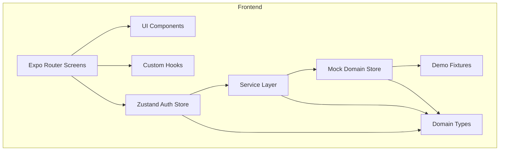
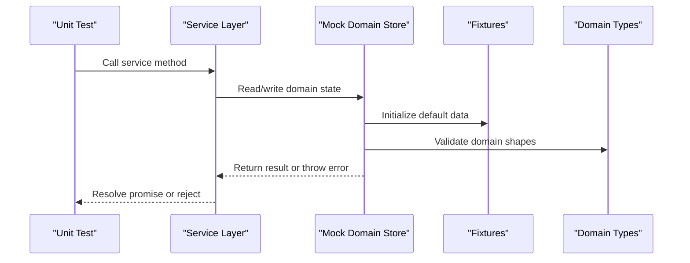
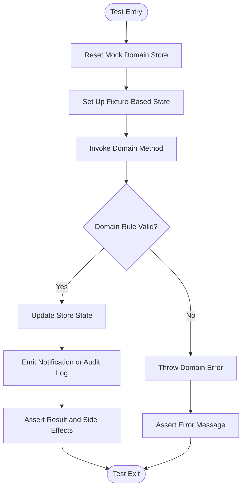
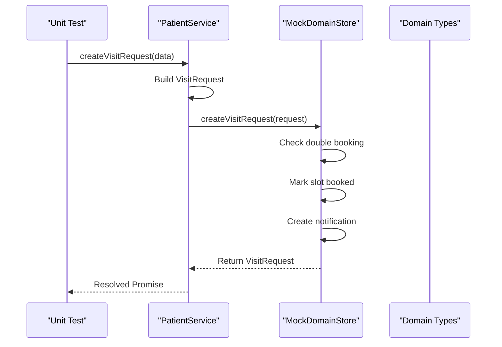
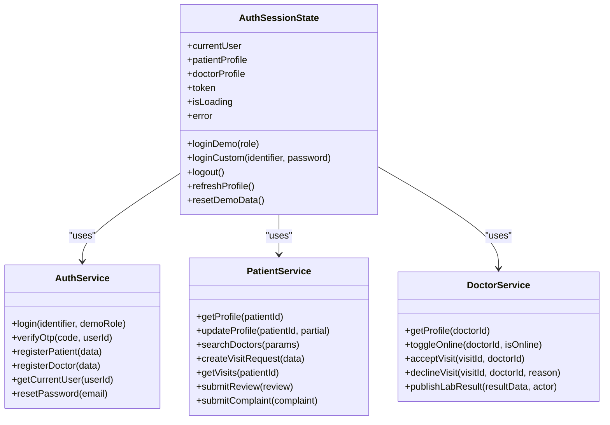
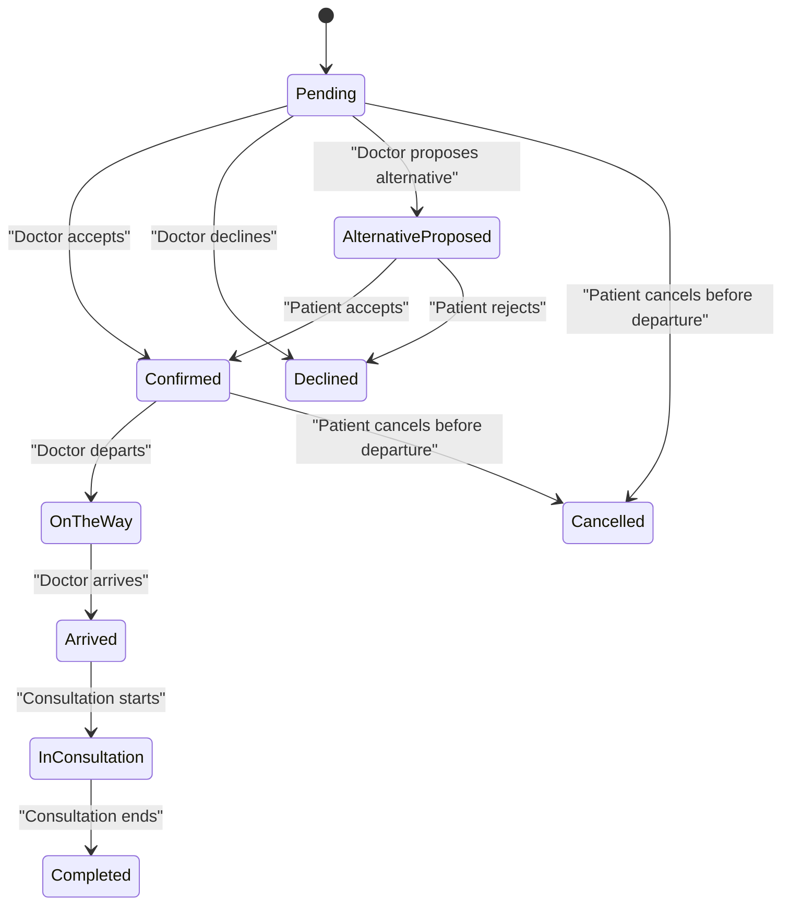
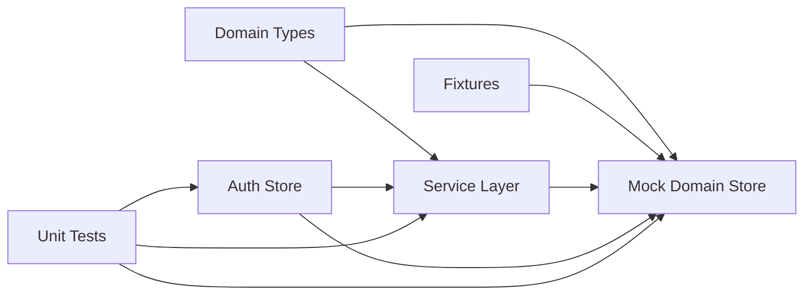

# Unit Testing

<cite>
**Referenced Files in This Document**   
- [README.md](file://README.md)
- [package.json](file://package.json)
- [src/types/domain.ts](file://src/types/domain.ts)
- [src/mock/fixtures.ts](file://src/mock/fixtures.ts)
- [src/mock/mockDomainStore.ts](file://src/mock/mockDomainStore.ts)
- [src/services/api.ts](file://src/services/api.ts)
- [src/stores/authStore.ts](file://src/stores/authStore.ts)
</cite>

## Table of Contents
1. [Introduction](#introduction)
2. [Project Structure](#project-structure)
3. [Core Components](#core-components)
4. [Architecture Overview](#architecture-overview)
5. [Detailed Component Analysis](#detailed-component-analysis)
6. [Dependency Analysis](#dependency-analysis)
7. [Performance Considerations](#performance-considerations)
8. [Troubleshooting Guide](#troubleshooting-guide)
9. [Conclusion](#conclusion)
10. [Appendices](#appendices)

## Introduction
This document explains how to design and implement unit tests for the HomeCare mobile application. It focuses on testing React Native components, custom hooks, service-layer abstractions, Zustand-based state management, and healthcare-specific workflows such as visit scheduling, doctor-patient relationships, and medical record operations. The project uses a mock domain store with realistic East African healthcare fixtures to create isolated test environments that simulate backend behavior without network dependencies.

The repository currently does not include dedicated test files or a configured Jest setup. Therefore, this guide proposes concrete testing strategies, utilities, and patterns aligned with the existing codebase architecture.

## Project Structure
The frontend is organized by feature areas:
- `src/app`: Expo Router screens grouped by role (`(auth)`, `(patient)`, `(doctor)`, `(admin)`).
- `src/components/ui`: Reusable UI primitives and cards.
- `src/hooks`: Custom hooks such as protected route logic.
- `src/mock`: In-memory domain store and demo fixtures.
- `src/services`: Service-layer contracts that wrap business logic and the mock domain store.
- `src/stores`: Zustand stores for session and global state.
- `src/types`: Shared TypeScript domain types.

**Diagram sources**
- [src/services/api.ts:1-20](file://src/services/api.ts#L1-L20)
- [src/mock/mockDomainStore.ts:1-35](file://src/mock/mockDomainStore.ts#L1-L35)
- [src/stores/authStore.ts:1-10](file://src/stores/authStore.ts#L1-L10)
- [src/types/domain.ts:1-10](file://src/types/domain.ts#L1-L10)

**Section sources**
- [README.md:1-10](file://README.md#L1-L10)
- [README.md:117-199](file://README.md#L117-L199)

## Core Components
For unit testing, the most important parts of the codebase are:
- **Domain types**: Provide strict contracts for users, patients, doctors, visits, consultations, lab samples, results, notifications, reviews, complaints, and audit logs.
- **Fixtures**: Realistic demo data representing Rwanda, Kenya, and Tanzania scenarios.
- **Mock domain store**: An in-memory reactive store implementing domain rules like double-booking prevention, visit lifecycle transitions, notification creation, review averaging, complaint resolution, and audit logging.
- **Service layer**: Async interfaces for auth, patient, doctor, and admin operations that wrap the mock store and add simulated latency.
- **Auth store**: A Zustand store managing login flows, profile loading, logout, and demo data reset.

These layers enable reliable isolation for unit tests:
- Test services directly against the mock store.
- Test Zustand actions without rendering UI.
- Test components with controlled props and mocked services.
- Simulate async operations using the service delay pattern.

**Section sources**
- [src/types/domain.ts:1-242](file://src/types/domain.ts#L1-L242)
- [src/mock/fixtures.ts:1-120](file://src/mock/fixtures.ts#L1-L120)
- [src/mock/mockDomainStore.ts:35-127](file://src/mock/mockDomainStore.ts#L35-L127)
- [src/services/api.ts:25-41](file://src/services/api.ts#L25-L41)
- [src/stores/authStore.ts:7-21](file://src/stores/authStore.ts#L7-L21)

## Architecture Overview
The testing architecture should mirror the runtime architecture:
- **Services** are the primary unit-testing surface because they encapsulate business rules and interact with the mock store.
- **Mock domain store** provides deterministic state and domain validation.
- **Zustand auth store** can be tested independently by mocking services when needed.
- **Components and hooks** should be tested with controlled props, user interactions, and mocked services or stores.

**Diagram sources**
- [src/services/api.ts:21-24](file://src/services/api.ts#L21-L24)
- [src/mock/mockDomainStore.ts:68-127](file://src/mock/mockDomainStore.ts#L68-L127)
- [src/types/domain.ts:1-242](file://src/types/domain.ts#L1-L242)

## Detailed Component Analysis

### Mock Domain Store Testing Strategy
The mock domain store is the backbone of test isolation. Tests should verify:
- Data initialization and reset behavior.
- Account isolation between patients, doctors, and admins.
- Visit lifecycle transitions and constraints.
- Double-booking prevention.
- Notification generation.
- Review average calculation.
- Complaint resolution.
- Audit log creation.

Recommended test categories:
- **Initialization tests**: Ensure `resetToDefaults` restores expected fixture counts and sample records.
- **User tests**: Verify lookup by email/phone, registration of patients and doctors.
- **Doctor catalog tests**: Verify filtering by verification status and online toggle.
- **Slot tests**: Verify overlap detection and slot booking/unbooking.
- **Visit tests**: Create, cancel, reschedule, accept alternative time, decline, and execute status transitions.
- **Consultation and result tests**: Save drafts, publish records, publish lab results, and retrieve patient records.
- **Notification tests**: Assert correct recipient, title, body, and type after key events.
- **Review and complaint tests**: Assert rating updates and complaint status changes.
- **Audit log tests**: Assert immutable audit entries for sensitive operations.

**Diagram sources**
- [src/mock/mockDomainStore.ts:207-216](file://src/mock/mockDomainStore.ts#L207-L216)
- [src/mock/mockDomainStore.ts:245-281](file://src/mock/mockDomainStore.ts#L245-L281)
- [src/mock/mockDomainStore.ts:283-380](file://src/mock/mockDomainStore.ts#L283-L380)
- [src/mock/mockDomainStore.ts:481-505](file://src/mock/mockDomainStore.ts#L481-L505)
- [src/mock/mockDomainStore.ts:522-552](file://src/mock/mockDomainStore.ts#L522-L552)

**Section sources**
- [src/mock/mockDomainStore.ts:35-127](file://src/mock/mockDomainStore.ts#L35-L127)
- [src/mock/mockDomainStore.ts:202-220](file://src/mock/mockDomainStore.ts#L202-L220)
- [src/mock/mockDomainStore.ts:245-380](file://src/mock/mockDomainStore.ts#L245-L380)
- [src/mock/mockDomainStore.ts:408-464](file://src/mock/mockDomainStore.ts#L408-L464)
- [src/mock/mockDomainStore.ts:481-552](file://src/mock/mockDomainStore.ts#L481-L552)

### Service Layer Testing Strategy
The service layer exposes async methods with simulated latency. Tests should:
- Use the real service implementations so domain rules remain intact.
- Assert successful responses and thrown errors.
- Assert side effects through the mock domain store.
- Handle async promises with proper waiting mechanisms.
- Avoid relying on the actual backend; rely on fallback behavior and mock store.

Key service areas to test:
- **Auth service**: Demo login, OTP verification, registration, current user retrieval, password reset.
- **Patient service**: Profile retrieval/update, specialty listing, doctor search filters, visit CRUD, cancellation/rescheduling, alternative time acceptance/rejection, records retrieval, result document retrieval, review submission, complaint submission.
- **Doctor service**: Profile retrieval, online toggle, visit requests, slot management, accept/decline/propose alternative, execution status transitions, consultation draft/publish, lab result publishing.
- **Admin service**: Doctor verification updates, visit listing, complaints, audit logs, platform metrics computation.

**Diagram sources**
- [src/services/api.ts:334-345](file://src/services/api.ts#L334-L345)
- [src/mock/mockDomainStore.ts:245-281](file://src/mock/mockDomainStore.ts#L245-L281)
- [src/types/domain.ts:97-129](file://src/types/domain.ts#L97-L129)

**Section sources**
- [src/services/api.ts:25-41](file://src/services/api.ts#L25-L41)
- [src/services/api.ts:46-104](file://src/services/api.ts#L46-L104)
- [src/services/api.ts:106-122](file://src/services/api.ts#L106-L122)
- [src/services/api.ts:124-244](file://src/services/api.ts#L124-L244)
- [src/services/api.ts:274-430](file://src/services/api.ts#L274-L430)
- [src/services/api.ts:468-585](file://src/services/api.ts#L468-L585)
- [src/services/api.ts:604-659](file://src/services/api.ts#L604-L659)

### Zustand Auth Store Testing Strategy
The auth store manages user sessions and integrates with services and the mock domain store. Tests should:
- Verify demo login sets user, token, and role-appropriate profile.
- Verify custom login flow with identifier/password.
- Verify error handling and loading state transitions.
- Verify logout clears all session fields.
- Verify profile refresh behavior based on user role.
- Verify demo data reset triggers store reset and profile refresh.

**Diagram sources**
- [src/stores/authStore.ts:7-21](file://src/stores/authStore.ts#L7-L21)
- [src/stores/authStore.ts:23-111](file://src/stores/authStore.ts#L23-L111)
- [src/services/api.ts:25-41](file://src/services/api.ts#L25-L41)
- [src/services/api.ts:274-430](file://src/services/api.ts#L274-L430)
- [src/services/api.ts:468-585](file://src/services/api.ts#L468-L585)

**Section sources**
- [src/stores/authStore.ts:1-112](file://src/stores/authStore.ts#L1-L112)

### Component and Hook Testing Strategy
Although no component test files exist yet, the recommended approach is:
- Render components with controlled props derived from fixtures.
- Mock services where necessary to isolate UI logic from domain state mutations.
- Interact via simulated user actions (press, input, scroll).
- Assert rendered output, accessibility attributes, and navigation calls.
- For hooks, render them inside a minimal provider context if they depend on stores or services.

Recommended patterns:
- **Props testing**: Verify that doctor cards display verified credentials, fees, ratings, and availability indicators.
- **User interaction testing**: Verify booking form validation, symptom selection, address entry, and fee preview.
- **Async operation testing**: Wrap async handlers with fake timers or wait for resolved promises.
- **Navigation testing**: Assert Expo Router navigation calls when moving between screens.

[No sources needed since this section describes conceptual testing patterns rather than analyzing specific files]

### Healthcare-Specific Workflow Testing
Healthcare workflows require careful validation of safety-critical rules:
- **Visit workflow**: Pending → Confirmed → On the Way → Arrived → In Consultation → Completed.
- **Cancellation restrictions**: Prevent cancellation once the doctor has started traveling or arrived.
- **Alternative time proposal and acceptance**: Validate proposed times and patient acceptance.
- **Doctor-patient relationship**: Ensure doctors only see assigned visits and patients only see their own records.
- **Medical record operations**: Draft vs published consultation records, lab sample tracking, result publication, and audit logging.

**Diagram sources**
- [src/types/domain.ts:9-19](file://src/types/domain.ts#L9-L19)
- [src/services/api.ts:359-382](file://src/services/api.ts#L359-L382)
- [src/services/api.ts:384-403](file://src/services/api.ts#L384-L403)
- [src/services/api.ts:531-538](file://src/services/api.ts#L531-L538)

**Section sources**
- [src/types/domain.ts:9-19](file://src/types/domain.ts#L9-L19)
- [src/services/api.ts:359-403](file://src/services/api.ts#L359-L403)
- [src/services/api.ts:531-538](file://src/services/api.ts#L531-L538)

## Dependency Analysis
The following diagram shows how testing targets relate to each other:

**Diagram sources**
- [src/types/domain.ts:1-242](file://src/types/domain.ts#L1-L242)
- [src/mock/fixtures.ts:1-120](file://src/mock/fixtures.ts#L1-L120)
- [src/mock/mockDomainStore.ts:1-35](file://src/mock/mockDomainStore.ts#L1-L35)
- [src/services/api.ts:1-20](file://src/services/api.ts#L1-L20)
- [src/stores/authStore.ts:1-10](file://src/stores/authStore.ts#L1-L10)

**Section sources**
- [src/types/domain.ts:1-242](file://src/types/domain.ts#L1-L242)
- [src/mock/fixtures.ts:1-120](file://src/mock/fixtures.ts#L1-L120)
- [src/mock/mockDomainStore.ts:1-35](file://src/mock/mockDomainStore.ts#L1-L35)
- [src/services/api.ts:1-20](file://src/services/api.ts#L1-L20)
- [src/stores/authStore.ts:1-10](file://src/stores/authStore.ts#L1-L10)

## Performance Considerations
- Keep unit tests fast by avoiding real network calls; rely on the service fallback and mock store.
- Use the simulated latency pattern to assert loading states and async behavior without slowing tests excessively.
- Reset the mock domain store between tests to avoid shared mutable state.
- Prefer small, focused tests per domain rule rather than large integration-style tests.
- When testing doctor search filters, limit fixture size to relevant subsets to reduce assertion overhead.

[No sources needed since this section provides general guidance]

## Troubleshooting Guide
Common issues and resolutions:
- **Flaky tests due to shared state**: Always call `mockDomainStore.resetToDefaults()` before or after tests that mutate domain state.
- **Async timing failures**: Wait for service promises to resolve and use stable assertions after delays.
- **Unexpected backend dependency**: Ensure tests do not call the live FastAPI backend; rely on service fallback behavior.
- **Invalid credentials in tests**: Use demo keys or known identifiers from fixtures instead of random values.
- **Double-booking conflicts**: When creating multiple visits in tests, ensure different dates/times or explicitly assert rejection.
- **Notification noise**: If tests poll notifications, clear or filter by reference ID to avoid unrelated entries.

**Section sources**
- [src/mock/mockDomainStore.ts:68-127](file://src/mock/mockDomainStore.ts#L68-L127)
- [src/services/api.ts:70-104](file://src/services/api.ts#L70-L104)
- [src/services/api.ts:106-122](file://src/services/api.ts#L106-L122)

## Conclusion
Effective unit testing for this healthcare application centers on isolating business logic behind the service layer and validating domain rules through the mock domain store. By leveraging realistic fixtures, strict TypeScript types, and predictable async patterns, tests can cover authentication flows, visit lifecycle management, doctor-patient relationships, and medical record operations reliably. As test files are added, follow the patterns described here to maintain clarity, stability, and coverage across the system.

[No sources needed since this section summarizes without analyzing specific files]

## Appendices

### Recommended Test File Organization
- Place service tests under a `tests/services` directory.
- Place store tests under `tests/stores`.
- Place component tests under `tests/components`.
- Place hook tests under `tests/hooks`.
- Share reusable helpers under `tests/helpers`.

### Example Test Scenarios Checklist
- **Auth service**:
  - Demo login returns user and token.
  - OTP verification accepts valid codes.
  - Registration creates user and profile in mock store.
- **Patient service**:
  - Search doctors applies query, specialty, district, language, fee, rating, and availability filters.
  - Create visit request prevents double booking.
  - Cancel visit throws error for restricted statuses.
  - Accept alternative time updates scheduled date/time and confirms visit.
- **Doctor service**:
  - Accept visit requires approved verification status.
  - Propose alternative time sets alternative fields.
  - Publish lab result creates result document and notifies patient.
- **Admin service**:
  - Update doctor verification changes status and logs audit event.
  - Platform metrics compute completed visits, active visits, revenue, average rating, and pending verifications.

[No sources needed since this section provides general guidance]