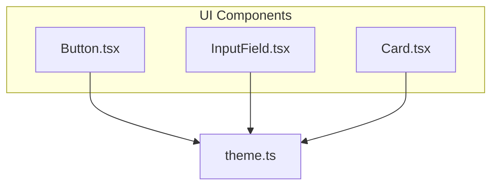
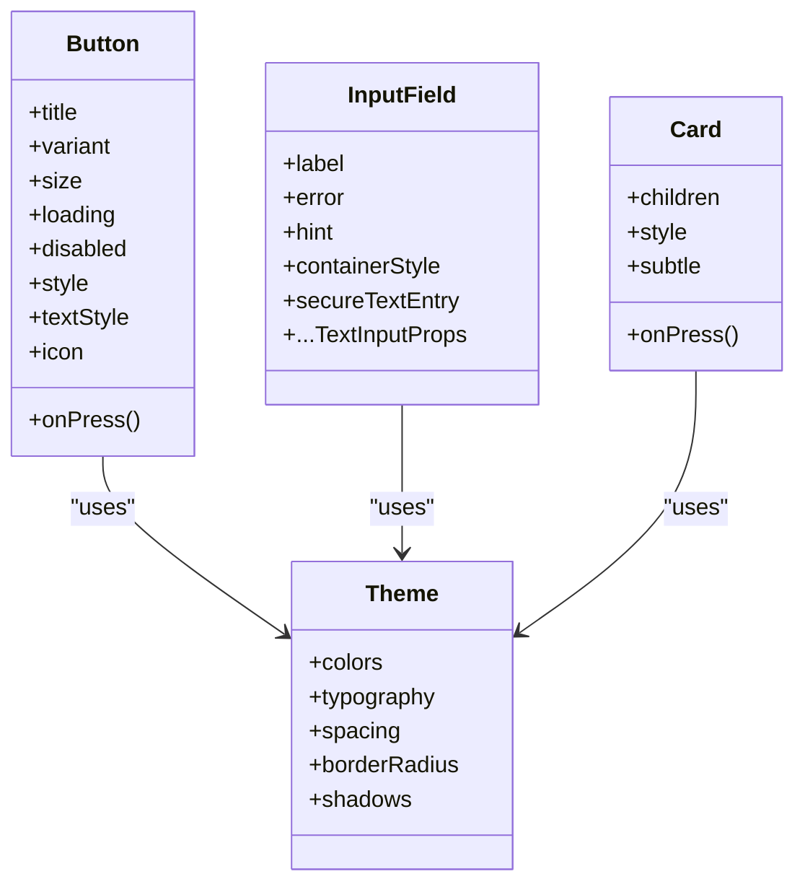
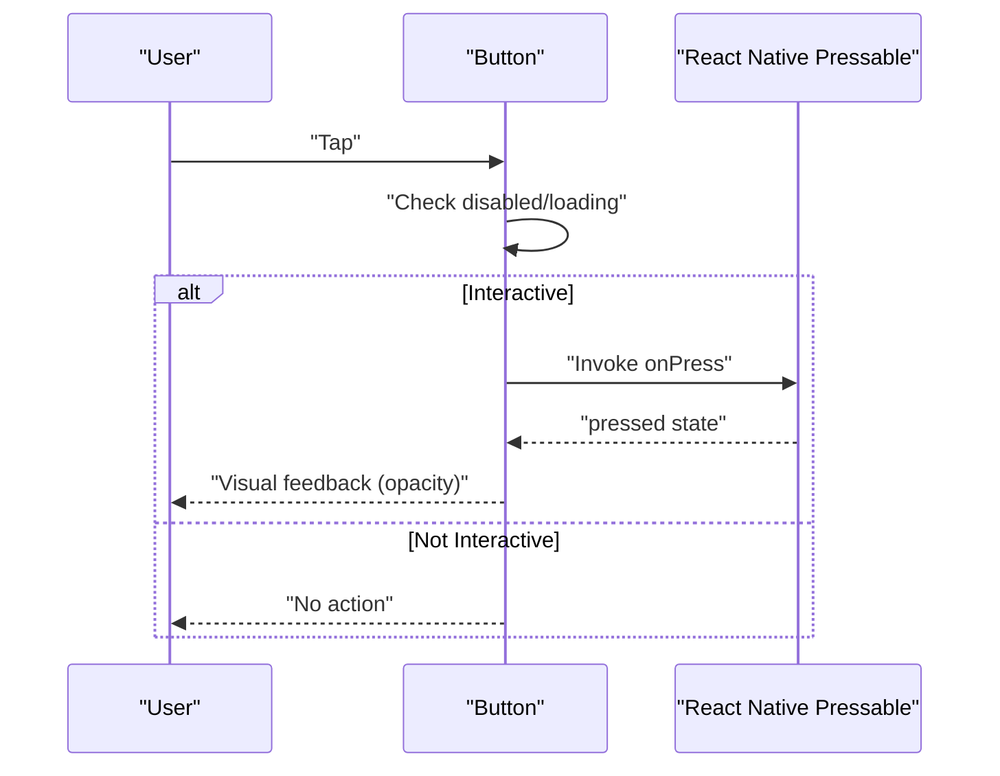
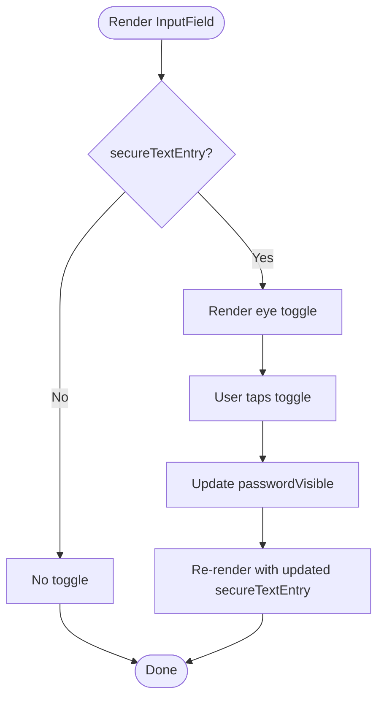
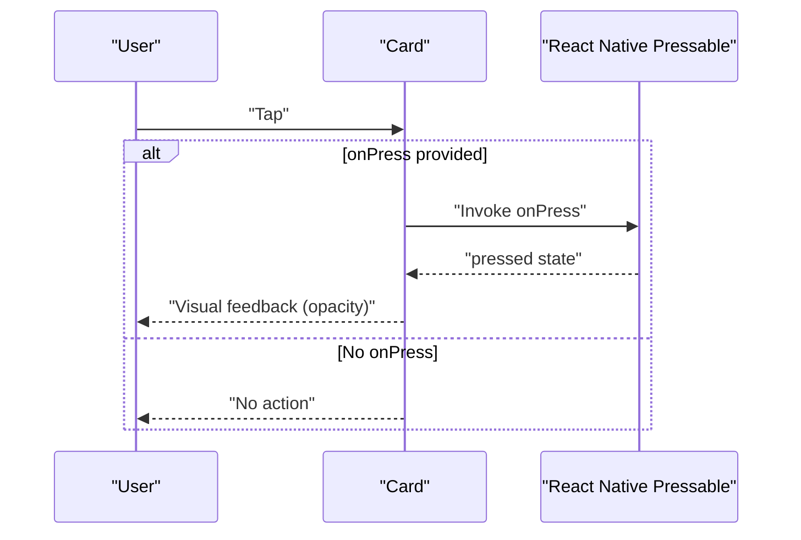
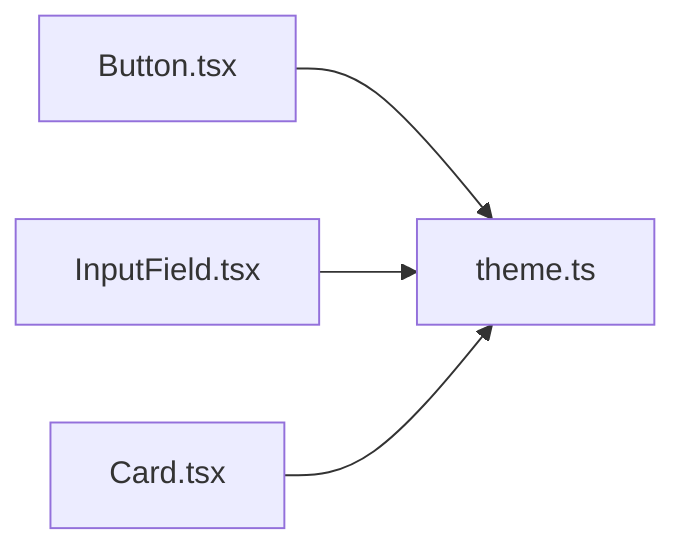

# Base Components

<cite>
**Referenced Files in This Document**
- [Button.tsx](file://src/components/ui/Button.tsx)
- [InputField.tsx](file://src/components/ui/InputField.tsx)
- [Card.tsx](file://src/components/ui/Card.tsx)
- [theme.ts](file://src/constants/theme.ts)
</cite>

## Table of Contents
1. [Introduction](#introduction)
2. [Project Structure](#project-structure)
3. [Core Components](#core-components)
4. [Architecture Overview](#architecture-overview)
5. [Detailed Component Analysis](#detailed-component-analysis)
6. [Dependency Analysis](#dependency-analysis)
7. [Performance Considerations](#performance-considerations)
8. [Troubleshooting Guide](#troubleshooting-guide)
9. [Conclusion](#conclusion)

## Introduction
This document describes the base UI components Button, InputField, and Card. It covers their props interfaces, styling options, event handling, accessibility features, design system integration (theme tokens, color schemes, typography), responsive behavior, touch interactions, platform-specific considerations, usage examples, composition guidelines, and best practices for extending these components.

## Project Structure
The base components live under src/components/ui and consume a centralized theme from src/constants/theme.ts. The theme provides colors, typography sizes, spacing, border radius, and shadows used consistently across components.

**Diagram sources**
- [Button.tsx:1-150](file://src/components/ui/Button.tsx#L1-L150)
- [InputField.tsx:1-129](file://src/components/ui/InputField.tsx#L1-L129)
- [Card.tsx:1-56](file://src/components/ui/Card.tsx#L1-L56)
- [theme.ts:71-165](file://src/constants/theme.ts#L71-L165)

**Section sources**
- [Button.tsx:1-150](file://src/components/ui/Button.tsx#L1-L150)
- [InputField.tsx:1-129](file://src/components/ui/InputField.tsx#L1-L129)
- [Card.tsx:1-56](file://src/components/ui/Card.tsx#L1-L56)
- [theme.ts:71-165](file://src/constants/theme.ts#L71-L165)

## Core Components
- Button: A versatile pressable action with variants, sizes, loading state, disabled state, icon support, and theme-driven styling.
- InputField: A form input wrapper with label, hint, error messaging, password visibility toggle, and theme-driven styles.
- Card: A content container with optional interactivity, subtle or shadowed appearance, and theme-driven layout.

All components integrate with the shared theme for consistent visual language.

**Section sources**
- [Button.tsx:13-74](file://src/components/ui/Button.tsx#L13-L74)
- [InputField.tsx:15-72](file://src/components/ui/InputField.tsx#L15-L72)
- [Card.tsx:6-38](file://src/components/ui/Card.tsx#L6-L38)

## Architecture Overview
The components follow a simple architecture:
- Each component is a React functional component.
- Styling is derived from the central THEME object.
- Interactions are handled via standard React Native primitives (Pressable, TextInput).
- Accessibility attributes are provided where appropriate.

**Diagram sources**
- [Button.tsx:13-74](file://src/components/ui/Button.tsx#L13-L74)
- [InputField.tsx:15-72](file://src/components/ui/InputField.tsx#L15-L72)
- [Card.tsx:6-38](file://src/components/ui/Card.tsx#L6-L38)
- [theme.ts:71-165](file://src/constants/theme.ts#L71-L165)

## Detailed Component Analysis

### Button
Purpose
- Provides primary actions with multiple visual variants and sizes.
- Supports loading and disabled states.
- Integrates icons and text with theme-driven colors and typography.

Props Interface
- title: string — Button label text.
- onPress: () => void — Click handler; not invoked when disabled or loading.
- variant?: 'primary' | 'secondary' | 'outline' | 'danger' | 'ghost' — Visual style.
- size?: 'sm' | 'md' | 'lg' — Padding and font size scale.
- loading?: boolean — Shows spinner instead of label.
- disabled?: boolean — Disables interaction and dims visuals.
- style?: ViewStyle — Additional container styles.
- textStyle?: TextStyle — Additional text styles.
- icon?: React.ReactNode — Optional leading icon.

Styling Options
- Variants map to background/border/text colors using THEME.colors.
- Sizes map to padding and font sizes using THEME.typography.sizes.
- Pressed state applies opacity; disabled state reduces opacity.
- Text color adapts per variant; outline uses primary color; ghost uses secondary text color.

Event Handlers
- onPress is only attached when interactive (not disabled and not loading).
- Uses Pressable’s pressed state for visual feedback.

Accessibility Features
- No explicit accessibilityRole on the root; consider adding role="button" and aria-like labels if needed by your testing/accessibility tooling.
- When loading, consider providing an accessible label indicating loading status.

Usage Examples
- Primary button: variant='primary', size='md'.
- Secondary button: variant='secondary'.
- Outline button: variant='outline'.
- Danger button: variant='danger'.
- Ghost button: variant='ghost'.
- Loading button: loading=true.
- Disabled button: disabled=true.
- With icon: pass icon as first child; text gets left margin automatically.

Responsive Behavior
- Size prop controls padding and font size; no automatic screen-width scaling.
- For very small screens, prefer sm size or adjust via style.

Platform-Specific Considerations
- Uses React Native Pressable and ActivityIndicator; behaves consistently across iOS and Android.
- Ensure sufficient contrast between text and background for all variants.

Best Practices
- Use primary for main actions, secondary/outline for less prominent actions, danger for destructive actions, ghost for low-emphasis actions.
- Keep loading and disabled mutually exclusive in practice.
- Provide meaningful titles and avoid overly long text inside buttons.

**Section sources**
- [Button.tsx:13-74](file://src/components/ui/Button.tsx#L13-L74)
- [Button.tsx:76-149](file://src/components/ui/Button.tsx#L76-L149)

#### Button Interaction Flow

**Diagram sources**
- [Button.tsx:36-48](file://src/components/ui/Button.tsx#L36-L48)

### InputField
Purpose
- Wraps TextInput with label, hint, error, and optional password visibility toggle.
- Applies theme-based colors, borders, and spacing.

Props Interface
- Extends TextInputProps.
- label: string — Required label displayed above the input.
- error?: string — Validation error message shown below the input.
- hint?: string — Helpful hint text shown when no error.
- containerStyle?: ViewStyle — Additional container styles.
- secureTextEntry?: boolean — Enables password mode with eye toggle.

Styling Options
- Container spacing uses THEME.spacing.md.
- Label uses THEME.colors.textPrimary.
- Input background and border use THEME.colors.surface and THEME.colors.border.
- Error state changes border and background to THEME.colors.error and a soft red tint.
- Multiline inputs get increased minHeight and top-aligned text.

Event Handlers
- Inherits all TextInput events (onChangeText, onFocus, onBlur, onSubmitEditing, etc.).
- Password toggle updates internal visibility state.

Accessibility Features
- Password toggle has accessibilityRole="button" and dynamic accessibilityLabel ("Show password"/"Hide password").
- Consider adding accessibilityLabel to the input itself for better screen reader context.

Usage Examples
- Basic text input: provide label and onChangeText.
- Password input: set secureTextEntry=true to enable toggle.
- With hint: provide hint text for guidance.
- With error: show validation feedback.
- Multiline: set multiline=true for longer text areas.

Responsive Behavior
- Width adapts to parent container; ensure adequate width for long content.
- Hint/error text wraps naturally.

Platform-Specific Considerations
- autoCorrect and autoCapitalize are adjusted for passwords to improve UX.
- On Android, ensure keyboard type matches input semantics (e.g., email, numeric).

Best Practices
- Always provide a clear label.
- Show hints before errors; hide hint when error is present.
- Use secureTextEntry for sensitive inputs and test the toggle behavior.

**Section sources**
- [InputField.tsx:15-72](file://src/components/ui/InputField.tsx#L15-L72)
- [InputField.tsx:74-128](file://src/components/ui/InputField.tsx#L74-L128)

#### InputField Password Toggle Flow

**Diagram sources**
- [InputField.tsx:31-66](file://src/components/ui/InputField.tsx#L31-L66)

### Card
Purpose
- A flexible container for grouping related content.
- Offers two visual modes: subtle (flat) and shadowed (elevated).
- Optionally wraps content in Pressable for click/tap behavior.

Props Interface
- children: React.ReactNode — Content to render inside the card.
- style?: StyleProp<ViewStyle> — Additional container styles.
- onPress?: () => void — Makes the card interactive.
- subtle?: boolean — Switches to subtle visual mode.

Styling Options
- Background uses THEME.colors.surface.
- Border radius uses THEME.borderRadius.lg.
- Padding uses THEME.spacing.base.
- Shadow mode applies THEME.shadows.card; subtle mode sets transparent border and surfaceSubtle background.

Event Handlers
- If onPress is provided, the card becomes a Pressable with pressed-state opacity.

Accessibility Features
- When interactive, consider adding accessibilityRole="button" and an accessibleLabel describing the action.

Usage Examples
- Non-interactive card: just wrap content.
- Interactive card: pass onPress for navigation or selection.
- Subtle card: set subtle=true for low-emphasis sections.

Responsive Behavior
- Adapts to container width; consider wrapping in flex layouts for responsive grids.

Platform-Specific Considerations
- Shadow and elevation are applied via THEME.shadows.card; verify visual consistency on iOS and Android.

Best Practices
- Use subtle for cards that should blend into backgrounds (e.g., within lists).
- Reserve shadowed cards for elevated content like summaries or highlights.
- Avoid nesting too many interactive elements inside a clickable card to prevent focus conflicts.

**Section sources**
- [Card.tsx:6-38](file://src/components/ui/Card.tsx#L6-L38)
- [Card.tsx:40-55](file://src/components/ui/Card.tsx#L40-L55)

#### Card Interaction Flow

**Diagram sources**
- [Card.tsx:26-34](file://src/components/ui/Card.tsx#L26-L34)

## Dependency Analysis
Components depend on:
- React Native primitives: Pressable, Text, TextInput, View, StyleSheet, ActivityIndicator.
- Shared theme: THEME.colors, THEME.typography.sizes, THEME.spacing, THEME.borderRadius, THEME.shadows.

**Diagram sources**
- [Button.tsx:1-150](file://src/components/ui/Button.tsx#L1-L150)
- [InputField.tsx:1-129](file://src/components/ui/InputField.tsx#L1-L129)
- [Card.tsx:1-56](file://src/components/ui/Card.tsx#L1-L56)
- [theme.ts:71-165](file://src/constants/theme.ts#L71-L165)

**Section sources**
- [Button.tsx:1-150](file://src/components/ui/Button.tsx#L1-L150)
- [InputField.tsx:1-129](file://src/components/ui/InputField.tsx#L1-L129)
- [Card.tsx:1-56](file://src/components/ui/Card.tsx#L1-L56)
- [theme.ts:71-165](file://src/constants/theme.ts#L71-L165)

## Performance Considerations
- Button:
  - Avoid heavy work in onPress; offload to async handlers or debounced functions if needed.
  - Reuse icon components to minimize re-renders.
- InputField:
  - Control value externally for performance-critical forms; avoid unnecessary re-renders.
  - Disable autoCorrect/autoCapitalize for passwords to reduce overhead.
- Card:
  - Wrap expensive children in memoization if the card re-renders frequently.
  - Prefer subtle mode for dense lists to reduce shadow calculations.

[No sources needed since this section provides general guidance]

## Troubleshooting Guide
Common issues and resolutions:
- Button does not respond:
  - Ensure disabled=false and loading=false.
  - Verify onPress is provided and not overridden by conditional logic.
- InputField password toggle not visible:
  - Confirm secureTextEntry is true.
  - Check that containerStyle does not clip the toggle area.
- InputField error styling not applied:
  - Ensure error prop is set; hint will be hidden when error exists.
- Card not interactive:
  - Pass onPress to enable Pressable behavior.
- Theme mismatch:
  - Verify THEME values are correctly imported and not overridden locally.

**Section sources**
- [Button.tsx:36-48](file://src/components/ui/Button.tsx#L36-L48)
- [InputField.tsx:31-66](file://src/components/ui/InputField.tsx#L31-L66)
- [Card.tsx:26-34](file://src/components/ui/Card.tsx#L26-L34)

## Conclusion
Button, InputField, and Card provide a cohesive, theme-driven foundation for building consistent mobile interfaces. By leveraging the shared theme tokens, adhering to the documented props and accessibility patterns, and following the composition guidelines, you can create scalable and maintainable UIs that behave predictably across platforms.

[No sources needed since this section summarizes without analyzing specific files]