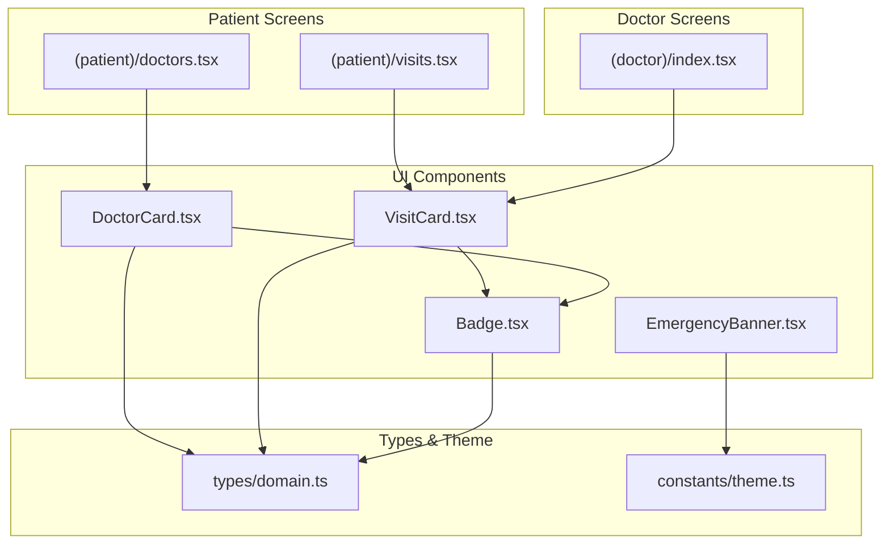
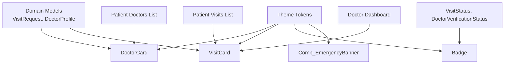
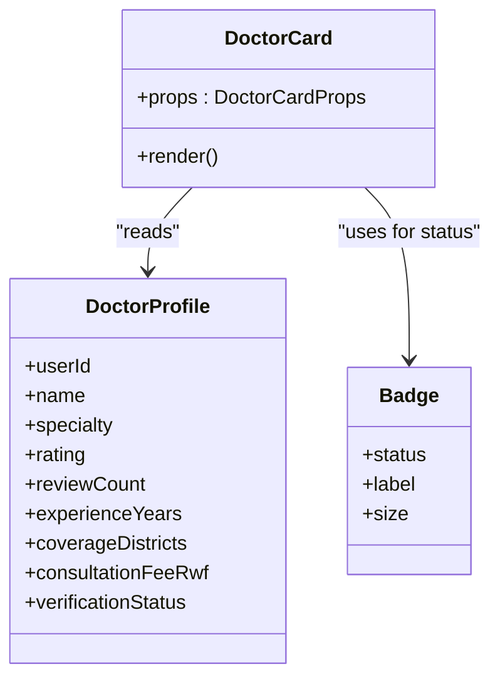
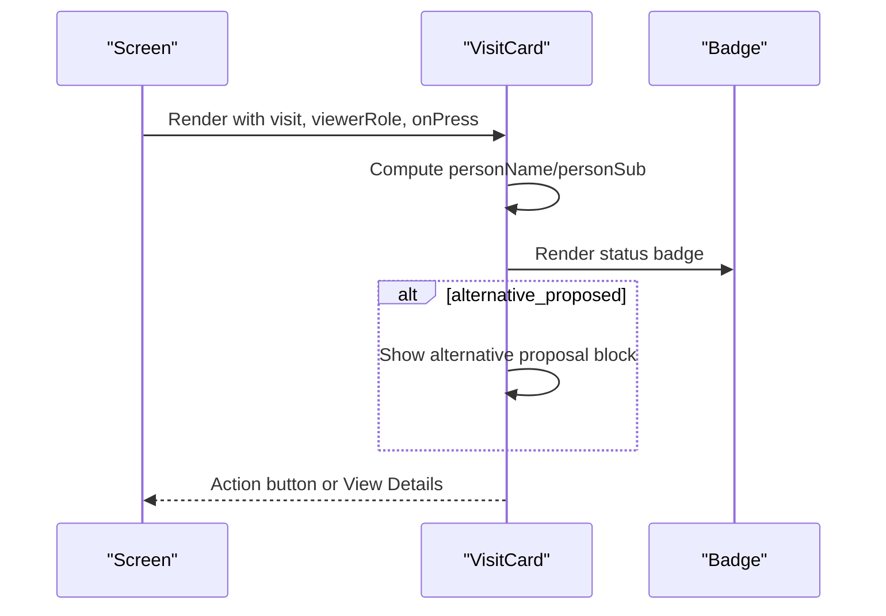
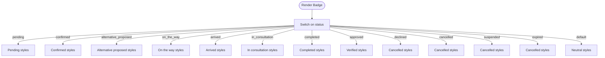
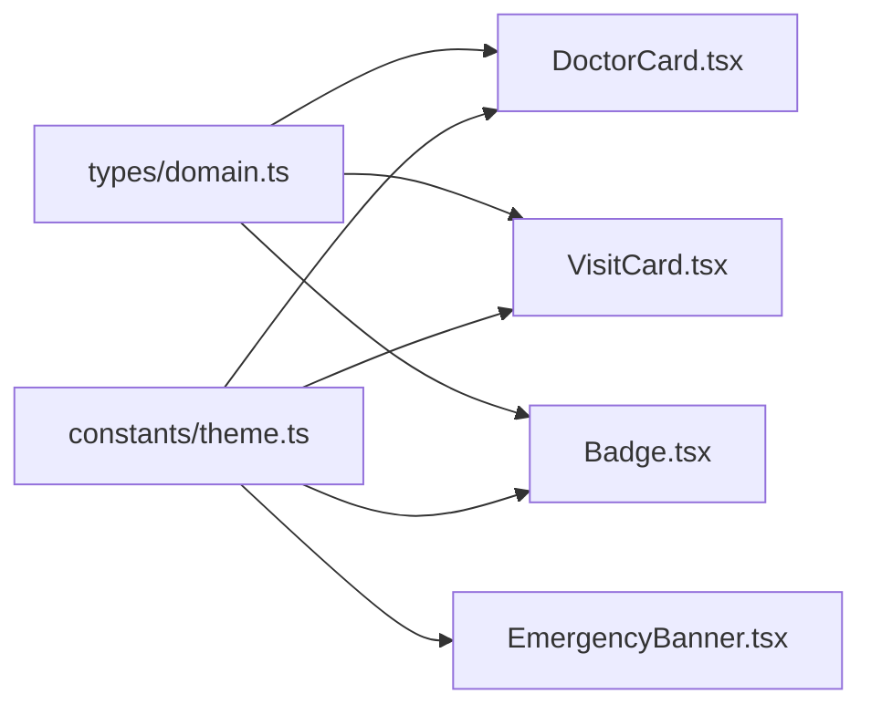

# Specialized Components

<cite>
**Referenced Files in This Document**
- [DoctorCard.tsx](file://src/components/ui/DoctorCard.tsx)
- [VisitCard.tsx](file://src/components/ui/VisitCard.tsx)
- [Badge.tsx](file://src/components/ui/Badge.tsx)
- [EmergencyBanner.tsx](file://src/components/ui/EmergencyBanner.tsx)
- [domain.ts](file://src/types/domain.ts)
- [theme.ts](file://src/constants/theme.ts)
- [doctors.tsx](file://src/app/(patient)/doctors.tsx)
- [visits.tsx](file://src/app/(patient)/visits.tsx)
- [index.tsx](file://src/app/(doctor)/index.tsx)
</cite>

## Table of Contents
1. [Introduction](#introduction)
2. [Project Structure](#project-structure)
3. [Core Components](#core-components)
4. [Architecture Overview](#architecture-overview)
5. [Detailed Component Analysis](#detailed-component-analysis)
6. [Dependency Analysis](#dependency-analysis)
7. [Performance Considerations](#performance-considerations)
8. [Troubleshooting Guide](#troubleshooting-guide)
9. [Accessibility Considerations](#accessibility-considerations)
10. [Conclusion](#conclusion)

## Introduction
This document provides detailed documentation for specialized healthcare domain components: DoctorCard, VisitCard, Badge, and EmergencyBanner. It explains their props, visual hierarchy, data binding patterns, and interaction behaviors tailored to patient and doctor workflows. It also documents the semantic meaning of badge types, visit statuses, and emergency alert levels, along with accessibility considerations for critical healthcare information display.

## Project Structure
The components live under src/components/ui and are consumed by role-based screens:
- Patient screens use DoctorCard for discovery and VisitCard for visit management.
- Doctor screens use VisitCard for request handling and dashboard metrics.
- Badge is a shared status indicator used across cards and dashboards.
- EmergencyBanner is a reusable safety notice component.

**Diagram sources**
- [doctors.tsx:16-20](file://src/app/(patient)/doctors.tsx#L16-L20)
- [visits.tsx:16-16](file://src/app/(patient)/visits.tsx#L16-L16)
- [index.tsx:19-22](file://src/app/(doctor)/index.tsx#L19-L22)
- [DoctorCard.tsx:5-7](file://src/components/ui/DoctorCard.tsx#L5-L7)
- [VisitCard.tsx:5-7](file://src/components/ui/VisitCard.tsx#L5-L7)
- [Badge.tsx:5-5](file://src/components/ui/Badge.tsx#L5-L5)
- [EmergencyBanner.tsx:4-4](file://src/components/ui/EmergencyBanner.tsx#L4-L4)

**Section sources**
- [doctors.tsx:16-20](file://src/app/(patient)/doctors.tsx#L16-L20)
- [visits.tsx:16-16](file://src/app/(patient)/visits.tsx#L16-L16)
- [index.tsx:19-22](file://src/app/(doctor)/index.tsx#L19-L22)

## Core Components
- DoctorCard: Displays doctor profile summary, verification status, specialty, rating, experience, coverage districts, fee, and booking actions.
- VisitCard: Displays visit scheduling details, status, person context (patient or doctor), address, symptoms, alternative time proposals, fees, and action buttons.
- Badge: Renders contextual status chips for visits and doctor verification with consistent color semantics.
- EmergencyBanner: Presents an emergency disclaimer and a call-to-action button that opens the device dialer.

**Section sources**
- [DoctorCard.tsx:9-86](file://src/components/ui/DoctorCard.tsx#L9-L86)
- [VisitCard.tsx:9-88](file://src/components/ui/VisitCard.tsx#L9-L88)
- [Badge.tsx:7-98](file://src/components/ui/Badge.tsx#L7-L98)
- [EmergencyBanner.tsx:6-24](file://src/components/ui/EmergencyBanner.tsx#L6-L24)

## Architecture Overview
The components follow a unidirectional data flow:
- Domain models from types define the shape of data.
- UI components consume these models via props.
- Shared theme tokens standardize colors, spacing, and typography.
- Role-aware screens bind data to components and handle navigation and actions.

**Diagram sources**
- [domain.ts:61-85](file://src/types/domain.ts#L61-L85)
- [domain.ts:97-129](file://src/types/domain.ts#L97-L129)
- [domain.ts:7-19](file://src/types/domain.ts#L7-L19)
- [theme.ts:71-165](file://src/constants/theme.ts#L71-L165)
- [doctors.tsx:196-202](file://src/app/(patient)/doctors.tsx#L196-L202)
- [visits.tsx:81-87](file://src/app/(patient)/visits.tsx#L81-L87)
- [index.tsx:149-179](file://src/app/(doctor)/index.tsx#L149-L179)

## Detailed Component Analysis

### DoctorCard
Purpose:
- Present a compact, scannable card for a doctor’s profile and key attributes.
- Provide primary actions: view details and book a visit.

Props:
- doctor: DoctorProfile object containing identity, credentials, specialty, ratings, experience, coverage districts, fee, and verification status.
- onPress: Navigate to doctor detail.
- onBookPress: Optional direct booking action; falls back to onPress if not provided.

Visual Hierarchy:
- Header row with avatar, name, verified checkmark, specialty, rating, review count, and experience.
- Bio snippet limited to two lines.
- Coverage district chips with location icon.
- Footer with consultation fee and “Book Visit” action.

Data Binding Patterns:
- Avatar URL fallback to a default image when missing.
- Verified checkmark shown only when verificationStatus equals approved.
- Fee formatted with locale-aware number formatting and currency label.
- Districts mapped into chip elements.

Interaction Behaviors:
- Card press navigates to doctor detail.
- Book Visit press triggers onBookPress or onPress.

Semantic Meaning:
- VerificationStatus indicates credential approval state.
- Rating and reviewCount reflect patient feedback.
- ExperienceYears communicates clinician seniority.

Accessibility Notes:
- Ensure meaningful labels for icons (e.g., verified checkmark).
- Provide accessible names for the card and action buttons.
- Maintain sufficient contrast for text and badges.

**Diagram sources**
- [DoctorCard.tsx:9-86](file://src/components/ui/DoctorCard.tsx#L9-L86)
- [domain.ts:61-85](file://src/types/domain.ts#L61-L85)
- [Badge.tsx:7-98](file://src/components/ui/Badge.tsx#L7-L98)

**Section sources**
- [DoctorCard.tsx:9-86](file://src/components/ui/DoctorCard.tsx#L9-L86)
- [domain.ts:61-85](file://src/types/domain.ts#L61-L85)

### VisitCard
Purpose:
- Display a visit summary with date/time, status, person context, address, symptoms, alternative proposal, total fee, and actionable controls.

Props:
- visit: VisitRequest object including scheduling, status, person fields, address, symptoms, alternative proposal, and fees.
- onPress: Navigate to visit detail.
- viewerRole: Determines whether to show patient or doctor context.
- onActionPress: Optional action handler for role-specific actions.
- actionLabel: Optional custom label for the action button.

Visual Hierarchy:
- Header with calendar/time info and status badge.
- Person section showing role label, name, and sub-info (phone or specialty).
- Address line with district.
- Symptoms snippet.
- Alternative proposal block when applicable.
- Footer with total fee and either a custom action or “View Details”.

Data Binding Patterns:
- PersonName and PersonSub switch based on viewerRole.
- Status rendered via Badge with size sm.
- Alternative proposal displayed conditionally when status equals alternative_proposed.
- Fees formatted with locale-aware number formatting and currency label.

Interaction Behaviors:
- Card press navigates to visit detail.
- Custom action button appears when onActionPress and actionLabel are provided.

Semantic Meaning:
- VisitStatus drives badge semantics and conditional UI (e.g., alternative proposal).
- TotalFeeRwf aggregates consultation, travel, and optional lab fees.

**Diagram sources**
- [VisitCard.tsx:17-88](file://src/components/ui/VisitCard.tsx#L17-L88)
- [Badge.tsx:13-98](file://src/components/ui/Badge.tsx#L13-L98)

**Section sources**
- [VisitCard.tsx:9-88](file://src/components/ui/VisitCard.tsx#L9-L88)
- [domain.ts:97-129](file://src/types/domain.ts#L97-L129)

### Badge
Purpose:
- Provide consistent, semantically meaningful status indicators for visits and doctor verification.

Props:
- status: VisitStatus | DoctorVerificationStatus | string.
- label: Optional override for displayed text.
- size: 'sm' | 'md'.

Behavior:
- Maps known statuses to background and text colors using theme tokens.
- Provides default labels for common statuses.
- Falls back to neutral styling for unknown statuses.

Semantic Meanings:
- Pending: Awaiting action or decision.
- Confirmed: Appointment confirmed.
- Alternative Time Proposed: New time suggested.
- On the Way: Doctor en route.
- Arrived: Doctor has arrived at location.
- In Consultation: Consultation underway.
- Completed / Approved: Successful completion or credential approval.
- Declined / Cancelled / Suspended / Expired: Negative or inactive states.

**Diagram sources**
- [Badge.tsx:13-75](file://src/components/ui/Badge.tsx#L13-L75)

**Section sources**
- [Badge.tsx:7-98](file://src/components/ui/Badge.tsx#L7-L98)
- [domain.ts:7-19](file://src/types/domain.ts#L7-L19)

### EmergencyBanner
Purpose:
- Display a prominent emergency notice with a call-to-action to dial the national emergency number.

Behavior:
- Uses APP_CONFIG.emergencyDisclaimer for the message.
- Opens the device dialer with APP_CONFIG.emergencyPhone when the call button is pressed.

Visual Semantics:
- Error-themed background and badge to signal urgency.
- Clear, concise copy and high-contrast call button.

Integration:
- Can be placed at the top of screens where safety-critical information must be visible.

**Section sources**
- [EmergencyBanner.tsx:6-24](file://src/components/ui/EmergencyBanner.tsx#L6-L24)
- [theme.ts:58-69](file://src/constants/theme.ts#L58-L69)

## Dependency Analysis
- DoctorCard depends on:
  - DoctorProfile type for data structure.
  - Badge for status indication.
  - Theme tokens for colors and spacing.
- VisitCard depends on:
  - VisitRequest type for data structure.
  - Badge for status indication.
  - Theme tokens for colors and spacing.
- Badge depends on:
  - VisitStatus and DoctorVerificationStatus types.
  - Theme tokens for status colors.
- EmergencyBanner depends on:
  - APP_CONFIG for emergency phone and disclaimer.
  - Theme tokens for error styling.

**Diagram sources**
- [domain.ts:7-19](file://src/types/domain.ts#L7-L19)
- [domain.ts:61-85](file://src/types/domain.ts#L61-L85)
- [domain.ts:97-129](file://src/types/domain.ts#L97-L129)
- [theme.ts:71-165](file://src/constants/theme.ts#L71-L165)
- [DoctorCard.tsx:5-7](file://src/components/ui/DoctorCard.tsx#L5-L7)
- [VisitCard.tsx:5-7](file://src/components/ui/VisitCard.tsx#L5-L7)
- [Badge.tsx:5-5](file://src/components/ui/Badge.tsx#L5-L5)
- [EmergencyBanner.tsx:4-4](file://src/components/ui/EmergencyBanner.tsx#L4-L4)

**Section sources**
- [domain.ts:7-19](file://src/types/domain.ts#L7-L19)
- [domain.ts:61-85](file://src/types/domain.ts#L61-L85)
- [domain.ts:97-129](file://src/types/domain.ts#L97-L129)
- [theme.ts:71-165](file://src/constants/theme.ts#L71-L165)

## Performance Considerations
- Avoid unnecessary re-renders by memoizing lists and passing stable callbacks.
- Use FlatList efficiently for long lists of doctors and visits.
- Keep images optimized and provide fallbacks to avoid layout shifts.
- Minimize heavy computations inside render paths; precompute derived values in parent screens.

[No sources needed since this section provides general guidance]

## Troubleshooting Guide
Common issues and resolutions:
- Missing doctor avatar: The component falls back to a default image; ensure valid URLs or provide a placeholder.
- Incorrect status rendering: Verify that VisitStatus values match the expected strings; unknown statuses fall back to neutral styling.
- Emergency banner not calling: Confirm APP_CONFIG.emergencyPhone is set correctly for the target country.
- Action button not appearing: Ensure onActionPress and actionLabel are both provided for VisitCard.

**Section sources**
- [DoctorCard.tsx:23-30](file://src/components/ui/DoctorCard.tsx#L23-L30)
- [Badge.tsx:68-73](file://src/components/ui/Badge.tsx#L68-L73)
- [EmergencyBanner.tsx:7-9](file://src/components/ui/EmergencyBanner.tsx#L7-L9)
- [VisitCard.tsx:73-84](file://src/components/ui/VisitCard.tsx#L73-L84)

## Accessibility Considerations
- Semantic labeling:
  - Provide accessible names for icons such as verified checkmarks and location markers.
  - Ensure buttons like “Book Visit” and “Call 112” have clear labels.
- Color contrast:
  - Badge backgrounds and text must meet contrast ratios for readability.
  - EmergencyBanner uses error tones; ensure text remains legible against the background.
- Focus management:
  - Make interactive elements (cards, buttons) focusable and keyboard-accessible.
- Screen readers:
  - Announce status changes (e.g., “Alternative time proposed”) clearly.
  - Use descriptive aria-labels for non-textual content.
- Language clarity:
  - Use plain language for medical and administrative terms.
  - Provide tooltips or helper text where necessary.

[No sources needed since this section provides general guidance]

## Conclusion
DoctorCard, VisitCard, Badge, and EmergencyBanner form a cohesive set of healthcare-focused UI primitives. They enforce consistent visual semantics through shared types and theme tokens, support role-aware interactions, and prioritize clarity and safety in critical contexts. Proper integration with patient and doctor screens ensures efficient workflows for discovery, scheduling, and execution of home consultations.

[No sources needed since this section summarizes without analyzing specific files]