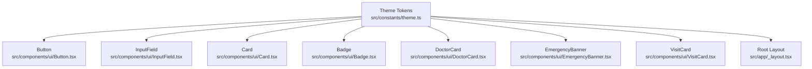
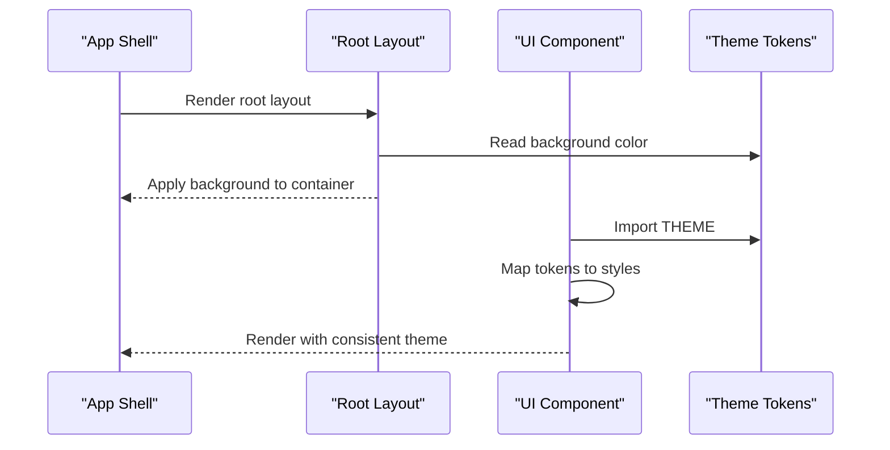
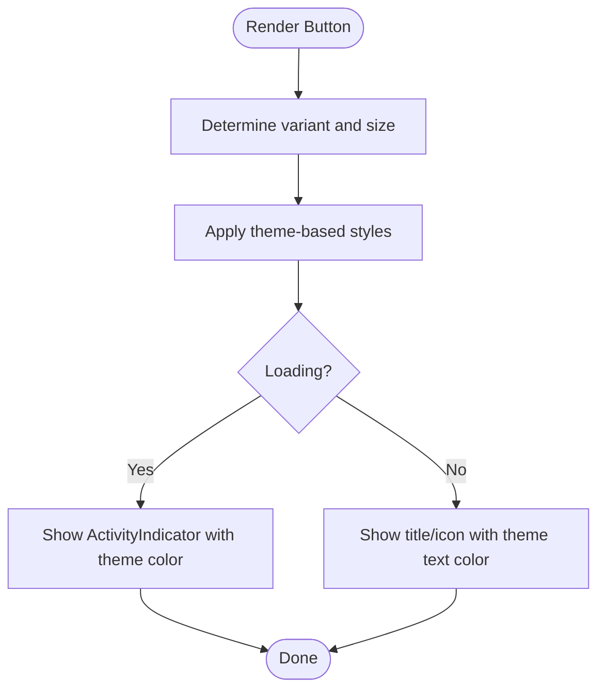
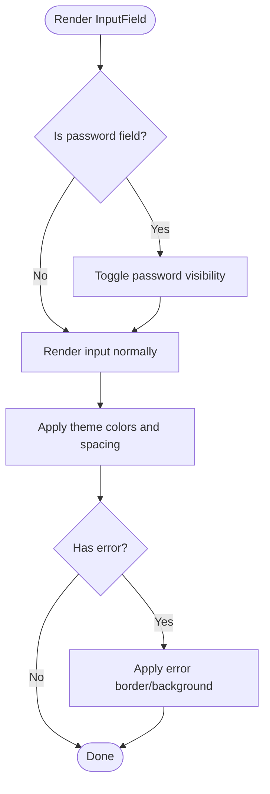
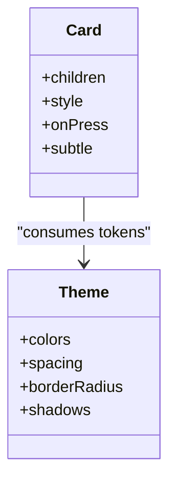
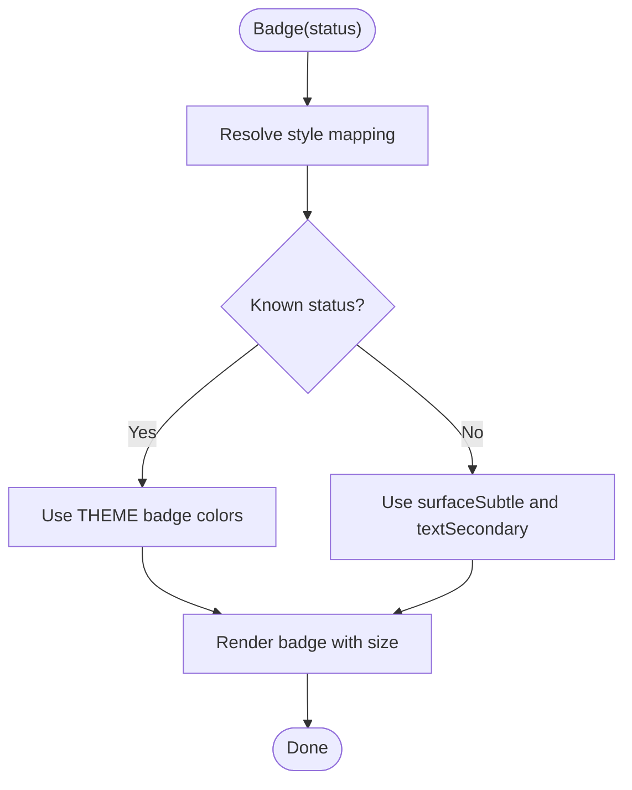
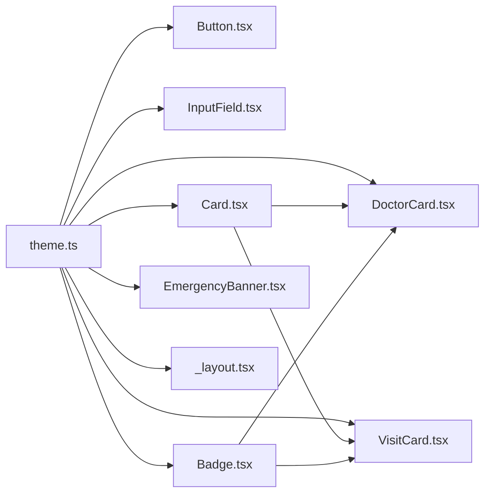

# Theming System

<cite>
**Referenced Files in This Document**
- [theme.ts](file://src/constants/theme.ts)
- [Button.tsx](file://src/components/ui/Button.tsx)
- [InputField.tsx](file://src/components/ui/InputField.tsx)
- [Card.tsx](file://src/components/ui/Card.tsx)
- [Badge.tsx](file://src/components/ui/Badge.tsx)
- [DoctorCard.tsx](file://src/components/ui/DoctorCard.tsx)
- [EmergencyBanner.tsx](file://src/components/ui/EmergencyBanner.tsx)
- [VisitCard.tsx](file://src/components/ui/VisitCard.tsx)
- [_layout.tsx](file://src/app/_layout.tsx)
</cite>

## Table of Contents
1. [Introduction](#introduction)
2. [Project Structure](#project-structure)
3. [Core Components](#core-components)
4. [Architecture Overview](#architecture-overview)
5. [Detailed Component Analysis](#detailed-component-analysis)
6. [Dependency Analysis](#dependency-analysis)
7. [Performance Considerations](#performance-considerations)
8. [Troubleshooting Guide](#troubleshooting-guide)
9. [Conclusion](#conclusion)
10. [Appendices](#appendices)

## Introduction
This document explains the theming system architecture used across the application. It covers the design tokens defined in the central theme, how components consume those tokens for colors, typography, spacing, and visual effects, and how to extend the system for custom branding, dark mode support, and accessibility compliance. The goal is to help you maintain a consistent, scalable design system while enabling safe overrides and brand variations.

## Project Structure
The theming system is centralized in a single token file and consumed by UI components and app layout:
- Design tokens (colors, typography, spacing, radii, shadows) are defined in one place.
- UI components import and apply these tokens consistently.
- App-level layout applies background color from the theme to ensure global consistency.

**Diagram sources**
- [theme.ts:71-164](file://src/constants/theme.ts#L71-L164)
- [Button.tsx:11-149](file://src/components/ui/Button.tsx#L11-L149)
- [InputField.tsx:13-128](file://src/components/ui/InputField.tsx#L13-L128)
- [Card.tsx:4-55](file://src/components/ui/Card.tsx#L4-L55)
- [Badge.tsx:4-124](file://src/components/ui/Badge.tsx#L4-L124)
- [DoctorCard.tsx:4-212](file://src/components/ui/DoctorCard.tsx#L4-L212)
- [EmergencyBanner.tsx:4-74](file://src/components/ui/EmergencyBanner.tsx#L4-L74)
- [VisitCard.tsx:4-203](file://src/components/ui/VisitCard.tsx#L4-L203)
- [_layout.tsx:9-70](file://src/app/_layout.tsx#L9-L70)

**Section sources**
- [theme.ts:71-164](file://src/constants/theme.ts#L71-L164)
- [_layout.tsx:9-70](file://src/app/_layout.tsx#L9-L70)

## Core Components
The core of the theming system is the centralized THEME object that defines:
- Color palette: primary, accent, semantic colors (success, warning, error, info), neutral backgrounds/surfaces/borders/text, and status badge colors.
- Typography scale: font families and size tokens.
- Spacing scale: xs through xxl.
- Border radius tokens: sm through full.
- Shadow definitions: card and floating elevation/shadow properties.

These tokens are imported by components and applied via StyleSheet rules, ensuring consistent visuals across screens.

Key responsibilities:
- Centralize all visual decisions so changes propagate automatically.
- Provide semantic naming (e.g., textPrimary, surfaceSubtle) to improve readability and intent.
- Offer a clear extension point for adding new tokens or variants.

**Section sources**
- [theme.ts:71-164](file://src/constants/theme.ts#L71-L164)

## Architecture Overview
Components consume theme tokens directly from the central theme file. There is no runtime theme provider; instead, components read static values at render time. This approach is simple and performant but requires careful management when introducing dynamic themes like dark mode.

**Diagram sources**
- [_layout.tsx:9-70](file://src/app/_layout.tsx#L9-L70)
- [Button.tsx:11-149](file://src/components/ui/Button.tsx#L11-L149)
- [InputField.tsx:13-128](file://src/components/ui/InputField.tsx#L13-L128)
- [Card.tsx:4-55](file://src/components/ui/Card.tsx#L4-L55)
- [Badge.tsx:4-124](file://src/components/ui/Badge.tsx#L4-L124)
- [DoctorCard.tsx:4-212](file://src/components/ui/DoctorCard.tsx#L4-L212)
- [EmergencyBanner.tsx:4-74](file://src/components/ui/EmergencyBanner.tsx#L4-L74)
- [VisitCard.tsx:4-203](file://src/components/ui/VisitCard.tsx#L4-L203)

## Detailed Component Analysis

### Theme Tokens
The THEME object provides:
- Colors:
  - Primary palette: primary, primaryDark, primaryLight, primarySoft.
  - Accent and semantic colors: accent, success, warning, error, info, plus soft variants for backgrounds.
  - Neutrals: background, surface, surfaceSubtle, border, borderLight.
  - Text: textPrimary, textSecondary, textMuted, textWhite.
  - Status badges: dedicated bg/text pairs for pending, confirmed, active, completed, cancelled.
- Typography:
  - Font families: regular, medium, bold mapped to system fonts.
  - Sizes: xs through display.
- Spacing:
  - Scale from xs to xxl.
- Border Radius:
  - sm through full.
- Shadows:
  - card and floating shadow presets.

Usage patterns:
- Components reference THEME.colors.* for fill and stroke.
- Typography sizes are applied via THEME.typography.sizes.*.
- Spacing and radii are applied via THEME.spacing.* and THEME.borderRadius.*.
- Shadows are spread into component styles using THEME.shadows.*.

Extensibility guidance:
- Add new semantic colors under THEME.colors with descriptive names.
- Extend typography sizes if needed, keeping ratios consistent.
- Introduce new spacing steps only when necessary to preserve rhythm.
- Define new shadow presets for elevated surfaces.

**Section sources**
- [theme.ts:71-164](file://src/constants/theme.ts#L71-L164)

### Button Component
Responsibilities:
- Renders interactive buttons with multiple variants (primary, secondary, outline, danger, ghost).
- Applies theme colors for backgrounds and text based on variant.
- Uses typography sizes and border radius from theme.
- Supports loading state and disabled state with appropriate opacity and color changes.

Token usage:
- Backgrounds and borders use THEME.colors.primary, accent, error, and textWhite.
- Text colors vary by variant using THEME.colors.textWhite, accent, primary, textSecondary, textMuted.
- Size and typography scale come from THEME.typography.sizes.*.
- Rounded corners use THEME.borderRadius.md.

Accessibility considerations:
- Ensure sufficient contrast between button text and background per WCAG guidelines.
- Provide accessible labels for icon-only buttons.

**Diagram sources**
- [Button.tsx:25-74](file://src/components/ui/Button.tsx#L25-L74)
- [Button.tsx:76-149](file://src/components/ui/Button.tsx#L76-L149)

**Section sources**
- [Button.tsx:11-149](file://src/components/ui/Button.tsx#L11-L149)

### InputField Component
Responsibilities:
- Provides labeled input fields with optional hint and error states.
- Handles password visibility toggle with an eye icon.
- Applies theme colors for borders, backgrounds, and text.
- Uses theme spacing and radii for consistent layout.

Token usage:
- Placeholder and hint text use THEME.colors.textMuted.
- Input background and border use THEME.colors.surface and THEME.colors.border.
- Error state uses THEME.colors.error for border and background tint.
- Label and helper text use THEME.colors.textPrimary and textMuted.
- Spacing and radii come from THEME.spacing.md and THEME.borderRadius.md.

Accessibility considerations:
- Use accessible labels for inputs and toggles.
- Ensure error messages are announced to screen readers.

**Diagram sources**
- [InputField.tsx:22-72](file://src/components/ui/InputField.tsx#L22-L72)
- [InputField.tsx:74-128](file://src/components/ui/InputField.tsx#L74-L128)

**Section sources**
- [InputField.tsx:13-128](file://src/components/ui/InputField.tsx#L13-L128)

### Card Component
Responsibilities:
- Wraps content with consistent background, border, padding, and radius.
- Offers subtle and shadowed variants.
- Optionally wraps content in Pressable for interaction feedback.

Token usage:
- Background and border use THEME.colors.surface and THEME.colors.border.
- Padding uses THEME.spacing.base.
- Radius uses THEME.borderRadius.lg.
- Shadow preset uses THEME.shadows.card.

**Diagram sources**
- [Card.tsx:13-38](file://src/components/ui/Card.tsx#L13-L38)
- [Card.tsx:40-55](file://src/components/ui/Card.tsx#L40-L55)
- [theme.ts:71-164](file://src/constants/theme.ts#L71-L164)

**Section sources**
- [Card.tsx:4-55](file://src/components/ui/Card.tsx#L4-L55)

### Badge Component
Responsibilities:
- Displays status labels with appropriate background and text colors.
- Maps domain statuses to theme-defined badge colors.
- Supports small and medium sizes.

Token usage:
- Background and text colors map to THEME.colors.badgePendingBg/text, badgeConfirmedBg/text, badgeCompletedBg/text, badgeCancelledBg/text.
- Fallback styling uses THEME.colors.surfaceSubtle and textSecondary.
- Radius uses THEME.borderRadius.full.

**Diagram sources**
- [Badge.tsx:13-98](file://src/components/ui/Badge.tsx#L13-L98)
- [Badge.tsx:100-124](file://src/components/ui/Badge.tsx#L100-L124)

**Section sources**
- [Badge.tsx:4-124](file://src/components/ui/Badge.tsx#L4-L124)

### DoctorCard Component
Responsibilities:
- Presents doctor profile information including avatar, specialty, rating, experience, coverage districts, and fee.
- Integrates Badge and Card components.
- Applies theme colors for verified indicators, accents, and typography.

Token usage:
- Verified checkmark uses THEME.colors.primary.
- District chips use THEME.colors.surfaceSubtle and THEME.borderRadius.sm.
- Typography sizes use THEME.typography.sizes.*.
- Fee highlight uses THEME.colors.primaryDark.
- Book button uses THEME.colors.primary and THEME.borderRadius.md.

**Section sources**
- [DoctorCard.tsx:4-212](file://src/components/ui/DoctorCard.tsx#L4-L212)

### EmergencyBanner Component
Responsibilities:
- Displays emergency notice and disclaimer text.
- Provides a call-to-action button to dial emergency number.
- Uses theme colors for background, badge, and button.

Token usage:
- Container background uses THEME.colors.errorSoft.
- Badge and button use THEME.colors.error.
- Spacing and radius use THEME.spacing.md/base and THEME.borderRadius.md/sm.

**Section sources**
- [EmergencyBanner.tsx:4-74](file://src/components/ui/EmergencyBanner.tsx#L4-L74)

### VisitCard Component
Responsibilities:
- Shows visit details including date/time, status badge, person info, address, condition snippet, alternative proposal alert, and fee summary.
- Integrates Badge and Card components.
- Applies theme colors for icons, text, and action elements.

Token usage:
- Date/time icons use THEME.colors.primary.
- Status badge uses THEME.colors via Badge component.
- Footer divider uses THEME.colors.borderLight.
- Action button uses THEME.colors.primary and THEME.borderRadius.sm.

**Section sources**
- [VisitCard.tsx:4-203](file://src/components/ui/VisitCard.tsx#L4-L203)

### Root Layout
Responsibilities:
- Sets up navigation stack and global background color.
- Applies THEME.colors.background to the container and Stack content style.

Token usage:
- Background color comes from THEME.colors.background.

**Section sources**
- [_layout.tsx:9-70](file://src/app/_layout.tsx#L9-L70)

## Dependency Analysis
Components depend on the central theme for visual consistency. There are no circular dependencies among components; they primarily import THEME and each other where composition is needed (e.g., DoctorCard uses Card and Badge).

**Diagram sources**
- [theme.ts:71-164](file://src/constants/theme.ts#L71-L164)
- [Button.tsx:11-149](file://src/components/ui/Button.tsx#L11-L149)
- [InputField.tsx:13-128](file://src/components/ui/InputField.tsx#L13-L128)
- [Card.tsx:4-55](file://src/components/ui/Card.tsx#L4-L55)
- [Badge.tsx:4-124](file://src/components/ui/Badge.tsx#L4-L124)
- [DoctorCard.tsx:4-212](file://src/components/ui/DoctorCard.tsx#L4-L212)
- [EmergencyBanner.tsx:4-74](file://src/components/ui/EmergencyBanner.tsx#L4-L74)
- [VisitCard.tsx:4-203](file://src/components/ui/VisitCard.tsx#L4-L203)
- [_layout.tsx:9-70](file://src/app/_layout.tsx#L9-L70)

**Section sources**
- [theme.ts:71-164](file://src/constants/theme.ts#L71-L164)
- [DoctorCard.tsx:4-212](file://src/components/ui/DoctorCard.tsx#L4-L212)
- [VisitCard.tsx:4-203](file://src/components/ui/VisitCard.tsx#L4-L203)

## Performance Considerations
- Static theme consumption avoids runtime overhead; components read THEME values directly.
- Avoid recalculating theme-derived styles inside frequently re-rendered components; prefer memoization if needed.
- Keep token definitions minimal and well-named to reduce bundle size and cognitive load.
- Prefer using existing spacing/radius tokens to avoid redundant style calculations.

[No sources needed since this section provides general guidance]

## Troubleshooting Guide
Common issues and resolutions:
- Inconsistent colors across components:
  - Ensure components import THEME and do not hardcode hex values.
  - Verify semantic color names match intended meaning (e.g., error vs warning).
- Poor contrast or accessibility failures:
  - Review text/background combinations against WCAG guidelines.
  - Adjust THEME.colors to meet contrast requirements without breaking brand identity.
- Misaligned spacing:
  - Use THEME.spacing tokens consistently; avoid ad-hoc pixel values.
- Unexpected shadow behavior:
  - Confirm platform-specific shadow settings in THEME.shadows are correct.
- Hardcoded fallbacks bypassing theme:
  - Replace hardcoded colors in components with THEME equivalents.

**Section sources**
- [Button.tsx:76-149](file://src/components/ui/Button.tsx#L76-L149)
- [InputField.tsx:74-128](file://src/components/ui/InputField.tsx#L74-L128)
- [Card.tsx:40-55](file://src/components/ui/Card.tsx#L40-L55)
- [Badge.tsx:100-124](file://src/components/ui/Badge.tsx#L100-L124)
- [EmergencyBanner.tsx:26-74](file://src/components/ui/EmergencyBanner.tsx#L26-L74)
- [VisitCard.tsx:90-203](file://src/components/ui/VisitCard.tsx#L90-L203)

## Conclusion
The theming system centralizes design tokens to ensure consistency and ease of maintenance. Components consume these tokens directly, which simplifies updates and supports scalable growth. To extend the system:
- Add new tokens in the central theme file.
- Update components to use semantic tokens rather than hardcoding values.
- Introduce a theme provider for dynamic themes (e.g., dark mode) while preserving token semantics.
- Validate accessibility and contrast for all color combinations.

[No sources needed since this section summarizes without analyzing specific files]

## Appendices

### How to Extend the Theme System

#### Create New Color Schemes
- Add new semantic color keys under THEME.colors with descriptive names.
- Provide both base and soft variants where appropriate (e.g., success and successSoft).
- Update components to use the new tokens instead of hard-coded colors.

#### Support Dark Mode
- Introduce a theme provider that switches between light and dark palettes.
- Mirror current token structure for dark mode (background, surface, text, borders, semantic colors).
- Ensure all components consume tokens from the provider rather than static THEME.

#### Maintain Accessibility Compliance
- Audit color contrasts for all text/background combinations.
- Provide accessible labels for interactive elements (buttons, toggles).
- Use semantic tokens to standardize accessible color usage across components.

#### Customize Component Styles Safely
- Prefer overriding via props or wrapper components rather than modifying shared styles.
- If customization is necessary, keep it within component boundaries and document the rationale.
- Reuse existing tokens to maintain design system integrity.

#### Maintain Design Consistency Across the App
- Enforce token usage through code reviews and linting rules.
- Avoid hardcoding colors, spacing, and radii in screens and features.
- Regularly audit components to ensure they align with the central theme.

[No sources needed since this section provides general guidance]