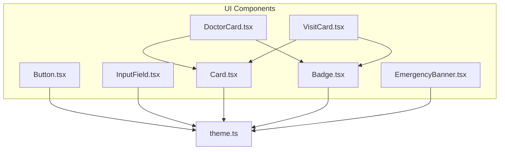
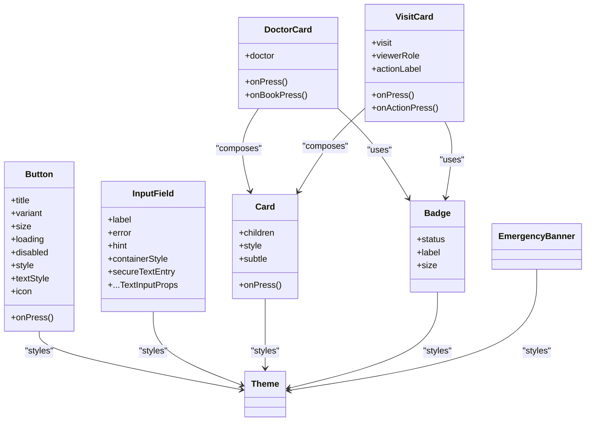
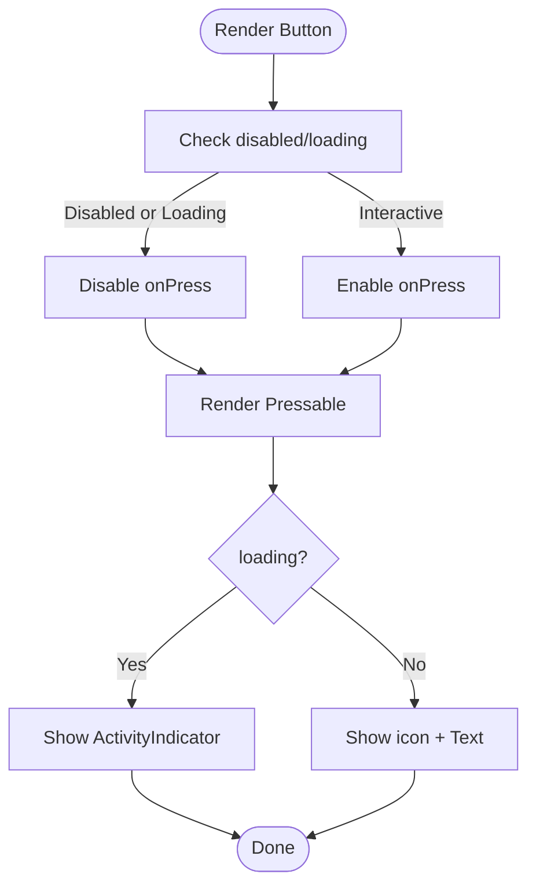
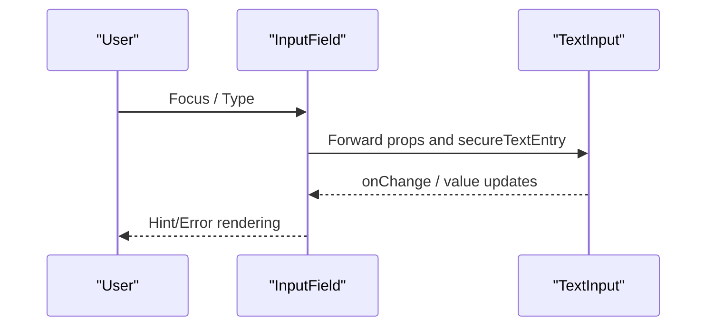
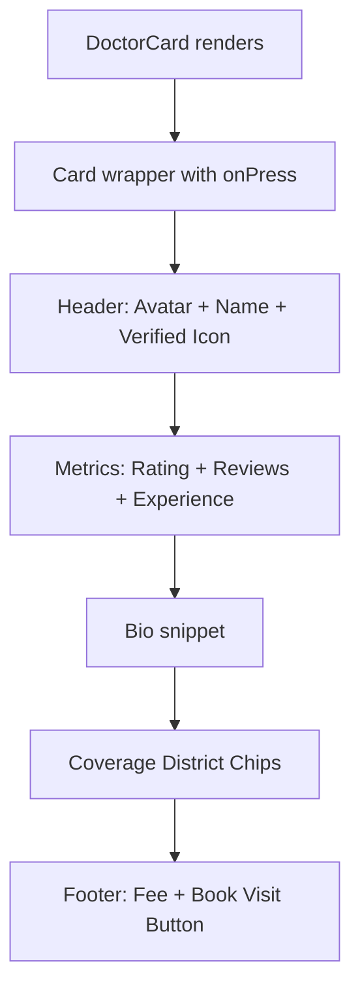
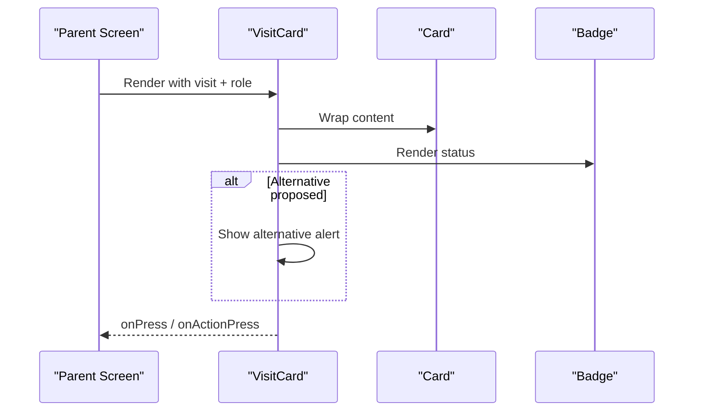
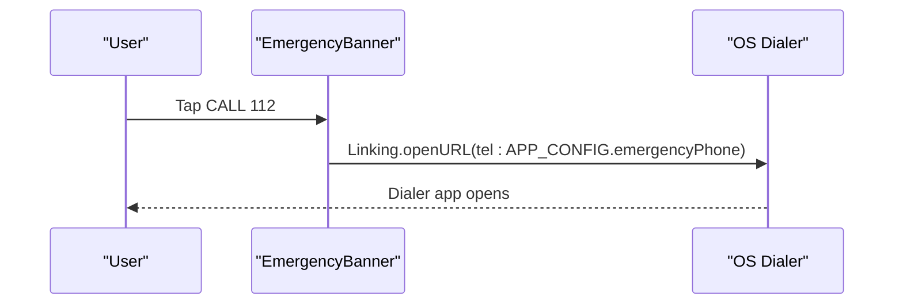
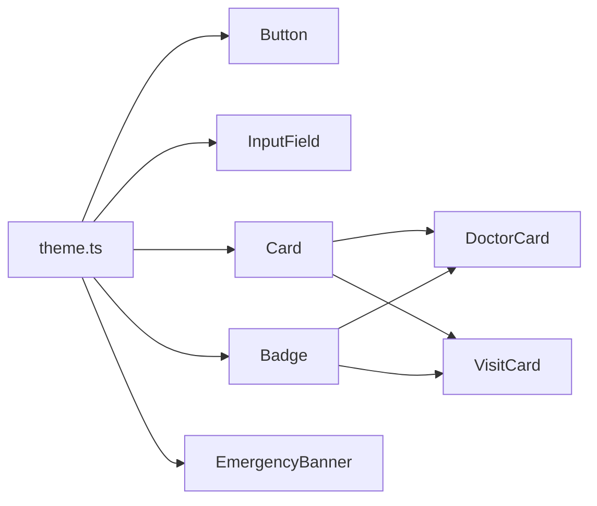

# UI Components Library

<cite>
**Referenced Files in This Document**
- [Button.tsx](file://src/components/ui/Button.tsx)
- [InputField.tsx](file://src/components/ui/InputField.tsx)
- [Card.tsx](file://src/components/ui/Card.tsx)
- [Badge.tsx](file://src/components/ui/Badge.tsx)
- [DoctorCard.tsx](file://src/components/ui/DoctorCard.tsx)
- [VisitCard.tsx](file://src/components/ui/VisitCard.tsx)
- [EmergencyBanner.tsx](file://src/components/ui/EmergencyBanner.tsx)
- [theme.ts](file://src/constants/theme.ts)
</cite>

## Table of Contents
1. [Introduction](#introduction)
2. [Project Structure](#project-structure)
3. [Core Components](#core-components)
4. [Architecture Overview](#architecture-overview)
5. [Detailed Component Analysis](#detailed-component-analysis)
6. [Dependency Analysis](#dependency-analysis)
7. [Performance Considerations](#performance-considerations)
8. [Troubleshooting Guide](#troubleshooting-guide)
9. [Conclusion](#conclusion)
10. [Appendices](#appendices)

## Introduction
This document describes the reusable UI components library used across the application. It covers base components (Button, InputField, Card, Badge), composite domain components (DoctorCard, VisitCard), and a safety-critical banner (EmergencyBanner). It also documents the theming system, design tokens, accessibility considerations, responsive behavior, and cross-platform compatibility notes for iOS and Android.

## Project Structure
The UI components live under src/components/ui and share a centralized theme from src/constants/theme.ts. Composite components compose base components to build domain-specific cards and banners.

**Diagram sources**
- [Button.tsx:1-150](file://src/components/ui/Button.tsx#L1-L150)
- [InputField.tsx:1-129](file://src/components/ui/InputField.tsx#L1-L129)
- [Card.tsx:1-56](file://src/components/ui/Card.tsx#L1-L56)
- [Badge.tsx:1-125](file://src/components/ui/Badge.tsx#L1-L125)
- [DoctorCard.tsx:1-213](file://src/components/ui/DoctorCard.tsx#L1-L213)
- [VisitCard.tsx:1-204](file://src/components/ui/VisitCard.tsx#L1-L204)
- [EmergencyBanner.tsx:1-75](file://src/components/ui/EmergencyBanner.tsx#L1-L75)
- [theme.ts:71-165](file://src/constants/theme.ts#L71-L165)

**Section sources**
- [Button.tsx:1-150](file://src/components/ui/Button.tsx#L1-L150)
- [InputField.tsx:1-129](file://src/components/ui/InputField.tsx#L1-L129)
- [Card.tsx:1-56](file://src/components/ui/Card.tsx#L1-L56)
- [Badge.tsx:1-125](file://src/components/ui/Badge.tsx#L1-L125)
- [DoctorCard.tsx:1-213](file://src/components/ui/DoctorCard.tsx#L1-L213)
- [VisitCard.tsx:1-204](file://src/components/ui/VisitCard.tsx#L1-L204)
- [EmergencyBanner.tsx:1-75](file://src/components/ui/EmergencyBanner.tsx#L1-L75)
- [theme.ts:1-165](file://src/constants/theme.ts#L1-L165)

## Core Components
This section summarizes each component’s purpose, props, events, styling options, and usage patterns.

- Button
  - Purpose: Primary interactive control with variants, sizes, loading state, and optional icon.
  - Props: title, onPress, variant, size, loading, disabled, style, textStyle, icon.
  - Events: onPress when not disabled or loading.
  - Styling: Uses theme colors, typography sizes, border radius; supports pressed/disabled states.
  - Usage pattern: Use primary for main actions, secondary/accent for supportive actions, outline for low-emphasis actions, danger for destructive actions, ghost for minimal emphasis.

- InputField
  - Purpose: Accessible form input with label, hint, error, password toggle, and multiline support.
  - Props: Extends TextInputProps plus label, error, hint, containerStyle.
  - Events: Inherits all TextInput events (onChangeText, onFocus, onBlur, etc.).
  - Styling: Themed surface/border/text colors; error state highlights border and background; password toggle adds right padding.
  - Usage pattern: Wrap user inputs with labels and hints; show errors inline; use secureTextEntry for passwords.

- Card
  - Purpose: Container with subtle or shadowed elevation, optional press interaction.
  - Props: children, style, onPress, subtle.
  - Events: onPress when provided.
  - Styling: Surface color, border, rounded corners, optional shadow via theme shadows.
  - Usage pattern: Encapsulate related content; wrap with Pressable if clickable.

- Badge
  - Purpose: Status indicator with semantic colors and default labels.
  - Props: status, label, size.
  - Events: None.
  - Styling: Rounded pill with background/text colors per status; sm/md sizes.
  - Usage pattern: Display visit or verification statuses consistently.

- DoctorCard
  - Purpose: Composite card presenting doctor profile, rating, coverage, fee, and booking action.
  - Props: doctor, onPress, onBookPress.
  - Events: onPress for card tap; onBookPress for booking button.
  - Styling: Composes Card and uses theme tokens; shows verified badge and district chips.
  - Usage pattern: Render in lists; provide both card-level and booking-level interactions.

- VisitCard
  - Purpose: Composite card showing visit details, status, address, symptoms, alternative proposal, and footer actions.
  - Props: visit, onPress, viewerRole, onActionPress, actionLabel.
  - Events: onPress for card; onActionPress for contextual action.
  - Styling: Uses Card and Badge; conditional alert for alternative proposals.
  - Usage pattern: Show different person info based on viewer role; render action button when provided.

- EmergencyBanner
  - Purpose: Safety banner with emergency disclaimer and call-to-action.
  - Props: None.
  - Events: Opens device dialer with configured emergency number.
  - Styling: Error-themed background and badge; compact layout.
  - Usage pattern: Place at top of screens where users might need quick access to emergency services.

**Section sources**
- [Button.tsx:13-74](file://src/components/ui/Button.tsx#L13-L74)
- [InputField.tsx:15-72](file://src/components/ui/InputField.tsx#L15-L72)
- [Card.tsx:6-38](file://src/components/ui/Card.tsx#L6-L38)
- [Badge.tsx:7-98](file://src/components/ui/Badge.tsx#L7-L98)
- [DoctorCard.tsx:9-86](file://src/components/ui/DoctorCard.tsx#L9-L86)
- [VisitCard.tsx:9-88](file://src/components/ui/VisitCard.tsx#L9-L88)
- [EmergencyBanner.tsx:6-24](file://src/components/ui/EmergencyBanner.tsx#L6-L24)

## Architecture Overview
The UI layer is built from small, themed primitives composed into domain-specific cards. The theme centralizes colors, typography, spacing, radii, and shadows.

**Diagram sources**
- [Button.tsx:13-74](file://src/components/ui/Button.tsx#L13-L74)
- [InputField.tsx:15-72](file://src/components/ui/InputField.tsx#L15-L72)
- [Card.tsx:6-38](file://src/components/ui/Card.tsx#L6-L38)
- [Badge.tsx:7-98](file://src/components/ui/Badge.tsx#L7-L98)
- [DoctorCard.tsx:9-86](file://src/components/ui/DoctorCard.tsx#L9-L86)
- [VisitCard.tsx:9-88](file://src/components/ui/VisitCard.tsx#L9-L88)
- [EmergencyBanner.tsx:6-24](file://src/components/ui/EmergencyBanner.tsx#L6-L24)
- [theme.ts:71-165](file://src/constants/theme.ts#L71-L165)

## Detailed Component Analysis

### Button
- Behavior
  - Interactive unless disabled or loading.
  - Shows ActivityIndicator when loading.
  - Applies pressed opacity feedback.
- Props
  - title: string
  - onPress: () => void
  - variant: 'primary' | 'secondary' | 'outline' | 'danger' | 'ghost'
  - size: 'sm' | 'md' | 'lg'
  - loading: boolean
  - disabled: boolean
  - style: ViewStyle
  - textStyle: TextStyle
  - icon: React.ReactNode
- Styling
  - Background and text colors vary by variant.
  - Font size maps to theme typography sizes.
  - Border radius from theme.
- Accessibility
  - No explicit accessibilityRole; consider adding role="button" and accessible label in consuming screens.
- Cross-platform
  - Uses standard Pressable and Text; consistent on iOS and Android.

**Diagram sources**
- [Button.tsx:36-73](file://src/components/ui/Button.tsx#L36-L73)

**Section sources**
- [Button.tsx:13-149](file://src/components/ui/Button.tsx#L13-L149)

### InputField
- Behavior
  - Wraps TextInput with label, hint, and error display.
  - Password mode toggles visibility and adjusts auto settings.
- Props
  - label: string
  - error?: string
  - hint?: string
  - containerStyle?: ViewStyle
  - All TextInputProps (e.g., placeholder, onChangeText, secureTextEntry, multiline)
- Styling
  - Surface background, border, and text colors from theme.
  - Error state applies red border and light red background.
  - Multiline sets minimum height and top-aligned text.
- Accessibility
  - Password toggle has accessibilityRole="button" and dynamic accessibilityLabel.
- Cross-platform
  - SecureTextEntry and autoCapitalize behave consistently; ensure platform-specific keyboard types are set in consuming code if needed.

**Diagram sources**
- [InputField.tsx:22-72](file://src/components/ui/InputField.tsx#L22-L72)

**Section sources**
- [InputField.tsx:15-129](file://src/components/ui/InputField.tsx#L15-L129)

### Card
- Behavior
  - Renders children inside a styled container.
  - Optional Pressable wrapper with pressed opacity.
- Props
  - children: React.ReactNode
  - style?: StyleProp<ViewStyle>
  - onPress?: () => void
  - subtle?: boolean
- Styling
  - Surface color, border, and rounded corners.
  - Shadow or subtle background depending on subtle prop.
- Accessibility
  - If using onPress, consider wrapping with an accessible container and providing accessibilityLabel in parent screens.

**Section sources**
- [Card.tsx:6-56](file://src/components/ui/Card.tsx#L6-L56)

### Badge
- Behavior
  - Maps status values to background/text colors and default labels.
  - Supports two sizes.
- Props
  - status: VisitStatus | DoctorVerificationStatus | string
  - label?: string
  - size?: 'sm' | 'md'
- Styling
  - Pill shape with full border radius.
  - Colors derived from theme or hardcoded fallbacks for specific statuses.
- Accessibility
  - No explicit accessibilityRole; consider labeling in context.

**Section sources**
- [Badge.tsx:7-125](file://src/components/ui/Badge.tsx#L7-L125)

### DoctorCard
- Behavior
  - Displays avatar, name, specialty, rating, reviews, experience, bio, coverage districts, fee, and a “Book Visit” action.
  - Shows a verified checkmark when doctor is approved.
- Props
  - doctor: DoctorProfile
  - onPress: () => void
  - onBookPress?: () => void
- Composition
  - Composes Card and Badge.
- Styling
  - Uses theme typography and spacing; includes internal color constants for star rating and fee emphasis.
- Accessibility
  - Ensure surrounding list items have proper roles and labels.

**Diagram sources**
- [DoctorCard.tsx:15-86](file://src/components/ui/DoctorCard.tsx#L15-L86)

**Section sources**
- [DoctorCard.tsx:9-213](file://src/components/ui/DoctorCard.tsx#L9-L213)

### VisitCard
- Behavior
  - Shows scheduled date/time, status badge, person info (patient or doctor), address, symptoms, alternative proposal alert, and footer with total fee and action link/button.
- Props
  - visit: VisitRequest
  - onPress: () => void
  - viewerRole: 'patient' | 'doctor'
  - onActionPress?: () => void
  - actionLabel?: string
- Composition
  - Composes Card and Badge.
- Styling
  - Conditional alert for alternative_proposed status; uses theme tokens for borders and colors.
- Accessibility
  - Provide meaningful labels for links/buttons in consuming screens.

**Diagram sources**
- [VisitCard.tsx:17-88](file://src/components/ui/VisitCard.tsx#L17-L88)

**Section sources**
- [VisitCard.tsx:9-204](file://src/components/ui/VisitCard.tsx#L9-L204)

### EmergencyBanner
- Behavior
  - Displays an emergency notice and opens the device dialer with the configured emergency phone number.
- Props
  - None.
- Integration
  - Uses APP_CONFIG.emergencyPhone to construct tel: URL.
- Accessibility
  - Call button should be focusable and announce its action to screen readers.

**Diagram sources**
- [EmergencyBanner.tsx:6-24](file://src/components/ui/EmergencyBanner.tsx#L6-L24)
- [theme.ts:58-69](file://src/constants/theme.ts#L58-L69)

**Section sources**
- [EmergencyBanner.tsx:1-75](file://src/components/ui/EmergencyBanner.tsx#L1-L75)
- [theme.ts:58-69](file://src/constants/theme.ts#L58-L69)

## Dependency Analysis
- Base components depend only on React Native and THEME.
- Composite components depend on base components and domain types.
- EmergencyBanner depends on APP_CONFIG for country-agnostic emergency information.

**Diagram sources**
- [Button.tsx:1-150](file://src/components/ui/Button.tsx#L1-L150)
- [InputField.tsx:1-129](file://src/components/ui/InputField.tsx#L1-L129)
- [Card.tsx:1-56](file://src/components/ui/Card.tsx#L1-L56)
- [Badge.tsx:1-125](file://src/components/ui/Badge.tsx#L1-L125)
- [DoctorCard.tsx:1-213](file://src/components/ui/DoctorCard.tsx#L1-L213)
- [VisitCard.tsx:1-204](file://src/components/ui/VisitCard.tsx#L1-L204)
- [EmergencyBanner.tsx:1-75](file://src/components/ui/EmergencyBanner.tsx#L1-L75)
- [theme.ts:71-165](file://src/constants/theme.ts#L71-L165)

**Section sources**
- [theme.ts:71-165](file://src/constants/theme.ts#L71-L165)
- [DoctorCard.tsx:1-213](file://src/components/ui/DoctorCard.tsx#L1-L213)
- [VisitCard.tsx:1-204](file://src/components/ui/VisitCard.tsx#L1-L204)

## Performance Considerations
- Prefer memoization for expensive lists of DoctorCard/VisitCard; pass stable references for callbacks to avoid re-renders.
- Avoid heavy images in lists; consider lazy loading or thumbnails.
- Keep Badge status mapping simple; it is already O(1).
- For long lists, virtualize containers and limit rendered items.
- Minimize unnecessary style recomputation by extracting styles outside render loops.

[No sources needed since this section provides general guidance]

## Troubleshooting Guide
- Button not responding
  - Ensure disabled and loading are false.
  - Verify onPress is provided and not overridden.
- InputField password toggle not visible
  - Confirm secureTextEntry is true.
  - Check that no custom style removes paddingRight for the toggle area.
- Card shadow not visible on some devices
  - On Android, elevation may require hardware acceleration; verify platform settings.
- Badge label incorrect
  - Ensure status matches one of the handled cases; otherwise, it falls back to raw status string.
- EmergencyBanner call fails
  - Verify device supports tel: URLs and permissions are granted.
  - Check APP_CONFIG.emergencyPhone is correctly set.

**Section sources**
- [Button.tsx:36-73](file://src/components/ui/Button.tsx#L36-L73)
- [InputField.tsx:31-72](file://src/components/ui/InputField.tsx#L31-L72)
- [Card.tsx:40-56](file://src/components/ui/Card.tsx#L40-L56)
- [Badge.tsx:14-98](file://src/components/ui/Badge.tsx#L14-L98)
- [EmergencyBanner.tsx:6-24](file://src/components/ui/EmergencyBanner.tsx#L6-L24)

## Conclusion
The UI components library provides a cohesive, theme-driven set of primitives and composites tailored for healthcare workflows. By adhering to the documented props, events, and styling tokens, teams can build consistent, accessible, and maintainable interfaces across iOS and Android.

[No sources needed since this section summarizes without analyzing specific files]

## Appendices

### Theming System and Design Tokens
- Colors
  - Primary palette: primary, primaryDark, primaryLight, primarySoft.
  - Accent: accent, accentSoft.
  - Semantic: success, warning, error, info and their soft variants.
  - Neutrals: background, surface, surfaceSubtle, border, borderLight.
  - Text: textPrimary, textSecondary, textMuted, textWhite.
  - Badges: dedicated bg/text pairs for pending, confirmed, active, completed, cancelled.
- Typography
  - fontFamilies: regular, medium, bold (all System).
  - sizes: xs, sm, base, md, lg, xl, xxl, display.
- Spacing
  - xs, sm, md, base, lg, xl, xxl.
- Border Radius
  - sm, md, lg, xl, full.
- Shadows
  - card and floating with elevation.

Usage examples (paths only):
- Button variant colors and sizes: [Button.tsx:89-149](file://src/components/ui/Button.tsx#L89-L149)
- InputField themed surfaces and borders: [InputField.tsx:88-128](file://src/components/ui/InputField.tsx#L88-L128)
- Card shadow and subtle modes: [Card.tsx:40-56](file://src/components/ui/Card.tsx#L40-L56)
- Badge status mapping: [Badge.tsx:14-75](file://src/components/ui/Badge.tsx#L14-L75)
- EmergencyBanner error theme usage: [EmergencyBanner.tsx:26-74](file://src/components/ui/EmergencyBanner.tsx#L26-L74)

**Section sources**
- [theme.ts:71-165](file://src/constants/theme.ts#L71-L165)
- [Button.tsx:89-149](file://src/components/ui/Button.tsx#L89-L149)
- [InputField.tsx:88-128](file://src/components/ui/InputField.tsx#L88-L128)
- [Card.tsx:40-56](file://src/components/ui/Card.tsx#L40-L56)
- [Badge.tsx:14-75](file://src/components/ui/Badge.tsx#L14-L75)
- [EmergencyBanner.tsx:26-74](file://src/components/ui/EmergencyBanner.tsx#L26-L74)

### Accessibility Compliance Guidelines
- Buttons
  - Add accessibleRole="button" and accessibleLabel in consuming screens if needed.
- Inputs
  - Ensure label association via accessibilityLabel or aria-like attributes in wrappers.
  - Password toggle already exposes accessibilityRole and dynamic label.
- Cards
  - When interactive, expose accessibleRole and label describing the action.
- Badges
  - Provide contextual labels in surrounding content; badges alone are decorative.
- EmergencyBanner
  - Ensure call button announces its action clearly to assistive technologies.

**Section sources**
- [InputField.tsx:52-66](file://src/components/ui/InputField.tsx#L52-L66)

### Responsive Design Considerations
- Use theme spacing and typography scales consistently to adapt across screen sizes.
- For long text (bio, symptoms), rely on numberOfLines to constrain lines.
- Flex layouts in cards wrap district chips and metrics gracefully.
- Avoid fixed widths; prefer flexible layouts and relative units from theme.

**Section sources**
- [DoctorCard.tsx:160-182](file://src/components/ui/DoctorCard.tsx#L160-L182)
- [VisitCard.tsx:148-153](file://src/components/ui/VisitCard.tsx#L148-L153)

### Cross-Platform Compatibility Notes (iOS vs Android)
- Pressable feedback
  - Opacity changes work on both platforms; ensure hitSlop is adequate for touch targets.
- Shadows
  - Android uses elevation; iOS uses shadow properties. The theme shadows include both.
- Keyboard
  - secureTextEntry and autoCapitalize behave consistently; set keyboardType appropriately in consuming code for numeric fields.
- Deep linking
  - tel: URLs open native dialer; verify device capability and permissions.

**Section sources**
- [Card.tsx:48-50](file://src/components/ui/Card.tsx#L48-L50)
- [theme.ts:148-163](file://src/constants/theme.ts#L148-L163)
- [EmergencyBanner.tsx:7-9](file://src/components/ui/EmergencyBanner.tsx#L7-L9)